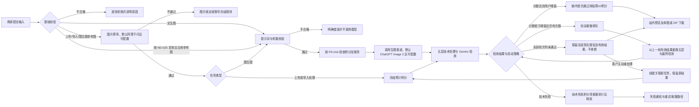
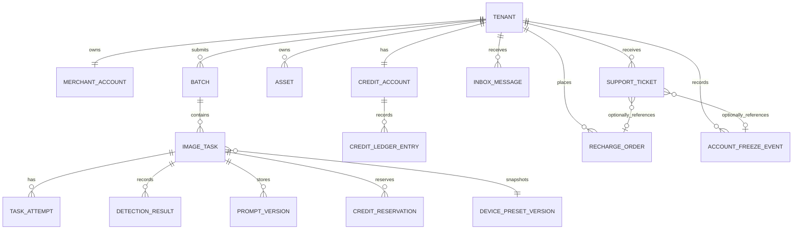
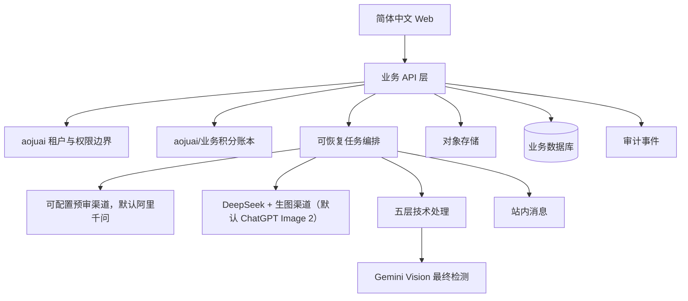

# 蜜獾原图 v2 第一版本产品需求文档

> 本文定义面向真实电商商家上线的第一版本产品边界、用户行为、业务规则、数据合同和上线验收条件。文档只描述已确认需求、明确的实现约束和待决策边界，不证明任何功能已经实现、测试通过、部署或上线。

## 0. 文档说明与证据基线

### 0.1 读者与使用方式

本 PRD 面向产品负责人、实现团队、测试与验收人员、客服运营和上线负责人。功能需求采用稳定编号 `FR-NNN`，非功能需求采用 `NFR-NNN`，用户旅程采用 `UJ-NNN`，状态机采用 `SM-NNN`，验收标准采用 `AC-NNN`，待决策采用 `ND-NNN`，拒绝路径采用 `RP-NNN`，任务采用 `T-NNN`。

本文先给出第一版本的业务主线，再给出功能需求、数据与接口合同、上线约束、测试和待决策清单。`蜜獾原图-v2-待决策清单-v1.0.md` 是与本文同时交付的独立文件；它不是隐藏的假设，也不是默认批准项。

本轮审计整改裁决见 [审计整改裁决与交接](../architecture_decisions/蜜獾原图-v2-审计整改裁决-2026-10-23.md)。原第 19 节已完整移至 [历史变更记录归档（截至 v1.25）](蜜獾原图-v2-PRD-历史变更记录-截至v1.25-2026-10-23.md)，仅供追溯，不作为当前开发指令。

### 0.2 输入材料与证据等级

| 来源 ID | 材料 | SHA-256（当前读取值） | 用途 | 权威边界 |
|---|---|---|---|---|
| S-01 | `D:\workspace\蜜獾原图v2\输入材料\蜜獾原图项目架构.md` | `BAE06B91A0E2ADB92505CB4BC881AD96816D10EEA6B1B1760D41B523F9778D90` | 当前架构、生产只读事实、模块状态、风险 | 当前真实状态的首要参考；不等于 v2 目标实现 |
| S-02 | `D:\workspace\蜜獾原图v2\输入材料\蜜獾原图技术原理.md` | `8AB63D7D2C59DAC82348A71A482D591E125894CAF4EBA481949A7CCD8589D1A5` | 图像处理环节、参数预设、模型调用、已知缺口 | 可复用模块提取的第二优先来源；算法缺口必须修复或禁用 |
| S-03 | `D:\workspace\蜜獾原图v2\输入材料\蜜獾原图-SaaS-PRD-v2.0.md` | `DD9006FEB9C5D33A0E9A0E5CD1AB8576570613EF83224C9445E3F5606715B15E` | 历史决策、字段、流程和缺陷映射 | 仅作历史参考；与本次确认冲突时本次确认优先 |
| S-04 | `C:\Users\Administrator\Desktop\材料库\PRD撰写提示词-通用模板-v1.0.md` | `FB6422B36CFD987C161DB0C61D9F96434B11285DB0AA9B75933E248BAC25A768` | 输出结构、证据、可测性和范围规则 | 文档格式参考；不产生业务事实 |
| S-05 | aojuai 官方仓库 | 开发启动时记录 | 多租户底座候选 | 必须以开发启动时最新稳定 Release、完整 SHA、许可证和锁文件为准 |
| S-06 | 2026-10-23 管理员关于 aojuai 的声明 | 不适用（聊天声明） | 自主开发底座及完整使用权限的项目方声明 | 使用权限记为“已确认（项目方声明）”，证据类型 PROJECT_DECLARED；未进行独立权属核验，不作为完整版权鉴定 |

证据等级使用以下口径：

- `CONFIRMED`：用户本轮明确确认，或来源材料直接记录且未被本轮覆盖。
- `PROJECT_DECLARED`：项目方明确声明的开发归属或使用权限，记录声明来源和日期；表示项目方声明已登记，不等同独立权属核验。ND-032/S-06 使用此口径。
- `CURRENT_FACT`：S-01/S-02 对现有版本的直接取证事实；不表示新系统可用。
- `PROPOSED`：为实现需求提出的方案，须在技术设计或待决策项中批准。
- `[ASSUMPTION A-NNN]`：为形成可执行合同而暂时推定，必须出现在假设索引。
- `DECISION_PENDING`：用户要求跳过或外部事实尚未提供；在 ND 清单裁决前不得实现真实写入或对外承诺。
- `CONFLICT_BLOCKED`：与本次确认或上线红线冲突，必须提供拒绝路径。

### 0.3 当前版本一句话范围

第一版本是面向中国大陆电商商家的多租户 Web SaaS：客户可上传或导入商品图片，也可完成文生图和图生图；图片预审渠道默认使用阿里千问，生图渠道默认使用 ChatGPT Image 2，两类模型均由平台配置并可更换。上传/导入图片及全部生成结果统一执行五层技术处理和 Gemini Vision 最终检测，完成后在站内对比、预览及下载 sRGB JPEG；文生图和图生图均不提供跳过处理的直接交付能力。第一版本每条图片任务链最多收取 10 积分，自动重做不按轮次叠加，DeepSeek 提示词优化成功为 1 积分/次、失败不计费；ND-019 最终检测失败不收费。平台暂不向外部目标平台发布。开发工具基线按用户指定使用 `GPT-6.1-sol / xhigh` 与 `Deepseek v4.1flash`；该开发模型选择不等于客户侧模型服务。

### 0.4 可复用模块状态

| 模块 | 当前证据 | v2 处理 | 状态 |
|---|---|---|---|
| aojuai 多租户、身份与底座能力 | S-05；需开发启动时核验 | 以官方最新稳定 Release 为基线，固定 SHA、许可证和锁文件后再适配 | `GAP_APPROVED`，未实现 |
| 设备参数预设字段与四类分类 | S-02 §11；旧版参数模板（约 60+ 字段） | 从旧代码和技术材料提取完整参数模板，不限于本文列举字段；重做版本、快照、归属和校验 | `EXTRACT_REUSE` |
| 像素物理化与频域算法 | S-02 §4—5 | 仅提取经小样本验证且不改变主体的算法；色差桩和静默失败不得迁入 | `GAP_APPROVED`，需重验 |
| 指纹破坏 | S-02 §6 | 提取可验证的像素处理；按 ND-020 禁用旋转、裁切和缩放，按通用配置和已确认内容保真范围验收 | `GAP_APPROVED` |
| EXIF 写入 | S-02 §7 | 重写活跃 writer；MakerNote、APEX、失败可见性作为 P0 验收 | `GAP_APPROVED` |
| 平台编码特征模拟 | S-02 §8 | 只保留通用电商配置；目标平台尚未确认，禁止宣称适配具体平台 | `GAP_APPROVED` |
| 图片预审与 Gemini 检测合同 | S-02 §9、管理员回复及本次调整 | 预审渠道默认阿里千问，可配置更换其他模型；Gemini Vision 只负责最终物理实拍检测；固定旧版五维、总分 ≥75 且 `passed=true` 的最终检测合同 | `GAP_APPROVED` |
| 旧版伪队列、假页面、裸路由和双轨迁移 | S-01/S-02 | 不迁入；采用 aojuai 底座的可验证任务执行和增量迁移 | `CONFLICT_BLOCKED` |
| 旧版外部发布矩阵 | S-01 §17 | 第一版本无发布入口、无真实外呼、无回调 | `CONFLICT_BLOCKED` |

## 1. 产品愿景与定位

### 1.1 产品命题

电商商家需要把商品图片和生成图片整理为可追溯、可下载、具有摄影设备成像参数的图片资产。蜜獾原图 v2 将图像处理过程拆成可审计的输入校验、图片预审（默认阿里千问，可配置更换）、技术处理、Gemini Vision 最终检测、积分结算和结果交付，让客户能看到处理结果及最终检测证据，同时保留第三方平台最终审核的不确定性。

第一版本的产品价值是“硬件化处理”与“原创化工作流”：平台维护真实设备参数预设，系统在不改变业务主体目标的前提下重写成像特征、元数据和编码特征，并以检测报告支持客户判断。产品不承诺任何外部平台必然认定图片为原创或物理实拍。

### 1.2 Why now 与上线理由

- 当前已有图像物理化算法、参数预设、模型调用和检测记录的代码资产，但 S-01/S-02 明确记录了队列、路由、鉴权、迁移、EXIF 和数据隔离缺口。
- 本次 v2 选择 aojuai 官方多租户底座，为真实商家上线提供租户、账本、任务和权限的重新建模机会。
- 文生图和图生图统一包含硬件化处理与最终检测，使全部交付图片具备一致的处理链路和检测记录。

### 1.3 产品边界

| 范围 | 第一版本口径 |
|---|---|
| 客户 | 电商商家；一个商家账号对应一个独立租户 |
| 输入 | 用户上传、已确定的外部图片下载 API、文生图、图生图 |
| 输出 | 完成五层处理及最终检测后，结果站内预览与下载，统一为 sRGB JPEG（`.jpg`）；批量下载为 ZIP；ND-019 最终检测未通过的有效结果仍可下载且不收费 |
| 检测 | Gemini Vision 最终检测采用旧版五维评分，总分 ≥75 且 `passed=true` 通过 |
| 发布 | 第一版本不提供向外部平台或目标地址上传发布 |
| 语言 | 简体中文 |
| 地区 | 中国大陆部署；数据库与对象存储使用阿里云，具体部署配置按 ND-013/NFR-012 确定并验证 |
| 交付 | 第一版本 PRD 与独立待决策清单；任务 CSV 和 HTML 暂缓 |

## 2. 目标用户、干系人和用户旅程

### 2.1 Jobs To Be Done

- 当我经营电商商品时，我希望用固定设备参数处理商品图，得到可对比、可下载且有检测证据的图片资产。
- 当我有一批商品图片时，我希望一次提交最多 10 张，坏图片不会阻断好图片，并能一次下载成功结果。
- 当我需要生成营销图时，我希望控制正向提示词、负向提示词、宽高和随机种子，并获得完成五层处理及最终检测的结果。
- 当我充值积分时，我希望客服确认到账后余额准确增加，余额、冻结、释放和消费流水可追溯。
- 当系统认为图片不合格时，我希望看到具体原因；连续失败时，我希望知道账号或图片被限制的原因和申诉入口。

### 2.2 非用户与非目标客户

- 不面向个人非商业图片处理作为第一版本主场景。
- 不面向需要团队成员、共享钱包或多席位协作的商家；第一版本一个商家仅一个账号。
- 不面向需要客户程序调用 API、API Key 或自动化发布接口的客户。

### 2.3 关键用户旅程

#### UJ-001：李婷提交商品图并下载硬件化结果

- **Persona + context**：李婷是跨境电商商家，准备上传商品主图。
- **Entry state**：已登录且租户余额足够；选择上传或外部导入入口。
- **Path**：选择最多 10 张 JPG/JPEG/PNG → 前端和后端校验大小、格式、解码、像素与方向分辨率 → 当前配置的预审模型检查（默认阿里千问）→ 选择四类设备预设及客户选择的 GPS → 系统冻结预计积分并执行五层处理 → Gemini Vision 返回五维分数和判定 → 站内并排对比原图与结果 → 下载 JPEG 或 ZIP。
- **Climax**：结果页同时展示输出尺寸、文件大小、设备预设、关键 EXIF 和检测报告，李婷能判断是否使用结果。
- **Resolution**：结果图保留 7 天；任务、检测摘要、积分流水和参数快照永久保留。
- **Edge case**：批次中一张图片被拒绝时，其余合格图片继续执行，拒绝原因逐张显示且不扣积分。

#### UJ-002：王强使用文生图并完成硬件化处理

- **Persona + context**：王强需要快速制作一个商品营销变体。
- **Entry state**：已登录；正向提示词已准备，负向提示词和随机种子可选。
- **Path**：输入正向/负向提示词 → 选择宽高 256–2048 px → 可选填写种子 → 可选主动调用 DeepSeek 优化 → 查看优化前后文本并确认 → 选择设备预设及可选 GPS → 按 FR-016 检查积分及账务 → 当前配置的生图模型（默认 ChatGPT Image 2）一次生成 1–10 张 → 自动继续五层技术处理与 Gemini Vision 最终检测 → 站内查看结果并下载 JPEG 或 ZIP。
- **Climax**：每张图片展示实际随机种子、设备预设和最终检测报告；完成处理及最终检测后，客户预览和下载 sRGB JPEG。
- **Resolution**：每张处理完成且最终检测通过的图片收取 10 积分，与当次张数无关；最终检测失败不收费，存在有效结果时仍可下载。DeepSeek 优化独立收取 1 积分/次；提示词版本链永久保留；修改提示词重新生成创建新任务。
- **Edge case**：提示词超过模型接口限制时，后端调用前拒绝并返回明确错误，不截断。

#### UJ-003：周敏使用图生图并完成硬件化处理

- **Persona + context**：周敏有一张商品参考图，希望保持图片可追溯并获得完整硬件化处理。
- **Entry state**：已登录；选择一张参考图，参考图接受与普通输入相同的校验和预审。
- **Path**：上传一张参考图 → 输入正向提示词、可选负向提示词、尺寸和种子 → 选择设备预设及可选 GPS → 当前配置的预审模型检查参考图（默认阿里千问）→ 按 FR-016 检查积分及账务 → 调用当前配置的生图模型（默认 ChatGPT Image 2）→ 自动继续五层技术处理与最终检测 → 查看每张结果与检测报告并下载 JPEG 或 ZIP。
- **Climax**：成功结果变为 sRGB JPEG，并展示设备参数、EXIF 和 Gemini Vision 五维分数。
- **Resolution**：失败图片不扣积分；成功图片可下载；原参考图仅用于站内对比，不提供原图下载。
- **Edge case**：同一参考图第二次预审仍不通过时，只锁定该图片，客户选择是否转客服；不自动冻结整个账号。

#### UJ-004：陈琳处理连续预审失败

- **Persona + context**：陈琳连续提交多张素材，系统无法通过预审。
- **Entry state**：账号正常；失败计数只统计符合计数条件的图片预审失败。
- **Path**：第一、第二张不同图片失败 → 第三张不同图片失败 → 系统冻结账号并发送站内消息 → 系统自动生成工单并发送给技术客服 → 技术客服查看与本次冻结有关的原图、预审结果和失败记录 → 人工审核 → 手动解冻。
- **Climax**：客服处理和解冻动作都有审计记录；陈琳可继续登录查看和下载保留期内历史结果，但不能新建任务。
- **Resolution**：任意一张图片预审通过会清零“不同图片连续失败”计数；同一图片二次失败只锁定图片，不触发账号冻结。

#### UJ-005：赵敏完成人工充值

- **Persona + context**：赵敏提交充值订单，通过微信或支付宝转账并联系客服。
- **Entry state**：已登录；积分余额为非负整数。
- **Path**：提交充值订单 → 通过客服提供的微信/支付宝方式转账 → 客服核对订单并确认 → 系统增加整数积分并写入流水 → 赵敏在站内查看余额和订单状态。
- **Climax**：订单、客服操作者、到账积分和幂等引用可审计。
- **Resolution**：第一版本不提供系统内人民币退款；积分永久有效。
- **Edge case**：同一订单重复确认不得重复增加积分。

## 3. 术语表

| 术语 | 定义 |
|---|---|
| 商家 | 使用蜜獾原图处理电商商品图片的客户主体。 |
| 租户 | aojuai 多租户底座中的独立业务空间；第一版本一个商家账号对应一个租户。 |
| 图片资产 | 租户拥有或由任务生成的图片对象及其元数据。 |
| 输入图片 | 用户上传、外部下载 API 导入或图生图参考图。 |
| 生成图片 | 生图渠道返回的文生图或图生图结果；第一版本默认渠道为 ChatGPT Image 2，可由平台配置替换。 |
| 图片预审 | 对上传图片、外部导入图片和图生图参考图执行文件、尺寸、解码、像素和内容安全检查；基础边界由规则校验，模型预审由当前配置的预审渠道执行，默认阿里千问且可更换；非分辨率检查边界见 ND-004。 |
| 五层技术处理 | 第一层像素物理化；第二层频域扰动；第三层指纹破坏；第四层设备参数与 EXIF 重写；第五层通用电商编码特征模拟。Gemini Vision 最终物理实拍检测独立于五层处理。五层代码模块可从旧版复用，但必须经过输入校验、租户边界、错误可见性、参数回读和测试。 |
| 设备预设 | 平台维护的一组完整设备参数模板，包含旧代码和技术材料中可验证的全部字段，不限于设备、镜头、曝光、时间和 GPS；提交时保存完整版本快照。 |
| 任务 | 一次客户提交的处理或生成业务对象，可包含最多 10 张结果。 |
| 批次 | 一次提交中最多 10 张输入或生成结果的聚合对象。 |
| 任务尝试 | 任务的一次执行尝试；同一任务可保留多次预审或系统执行尝试。 |
| 完整技术处理 | 上传/导入图片及全部文生图、图生图结果均必须执行五层技术处理，并完成 Gemini Vision 最终物理实拍检测后交付的统一流程。 |
| 模型渠道配置 | 平台分别配置图片预审和生图的 provider、model 与配置版本；默认模型分别为阿里千问和 ChatGPT Image 2，均可更换，客户不能自行指定上游模型或 Key。 |
| 检测报告 | Gemini Vision 五个维度分数、总分、最终判定和未通过原因。 |
| 积分 | 平台计费单位；第一版本使用整数，永久有效，不区分充值与赠送。 |
| 冻结积分 | 已为任务预留、尚未最终结算的整数积分。 |
| 站内消息 | 产品内部通知中心；第一版本用于任务、失败、冻结和客服处理结果通知。 |

## 4. 业务流程与状态机

### 4.1 总体流程

### 4.2 图片任务状态机 SM-001

| 状态 | 进入条件 | 允许迁移 | 禁止迁移 |
|---|---|---|---|
| `DRAFT` | 客户开始填写任务 | `SUBMITTED` | 直接进入交付 |
| `SUBMITTED` | 基础校验通过 | `PRE_REVIEW`, `GENERATING`, `REPROCESS_PENDING`, `REJECTED` | 无校验执行；账号冻结或账务校验失败仍执行 |
| `PRE_REVIEW` | 输入图片需要预审 | `PRE_REVIEW_PASSED`, `PRE_REVIEW_FAILED`, `IMAGE_LOCKED`；模型调用技术异常进入 `FAILED` | 未记录结果直接处理；把技术异常计入内容预审失败次数 |
| `PRE_REVIEW_PASSED` | 已保存本次通过的预审结果 | 上传/导入进入 `FULL_PROCESSING`；图生图参考图进入 `GENERATING` | 未完成 FR-016 账务校验即执行；混用图片任务与账号状态 |
| `PRE_REVIEW_FAILED` | 单次预审不通过 | `PRE_REVIEW`, `IMAGE_LOCKED`, `REJECTED` | 直接进入完整处理 |
| `IMAGE_LOCKED` | 同图第二次预审失败 | 保持锁定并可另建图片申诉工单；拒绝结束时进入 `REJECTED` | 再次自助重试；仅因提交申诉就解锁或进入处理 |
| `GENERATING` | 生图渠道执行（默认 ChatGPT Image 2） | `GENERATED`, `FAILED` | 假成功；空响应、超时或未知结果扣成功费（ND-023） |
| `GENERATED` | 生成图片返回，作为内部中间资产 | `FULL_PROCESSING` | 跳过五层处理或最终检测直接交付；仅按生成成功扣图片积分 |
| `FULL_PROCESSING` | 进入五层 | `DETECTION`, `FAILED` | 绕过阶段快照 |
| `DETECTION` | Gemini Vision 最终检测执行 | `DELIVERED`, `FAILED`, `AUTO_REPROCESS_PENDING` | 未知响应按通过；用人工审核状态代替真实检测结果 |
| `DELIVERED` | 五层完成、最终检测通过且有效结果存在 | `EXPIRED`, `DELETED` | 修改已完成结果 |
| `FAILED` | 图片任务技术失败或最终检测正常返回但未通过；分别记录失败类别 | 技术失败按条件进入 `RETRY_PENDING`；正常检测结果按自动策略进入 `AUTO_REPROCESS_PENDING` 或结束；有效结果到期或删除进入 `EXPIRED`、`DELETED` | 将最终检测未通过计入技术重试；技术失败自动循环；超过配置的自动重做次数 |
| `RETRY_PENDING` | 图片任务技术失败后客户手动重试；已使用重试次数小于 2 | 按原任务及失败阶段恢复到 `PRE_REVIEW`、`GENERATING`、`FULL_PROCESSING` 或 `DETECTION`；恢复执行仍技术失败则进入 `FAILED` | 创建新任务替代本次技术重试、覆盖既有尝试记录、绕过次数上限；混用预审内容失败计数 |
| `REPROCESS_PENDING` | ND-019 客户主动重处理创建的新任务，已关联原失败任务和有效结果，完成来源及通常账务校验 | `FULL_PROCESSING`, `FAILED` | 修改原任务、报告或账务；自动发起；套用 ND-025 的复制生成免冻结例外 |
| `AUTO_REPROCESS_PENDING` | 当前链已启用自动重做，上一轮有有效检测分数低于该链阈值且仍有追加次数 | `FULL_PROCESSING`, `FAILED` | 重新调用文生图/图生图；覆盖上一轮结果；创建新的冻结或重复计费 |
| `REJECTED` | 前置条件不满足或预审拒绝结束 | 终态，保留拒绝原因 | 当作处理成功或产生图片成功消费 |
| `CLOSED` | 失败任务结束后续执行 | 有效结果到期或删除时进入 `EXPIRED`、`DELETED` | 丢失失败判定、有效结果访问规则或账务记录 |
| `EXPIRED` | 结果资产按自身到期时间已过期，结果文件访问被拒绝 | 清理完成后可进入 `DELETED` | 重新开放过期文件、删除永久摘要；仅因输入原图先到期而隐藏仍有效结果 |
| `DELETED` | 结果资产被客户主动删除或到期副本清理完成 | 终态，保留任务、检测和账务摘要 | 恢复图片访问或删除必要审计记录 |

任务状态、检测判定、结果文件可用性和计费状态分别记录：ND-019 的最终检测未通过仍为失败判定，但有效结果可以预览和下载，不收费；不得仅因进入 `FAILED` 或 `CLOSED` 状态就一律隐藏有效结果。账号冻结/解冻由 SM-003 管理，客服审核由独立工单记录，不再作为图片任务状态；第三张不同图片失败同时触发账号冻结和工单，不改变该图片真实的预审失败记录。

ND-019 主动重处理按 FR-018 和 `processing.reprocess` 创建关联新任务：`DRAFT` → `SUBMITTED` → `REPROCESS_PENDING` → `FULL_PROCESSING` → `DETECTION` → `DELIVERED` 或 `FAILED`。原失败任务、结果和报告保持不变。自动重做是同一任务链中的显式新轮次：`FAILED` → `AUTO_REPROCESS_PENDING` → `FULL_PROCESSING` → `DETECTION`，每轮独立保存结果和报告，不重新生图、不覆盖上一轮。技术失败手动重试仍沿用原任务并受 FR-024 的 2 次上限约束，自动轮次、手动重试和账务引用分别记录。

### 4.3 积分状态机 SM-002

| 状态 | 规则 |
|---|---|
| `AVAILABLE` | 可用余额，必须是非负整数。 |
| `RESERVED` | 通常提交任务时一次性冻结整批预计积分；冻结失败则整批不可执行。从旧任务复制生成新任务的已确认例外按 ND-025/FR-013 执行，不再次冻结。 |
| `CONSUMED` | 每个图片任务链最多消费一次 10 积分：任一轮完成五层且最终检测通过并有有效结果时结算；自动重做轮次不新增收费。单轮通过后即使后续轮次未通过，仍保留该次消费和全部轮次结果。DeepSeek 优化按 ND-024 成功返回有效结果独立收取 1 积分/次，失败不计费。 |
| `RELEASED` | 只有链内全部轮次均未通过且无其他成功消费时，才释放图片链预留积分；自动重做进行中不得因单轮未通过提前释放。技术失败的冻结积分须由客服审计后释放，按 ND-009 执行。DeepSeek 优化失败不产生消费流水，其已有冻结积分须幂等释放，按 ND-024/FR-013 执行。 |
| `ADJUSTED` | 客服人工确认订单或调整余额；人工加分、扣分、误充值修正、订单撤销和对账操作均须记录理由、操作者和幂等键，按 ND-008 正式规则执行；不提供现金退款。 |

### 4.4 账号冻结规则 SM-003

- 同一图片连续两次预审不通过：锁定该图片，客户可选择是否提交客服；不自动冻结账号。
- 三张不同图片连续预审不通过：自动冻结账号，自动生成并派发技术客服工单；技术客服或平台管理员人工审核后手动解冻，必须记录租户、冻结事件、操作者、原因和时间。
- 任意一张图片预审通过：清零“三张不同图片连续失败”计数。
- 文件大小、格式、分辨率、解码、像素总量、网络中断和积分不足等前置或技术失败不计入上述失败计数。
- 冻结账号仍可登录、查看和下载保留期内历史结果；禁止新建上传、导入、文生图和图生图任务。

## 5. 信息架构与页面目录

| 页面 ID | 页面 | 核心能力 | 主要 FR |
|---|---|---|---|
| PG-001 | 登录/注册 | 用户名密码加随机验证码；租户建立 | FR-001 |
| PG-002 | 工作台 | 余额、任务、冻结状态、站内消息 | FR-002, FR-016, FR-021, FR-023 |
| PG-003 | 图片上传/外部导入 | 单张或最多 10 张、逐张校验 | FR-003—FR-006 |
| PG-004 | 文生图 | 正向/负向提示词、尺寸、种子、数量 | FR-010—FR-014 |
| PG-005 | 图生图 | 一张参考图、提示词、尺寸、种子、数量 | FR-010—FR-014 |
| PG-006 | DeepSeek 优化确认 | 原始/优化提示词、客户确认、复制任务 | FR-013 |
| PG-007 | 设备预设与 GPS | 四类固定设备预设、客户选择 GPS | FR-007—FR-009 |
| PG-008 | 任务/历史详情 | 进度、状态、结果、EXIF、每轮检测报告、提示词版本、计费状态 | FR-016—FR-019、FR-026、FR-027 |
| PG-009 | 结果对比 | 原图与结果并排对比、下载、ZIP | FR-017—FR-019 |
| PG-010 | 积分与充值订单 | 余额、冻结、人工订单、流水 | FR-016, FR-020, FR-021 |
| PG-011 | 站内消息 | 完成、失败、冻结、客服结果 | FR-023 |
| PG-012 | 客服处理 | 冻结审核、订单确认、人工解冻/加积分 | FR-002, FR-006, FR-020—FR-022, FR-024 |
| PG-013 | 运营指标 | 余额、冻结积分、队列、失败率、检测通过率、成本、模型调用量、存储占用 | FR-025 |
| PG-014 | 自动重做设置 | 开关、检测分数阈值、追加次数、当前配置版本 | FR-026 |
| PG-015 | 生成历史 | 上传、外部导入、文生图、图生图的链级记录、来源筛选、轮次详情、结果与报告 | FR-027 |

第一版本不提供外部平台发布页、客户 API Key 管理页、团队成员页、订阅席位页或 API 开发者页；对应拒绝路径见 RP-001—RP-004。

## 6. 功能需求

### 6.1 租户、账户和访问控制

#### FR-001 独立租户开户与访问

每个商家账号必须对应一个独立租户；业务请求的租户标识必须从已验证会话解析，不能信任客户端传入。

**可测后果：**

- 资产、任务、积分、订单、提示词和检测记录的读写均带租户条件；跨租户 ID 访问返回统一的无权限或不存在错误。
- 同一商家重复提交开户请求只产生一个租户和一个积分账户。

按 ND-001 已确认规则，第一版本采用用户名密码加随机验证码，会话有效期为 30 天；密码连续 5 次错误锁定账号。找回密码及账号吊销由在线客服处理；登录锁定与 FR-006 的预审失败冻结分别记录，不混用计数。用户名规范、锁定恢复及会话吊销的实现细节在认证设计中固化并验证，不另行开放未经确认的登录方式。

#### FR-002 账号冻结访问边界

冻结账号可以登录并查看、下载尚在 7 天保留期内的结果，但不能提交新任务。

**可测后果：**

- 冻结状态下上传、外部导入、文生图和图生图写操作均被服务端拒绝。
- 访问历史结果不会解除冻结；手动解冻必须记录客服、原因、时间和关联事件。

### 6.2 输入资产与预审

#### FR-003 输入格式、大小和像素校验

支持 JPG、JPEG、PNG；单张文件最大 `20 MiB`（`20,971,520` 字节），单张最大像素总量 `40 MP`；前端选择时拦截，后端必须再次验证。

**可测后果：**

- 超过任一限制、无法解码或像素总量超限时返回明确错误，不创建图片资产、不进入预审、不扣积分。
- 单次批量最多 10 张；不合格图片逐张拒绝，合格图片继续进入后续流程。

#### FR-004 方向自适应最低分辨率

上传图片、外部导入图片和图生图参考图的最低分辨率按方向判断：横图至少 `1024 × 768`，竖图至少 `768 × 1024`。该约束不适用于文生图输出的客户自选尺寸。

**可测后果：**

- 低于对应方向阈值的图片在预审前被拒绝，并显示宽度、高度和要求值。
- 文生图和图生图生成参数允许宽度、高度各在 `256–2048 px`，不因低于 `1024 × 768` 被套用输入图片规则。

#### FR-005 内容安全预审

图片预审对已列明的违法、色情、暴力、侵权明确禁止项进行检查，由当前配置的预审模型执行，默认阿里千问且可更换；文件格式、大小、解码、像素总量和方向分辨率仍由服务端硬性校验。按 ND-004 已确认规则，命中明确禁止项即拒绝，不自动扩大分类，不把模型不确定当通过。拒绝时记录可审计原因且不扣积分；规则版本、当前供应商阈值映射及复核实现的设计和验证证据为 `PENDING`，供应商验证要求沿用 ND-011。

**可测后果：**

- 预审拒绝结果包含机器判定、规则版本、时间、任务和租户关联。
- 本节输入图片预审范围不变；全部文生图和图生图结果均须继续五层处理及最终检测，不再保留跳过上述流程的生成结果交付分支。

#### FR-006 预审失败重试与冻结

同一图片首次预审失败后最多允许客户重试 1 次；第二次仍失败时锁定该图片并由客户选择是否提交客服。三张不同图片连续失败时冻结整个账号；任意图片预审通过清零不同图片失败计数。

**可测后果：**

- 同一图片第二次失败不能继续自助重试，也不会自动冻结账号。
- 第三张不同图片失败后，账号进入冻结态；系统必须自动生成技术客服工单并发送站内工单通知，工单关联租户、冻结事件、失败图片、预审结果和失败记录；技术客服可查看最小必要数据并手动解冻。

### 6.3 设备预设与五层处理

#### FR-007 固定设备预设

平台维护固定设备预设，首期开放手机、单反、无反相机和运动相机四类；客户选择预设，不得新增或编辑。预设模板优先从旧版代码读取和映射完整参数，不限于本 PRD 例举字段；只有经过回读验证的字段才能标记为已写入。

**可测后果：**

- 提交任务时保存完整预设版本快照；平台更新预设不会改变在途任务和历史结果。
- 预设字段包括旧代码模板中实际可用的完整设备、镜头、曝光、时间、GPS、编码和其他成像参数；空字段不得被伪造为成功写入，未验证字段必须显示为未验证或未写入。

#### FR-008 客户选择 GPS

客户可以为完整技术处理输入地点；系统将地点自动转换为经纬度。按 ND-005/ND-027，第一版不限制敏感地点，也不新增历史地点限制；平台编码特征模拟层采用通用电商配置。具体地图服务、坐标精度和失败提示在技术设计中固化。

**可测后果：**

- 最终结果的 GPS 写入状态可验证；未写入、写入失败和跳过必须分别记录。
- 结果详情展示实际 GPS 值或明确显示未写入原因。

#### FR-009 五层技术处理

对用户上传、外部导入图片，以及全部文生图或图生图结果，必须按以下顺序执行：

1. 像素物理化；
2. 频域扰动；
3. 指纹破坏；
4. 设备参数与 EXIF 重写；
5. 通用电商平台编码特征模拟。

五层处理完成后，另行调用 Gemini Vision 执行最终物理实拍检测。

按 2026-10-23 已确认的 ND-020，以进入五层流程的图像为对照，处理后商品主体、颜色、文字、商标、构图和边框须无肉眼可见变化，像素尺寸不变。仅允许细微噪声、频域扰动、编码调整及设备元数据重写；禁用旋转、裁切和缩放。该约束适用于五层处理阶段。

按 2026-10-23 已明确的 ND-021，完整五层处理输出的最终单图文件字节数必须不小于进入五层流程的原图文件字节数，即 `output_bytes >= source_bytes`；取消旧版原图 60%–80% 的体积目标，不以下浮偏差放宽该下限。该要求须与 ND-020 内容保真及 sRGB JPEG 格式要求同时满足；文生图和图生图以生图渠道返回、进入五层流程的原始图像文件为体积对照，最终交付统一为 sRGB JPEG。

**可测后果：**

- 每层有独立开始、完成、失败和版本记录；某层失败不得以成功状态继续交付。
- 对照进入五层流程的图像进行算法小样验证，检查已确认的内容保真范围和像素尺寸；验证证据为 `PENDING`，规则确认不表示小样验收通过。
- 结果统一转换为 sRGB JPEG，扩展名 `.jpg`；不能以原始 PNG、JPEG 或其他输入格式交付完整技术处理结果。
- 在最后一次重编码和全部元数据写入完成后，按实际字节数校验 ND-021 下限；不得按界面显示的 KB/MB 四舍五入值判定。不满足下限的文件不得作为合格的完整处理结果交付；实现及小样验证证据为 `PENDING`。
- 现有 S-02 已知的 MakerNote 未写入、APEX 值错误、色差桩和 EXIF 静默回退必须在 P0 验收前修复或明确禁用并记录。

### 6.4 文生图与图生图

#### FR-010 文生图输入

客户可以输入必填正向提示词、选填负向提示词，选择宽度、高度和数量；数量 1–10 张，宽高各 256–2048 px。应用不设置额外最大字符数，但后端必须遵守当前生图渠道实际接口长度。

**可测后果：**

- 正向提示词为空时拒绝调用模型。
- 提示词超过当前生图渠道真实接口限制时，在调用前返回明确错误，不截断。
- 客户填写种子时整批使用该种子；未填写时为每张生成实际随机种子并保存展示。

#### FR-011 图生图输入

每个图生图任务只支持一张参考图；参考图执行 FR-003—FR-006 的格式、大小、像素、方向分辨率和预审规则。

**可测后果：**

- 第二张参考图在前端和后端均被拒绝。
- 参考图不通过当前配置的预审模型检查时不调用生图渠道，不扣图片积分；预审模型默认阿里千问且可更换。

#### FR-012 模型职责与配置合同

第一版本按职责配置模型：DeepSeek 负责文本理解、提示词优化或任务编排；图片预审渠道默认使用阿里千问，生图渠道默认使用 ChatGPT Image 2，两类渠道均支持平台更换其他模型，不得在业务流程中写死供应商或模型名；Gemini Vision 负责最终物理实拍检测。第一版本可分别只启用一个预审渠道配置和一个生图渠道配置；配置替换不等于多平台自动轮询，轮询仍为后续版本范围。后续文本轮询候选为阿里千问、GLM、KIMI、Claude Opus，图像轮询候选为 Gemini、Seedance、Claude Opus；候选名称不代表已签约、已可用或已通过中国大陆合规验证。

**可测后果：**

- 预审与生图分别读取当前启用的 provider、model 和配置版本，并写入任务及尝试快照；历史任务和报告可追溯实际调用模型，配置更新不得改写历史记录。
- 按 ND-006，上游 Key 对客户不可见，用户不能在任务请求中替换平台模型或输入上游 Key；平台管理员可以在受控配置中分别替换预审和生图模型，Key 存储、轮换和审计实现在接入设计中固化并验证。
- 更换模型后仍遵守相同的业务校验、预审失败计数、输入输出合同及 §12.1 价格；实际启用配置须按 ND-011/NFR-014 完成供应商接入与真实小样验证，不能因名称可配置而把未接入的模型显示为可用。

#### FR-013 DeepSeek 主动优化

客户主动点击后才调用 DeepSeek；系统展示原始提示词与优化结果，客户确认后才可使用优化结果调用当前生图渠道。客户可以跳过优化，直接使用自己的提示词。

**可测后果：**

- 未确认优化结果时不得使用优化文本发起图像生成。
- 原始、优化和最终确认提示词永久保留并在客户任务详情页展示。
- 按 ND-024 的本次调整，客户主动执行 DeepSeek 优化且成功返回有效结果时按 §12.1 收取 1 积分/次；客户之后不确认或未采用该成功结果仍计费。优化失败、空响应、超时或无法解析的响应不产生消费流水；已有冻结积分须幂等释放，不能以请求已发起作为收费依据。
- 按 ND-025，客户可以从旧任务复制参数、种子和参考图，创建独立新任务并保留原任务结果；该新任务不再次完整预审和冻结，提交仍做基础合法性校验。原任务的冻结或消费流水不得作为新任务的付款记录；余额非负、独立报价及结算幂等要求仍适用，此例外的并发和计费控制须在架构设计中明确并验证。新上传或更换的参考图仍按 FR-003—FR-006 校验。

#### FR-014 生成结果完整处理与交付

文生图和图生图生成完成后，系统自动继续 FR-009 的五层技术处理及 Gemini Vision 最终检测，完成后统一交付 sRGB JPEG（`.jpg`）。客户选择设备预设及可选 GPS，系统不再提供生成结果路径选择。

**可测后果：**

- 每批最多 10 张，每张结果独立记录五层处理、最终检测、成功或失败及计费状态；不能跳过完整处理或仅按生成成功交付、收费。
- 生图渠道原始返回文件仅作为内部中间资产或完成后站内对比依据，不提供独立预览下载的交付入口，也不以原始格式加入客户下载包。
- 每条图片任务链最多收取 10 积分，与当次张数无关。首次或自动重做任一轮完成五层且最终检测通过即结算一次；若所有轮次均未通过则免费。按 ND-019，未通过但存在有效结果文件时仍允许预览和下载；未启用自动重做时，客户可以主动选择独立重处理，系统不自动重跑。

### 6.5 任务、批次与交付

#### FR-015 批量提交与部分成功

单次上传、外部导入或生成最多 10 张；每张结果独立状态、检测、扣费和错误原因。批量下载打包可下载的结果文件；其中包括 ND-019 允许下载的最终检测未通过结果，此类文件必须展示真实判定且不收费，不计入收费成功数。技术失败且没有有效结果文件的子项不进入 ZIP。

**可测后果：**

- 一张输入失败不会阻断其他合格输入。
- ZIP 内文件数量等于本次选择的可下载结果数量，图片均为完成五层处理的 sRGB JPEG；无可下载结果时不得生成假 ZIP。按 ND-026，统一文件名、ZIP 目录和模型元数据清理规则在交付设计中固化并验证。
- 按已确认的 ND-023，生图部分成功时逐张保存结果；每条图片链任一轮完成且最终检测通过时只按 10 积分结算一次，空响应、超时或未知结果不扣成功费。技术失败重试和客服释放积分沿用 ND-009/FR-024，处理结果通过 FR-023 站内消息通知。
- 按已确认的 ND-012 正式规则，缺少供应商合同和接口证据时，外部导入只能显示“未配置”或使用测试替身；后端不得发起真实图片下载 API 调用。

#### FR-016 积分预扣、结算和释放

通常提交前检查余额并一次性冻结预计整批积分；余额不足时拒绝提交。一个图片任务链最多预留 10 积分，自动重做轮次沿用该链的预留，不新增冻结。ND-025 复制新任务不再次冻结的例外按 FR-013 执行，不能被通用冻结规则覆盖，也不能复用原任务账务或绕过余额非负约束。任一轮完成五层且最终检测通过时，链级幂等消费一次 10 积分；后续轮次不重复收费。全部轮次均未通过时才释放该链预留，仍允许下载有效结果；其中图片任务技术失败的冻结积分由客服审计后释放，按已确认的 ND-009 执行。DeepSeek 优化独立按 ND-024/FR-013 结算，成功 1 积分/次、失败不计费并释放已有冻结。

**可测后果：**

- 冻结、结算、释放和人工调整均生成整数积分流水，重复请求只产生一次业务效果。
- 任意并发竞争下余额、冻结额和流水对账一致。
- 图片报价按预计张数 × 10 积分预留，结算按每条链是否至少有一轮通过计 10 积分，不按自动轮次或批次张数重复计费；DeepSeek 优化按成功每次 1 积分独立记账，失败不计费。已有任务报价按原价格快照追溯，不因文档调价改写历史流水。
- 生图空响应、超时或未知结果不产生成功消费流水；对应冻结积分必须与图片任务、执行尝试及流水保持关联，不得丢失或被静默清除。失败图片的冻结积分按 ND-009 由客服审计后幂等释放；DeepSeek 优化失败不计费，已有冻结按 ND-024/FR-013 幂等释放。

#### FR-017 结果详情与对比

完整处理结果详情页展示原图与结果并排对比、输出尺寸、文件大小、所用设备预设和关键 EXIF：设备品牌、型号、ISO、快门、光圈、焦距、拍摄时间和 GPS。

**可测后果：**

- 原图仅用于站内对比，不提供原图下载入口。
- 检测报告只在站内查看，不随图片下载生成报告文件。

#### FR-018 Gemini 检测报告

检测报告展示旧版五个维度分数、总分、最终判定和未通过原因；通过标准为总分 `>=75` 且 `passed=true`。检测结果只表示 Gemini Vision 的结果，不保证任何第三方平台最终审核通过。

**可测后果：**

- 缺失、HTML、超时或无法解析的模型响应不视为通过。
- 第三方平台审核保证文案在客户界面和帮助文本中不得出现。
- 按 ND-019，Gemini Vision 正常返回但最终判定未通过时，保留真实报告及有效结果文件供客户预览、下载；若已启用自动重做且分数低于该链阈值，进入同一链的下一自动轮次，否则不收费并结束该链。模型响应异常按技术失败处理，不能伪造一个未通过报告或可下载文件。
- 主动重处理通过后端 `processing.reprocess` 执行：校验原任务确为最终检测正常返回但未通过、所选处理后结果仍可访问且属于当前租户，并校验解码、参数和账号状态；以该结果为新任务输入，保存 `source_task_id` 和独立预设快照，直接重新执行完整五层与最终检测，不再次生成图片。原任务、报告、结果和消费记录不被覆盖；重复提交按请求幂等键只创建一个新任务。
- 重处理新任务按 FR-016 通常规则独立报价、检查余额和冻结，完成且检测通过按 10 积分结算，失败按相应失败类别释放；原失败任务仍为 0 消费。该动作不属于 ND-025 的复制生成例外，也不占用原任务技术重试次数；重处理任务自身发生技术失败时按 FR-024 执行。过期、已删除、无有效处理后结果或非本租户的来源不得发起重处理。

#### FR-019 生命周期与删除

图片文件、缩略图、中间文件和下载包默认保留 7 天（系统管理中配置）；客户可主动删除图片文件。任务记录、检测摘要、提示词历史、设备快照和积分流水永久保留。

**可测后果：**

- 到期或主动删除后，图片访问被拒绝且所有图片副本按清理清单处理；非图片记录仍可查。
- 清理任务不删除积分流水和检测摘要中的必要审计字段。

### 6.6 充值、客服和站内消息

#### FR-020 人工充值订单

第一版本收款通道为微信和支付宝转账；流程为客户提交订单、联系客服付款、客服确认订单并增加对应整数积分。扫码跳转支付属于后续版本。

**可测后果：**

- 客服确认必须绑定订单、商家租户、操作者、积分数量和幂等键。
- 按 ND-015，客服使用站内工单；客户上传付款截图并填写备注，订单客服入口与图片申诉入口分开。
- 第一版本不支持系统内人民币退款，不得显示无后端能力的退款按钮。

#### FR-021 积分规则

积分按整数记账，永久有效，不区分充值积分和赠送积分；基础换算为 `1 元人民币 = 10 积分`，充值档位包含的额外积分直接并入同一余额。ND-007 按 2026-10-23 本次调整执行：原充值档位保留，每条图片任务链最多 10 积分且自动轮次不重复收费，DeepSeek 优化 1 积分/次，详见 §12.1。

ND-008 已于 2026-10-23 确认为第一版本正式规则：所有人工加分、扣分、误充值修正、订单撤销和对账操作必须记录理由、操作者和幂等键；不提供现金退款。

**可测后果：**

- 数据库禁止以浮点保存或计算积分；所有扣减、冻结、释放和人工加减均为整数。
- 任何扣减不得使可用余额为负。
- 上述人工操作缺少理由、操作者或幂等键时拒绝执行；相同幂等请求重放不得重复产生账务效果。

#### FR-022 客服与冻结处理

客服工单按应用层类型区分订单、图片申诉和账号冻结，均绑定租户，客户的订单入口与图片申诉入口分开。订单客服只处理授权订单工单及付款凭证；技术客服只处理授权图片申诉或账号冻结工单，并查看关联的最小必要图片、预审和失败记录；平台管理员按管理权限和授权范围处理。后台角色边界见 ND-010，客服入口和付款凭证见 ND-015。

| 工单类型 | 必需关联 | 可空或禁止关联 | 创建与权限 |
|---|---|---|---|
| `order` | 本租户订单、付款截图及备注按 FR-020 校验 | 不要求账号冻结事件；不得混入无关图片申诉数据 | 客户主动提交至订单入口，订单客服处理；管理员按授权范围处理 |
| `image_appeal` | 本租户图片及对应预审/失败记录；存在图片任务时关联任务 | 无账号冻结时 `freeze_event_id` 为空；不绑定无关订单 | 同图第二次预审失败后由客户选择是否提交，技术客服处理；管理员按授权范围处理 |
| `account_freeze` | 租户、冻结事件、失败图片、预审记录和处理状态 | 不绑定无关订单 | 三张不同图片连续失败时系统自动创建并派发技术客服，不能以未冻结图片申诉替代 |

技术客服和平台管理员均可在授权租户范围内人工解冻，须校验冻结事件、记录操作者、原因及时间；订单客服和商家账号默认无解冻权限。工单处理、解冻和订单确认分别记录业务状态与审计事件；提交图片申诉不等于图片解锁或预审通过。类型及关联条件由后端校验，不能仅依赖前端入口区分。

#### FR-023 站内消息

任务完成、任务失败、账号冻结、自动生成并派发技术客服工单、人工解冻和充值确认使用站内消息；第一版本不发送邮件或短信。

按已确认的 ND-023，生图部分成功以及空响应、超时或未知结果的处理结果同样通过站内消息通知，并关联相应任务。

按 ND-028 于 2026-10-23 已确认的完整规则，站内消息自创建时间起保留 30 天，到期清理；消息清理不影响任务、积分流水和必要审计记录的永久保留。第一版不提供已读/未读筛选，不支持客户直接回复站内消息，也不提供站内消息对话入口；客服沟通沿用 ND-015 已确认的工单入口。消息首次发送失败后最多自动重试 3 次，含首次共最多 4 次；仍失败则提示后台人工补发。重试和补发仅重发通知，不重跑图片任务或重复扣费。

**可测后果：**

- 消息有事件类型、租户、任务或订单关联、创建时间和已读状态。
- 消息发送失败不改变任务或账本终态，必须在后台可观测。
- 自动重试达到 3 次后停止，不能继续自动发送；后台可查看发送尝试、错误和人工补发记录，重试和补发须幂等，不得触发图片任务重跑或重复扣费。
- 验证消息自创建时间起保留 30 天并到期清理，清理不误删关联任务、积分流水或必要审计记录；同时验证首次发送及自动重试次数上限、失败提示和人工补发；通知验收证据为 `PENDING`。

#### FR-024 失败与重试

预审重试按 FR-006；图片任务在五层处理或外部模型调用中发生技术失败时，按 2026-10-23 已确认的 ND-009/ND-035 执行：

- 每张图片任务最多允许客户手动重试 2 次，含首次执行共最多 3 次；达到上限后转客服处理，不允许继续自助重试。
- 技术重试沿用原任务记录，分别保存每次执行尝试、结果和错误信息，不覆盖既有尝试记录。
- 失败图片不收费，冻结积分由客服审计后释放；不得将技术失败标记为成功或因重试、请求重发造成重复扣费。
- 该次数上限只用于图片任务技术失败，不与预审失败计数混用；Gemini Vision 正常返回但最终判定未通过，仍按 ND-019 的交付和客户重新处理规则执行。
- 第一版本不支持取消任务，不显示取消按钮；修改提示词后重新生成仍按已确认规则创建新任务并保留原任务结果。

**可测后果：**

- 同一图片任务首次执行及 2 次手动重试均有独立尝试记录；请求第三次手动重试时，后端拒绝执行并显示客服处理路径。
- 客服审计后释放失败图片的冻结积分，重复释放请求只产生一次账务效果；任务和账本均保留审计关联。

#### FR-025 运营后台真实指标

按 2026-10-23 已确认的 ND-033，客服和平台管理员按 ND-010 的岗位最小权限及授权数据范围查看余额、冻结积分、队列、失败率、检测通过率、成本、模型调用量和存储占用。后台使用真实后端数据；统计口径和数据来源在后台设计阶段确定，上线前完成验证。

**可测后果：**

- 未接入或没有可用真实数据的指标显示空态，不得以硬编码示例值或零值代替缺失数据；真实统计结果为零时可显示零。
- 后台设计记录各指标的统计口径、适用时间范围和数据来源，查询与展示遵守岗位权限及授权数据范围。
- 上线前逐项对照来源数据验证数值、权限和空态；指标设计、接入及验证证据为 `PENDING`，规则确认不表示指标已接通或验证通过。

#### FR-026 自动重做

用户可在设置页启用自动重做，默认关闭；开启时默认追加 1 次，追加次数可设置为 1—5 次（不含首次处理），检测分数阈值可设置为 0—100，默认 70 分。设置由服务端持久保存，提交任务时生成不可变配置快照，后续修改只影响新任务。

自动重做适用于上传、外部导入、文生图和图生图四类任务。每轮以上一轮有效处理结果为输入，仅重新执行五层技术处理和最终检测，不再次调用文生图/图生图，不覆盖任何既有图片、报告或尝试记录。触发条件为上一轮有可解析的总分且 `total_score < chain.score_threshold`，且未达到该链的追加次数；该条件独立于最终检测的基线 `total_score >=75 && passed=true`，因此阈值高于 75 时，已通过基线但低于用户阈值的结果仍会继续重做。技术异常、缺失分数、无有效结果或前置校验失败不触发自动重做，按技术失败或拒绝路径处理。

每条链最多消费 10 积分：任一轮通过且有有效结果时链级幂等结算一次；所有轮次均未通过则免费并释放预留。每轮结果、检测报告、实际分数、触发原因、配置快照、轮次序号和来源均须保留。自动轮次使用后台持久化任务执行，关闭浏览器不影响执行；迟到回调或重复调度不得创建重复轮次、重复消费或重复释放。

**可测后果：**

- 默认配置为关闭、阈值 70、追加 1 次；边界值 0、100、1 次和 5 次均经服务端校验，越界拒绝。
- 分数 69、70、75、90 的触发结果与 `passed` 分别按配置快照计算；分数等于阈值不触发。
- 首轮通过后后轮失败仍只消费一次；首轮及所有自动轮次均未通过则消费为 0；技术异常不进入自动循环。
- 同一链重复回调、进程重启和并发 worker 仅保留一个下一轮，且账本最多一笔 10 积分消费。

#### FR-027 统一生成历史

移除独立“检测结果”页面及其菜单入口；检测报告、五维分数、总分、判定和未通过原因继续作为任务/历史详情的一部分保留。生成历史统一展示上传、外部导入、文生图和图生图四类来源的任务链，支持按来源筛选、按时间分页、查看链级状态和展开全部自动/手动轮次；历史中必须区分真实检测未通过、技术失败、处理中、已消费和免费结束，不以页面状态伪造成功。

历史查询只返回当前租户数据，链级记录显示来源、首次提交时间、最新状态、轮次数、每轮结果访问状态、检测报告引用和一次性计费状态。旧检测报告查询接口可继续作为详情内部接口，但不得再注册为独立页面或导航项。

**可测后果：**

- 四类来源均可在同一历史列表出现，来源筛选不串租户、不漏记录；分页总数与唯一链 ID 对账。
- 一条链展开后可见首次处理及每个自动轮次的独立结果和报告，原结果不被后轮覆盖；过期图片不可下载但永久摘要仍可查。
- 直接访问旧“检测结果”路由返回不存在或重定向到生成历史详情，不能形成第二个独立结果入口。

## 7. 权限矩阵

| 动作 | 商家账号 | 订单客服 | 技术客服 | 平台管理员 |
|---|---:|---:|---:|---:|
| 查看本租户任务、结果、提示词 | 允许 | 仅按授权事件 | 仅按授权图片申诉或冻结事件 | 需最小权限 |
| 提交新任务 | 允许（冻结账号除外） | 拒绝 | 拒绝 | 需明确代理权限 |
| 查看原图 | 仅站内对比 | 默认拒绝；后续仅按明确授权 | 仅授权图片申诉或冻结关联 | 最小必要 |
| 确认充值订单 | 拒绝 | 允许 | 默认拒绝；后续仅按明确授权 | 允许 |
| 增加积分 | 拒绝 | 受限且有理由 | 拒绝 | 允许 |
| 手动解冻账号 | 拒绝 | 默认拒绝；后续仅按明确授权 | 允许 | 允许 |
| 处理客服工单 | 仅创建/查看本租户订单或图片申诉，查看本租户冻结工单 | 仅授权订单工单 | 仅授权图片申诉或冻结工单 | 按管理权限及授权数据范围 |
| 修改公共设备预设 | 拒绝 | 拒绝 | 拒绝 | 允许 |
| 管理模型 Key | 拒绝 | 拒绝 | 默认拒绝；后续仅按明确授权 | 允许 |
| 查看平台运营指标 | 拒绝 | 按岗位配置最小权限 | 按岗位配置最小权限 | 按管理权限与授权数据范围 |
| 查看跨租户数据 | 拒绝 | 拒绝 | 拒绝 | 仅授权审计 |

按 ND-010 已确认规则，订单客服、技术客服和平台管理员为独立角色，默认按岗位最小权限隔离；2026-10-23 本次明确平台管理员有解冻权限，与技术客服均须满足同一租户范围、冻结事件和审计要求。后续细粒度权限由 aojuai 后台配置，必须有明确授权与审计；具体权限配置及验证在后台设计中固化，不自动授予其他跨岗位权限。

## 8. 非功能需求与上线约束

| ID | 要求 | 验证合同 |
|---|---|---|
| NFR-001 | 所有业务 CRUD 必须带租户边界；仅凭主键访问一律拒绝。 | 两租户交叉读写、下载和任务恢复测试；越权成功数 0。 |
| NFR-002 | 按 2026-10-23 本次管理员裁决，资金使用整数类型即可：人民币金额以分、积分以整点保存和计算，不强制引入高精度库；不使用 Float/Double。入参、运算及持久化须校验整数范围和溢出。此裁决覆盖此前本项目资金计算必须使用高精度库的要求。 | 充值、冻结、并发结算、释放和人工调整对账；验证整数边界及溢出拒绝，不以浮点中间值参与资金计算。 |
| NFR-003 | 任务、积分、订单和检测终态须同时具备业务幂等与并发控制；资金高频更新必须使用 `version` 乐观锁或 Redis 分布式锁，不能仅用幂等键代替并发控制。账户与流水更新须原子一致；迟到 worker 不能覆盖新终态。 | 重放、不同幂等键并发提交、重复客服确认、版本冲突或锁竞争、旧租约迟到测试，验证余额非负及流水一致。 |
| NFR-004 | 文件校验以魔数和解码结果为准，前端校验不能作为安全边界；限制 20 MiB、40 MP 和 10 张批次。 | JPG/JPEG/PNG 边界样本、伪 MIME、解码炸弹、空批次。 |
| NFR-005 | 访问图片使用租户绑定的短期授权地址；不暴露可枚举裸路径。 | 跨租户 URL、过期 URL、主动删除和对象副本检查。 |
| NFR-006 | 外部模型请求必须记录 provider、model、配置版本、请求引用、耗时、错误类别和费用口径；日志不得出现 Key、密码和完整签名 URL。 | 脱敏扫描和模型错误样本。 |
| NFR-007 | 结果预览下载必须在五层处理及最终检测完成、结果状态、格式和计费状态明确后开放；生成中间资产不作独立交付，不得用前端状态伪造成功。ND-019 最终检测未通过的有效结果仍可下载且不收费。 | 断网、刷新、重复下载、后端返回 HTML/非 JSON；验证不能绕过处理下载生成中间资产。 |
| NFR-008 | 按 2026-10-23 已确认的 ND-018，通常任务提交时按 FR-016 检查并冻结所需积分；ND-025 复制新任务不再次冻结的例外按 FR-013 执行。关页或断网后继续后台执行，重新登录可恢复进度。采用持久化后台执行或等价可恢复机制，不复用旧版伪队列；具体队列、worker、租约及重启恢复方案在架构设计阶段确定，容量按 ND-029 定标。 | 上线前完成关闭页面、断网、进程重启、重复消费和重新登录恢复测试，并验证 ND-025 例外仍满足余额非负及结算幂等；执行规则已确认，架构设计细节及恢复验证证据为 PENDING，当前验证为 `NOT_RUN`。 |
| NFR-009 | 图片文件生命周期从各资产生成完成起计算 7×24 小时；临时副本在终态后按清理 SLA 删除。 | 时间推进、对象清单、异常中断清理。 |
| NFR-010 | 站内消息覆盖完成、失败、冻结、自动工单派发、解冻和订单确认；不能以发送消息替代业务事务。按 ND-028 已确认规则，自消息创建时间起保留 30 天，到期清理，不影响永久业务和审计记录；第一版不提供已读/未读筛选，不支持直接回复，客服沟通沿用工单。首次发送失败后最多自动重试 3 次，含首次共最多 4 次；仍失败则提示后台人工补发，仅重发通知，不重跑图片任务或重复扣费。 | 消息失败、重复消息、工单派发和已读状态测试；验证 30 天到期清理、永久记录不被误删、最多 3 次自动重试、达到上限停止、后台人工补发和幂等；通知验收证据为 PENDING。 |
| NFR-011 | 简体中文错误提示必须包含可操作原因、任务或订单引用，不泄露密钥、堆栈和敏感路径。 | 输入拒绝、模型错误、账本错误和冻结场景走查。 |
| NFR-012 | 生产部署在中国大陆，首版业务数据库采用本地自建 PostgreSQL，对象存储使用阿里云 OSS；按 ND-013，数据库主机、地域、备份、加密、访问权限、费用、日志保留，以及可接受的数据丢失范围（RPO）与恢复时长（RTO），在部署设计阶段确定并在上线前验证。实现使用可替换适配器，不承诺未验证的生产容量、SLA、RPO/RTO；外部模型服务区域按 NFR-014 验证。 | 执行规则已确认，数据库与对象存储部署细节及上线验证证据为 PENDING；上线前归档配置与验证证据；专项审查范围按 ND-032 执行。 |
| NFR-013 | 按 2026-10-23 已确认的 ND-029，当前不承诺未经验证的处理量、并发数、处理时延和可用性；上线前通过压测确定容量基线与并发上限，不编造实测指标。业务日活规模尚无估算；RTO/RPO 沿用 ND-013/NFR-012，开发周期见 ND-030。 | 使用固定机器、样本、并发和模型预算记录压测证据，归档容量基线、并发上限及处理时延等实际结果；执行规则已确认，压测结果、容量指标及验证证据为 PENDING。 |
| NFR-014 | 按 ND-011 执行：开发阶段可使用隔离模拟；上线前验证实际启用的预审渠道（默认阿里千问）、生图渠道（默认 ChatGPT Image 2）、Gemini Vision 最终检测和 DeepSeek 在中国大陆的服务可用性。预审和生图模型均可配置更换，替换配置同样须有接入与真实小样证据。 | 完成真实小样调用，并按 provider、model 和配置版本归档账号权限、服务区域、网络路径、成本及供应商条款的验证证据；保留失败演练要求。执行规则已确认，证据为 PENDING，未完成不得放行。 |
| NFR-015 | 按 2026-10-23 已确认的 ND-032，第一版不单独开展合规与许可证专项审查，不设置 aojuai 许可证专项审核或对应上线阻塞项；底座自主开发及完整使用权限按 S-06 项目方声明登记。已确认的数据删除、第三方模型处理告知、支付边界及 ND-011/ND-012 供应商验证要求继续执行；客户内容权利声明及版权专门流程按 ND-016 排除。 | 范围决策已确认；aojuai 完整使用权限记为“已确认（项目方声明）”，未进行独立权属核验，不写成完整版权鉴定；本条不新增专项审查门禁。 |
| NFR-016 | 按 2026-10-23 已确认的 ND-031，先完成可复现的部署设计，开发期间申请 TLS 证书，上线前验证部署流程、回滚、监控和告警；基础设施配置沿用 ND-013/NFR-012。 | 具体部署设计、证书配置及上线验证证据为 PENDING；归档部署与回滚演练、TLS 检查、监控和告警验证证据。域名已备案按管理员提供情况登记，备案证据待归档；规则确认不表示已部署、已发布或验证通过。 |
| NFR-017 | 按 2026-10-23 已确认的 ND-034，各模型的具体样本、数量、预算和负责人在验收准备阶段确定；保留 ND-011/NFR-014 的上线前真实小样验证及结果归档要求，真实验收使用独立 test_run_id 关联记录，数据删除按 §9.3 执行。 | 准备阶段记录供应商、样本范围与数量、预算、负责人、test_run_id 和数据清理安排，执行后归档结果及失败证据；具体准备及真实验收证据为 PENDING，不预设样本数量、预算或验收通过事实。 |

## 9. 产品数据模型与数据治理

### 9.1 核心实体

### 9.2 数据字典

| 实体 | 关键字段 | 约束 |
|---|---|---|
| `tenant` | `id`, `kind`, `owner_account_id`, `status` | 一个商家账号一个租户；状态含 `active/frozen/closed`。 |
| `merchant_account` | `id`, `tenant_id`, `login_identifier`, `status` | ND-001 已确认用户名密码加随机验证码；用户名规范及唯一性约束在认证设计中固化，不向前端返回密码哈希。 |
| `asset` | `id`, `tenant_id`, `kind`, `object_key`, `sha256`, `mime`, `bytes`, `width`, `height`, `pixel_count`, `expires_at` | 对象 Key 不可猜；原图和结果访问分离；图片 7 天。 |
| `batch` | `id`, `tenant_id`, `request_key`, `item_count`, `success_count`, `status` | 最多 10 个子项；成功数来自服务端终态。 |
| `image_task` | `id`, `tenant_id`, `batch_id`, `mode`, `origin_kind`, `source_task_id`, `chain_id`, `round_no`, `status`, `stage`, `version`, `input_asset_id`, `output_asset_id`, `auto_reprocess_count` | 每个任务有唯一租户；上传、导入、文生图和图生图统一进入五层处理及最终检测，不再定义生成结果交付路径选项。一个逻辑图片对应一个 `chain_id`，首次处理为 `round_no=0`，自动轮次递增且唯一；每轮保存独立输入/输出和报告。ND-019 重处理以应用字典 `origin_kind=reprocess` 标识，`source_task_id` 必填且同租户，输入为原任务有效处理后结果；原任务不被覆盖。 |
| `task_attempt` | `task_id`, `attempt_no`, `kind`, `provider`, `model`, `request_id`, `error_class`, `started_at`, `ended_at` | 任务和尝试联合唯一；保留预审重试；`provider/model` 必须记录实际生效的预审、生成或检测渠道。 |
| `prompt_version` | `task_id`, `version`, `kind`, `text`, `confirmed_at` | 原始、DeepSeek 优化、客户确认版本永久保留。 |
| `device_preset_version` | `preset_id`, `version`, `category`, `parameter_json`, `gps_policy`, `verified_at` | 手机/单反/无反/运动相机；`parameter_json` 保存从旧版完整模板映射的全部可用字段；提交时快照。 |
| `detection_result` | `task_id`, `chain_id`, `round_no`, `provider`, `model`, `dimension_scores`, `total_score`, `passed`, `reason`, `raw_hash`, `created_at` | 不能以缺失响应当通过；每轮独立保存，永久保留摘要；`passed` 使用 75 分基线，自动重做另按链配置阈值判断。 |
| `auto_reprocess_setting` | `tenant_id`, `enabled`, `max_count`, `score_threshold`, `version`, `updated_by` | 租户唯一；默认关闭、1 次、70 分；次数 1—5、阈值 0—100；保存版本并在任务链创建时快照。 |
| `task_chain` | `id`, `tenant_id`, `origin_kind`, `setting_snapshot`, `round_count`, `charge_state`, `status` | 四类来源统一归档；`tenant_id + id` 唯一；最多一笔 10 积分消费；历史查询按来源过滤并展开轮次。 |
| `credit_account` | `tenant_id`, `available_integer`, `reserved_integer`, `version` | 余额非负；整数；一租户一个账户。 |
| `credit_ledger_entry` | `idempotency_key`, `tenant_id`, `type`, `delta`, `before`, `after`, `reference_id`, `operator_id` | 图片链级消费唯一键；自动轮次复用原预留；不修改历史流水；重复键只产生一次业务效果。 |
| `recharge_order` | `id`, `tenant_id`, `channel`, `amount_fen`, `points_integer`, `status`, `confirmed_by` | 人工确认；微信/支付宝；现金退款不在 v1。 |
| `inbox_message` | `id`, `tenant_id`, `type`, `reference_id`, `payload`, `created_at`, `read_at` | 站内消息；与业务事务结果分离但可追溯；按 ND-028 自创建时间起保留 30 天，到期清理；自动重试及人工补发按 FR-023 执行，发送尝试可追溯。 |
| `account_freeze_event` | `id`, `tenant_id`, `reason`, `failed_asset_ids`, `pre_review_ids`, `created_at`, `resolved_at`, `resolved_by` | 三张不同图片连续预审失败产生；关联冻结前后的失败证据。 |
| `support_ticket` | `id`, `tenant_id`, `type`, `order_id`, `freeze_event_id`, `related_task_id`, `status`, `assignee_id`, `related_asset_ids`, `related_pre_review_ids`, `payment_proof_asset_ids`, `remark`, `created_at`, `resolved_at` | 类型及关联按 FR-022 条件校验，所有引用必须同租户。订单工单必填 `order_id`；冻结工单必填 `freeze_event_id`，系统自动派发；图片申诉关联图片/预审证据，无冻结时允许 `freeze_event_id` 为空。仅订单客服、技术客服及管理员各自授权范围内可处理，客户只能访问本租户工单。类型和状态使用应用字典，不以数据库业务 ENUM 固化；手动解冻后保留审计记录。 |
| `audit_event` | `tenant_id`, `actor_id`, `action`, `target_type`, `target_id`, `reason`, `created_at` | 冻结、解冻、人工加分、订单确认、模型配置变更必记。 |

### 9.3 数据保留与删除

- 图片对象：输入原图、生图渠道返回的内部中间图、完整处理结果、缩略图、中间产物和 ZIP 按各自生成时间保留 7 天；内部中间图不提供独立交付下载入口。
- 站内消息：按 ND-028 自消息创建时间起保留 30 天，到期清理消息记录；关联业务记录的保留期限独立执行。
- 永久记录：任务状态摘要、检测五维分数、总分、判定、失败原因、提示词版本、设备预设快照、积分流水、冻结事件和技术客服工单摘要、审计事件。
- 原图下载：`CONFLICT_BLOCKED`，只允许站内对比。
- 删除策略：主动删除和到期清理必须覆盖所有图片副本，不能删除账本或必要审计记录。

## 10. 接口与集成合同

### 10.1 内部业务动作

| 动作 | 输入 | 输出 | 错误边界 |
|---|---|---|---|
| `tenant.create` | 登录凭据/注册信息 | 租户与账号引用 | 重复开户、未完成认证、冻结状态拒绝 |
| `asset.validate` | 文件、来源、租户 | 校验结果与原因 | 格式、20 MiB、40 MP、方向分辨率、解码 |
| `asset.import_external` | 外部下载服务引用 | 输入资产引用 | 按 ND-012，缺少供应商合同和接口证据时仅显示未配置或使用测试替身，不得真实调用 |
| `pre_review.run` | 输入资产 | 预审结果、版本、原因 | 内容安全、分辨率、模型错误分别记录 |
| `generation.create` | mode、prompt versions、尺寸、种子、数量、设备预设及可选 GPS | 自动继续五层处理与最终检测的批次及任务引用 | 正向为空、尺寸非法、提示词超限；拒绝跳过处理的生成交付请求，不接受旧路径选择参数 |
| `processing.submit` | 任务、预设快照、账务关联（通常为冻结引用；ND-025 例外单独记录） | 后台任务状态 | 余额不足、重复幂等、租户越权；不得以复制任务绕过账务约束 |
| `processing.reprocess` | 原失败任务、其有效处理后结果、预设及可选 GPS、请求幂等键；租户从会话解析 | 关联原任务的独立新任务及通常冻结引用，按 FR-018 进入五层与最终检测 | 非 ND-019 正常检测未通过、结果过期/删除/不可解码、账号冻结、余额不足或租户越权拒绝；重复请求不重复建任务或冻结，不复用原账务 |
| `auto_reprocess.settings.update` | `enabled`、`max_count`、`score_threshold`、`expected_version` | 服务端保存租户配置并返回版本；新任务读取快照 | 次数不在 1—5、阈值不在 0—100、越权或版本冲突拒绝；不修改已提交链快照 |
| `auto_reprocess.schedule` | 链、上一轮、有效检测分数、配置快照 | 内部动作；创建唯一下一轮任务并沿用原链预留 | 缺分、技术异常、无有效结果、超过次数或重复回调不调度；不重新生图、不覆盖原结果 |
| `history.list` / `history.detail` | 来源筛选、分页、链 ID；租户从会话解析 | 四类来源的链级记录、轮次、结果和报告摘要 | 跨租户、非法来源、越权访问拒绝；独立检测页路由不注册 |
| `detection.get` | 任务 | 五维报告 | 缺失/非 JSON/未知结果不得按通过 |
| `asset.download` | 结果任务 | 短期授权地址或 ZIP | 原图拒绝；过期/删除拒绝；ND-019 最终检测未通过的有效结果仍可下载，不能按任务失败状态一律拒绝 |
| `recharge.confirm` | 订单、渠道、金额、积分、操作者 | 账本流水 | 重复确认、金额不匹配、无权限拒绝 |
| `support_ticket.create` | 订单或图片申诉类型、对应订单/图片/预审证据、付款截图及备注（按类型校验）；租户从会话解析 | 对应类型工单引用和处理状态 | 按 FR-022 校验类型必需关联及租户；不要求订单或未冻结图片申诉提供冻结事件；拒绝客户伪造自动冻结工单；重复请求幂等 |
| `support_ticket.create_and_assign` | 系统冻结事件、失败图片、预审记录、租户 | `account_freeze` 类型技术客服工单与站内通知 | 仅系统冻结流程调用；重复冻结事件幂等，关联证据缺失不得派单；不用于订单或未冻结图片申诉 |
| `account.unfreeze` | 冻结事件、原因、技术客服或平台管理员身份、授权租户范围 | 解冻审计事件 | 非技术客服且非平台管理员、超出租户授权范围、冻结事件不匹配或缺少原因时拒绝；重复请求幂等 |
| `operations.metrics.get` | 岗位身份、授权数据范围、统计时间范围 | 指标实际值、统计口径与数据可用状态 | 未授权范围拒绝；未接入指标返回不可用状态并展示空态，不伪造数值；具体口径及来源按 FR-025 在后台设计阶段确定 |

### 10.2 外部服务

| 服务 | 第一版本用途 | 凭据与状态 |
|---|---|---|
| DeepSeek | 文本理解、提示词优化、任务编排 | ND-006 已确认客户不可见；Key 由平台管理，存储、轮换和审计实现在接入设计中固化并验证 |
| 图片预审渠道 | 图片预审（文件基础边界之外的模型检查）；默认阿里千问 | provider 与 model 由平台配置，可更换其他模型；精确配置在接入设计中固化，按 ND-011/NFR-014 归档实际启用配置的验证证据 |
| 生图渠道 | 文生图、图生图；第一版本默认 ChatGPT Image 2 | 渠道和模型可配置替换；平台管理；按 ND-011/NFR-014 归档上线验证证据 |
| Gemini Vision | 完整技术处理后的最终物理实拍检测 | 平台管理；精确型号在接入设计中固化，按 ND-011/NFR-014 归档上线验证证据 |
| 图片下载 API 服务商 | 外部图片导入 | ND-012 已确认：没有供应商合同和接口证据时，只能显示“未配置”或使用测试替身，不得真实调用；供应商合同和接口证据为 PENDING |
| 微信/支付宝 | 人工转账收款信息展示 | 第一版本客服人工确认；扫码跳转支付后续 |
| 对象存储 | 图片与临时文件 | 使用阿里云；按 ND-013/NFR-012 在部署设计中确定具体地域、备份、加密、访问权限、费用、日志保留及 RPO/RTO，上线前验证；设计细节和验证证据为 PENDING |
| 业务数据库 | 租户、任务、积分、订单和审计 | 首版本地自建 PostgreSQL；按 ND-013/NFR-012 确定主机、数据目录、备份、加密、访问权限、日志保留及 RPO/RTO，上线前验证；后续可升级托管 PostgreSQL |

### 10.3 外部发布拒绝路径

`RP-001`：第一版本没有平台目标、发布接口、鉴权、回调、费用和合规合同，因此不提供上传发布按钮、不创建外呼任务、不存“已发布”假状态。后续平台适配必须新增决策和接口合同。

## 11. 目标架构与技术边界

### 11.1 底座与业务分层

aojuai 只在开发启动时固定稳定 Release 后作为底座。旧版 TypeScript 单体代码不作为 v2 基线；可复用代码必须经过输入校验、租户边界、错误可见性、迁移和测试审查。

### 11.2 必须重写或禁止迁入的当前缺陷

- 旧版无服务端消费者的伪队列不得迁入。
- S-01 记录的 SPA 兜底遮蔽上传/SSE/回调路由不得迁入。
- 旧版 `auth.me` 返回密码哈希的行为不得迁入。
- 双轨迁移、仅凭主键 CRUD、跨租户 WS 全表广播不得迁入。
- EXIF 写入静默失败、MakerNote 未写入、APEX 错误、色差空处理不得宣称可复用。
- 旧版矩阵发布、真实外部发布回调和平台账号模块第一版本禁止开放。

### 11.3 迁移策略

- 第一版本数据库变更只通过带时间戳的增量迁移；不得覆盖原始 `schema.sql` 或以启动期 DDL 代替迁移。
- 旧版生产用户、Key、账本和图片不自动迁入。设备参数预设只允许先做读取、映射和导入预览；真实导入范围见 ND-014。
- aojuai 的表结构、许可证和依赖锁文件在开发启动时固定并附在交付证据中。

## 12. 商业化、合规与运营

### 12.1 商业规则

- 收款：微信/支付宝人工转账，客服确认后加整数积分。
- 充值积分：永久有效，不区分赠送与充值。
- 人工操作：按已确认的 ND-008 规则，人工加分、扣分、误充值修正、订单撤销和对账必须记录理由、操作者和幂等键；不提供现金退款。
- 处理扣费：通常批量任务先冻结预计积分，ND-025 复制新任务例外按 FR-013 执行；每条图片任务链最多 10 积分，任一轮通过时只结算一次，不按自动轮次叠加。ND-019 最终检测未通过仍可下载但不收费；图片任务技术失败的冻结积分由客服审计后释放，按 ND-009 执行。DeepSeek 优化按 ND-024 成功收取 1 积分/次、失败不计费并释放已有冻结；成功后客户未确认采用结果仍计费。
- 现金退款：第一版本不支持系统内退款；真实收款主体、条款和客服受理边界列为 ND-007/ND-015。
- 价格：ND-007 按 2026-10-23 本次调整，以原充值档位、图片统一单价和 DeepSeek 优化单价作为第一版本价格基线；取消文生图、图生图的直接交付能力及其价格，取消图片单价的批量梯度。确认需求不代表系统已配置价格或已开始收费。

#### ND-007 已确认充值档位与统一单价

第一版本基础换算为 `1 元人民币 = 10 积分`。充值采用固定档位，额外积分直接并入同一余额；所有积分、冻结、释放和消费均为整数。

| 人民币充值 | 到账积分 |
|---:|---:|
| 100 元 | 1,000 |
| 300 元 | 3,150 |
| 500 元 | 5,500 |
| 1,000 元 | 11,500 |
| 3,000 元 | 36,000 |

| 能力 | 积分单价 | 计费单位 | 成功条件 |
|---|---:|---|---|
| 上传/外部导入：五层技术处理＋最终检测 | 10 | 图片任务链 | 该链任一轮完成五层处理且最终检测通过 |
| 文生图：生成＋五层技术处理＋最终检测 | 10 | 图片任务链 | 该链任一轮完成生成、五层处理且最终检测通过 |
| 图生图：生成＋五层技术处理＋最终检测 | 10 | 图片任务链 | 该链任一轮完成生成、五层处理且最终检测通过 |
| DeepSeek 提示词优化 | 1 | 次 | 成功返回有效优化结果；客户未采用成功结果仍计费 |

单次 1–10 张均执行相同的图片链单价；生成能力的 10 积分包含生成、五层处理和最终检测，自动重做不按轮次叠加收费。ND-019 最终检测失败及其他失败图片不收费，预审/前置校验拒绝、未发起调用不消费图片积分。DeepSeek 优化失败不计费，已有冻结须幂等释放；优化成功后客户未确认采用结果仍按 1 积分/次计费。预审模型默认阿里千问、生图模型默认 ChatGPT Image 2，二者均可配置更换，更换模型不自动改变当前单价。价格必须保存为任务报价快照；调研背景及最新裁决见独立清单 ND-007。发布时保存实际启用的价格版本及生效时间，不追溯修改既有任务报价。

### 12.2 合规与治理提示

按 ND-032 已确认的范围，第一版不单独开展合规与许可证专项审查；以下记录项目方权限声明、版本来源和已确认的业务及技术验证要求。

| 编号 | 主题 | 第一版本动作 |
|---|---|---|
| CP-001 | aojuai 使用权限与版本来源 | 按 S-06，管理员声明 aojuai 为本项目开发者自主开发底座并具有完整使用权限，记为“已确认（项目方声明）”；按 ND-032 不开展许可证专项审核，不将其列为上线阻塞项。开发启动时仍记录官方 Release、完整 SHA、许可证元数据及依赖锁文件用于版本追溯；此记录不作为完整版权鉴定。 |
| CP-002 | 图片与提示词 | 首次使用前告知第三方模型处理及可能跨境传输；按 ND-016，第一版不要求客户提交内容权利声明，不建设版权核验及版权投诉、下架、封禁专门流程。 |
| CP-003 | 中国大陆运营 | 按 NFR-012/NFR-014/NFR-016 归档域名备案、部署配置、数据安全、网络路径、模型服务区域和日志留存的相关验证证据；不另设 ND-032 已排除的专项审查流程。 |
| CP-004 | AI 内容声明 | 仅展示 Gemini Vision 结果，不承诺第三方平台审核通过。 |
| CP-005 | 支付预付费 | 收款主体、交易条款、积分永久有效、人工确认和无退款口径必须一致。 |
| CP-006 | 数据删除 | 7 天删除覆盖对象存储副本、缩略图、ZIP 和临时文件；永久记录不得含可恢复图片内容。 |

## 13. MVP 与迭代规划

### 13.1 第一版本 MVP

第一版本垂直旅程包含：一个商家账号和租户 → 输入校验 → 图片预审或生成参数校验 → 按 FR-016 检查积分及账务 → 上传/导入图片或文生图/图生图生成结果统一执行五层处理与最终检测 → 按 FR-026 触发有限自动重做（如已开启）→ 统一生成历史查看四类来源和每轮报告 → 站内结果对比/下载 → 链级积分结算 → 站内消息 → 7 天清理与永久审计记录。

### 13.2 版本切片

按 2026-10-23 已确认的 ND-030，当前仅保留以下相对里程碑，以范围、依赖和退出证据描述推进顺序；不填写未经确认的上线日期、开发周期、团队人数或人日承诺。具体日历排期和团队资源安排为 `PENDING`，须在实际资源明确后另行制定。

| 版本 | 范围 | 退出证据 |
|---|---|---|
| R0 底座与证据 | 固定 aojuai Release；确定本地 PostgreSQL 与对象存储的部署配置；建立迁移、租户和账本合同 | 完整 SHA、许可证、锁文件、ADR、启动和隔离证据 |
| R1 单张输入闭环 | 上传/导入、预审、四类预设、五层处理、Gemini 报告、结果下载 | 单张成功、拒绝、冻结、检测和删除测试 |
| R2 批量与计费 | 最多 10 张、部分成功、ZIP、冻结/结算/释放 | 10 张混合批次和并发账本对账 |
| R3 生成能力 | DeepSeek 优化、可配置生图渠道（默认 ChatGPT Image 2）的文生图/图生图、尺寸/种子、强制五层处理及最终检测、自动重做与统一历史 | 1–10 张、提示词版本、统一 sRGB JPEG 交付；预审默认阿里千问且可配置替换；图片链最多 10 积分、优化成功 1 积分/次及失败不计费、自动轮次和历史筛选验证 |
| R4 商业上线门禁 | 人工充值、客服、站内消息、运营指标、已确认治理规则、容量、备份、上线回滚 | 上线清单全部有证据；按 ND-031/NFR-016 完成部署流程、TLS、回滚、监控和告警验证；运营指标按 FR-025/AC-015 验证；未决阻断项为 0 |
| 后续 R5 | 多平台模型轮询、扫码支付、外部发布、客户 API、团队租户、平台目标适配 | 另行 PRD 与决策，不自动扩展 |

## 14. 测试与验收策略

### 14.1 最低验收合同

真实模型验收按 ND-034/NFR-017 在准备阶段确定样本、数量、预算和负责人，并通过独立 test_run_id 归档执行结果；开发阶段隔离模拟及上线前真实小样要求仍按 ND-011/NFR-014 执行。当前具体准备和真实验收证据均为 `PENDING`。

每个 P0 功能至少验证：合法成功、非法输入、非法租户、重复请求、并发竞争、迟到响应、状态前置条件、未知模型结果、数据清理和审计记录。

### 14.2 核心验收标准

| ID | 场景 | 通过条件 |
|---|---|---|
| AC-001 | 20 MiB/40 MP/格式边界 | 前后端均拒绝不合格文件；不建资产、不预审、不扣费。 |
| AC-002 | 10 张混合批次 | 合格图片继续；不合格图片逐张原因；可下载结果可 ZIP，包括 ND-019 允许下载的最终检测未通过结果，该类结果不计费且不计入收费成功数。 |
| AC-003 | 同图二次预审失败与分类工单 | 图片锁定、最多一次重试、不冻结账号、客服选择入口可见；客户可创建不含冻结事件的图片申诉工单，技术客服仅查看关联证据。订单工单走独立入口，校验订单及付款凭证，不要求冻结事件，仅订单客服及授权管理员可处理；非法类型、缺少必需关联或跨租户引用拒绝。 |
| AC-004 | 三张不同图片连续失败与解冻权限 | 账号冻结；系统自动生成并派发技术客服工单；工单关联租户、冻结事件、失败图片、预审记录和站内通知；通过后清零；关联原图和结果可审计。技术客服、平台管理员均可在授权租户范围内手动解冻，记录事件、操作者、原因及时间；商家和未获授权订单客服拒绝，重放不重复产生效果。 |
| AC-005 | 完整五层处理、内容保真与文件体积 | 上传/导入通过预审后经 `PRE_REVIEW_PASSED` 进入 `FULL_PROCESSING`；图生图参考图通过预审后进入 `GENERATING`；均须先完成账务校验。五层阶段记录齐全；输出 sRGB JPEG；按 ND-020/FR-009 对照进入五层流程的图像完成内容保真小样验证，像素尺寸不变且禁用旋转、裁切、缩放；按 ND-021 在最终重编码和元数据写入后验证 `output_bytes >= source_bytes`；Gemini ≥75 且 true 才为最终物理实拍检测通过。 |
| AC-006 | 禁止生成结果绕过完整处理 | 文生图和图生图均无独立原始结果交付入口、路径选择接口或跳过处理参数；生成后自动进入五层与最终检测，不按生成成功提前收费；未完成流程的生成中间资产不可作为交付结果下载。 |
| AC-007 | 生成完整处理与 ND-019 失败免费及主动重处理 | 文生图、图生图结果逐张完成五层和最终检测；成功结果为 sRGB JPEG。最终检测未通过但存在有效结果时仍可预览、单图/ZIP 下载，按 FR-026 判断是否进入同链自动重做；任一轮通过时链级仅消费 10 积分，全部轮次未通过时消费为 0 并释放预留；报告和各轮结果真实可见。客户主动重处理通过 `processing.reprocess` 幂等创建关联新任务，经 `REPROCESS_PENDING` 进入五层及最终检测，原任务及结果不覆盖，独立按通常规则冻结和结算，不混用 ND-025 例外或原任务技术重试计数；过期、删除和越权来源拒绝。技术失败不自动重做，冻结释放仍按 ND-009 执行。 |
| AC-008 | 提示词版本与复制任务 | 原始、优化、确认版本永久保存；使用优化结果需客户确认，优化本身按 ND-024 独立计费；修改提示词新建任务并保留原结果。ND-025 允许复制参数、种子和参考图，不再次完整预审和冻结，仍校验基础合法性及余额非负、结算幂等。 |
| AC-009 | 随机种子 | 未填时每张有实际种子；填写时整批相同；详情展示。 |
| AC-010 | 租户隔离 | 跨租户任务、资产、提示词、积分、订单和消息读取/写入全部拒绝。 |
| AC-011 | 整数资金与并发账本 | 金额以分、积分以整点保存和计算，无 Float/Double 中间值，越界/溢出拒绝；同一冻结或确认请求重放只产生一次效果。使用不同幂等键并发更新时，资金 `version` 乐观锁或 Redis 分布式锁生效，余额不为负且账户与流水一致。 |
| AC-012 | 删除保留 | 图片 7 天后不可访问；任务、报告摘要、提示词、预设快照和流水永久可查。 |
| AC-013 | 图片任务技术失败与第三方模型故障 | 最多手动重试 2 次，含首次共 3 次；沿用原任务，分别保存尝试；超限后端拒绝并转客服；失败图片不收费，冻结积分由客服审计后幂等释放；按 ND-023 验证生图部分成功逐张保存且仅成功交付图片收费，空响应、超时或未知结果不扣成功费，冻结积分可追溯、处理结果站内通知；错误可见、任务不假成功，Key 不出日志。 |
| AC-014 | 发布边界 | 第一版本不存在真实平台发布按钮、任务、回调或“已发布”状态。 |
| AC-015 | 运营后台真实指标 | 按 ND-033/FR-025 逐项核对已确认八类指标的数据来源、统计口径、时间范围及岗位权限；未接入或数据不可用显示空态，真实零值与缺失数据可区分；不显示硬编码示例数字，归档上线验证证据。 |
| AC-016 | 预审与生图模型可配置 | 默认分别为阿里千问和 ChatGPT Image 2；在受控测试配置中分别替换模型，验证实际调用读取启用配置，任务/尝试记录实际 provider、model 和配置版本，历史记录不被改写，客户不能替换模型或查看 Key；真实配置按 NFR-014 验证后启用。 |
| AC-017 | 统一单价与 DeepSeek 失败不计费 | 单次 1–10 张的每条图片链最多 10 积分，生成、五层及最终检测不叠加收费，任一轮通过才产生一次消费；优化成功每次 1 积分，成功后未被采用仍计费。优化失败、空响应、超时、解析失败及调用前拒绝均无消费，已有冻结幂等释放；重复响应不能重复扣费或释放。 |
| AC-018 | 自动重做阈值、次数与链级计费 | 默认关闭、阈值 70、追加 1 次；设置允许次数 1—5、阈值 0—100；以 `total_score < threshold` 且有有效结果触发，等于阈值不触发，技术异常/缺分不触发；上一轮结果作为输入重跑五层和最终检测，不重新生图、不覆盖原结果；四类来源均适用；任一轮通过仅消费一次 10 积分，全部未通过免费；重复回调只创建一个下一轮。 |
| AC-019 | 统一生成历史与独立检测页移除 | 同一历史列表展示上传、外部导入、文生图和图生图四类来源，来源筛选、链展开和每轮报告可用且按租户隔离；独立“检测结果”导航/页面不存在，检测详情仍可从任务或历史详情查看；旧路由不能形成第二入口。 |

### 14.3 验证状态边界

当前仅完成文档和输入材料审阅；没有执行 v2 代码、数据库、真实模型、真实支付、容量压测、生产部署或商业验收。所有实现状态在开发后必须分别记录 `CODE_COMPLETE`、`TEST_PASS`、`DEPLOYED`、`BUSINESS_ACCEPTED`。

## 15. 治理、风险与待决策使用方式

### 15.1 放行规则

- P0：租户越权、积分负数、重复到账、任务假成功、图片泄露、模型 Key 泄露、EXIF 静默失败、冻结绕过、迁移不可回滚，任一失败停止上线。
- P1：站内消息、ZIP、设备快照、检测报告展示、7 天清理和客服审计必须有可复核证据。
- `DECISION_PENDING` 不得被实现者自行补成默认业务决定；可写逻辑只能占位或拒绝。

### 15.2 风险登记

| 风险 | 影响 | 缓解/证据 |
|---|---|---|
| 旧版算法缺口导致“写入成功”但实际未生效 | 高 | P0 逐字段回读；失败显式中止；禁止静默回退。 |
| 实际启用的预审/生图渠道、Gemini Vision 或 DeepSeek 在中国大陆服务不可用或供应商条件未核实 | 高 | 按 ND-011/NFR-014 对实际 provider、model 和配置版本完成上线前真实小样，归档账号权限、服务区域、网络路径、成本及供应商条款验证证据；专项审查范围按 ND-032 执行。 |
| 价格版本、报价与实际结算不一致 | 高 | ND-007 价格基线已确认；充值与任务保存价格快照，按确认报价结算并逐笔对账；人工调整规则见 ND-008。 |
| 下载 API 供应商合同及接口证据不足导致真实导入无法验收 | 高 | ND-012 执行规则已确认；证据为 PENDING，补齐前仅显示“未配置”或使用测试替身，不得真实调用。 |
| 目标平台未定导致平台模拟误导客户 | 中 | 默认不宣称具体平台适配；ND-005。 |
| 任务容量未知 | 中 | ND-029 执行规则已确认；按 NFR-013 上线前压测确定容量基线与并发上限，压测结果、容量指标及验证证据为 PENDING。 |

## 16. 非目标与拒绝路径

- `RP-001`：第一版本不向目标平台上传发布。
- `RP-002`：第一版本不提供客户程序调用 API、API Key 或自动化批处理 API。
- `RP-003`：第一版本不支持团队成员、共享钱包、订阅席位和公开预设分享。
- `RP-004`：第一版本不支持扫码跳转支付和系统内人民币退款。
- `RP-005`：第一版本不支持 HEIC、HEIF、WebP、SVG、动画图片。
- `RP-006`：第一版本不允许前端单独决定租户、积分余额、任务成功、检测通过或发布成功。
- `RP-007`：第一版本不承诺 Gemini 结果等于第三方平台审核结论。
- `RP-008`：第一版本不提供文生图或图生图跳过五层处理与最终检测的独立交付能力；后端拒绝旧路径选择请求及生成中间资产交付下载请求。
