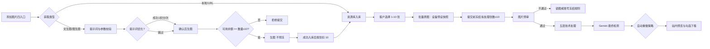
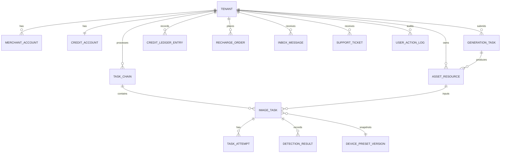
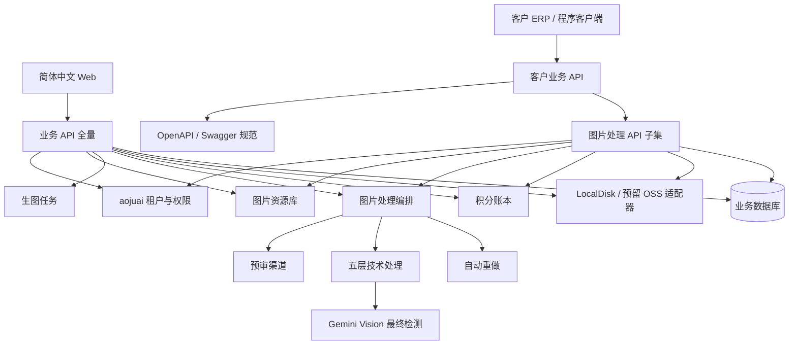

# 蜜獾原图 v2 产品需求文档（v2.0）

> 本文定义面向真实电商商家上线的第一版本产品边界、用户行为、业务规则、数据合同和上线验收条件。文档描述已确认需求与实现约束，不证明任何功能已经实现、测试通过、部署或上线。功能需求 `FR-NNN`、非功能 `NFR-NNN`、用户旅程 `UJ-NNN`、状态机 `SM-NNN`、验收 `AC-NNN`、待决策 `ND-NNN`、拒绝路径 `RP-NNN`。独立待决见 [待决策清单](蜜獾原图-v2-待决策清单-v1.0.md)；与本版冲突时以本版已确认行为为准。

## 1. 产品愿景与定位

### 1.1 产品命题

电商商家需要把商品图与生成图整理为可追溯、可下载、带摄影设备成像参数的图片资产。蜜獾原图 v2 将「获取图片」与「硬件化处理」拆成可审计两段：先入库形成可复用资源，再按客户选择提交预审、五层技术处理与 Gemini 最终检测，并保留积分结算与结果交付证据。产品不承诺任何外部平台必然认定图片为原创或物理实拍。

### 1.2 Why now

- 现行原型已验证「资源库 → 处理」拆分、设备预设三级联动、账号级历史/消息隔离与管理后台交互，可作为第一版本信息架构基线。
- 旧代码中的算法与设备参数仍有复用价值，但须在 aojuai 多租户与可恢复任务底座上重建模。
- Gemini 检测与自动重做合同暂保持 v1.0，避免与并行中的替代检测研究交叉改写正式范围。

### 1.3 产品边界

| 范围 | 第一版本口径 |
|---|---|
| 客户 | 电商商家；业务空间为租户；账号可由管理员/技术客服创建，历史与消息按账号隔离 |
| 输入 | 资源库四入口：文生图、图生图、本地上传、URL 导入 |
| 处理 | 仅从资源库选择 1–10 张；统一设备预设；预审 → 五层 → Gemini 最终检测 |
| 输出 | 处理结果站内预览与下载，统一 sRGB JPEG（`.jpg`）；批量不生成 ZIP |
| 检测 / 自动重做 | **CONFIRMED_PRODUCTION**：Gemini 五维 ≥75 且 `passed=true`；自动重做见 FR-026 |
| 发布 | 不提供向外部平台上传发布 |
| 客户集成 | **第一版提供**本平台业务 API（OpenAPI/Swagger）；鉴权为 `X-API-Key`；**可调用能力仅限图片处理**（见 FR-033）；支持不登录 Web、仅经 API 完成处理主路径；面向已有 ERP 的对接。仍不开放客户自建**上游模型** API Key，不提供向外部电商平台代发 |
| 语言 / 地区 | 简体中文；中国大陆部署（库与存储约束沿用 NFR-012；**首版默认 LocalDisk，OSS 适配器预留**，见架构 1.4 / grill ADR 2026-11-04） |

## 2. 目标用户、干系人和用户旅程

### 2.1 Jobs To Be Done

- 当我有商品图或生成图时，我希望先统一入库，再挑图做硬件化处理，同一张原图可多次处理。
- 当我批量提交时，我希望最多一次处理 10 张，坏图不阻断好图，并能勾选下载成功结果。
- 当我需要营销图时，我希望文生图/图生图只负责生成入库，之后再决定是否做 EXIF/五层处理。
- 当我充值积分时，我希望客服确认后余额准确增加，流水可追溯。
- 当预审连续失败时，我希望知道图片锁定或账号冻结原因，并有申诉/解冻路径。
- 当我已有 ERP 时，我希望不登录 Web 后台，仅通过本平台业务 API（`X-API-Key`）完成图片处理相关操作（入库供处理、提交处理、查询、下载）。

### 2.2 非用户与非目标

- 不面向个人非商业主场景。
- 不面向客户自建**上游模型** API Key、向外部平台自动化发布或**订阅席位制**协作产品。第一版本**面向**已有 ERP、需经本平台业务 API（OpenAPI/Swagger）对接的商家（可不登录 Web 完成主路径）。第一版本支持一租户多账号；**积分账户按租户共用**（店内账号共享余额与流水可见性，扣费记操作账号），这不是独立「共享钱包产品化」功能，但是明确的资金归属选择（见 grill Q2/Q8）。
- 不面向需要「生成即自动完成硬件化并直接交付」的旧路径客户；该路径已取消。

### 2.3 关键用户旅程

#### UJ-001：李婷入库商品图并完成硬件化下载

- **Persona + context**：跨境电商商家，准备处理商品主图。
- **Entry**：已登录，余额足够。
- **Path**：图片资源 → 添加图片 → 本地上传（单次最多 20）或 URL/JSON 导入（单次最多 100）→ 入库成功不扣积分 → 勾选 1–10 张「去处理」或进入批量原图选择 → 选择启用中的 EXIF 参数预设（类型→品牌→型号）→ 系统冻结预计积分 → 预审 → 五层处理 → Gemini 最终检测 → 站内结果预览 → 勾选下载（目录写入或降级逐文件）。
- **Climax**：详情展示输出尺寸、设备预设快照、关键 EXIF、检测报告与按张账务。
- **Resolution**：资源库原图长期可再用；处理结果默认保留 7 天；任务/检测摘要/积分流水永久保留。
- **Edge**：批次中一张被拒绝时其余继续；失败张不扣费并释放对应预留；成功张按每张 10 积分结算。

#### UJ-002：王强文生图入库后再处理

- **Persona + context**：需要营销变体。
- **Path**：图片资源 → 文生图 → 正向/负向提示词、尺寸、数量、可选种子 → 可选提示词优化并确认 → 生图三阶段（生成请求→生图中→生成结果）→ 结果自动入库 →「前往图片资源」→ 再选图提交批量原图处理（含设备预设与完整处理链）。
- **Climax**：生图详情可预览/批量下载生成图，但不含复制/主动重处理/处理时间线；处理任务详情才含完整证据与后续动作。
- **Resolution**：生图按成功入库张数收取每张 10 积分；提示词优化成功另计 1 积分/次；其后处理任务再按成功处理张数每张 10 积分计费（见 FR-016）。
- **Edge**：提示词超限在调用前拒绝；未确认优化结果不得用于生图；生图部分成功时仅对成功张计费。

#### UJ-003：周敏图生图入库后再处理

- **Path**：选择一张参考图（资源库或临时本地上传；临时参考图不入库）→ 提示词与参数 → 预审参考图（适用时）→ 生图入库 → 客户另行提交处理。
- **Edge**：参考图二次预审失败只锁图；不自动冻账号。

#### UJ-004：陈琳连续预审失败

- 同图二次失败 → 锁图，可选申诉；三张不同图连续失败 → 冻账号 + 自动技术客服工单；任意图片预审通过清零连续失败计数。冻结后仍可登录查看历史与保留期内结果，不能新建获取/处理任务。

#### UJ-005：赵敏人工充值

- 提交订单 → 微信/支付宝转账 → 客服确认 → 整数积分到账；无系统内现金退款。

#### UJ-006：管理员维护设备预设与账号

- 平台管理员启停/编辑设备预设（含 GPS 模式）；管理员或技术客服创建账号、调整积分/权限、启停、重置密码、删除，成功操作写入系统日志。

## 3. 术语表

| 术语 | 定义 |
|---|---|
| 商家 / 租户 | 客户业务主体；租户为多租户底座中的独立空间。 |
| 账号 | 登录主体；历史与消息按「接收账号 + 租户」隔离。 |
| 图片资源 | 租户资源库中的原图资产；来源为 text / image / upload / import。 |
| 生图任务 | 文生图或图生图任务；成功后将结果写入资源库，不自动处理。 |
| 图片处理任务 | 从资源库选图后的预审 + 五层 + 最终检测任务链。 |
| 图片预审 | 对处理输入（及图生图参考图）的文件与内容安全检查；模型预审默认阿里千问可更换。 |
| 五层技术处理 | 像素物理化 → 频域扰动 → 指纹破坏 → 设备参数与 EXIF → 通用电商编码模拟。 |
| 设备预设 | 平台维护的完整参数模板；含 GPS 写入策略；提交时快照。 |
| EXIF 参数预设选择 | 处理页按设备类型 → 品牌 → 型号三级联动选择**已启用**预设。 |
| 检测报告 | **CONFIRMED_PRODUCTION**：Gemini 五维分数、总分、判定与未通过原因。 |
| 自动重做 | **CONFIRMED_PRODUCTION**：见 FR-026。 |
| 积分 / 冻结积分 | 整数计费单位；永久有效。生图不预冻、成功入库后按张扣 10；处理提交前按拟处理张数 × 10 冻结，见 FR-016。 |

## 4. 业务流程与状态机

### 4.1 总体流程

### 4.2 图片资源状态 SM-004（新增）

| 状态 | 规则 |
|---|---|
| `AVAILABLE` | 在资源库可见，可勾选处理/下载。 |
| `PROCESSING` | 存在任一关联运行中处理任务；优先展示处理中；禁止删除。 |
| `PROCESSED` / `PROCESS_FAILED` | 卡片态提示；不阻止再次提交新处理任务。 |
| `DELETED` | 客户删除后移出列表；关联生图历史禁止原图预览/下载；既有处理输出与摘要保留；不得用输出冒充原图重新处理。 |

入库动作（上传/导入/生图成功）不创建处理任务、不扣图片处理积分。单次本地或 URL 获取最多 20；处理提交最多 10。

### 4.3 生图任务状态机 SM-005（新增）

| 状态 | 进入条件 | 允许迁移 | 禁止 |
|---|---|---|---|
| `DRAFT` | 填写生图表单 | `SUBMITTED` | 直接交付为已处理结果 |
| `SUBMITTED` | 基础校验通过 | `GENERATING`, `REJECTED` | 跳过参数校验 |
| `GENERATING` | 生图渠道执行 | `GENERATED`, `FAILED` | 假成功；空响应扣成功图片处理费 |
| `GENERATED` | 结果已写入资源库 | 终态（就生图链而言） | 自动进入五层或最终检测 |
| `FAILED` / `REJECTED` | 技术失败或前置拒绝 | 按规则重试或结束 | 伪造入库 |

生图进度对客户仅展示：生成请求 → 生图中 → 生成结果。

### 4.4 图片处理任务状态机 SM-001（修订）

沿用 v1.0 处理侧状态名，入口改为「已选资源 + 预设快照」：

| 状态 | 进入条件 | 允许迁移 | 禁止迁移 |
|---|---|---|---|
| `DRAFT` | 选择资源并配置预设 | `SUBMITTED` | 直接交付 |
| `SUBMITTED` | 基础校验通过 | `PRE_REVIEW`, `REPROCESS_PENDING`, `REJECTED` | 账号冻结仍执行 |
| `PRE_REVIEW` | 需要预审 | `PRE_REVIEW_PASSED`, `PRE_REVIEW_FAILED`, `IMAGE_LOCKED`, `FAILED` | 未记录结果直接处理 |
| `PRE_REVIEW_PASSED` | 预审通过 | `FULL_PROCESSING` | 未完成账务校验即执行 |
| `PRE_REVIEW_FAILED` / `IMAGE_LOCKED` | 预审失败规则 | 同 v1.0 | 同 v1.0 |
| `FULL_PROCESSING` | 五层执行 | `DETECTION`, `FAILED` | 绕过阶段快照 |
| `DETECTION` | Gemini 最终检测 | `DELIVERED`, `FAILED`, `AUTO_REPROCESS_PENDING` | 未知响应当通过 |
| `DELIVERED` / `FAILED` / `RETRY_PENDING` / `REPROCESS_PENDING` / `AUTO_REPROCESS_PENDING` / `REJECTED` / `CLOSED` / `EXPIRED` / `DELETED` | **CONFIRMED_PRODUCTION 语义同 v1.0** | 同 v1.0 | 同 v1.0 |

处理进度对客户展示：输入校验 → 预审 → 技术处理 → 结果检测 → 结果交付。

主动重处理、自动重做与技术失败手动重试的区分**沿用 v1.0**：自动重做不重生图、不覆盖上轮；主动重处理创建关联新任务；技术重试沿用原任务且最多 2 次手动重试。

### 4.5 积分状态机 SM-002

状态名沿用 v1.0：`AVAILABLE` / `RESERVED` / `CONSUMED` / `RELEASED` / `ADJUSTED`。计费单位改为**按张**：

- **生图任务**：不预冻。提交时校验 `可用余额 ≥ 生成数量 × 10`，不足则整批拒绝；每张成功入库后从可用余额直接扣 10（`CONSUMED`）。失败/空响应/超时不扣、不产生冻结。扣费时余额不足则该张不入库并记失败，已成功张保持已扣。
- **图片处理任务**：提交前按 `拟处理张数 × 10` 冻结；每张完成五层且最终检测通过结算 10 积分；未通过/技术失败张不扣费并释放对应预留；同一张图的自动重做轮次不叠加收费。
- **提示词优化**：成功 1 积分/次，失败不计费。
- 复制处理任务的免再次冻结例外沿用 ND-025/FR-013（仅适用于**图片处理任务**复制，不适用于生图任务）。复制执行期间暂缓同账号其他扣分/冻结，充值正常。

### 4.6 账号冻结规则 SM-003

同 v1.0：同图二次预审失败锁图；三张不同图连续失败冻账号并自动派单；通过清零；技术/前置失败不计数；冻结后可看历史不可新建任务（含资源获取与处理提交）。

## 5. 信息架构与页面目录

侧栏顺序（按角色裁剪）：工作台 → 图片资源 → 批量原图 → 任务详情 → 设备预设 → AI 提示词模板 → 积分与充值 → 工单管理 → 用户管理 → 系统日志 → 系统管理。消息中心在顶栏铃铛。

| 页面 ID | 页面 | 核心能力 | 主要 FR | 角色可见性 |
|---|---|---|---|---|
| PG-001 | 登录/注册 | 用户名密码 + 随机验证码；租户建立 | FR-001 | 全部 |
| PG-002 | 工作台 | 商家/客服：四张概览卡与最近历史；管理员：运营指标，无商家概览卡 | FR-002, FR-025 | 全部（视图不同） |
| PG-003 | 图片资源 | 四入口添加、表格列表、勾选、去处理、下载/删除 | FR-003—FR-006, FR-028 | 全部（数据按账号/租户） |
| PG-004 | 批量原图 | 仅选库内资源、EXIF 三级联动、提交处理 | FR-007—FR-009, FR-015—FR-016 | 全部 |
| PG-005 | 任务详情 | 处理/生图双标签（默认处理）、筛选分页、详情 | FR-017—FR-019, FR-027 | 全部（账号隔离） |
| PG-006 | 设备预设 | 405+ 目录、新建/编辑、启停、GPS 配置 | FR-007—FR-008 | 仅平台管理员 |
| PG-014 | AI 提示词模板 | 平台/租户模板目录、新建编辑、生图选用 | FR-032 | 全部（编辑范围按角色） |
| PG-007 | 积分与充值 | 余额、冻结、订单、流水 | FR-016, FR-020, FR-021 | 仅商家 |
| PG-008 | 工单管理 | 冻结/申诉/订单类工单弹窗与审计 | FR-022, FR-024 | 技术客服、管理员 |
| PG-009 | 用户管理 | 创建账号、积分、权限、启停、重置密码、删除 | FR-029 | 技术客服、管理员 |
| PG-010 | 系统日志 | 用户账号成功变更审计 | FR-030 | 技术客服、管理员 |
| PG-011 | 系统管理 | 自动重做（Gemini / FR-026）、模型 API（管理员） | FR-012, FR-026 | 全部可见入口；内容按角色 |
| PG-012 | 消息中心 | 一行通知、已读、补发 | FR-023 | 顶栏；按接收账号隔离 |
| PG-013 | 提示词优化确认 | 嵌于生图表单流程 | FR-013 | 生图时 |

第一版本不提供：外部发布页、团队席位页、独立「检测结果」页、独立「GPS 配置」页、旧「AI 生图」一级菜单、客户自建**上游模型** Key 页。第一版本**提供**本平台业务 API 凭证管理（商家或管理员签发）与 OpenAPI/Swagger 规范（见 FR-033）。拒绝路径见 RP-001—RP-008（RP-002 已按 2.9 修订）。

## 6. 功能需求

### 6.1 租户、账户和访问控制

#### FR-001 独立租户开户与访问

每个商家业务空间对应独立租户；业务请求租户标识必须从已验证会话解析。资产、任务、积分、订单、提示词、检测记录与消息读写均带租户条件；跨租户访问统一拒绝。

按 ND-001：用户名密码 + 随机验证码；会话 30 天；密码连续 5 次错误锁定。找回与吊销由在线客服处理。原型跳过真实认证仅作演示，后端不得省略。

**账号级隔离（本版确认）：** 任务详情、消息中心、工作台最近历史、结果操作以任务/消息上的接收账号 + 租户与当前登录账号比对；**平台管理员也不跨账号查看他人历史**。

#### FR-002 账号冻结访问边界

冻结账号可登录并查看、下载尚在保留期内的处理结果与未删除资源元数据，但不能提交新的资源获取或处理任务。解冻须记录操作者、原因、时间与关联事件。

### 6.2 图片资源、输入校验与预审

#### FR-028 统一图片资源库

系统提供统一图片资源库，四种获取方式均经「添加图片」进入：文生图、图生图、本地上传、URL 导入。

**可测后果：**

- 本地上传：单次最多 20 张；第 21 张整体拒绝。
- URL / JSON 导入：单次最多 100 条。支持三种输入：每行一个 HTTP/HTTPS 地址；粘贴 JSON 数组；上传 JSON 文件。JSON 字段顺序为 `name → seller → sku → asn → price → website → url`；`name` / `sku` / `url` 为必填语义，其中 `sku` 可空，空则系统生成 16 位内部编号。第 101 条整体拒绝。缺少供应商合同与接口证据时不得真实外呼（ND-012）。
- 获取成功只入库，不创建处理任务、不扣图片处理积分。
- 文生图 / 图生图：数量 1–10；成功结果自动入库；图生图临时参考图不入库。
- 列表：表格（非卡片网格）默认 20 条/页；列含勾选、缩略图、拼接文件名、操作；可按来源筛选；勾选跨页与跨筛选保留；支持放大查看、单张/批量下载与删除。
- 列表展示的文件名按有值字段拼接，字段顺序固定为 `name`、`seller`、`sku`、`asn`、`price`、`website`、`url`。落盘建议名以 `sku` 或 `sku_asn` 为基名；同租户未删除资源的 `sku` 冲突时追加 ASN 或重新生成内部编号。
- 处理输出**不**回流入资源库；同一原图可并行、多次提交处理，任务与设备快照独立。
- 存在任一关联运行中处理任务时，禁止删除该资源（单张或整批含该资源时整批阻止）。
- 删除后资源离开列表；关联生图历史禁止原图预览/下载；历史摘要与既有处理结果保留；禁止用处理输出冒充原图重新处理。

#### FR-003 输入格式、大小和像素校验

支持 JPG、JPEG、PNG；单张最大 `20 MiB`，单张最大像素总量 `40 MP`；前端拦截，后端必须再验。处理提交批次最多 10 张；不合格逐张拒绝，合格继续。

URL / JSON 导入在缺少供应商合同与接口证据时仅显示未配置或使用测试替身，不得真实外呼（ND-012）。

#### FR-004 方向自适应最低分辨率

进入处理的输入图与图生图参考图：横图至少 `1024×768`，竖图至少 `768×1024`。文生图客户自选宽高 `256–2048` 不受该输入规则约束。

#### FR-005 内容安全预审

对进入处理的图片及图生图参考图，由当前配置的预审模型检查明确禁止项（默认阿里千问可更换）。命中即拒，不确定不当通过。拒绝可审计且不扣图片处理积分。

#### FR-006 预审失败重试与冻结

同图首次失败后最多再试 1 次；第二次锁图并可选客服。三张不同图连续失败冻账号并自动派技术客服工单。任意图片预审通过清零连续失败计数。

### 6.3 设备预设与五层处理

#### FR-007 固定设备预设

平台维护设备预设目录；首期类别含手机、单反、无反、运动相机等。客户不得在处理页新增或编辑公共预设。平台管理员可浏览旧版导入记录（含来源 ID、PRIVATE、NOT_ACTIVATED、复核状态），新建/编辑（基本信息、拍摄参数、图像属性、EXIF/GPS含 MakerNote、AI 提示词），启停与版本快照。作者/版权声明字段不纳入；IP-GEO 不纳入第一版本表单。

处理页仅展示状态为「启用」的预设，按类型 → 品牌 → 型号三级联动；提交时保存完整预设版本快照。

#### FR-008 GPS 写入策略（本版修订）

GPS **不再**由客户在批量原图页单独选择地点。GPS 模式、固定坐标或按场景随机仅在设备预设的 EXIF/GPS 中配置；处理任务继承提交时快照。

| GPS 模式 | 行为 |
|---|---|
| `none` | 不写入 GPS |
| `fixed` | 写入预设中的纬度/经度/海拔 |
| `random_by_scene` | 按预设场景规则随机写入 |

**可测后果：** 结果详情展示实际 GPS 或明确未写入原因；写入失败与跳过分别记录。

#### FR-009 五层技术处理

对批量原图提交的每张资源输入，按序执行五层处理，再调用 Gemini Vision 最终检测。内容保真与 `output_bytes >= source_bytes`（ND-020/ND-021）沿用 v1.0。结果统一 sRGB JPEG（`.jpg`）。

生图渠道原始返回仅作资源库原图或站内对比依据，**不得**在未完成处理任务时作为「已硬件化交付」收费结果。

### 6.4 文生图与图生图

#### FR-010 文生图输入

必填正向提示词、选填负向提示词；宽高各 256–2048；数量 1–10。表单可选用「AI 提示词模板」（见 FR-032）填充正/负向提示词，客户仍可改写。表单**不**展示设备预设或 GPS。后端遵守当前生图渠道真实长度限制，超限不截断。

#### FR-011 图生图输入

每任务一张参考图；参考图执行 FR-003—FR-006。可从资源库选择或临时上传；临时上传不入库。

#### FR-012 模型职责与配置合同

提示词优化渠道（平台可配置，默认可用 DeepSeek 等文本模型）、预审渠道（默认阿里千问可更换）、生图渠道（默认 ChatGPT Image 2 可更换）、**Gemini Vision 最终物理实拍检测（CONFIRMED_PRODUCTION）**。客户界面与计费文案统一称「提示词优化」，不向客户暴露必须绑定某一供应商名称。客户不可见上游 Key，不可自选替换平台模型。平台管理员在系统管理-模型 API 中登记渠道；列表只存掩码。**第一版本每职责只启用一套验证过的配置，不轮询。** 后续版本可按渠道最多 10 个 Key 轮询，须另开本版范围外实现，不得在第一版本静默打开。

#### FR-013 提示词优化

客户主动点击后调用；展示原始与优化文本，确认后才可用于生图。成功返回有效结果收 1 积分/次（未采用仍计费）；失败不计费并释放已有冻结。原始/优化/确认版本永久保留。

**复制任务：** 仅**图片处理任务**支持从历史复制为新草稿（`copiedFrom`），可免再次完整预审与冻结（ND-025 例外），仍做基础合法性与余额非负校验。**生图任务不提供复制。** 复制处理任务执行期间，暂缓同账号其他扣分和冻结请求，充值与正向加分不受影响；该复制批次完成或失败后解除限制。不得用此门闩绕过余额非负与结算幂等。

#### FR-014 生成结果入库与处理分离（本版修订）

文生图/图生图完成后：

1. 结果自动写入图片资源库；
2. 客户可在结果弹窗预览并勾选批量下载；
3. 主后续动作为「前往图片资源」；
4. **不**自动进入五层处理或最终检测；
5. 生图本身按**成功入库张数**收取每张 10 积分（与后续图片处理费分开）；不预冻；部分成功时仅对成功张结算，失败张不扣。

客户需硬件化时，须从资源库另建图片处理任务，并再按处理成功张数计费。

### 6.5 任务、批次与交付

#### FR-015 批量处理与部分成功

单次处理 1–10 张，可混选来源；整批共用一套启用设备预设。每张独立状态、检测、错误原因与计费。前置校验失败项不扣费并释放该张预留。批量下载只包含勾选的可下载结果；最终检测未通过但有效结果仍可下载且不收费（ND-019）。**不生成 ZIP。**

#### FR-016 积分预扣、结算和释放

单价：**每张成功图片 10 积分**（生图成功入库，或图片处理完成五层且最终检测通过）。生图与处理冻结时机不同：

- **生图任务**：不预冻。提交时校验 `可用余额 ≥ 生成数量 × 10`，不足则整批拒绝；成功入库后按张从可用余额扣 10。
- **图片处理任务**：提交前一次性冻结 `拟处理张数 × 10`；余额不足则整批拒绝提交。

**可测后果：**

- **生图任务**：无 `RESERVED` 流水。逐张结算，成功入库扣 10；失败/空响应/超时不扣、不产生冻结。扣费时余额不足则该张失败且不入库。技术失败无需客服释放冻结。
- **图片处理任务**：`拟处理张数 × 10` 预留；逐张结算，通过最终检测扣 10；ND-019 未通过、前置拒绝不扣；技术失败冻结由客服审计后释放（ND-009）。同一张图的自动重做不新增扣费。
- **提示词优化**：独立按 FR-013，成功 1 积分/次。
- 冻结、结算、释放与人工调整均为整数流水；重复请求幂等。任意并发下余额、冻结额与流水对账一致。
- 复制处理任务的免冻结例外不得绕过余额非负与结算幂等；不得按「整批只收 10 积分」计费。

#### FR-017 结果详情与对比（本版修订）

处理任务详情以「结果预览」合并成功预览与逐张结果表；图片详情弹窗承载**按张账务**与处理快照。原图用于追溯时以资源引用为准；**不再要求**独立「原图/结果并排对比」卡片。生图任务详情精简：保留预览、批量下载、逐张查看与按张计费状态；**移除**复制、主动重新处理、标题下四张概览卡、任务链时间线。

关键 EXIF 展示（处理成功时）：设备品牌、型号、ISO、快门、光圈、焦距、拍摄时间、GPS。

#### FR-018 Gemini 检测报告 — CONFIRMED_PRODUCTION

> 本节全文沿用 PRD v1.0 FR-018。2026-11-02 确认为生产最终检测合同，检测器不得替换为 Check_Aimage 或 Synthbuster。

检测报告展示五个维度分数、总分、最终判定和未通过原因。维度名称与键名固定为：噪点颗粒 (`noise`)、景深 (`depthOfField`)、光线曝光 (`lighting`)、色彩真实度 (`colorRealism`)、整体真实感 (`overallRealism`)。通过标准为总分 `>=75` 且 `passed=true`。检测结果只表示 Gemini Vision 的结果，不保证任何第三方平台最终审核通过。不得用「真实感 / 材质 / 光线 / 设备 / 平台适配」或其他候选分数映射替代上述五维。

**可测后果：**

- 缺失、HTML、超时或无法解析的模型响应不视为通过。
- 第三方平台审核保证文案在客户界面和帮助文本中不得出现。
- 按 ND-019，Gemini Vision 正常返回但最终判定未通过时，保留真实报告及有效结果文件供客户预览、下载；若已启用自动重做且分数低于该链阈值，进入同一链的下一自动轮次，否则不收费并结束该链。模型响应异常按技术失败处理，不能伪造一个未通过报告或可下载文件。
- 主动重处理通过后端 `processing.reprocess` 执行：校验原任务确为最终检测正常返回但未通过、所选处理后结果仍可访问且属于当前租户，并校验解码、参数和账号状态；以该结果为新任务输入，保存 `source_task_id` 和独立预设快照，直接重新执行完整五层与最终检测，不再次生成图片。原任务、报告、结果和消费记录不被覆盖；重复提交按请求幂等键只创建一个新任务。
- 重处理新任务按 FR-016 通常规则独立报价、检查余额和冻结，完成且检测通过按**每张 10 积分**结算，失败按相应失败类别释放；原失败任务中未通过张仍为 0 消费。该动作不属于 ND-025 的复制生成例外，也不占用原任务技术重试次数；重处理任务自身发生技术失败时按 FR-024 执行。过期、已删除、无有效处理后结果或非本租户的来源不得发起重处理。
- **本版补充：** 主动重新处理仅对**图片处理任务**开放；原图资源已删除时不得发起。

#### FR-019 生命周期与删除（本版修订）

| 对象 | 保留 |
|---|---|
| 图片资源（原图） | 长期保留，直至客户删除或合规删除指令 |
| 处理结果、缩略图、中间产物 | 默认自生成起 7×24 小时 |
| 站内消息 | 自创建起 30 天（ND-028） |
| 任务摘要、检测摘要、提示词、预设快照、积分流水、冻结与工单摘要、审计 | 永久 |

到期或主动删除后，对应文件访问拒绝；清理不得删除账本与必要审计字段。

#### FR-031 下载与导出（新增）

- 资源库、生图结果、处理详情均支持勾选后批量下载；未勾选时提示且不得默认下载全部。
- 优先使用目录选择器写入；不支持时降级为浏览器逐文件下载。
- **禁止生成 ZIP 交付包**（RP-009）。
- 同一次批量保存中同名文件须加后缀避免覆盖。
- 处理交付文件格式为 sRGB JPEG；资源库原图下载按其源类型（JPEG/PNG）保存。

### 6.6 充值、客服、消息与管理

#### FR-020 人工充值订单

微信/支付宝转账；客户提交订单与凭证，客服确认后加整数积分。无系统内人民币退款，无扫码跳转支付（第一版本）。

#### FR-021 积分规则

整数记账，永久有效；`1 元 = 10 积分`；充值档位同 v1.0；**图片单价改为每张 10 积分**（生图成功入库与图片处理成功各计一次，互不替代）；提示词优化 1 积分/次。人工加减须理由、操作者、幂等键（ND-008）。

#### FR-022 客服与冻结处理

工单类型 `order` / `image_appeal` / `account_freeze` 关联规则同 v1.0。技术客服处理授权范围；平台管理员处理全平台。解冻权限：技术客服与平台管理员；订单客服与商家默认无解冻权限。

#### FR-023 站内消息

任务完成/失败、冻结、自动派单、解冻、充值确认等站内通知；不发邮件/短信。保留 30 天；首次失败后最多自动重试 3 次；补发不重跑任务、不重复扣费。

**本版确认：** 消息列表、未读数、全部已读与补发均按接收账号 + 租户隔离；后台任务完成通知发给提交时快照的接收账号。

#### FR-024 失败与重试

预审按 FR-006；处理技术失败最多手动重试 2 次（含首次共 3 次）；沿用原任务分别记尝试；超限转客服。Gemini 正常未通过按 FR-018/ND-019，不占用技术重试计数。第一版本不支持取消任务。

#### FR-025 运营后台真实指标

同 v1.0：余额、冻结、队列、失败率、检测通过率、成本、模型调用量、存储占用；真实数据，缺失显示空态。商家/客服工作台展示四张概览卡，不展示「一条任务链」横幅。管理员工作台展示运营指标，不展示商家概览卡。

#### FR-026 自动重做 — CONFIRMED_PRODUCTION

> 本节全文沿用 PRD v1.0 FR-026（计费单位按 v2.1 改为按张）。2026-11-02 与 Gemini Vision 最终检测一并确认为生产合同。系统管理页提供可编辑开关、阈值与追加次数；Check 门禁夹具不得覆盖下列规则。

用户可在设置页启用自动重做，默认关闭；开启时默认追加 1 次，追加次数可设置为 1—5 次（不含首次处理），检测分数阈值可设置为 0—100，默认 70 分。设置由服务端持久保存，提交任务时生成不可变配置快照，后续修改只影响新任务。

自动重做适用于上传、外部导入、文生图和图生图来源进入**图片处理任务**后的链路。每轮以上一轮有效处理结果为输入，仅重新执行五层技术处理和最终检测，不再次调用文生图/图生图，不覆盖任何既有图片、报告或尝试记录。触发条件为上一轮有可解析的总分且 `total_score < chain.score_threshold`，且未达到该链的追加次数；该条件独立于最终检测的基线 `total_score >=75 && passed=true`，因此阈值高于 75 时，已通过基线但低于用户阈值的结果仍会继续重做。技术异常、缺失分数、无有效结果或前置校验失败不触发自动重做，按技术失败或拒绝路径处理。

**计费（本版修订，覆盖 v1.0「每链 10 积分」表述）：** 每一张图片最多因处理成功消费一次 10 积分；任一轮通过且有有效结果时对该张幂等结算 10；该张全部轮次均未通过则该张免费并释放其预留。自动重做不按轮次叠加。每轮结果、检测报告、实际分数、触发原因、配置快照、轮次序号和来源均须保留。自动轮次使用后台持久化任务执行，关闭浏览器不影响执行；迟到回调或重复调度不得创建重复轮次、重复消费或重复释放。

**可测后果：**

- 默认配置为关闭、阈值 70、追加 1 次；边界值 0、100、1 次和 5 次均经服务端校验，越界拒绝。
- 分数 69、70、75、90 的触发结果与 `passed` 分别按配置快照计算；分数等于阈值不触发。
- 某张首轮通过后后轮失败仍只对该张消费一次 10 积分；该张全部自动轮次均未通过则该张消费为 0；技术异常不进入自动循环。
- 同一张图重复回调、进程重启和并发 worker 仅保留一个下一轮，且该张账本最多一笔 10 积分消费；一批 N 张通过时消费为 `N × 10`，不得整批只扣 10。

#### FR-027 任务详情（本版修订）

- 一级菜单名称为「任务详情」（不再使用「生成历史」作为导航文案）。
- 移除独立「检测结果」页面与菜单；报告仅在任务/图片详情内查看。
- 历史分「图片处理任务」「生图任务」两个标签，**默认打开图片处理任务**；各默认 10 条/页，筛选与页码分标签保存。
- 来源筛选覆盖文生图、图生图、本地上传、URL 导入；处理标签另含混合来源；状态含预审未通过、图片锁定、拒绝、技术异常、自动重做相关态、已过期、已删除等。
- 查询只返回当前账号可见数据（接收账号 + 租户）。
- 处理任务可展开轮次、报告、账务；生图任务不展示处理轮次时间线。

#### FR-032 AI 提示词模板（新增）

系统提供一级菜单「AI 提示词模板」。模板含名称、适用模式（文生图 / 图生图 / 通用）、正向提示词、负向提示词、范围（平台 / 租户）。

**可测后果：**

- 全部角色可见列表；平台模板由平台管理员维护，商家与技术客服只读。
- 商家可新建、编辑、删除本租户模板；平台管理员可维护平台模板与任意租户模板。
- 列表默认 10 条/页；「选用」将模板填入当前生图表单，客户仍可改写，不因此扣积分。
- 提示词优化（FR-013）与模板选用独立；优化成功仍按次计 1 积分。

#### FR-029 用户管理（新增）

技术客服与平台管理员可管理账号：创建；整数积分增减（填原因，拒绝小数与负余额）；权限（角色 + 功能权限，「保存权限」）；启停；重置密码（两次一致，明文不落库、不进日志）；删除（输入登录名确认）。列表默认 10 条/页。当前管理员关键保护操作受限。商家无此菜单。

#### FR-030 系统日志（新增）

记录对用户账号的成功变更：创建、积分增减、权限、启停、重置密码、删除。字段含操作人（含账号 ID）、时间、目标账号、租户、变更前后值、原因、结果。不记录模型配置、系统更新或资源处理操作。默认 20 条/页。

#### FR-033 客户业务 API 与 OpenAPI/Swagger（第一版纳入 · 2.9）

第一版本向商家开放**本平台业务 API**，使已有 ERP / 自建系统可不登录 Web、仅经接口完成**图片处理**主路径。须发布并维护 **OpenAPI（Swagger）** 规范，作为对接合同。复用 aojuai 机器凭证机制，以请求头 `X-API-Key` 鉴权（与浏览器 JWT 会话并列；无会话时用 Key）。

**鉴权方式（第一版锁定）：**

| 项 | 口径 |
|---|---|
| 协议 | HTTP 头 `X-API-Key: <明文密钥>` |
| 身份 | Key 绑定**租户 + 商家账号**；调用权限不超过该账号 Web 侧商家权限；扣费/冻结记该操作账号 |
| 签发 | 须先 **Web 登录态（JWT）** 创建；禁止用已有 API Key 再创建/吊销 Key（防自我复制） |
| 设定步骤 | 商家（或管理员代管授权租户）登录 Web → 业务 API 凭证页 → 填写名称、可选过期天数 → 勾选能力 scope=`image_processing`（图片处理）→ 创建 → **明文仅本次显示**，之后列表只见前缀/掩码 |
| 轮换 / 吊销 | 支持吊销；吊销后立即 401；轮换=新建 + 吊销旧 Key |
| Scope | 第一版默认且仅允许能力名 `image_processing`；**禁止**空 scope、省略 scope、通配全站 |
| 与底座 `api_keys.scopes` | 能力名写入 JSON 数组（如 `["image_processing"]`）；**不得**沿用底座「空列表=不限制」语义。鉴权层将 `image_processing` **映射**为 OpenAPI 中标注的处理路径前缀白名单；白名单外一律拒绝 |

**可调用能力（第一版仅「图片处理」）：**

- 处理前置入库：本地上传入库（硬校验同 FR-003）、处理相关资源列表/详情；运行中占用资源禁删。
- 处理任务：提交处理（张数上限同 FR；设备预设规则同 Web）、查询任务/图片状态与检测摘要。
- 交付：处理结果下载（遵守 `expires_at` 与鉴权网关；无裸路径）。
- 计费副作用：提交处理时按 FR-016 冻结/结算/释放（记 Key 绑定账号）；**不提供**经 API 的充值下单、加减分、流水导出以外的资金写操作。

**明确不做（仍拒绝，即使持有 Key）：**

- 文生图 / 图生图 / 提示词优化 / URL 真导入等获取类能力（非本 scope）。
- 客户配置或替换平台上游模型 Key；外部电商平台代发；生成即硬件化交付。
- 订单客服/技术客服/管理员后台类接口。

**可测后果：**

- 仅持有效 `X-API-Key`（scope含图片处理）即可完成「上传（供处理）→ 提交处理 → 查询终态 → 下载」，无需浏览器会话。
- 缺少头、错误 Key、已吊销、过期、scope 不含图片处理 → 拒绝；跨租户拒绝。
- OpenAPI/Swagger 写明鉴权头、`image_processing` 路径集合与错误码；与实现一致。

## 7. 权限矩阵

| 动作 | 商家账号 | 技术客服 | 平台管理员 |
|---|---:|---:|---:|
| 查看本账号资源/历史/消息 | 允许 | 仅本账号 | 仅本账号（不跨账号历史） |
| 提交获取/处理任务 | 允许（未冻结） | 允许（未冻结，本账号） | 允许（本账号） |
| 积分与充值页 | 允许 | 拒绝 | 拒绝 |
| 设备预设目录管理 | 拒绝 | 拒绝 | 允许 |
| 模型 API 配置 | 拒绝 | 拒绝 | 允许 |
| 自动重做设置 | 允许（本租户） | 允许（本租户入口） | 允许 |
| 查看 AI 提示词模板 | 允许 | 允许 | 允许 |
| 维护租户提示词模板 | 允许（本租户） | 允许（本租户） | 允许 |
| 维护平台提示词模板 | 拒绝 | 拒绝 | 允许 |
| 确认充值订单 | 拒绝 | 按授权（订单类默认非技术岗） | 允许 |
| 用户管理 / 系统日志 | 拒绝 | 允许 | 允许 |
| 处理授权工单 / 解冻 | 仅本租户工单查看/创建申诉 | 允许（授权范围） | 允许（全平台） |
| 查看运营指标 | 拒绝 | 最小岗位权限 | 允许 |
| 跨租户数据 | 拒绝 | 拒绝 | 仅授权审计 |
| 签发/吊销本平台业务 API 凭证 | 允许（本租户本账号范围） | 拒绝 | 允许（授权租户） |
| 调用本平台业务 API（FR-033） | 允许（未冻结；凭证有效） | 拒绝 | 允许（本账号凭证） |

订单客服角色若在实现中独立于技术客服，权限边界仍按 v1.0 FR-022 / ND-010；原型当前以技术客服 + 管理员演示。

## 8. 非功能需求与上线约束

下列 NFR 除点名修订外，验证合同同 v1.0。

| ID | 要求 | 本版要点 |
|---|---|---|
| NFR-001 | 租户边界 CRUD | 另加账号级历史/消息隔离测试 |
| NFR-002 | 资金整数 | 人民币分、积分整点；可用高精度库实现，禁止 Float/Double |
| NFR-003 | 幂等与并发控制 | 账本 version/锁；迟到 worker 不覆盖新终态 |
| NFR-004 | 魔数与解码校验 | 20 MiB / 40 MP / 处理批 10 / 本地上传批 20 / URL·JSON 导入批 100 |
| NFR-005 | 短期授权 URL | 不暴露可枚举裸路径 |
| NFR-006 | 模型调用审计脱敏 | 无 Key、密码、完整签名 URL |
| NFR-007 | 交付开放条件 | 处理完成且状态明确；生图中间态不作硬件化交付；ND-019 有效失败结果可下载不收费 |
| NFR-008 | 可恢复后台执行 | 关页续跑；复制处理任务免冻且执行期间暂缓同账号其他扣分/冻结；仍满足余额非负 |
| NFR-009 | 处理结果 7 天生命周期 | **资源库原图长期保留**，与结果生命周期分离 |
| NFR-010 | 站内消息 | 同 v1.0 + 账号隔离 |
| NFR-011 | 中文可操作错误 | 不泄露密钥与堆栈 |
| NFR-012—NFR-017 | 部署、容量、供应商、合规声明、TLS、真实验收样本 | 同 v1.0；Gemini/提示词优化渠道/预审/生图上线前真实小样仍必需 |

## 9. 产品数据模型与数据治理

### 9.1 核心实体

### 9.2 数据字典（增量与修订）

| 实体 | 关键字段 | 约束 |
|---|---|---|
| `asset_resource` | `id`, `tenant_id`, `owner_account_id`, `source`, `object_key`, `sha256`, `mime`, `bytes`, `width`, `height`, `name`, `seller?`, `sku`, `asn?`, `price?`, `website?`, `url?`, `generation_task_id?`, `deleted_at?` | 原图长期保留直至删除；处理输出不写入本表；同租户未删除 `sku` 冲突须重分配 |
| `prompt_template` | `id`, `scope`, `tenant_id?`, `owner_account_id?`, `mode`, `name`, `prompt`, `negative` | 平台模板跨租户只读可见；租户模板不跨租户 |
| `generation_task` | `id`, `tenant_id`, `account_id`, `mode`, `prompt_versions`, `status` | 成功产生 1–10 个 resource；不自动建 processing chain |
| `task_chain` / `image_task` | 同 v1.0，并增加 `input_resource_ids[]`、`preset_snapshot`、`message_recipient` | 仅 processing；`origin_kind` 含 upload/import/text/image/reprocess/copy |
| `detection_result` | **CONFIRMED_PRODUCTION 字段同 v1.0** | Gemini 五维；每轮独立 |
| `auto_reprocess_setting` | **CONFIRMED_PRODUCTION 同 v1.0** | 默认关、1 次、70 分 |
| `device_preset_version` | 完整 `parameter_json`，含 `gps_mode` 等 | 仅启用项可选 |
| `inbox_message` | 增加 `recipient_id` | 与 `tenant_id` 同时校验 |
| `user_action_log` | `actor_id`, `target_id`, `before`, `after`, `reason` | 仅账号管理成功变更 |
| `credit_*` / `support_ticket` / `audit_event` | 同 v1.0 主约束 | — |

### 9.3 数据保留与删除

- 资源库原图：长期；删除覆盖对象副本。
- 处理结果与临时包：7 天。
- 消息：30 天。
- 永久：任务/检测摘要、提示词、预设快照、流水、冻结与工单摘要、用户操作日志、审计事件。
- 原图不提供「无鉴权裸下载」；站内授权访问。

## 10. 接口与集成合同

### 10.1 内部业务动作（修订摘要）

| 动作 | 说明 |
|---|---|
| `resource.add_upload` / `resource.add_import` / `resource.add_from_generation` | 入库；校验批大小；不创建 processing |
| `resource.list` / `resource.delete` | 租户+可见性；运行中处理阻止删除 |
| `generation.create` | 生图；校验余额但不冻结；成功入库后按张扣 10；拒绝「生成并自动处理」旧参数；可引用提示词模板 ID |
| `prompt_template.*` | 列表/新建/编辑/删除；范围与角色按 FR-032 |
| `processing.submit` | `resource_ids[1..10]` + 启用预设快照 + 账务冻结 |
| `processing.reprocess` | **语义同 v1.0**；且要求原资源仍可用 |
| `auto_reprocess.*` | **CONFIRMED_PRODUCTION 同 v1.0** |
| `history.list` / `history.detail` | 双标签；按 recipient+tenant 过滤 |
| `detection.get` | **CONFIRMED_PRODUCTION 同 v1.0** |
| `asset.download` | 勾选下载；无 ZIP；ND-019 规则保留 |
| `user.manage.*` / `user_action_log.list` | FR-029/030 |
| `recharge.confirm` / `support_ticket.*` / `account.unfreeze` / `operations.metrics.get` | 同 v1.0 主边界 |

### 10.2 外部服务

同 v1.0 表：提示词优化渠道（平台配置）、预审渠道、生图渠道、**Gemini Vision（CONFIRMED_PRODUCTION）**、图片下载 API（证据前不可真呼）、微信/支付宝人工、**首版 LocalDisk（OSS 适配器预留）**、PostgreSQL。

### 10.3 拒绝路径

- `RP-001`、`RP-003`—`RP-008`：同 v1.0 精神（无外部发布、无团队席位产品化、无扫码支付/现金退款、无 HEIC 等、无前端伪造终态、不承诺第三方审核、**禁止生成结果跳过处理的旧自动交付路径**——本版改为「生图只入库」，处理必须另提交）。
- `RP-002`（**2.9 修订**）：第一版本**开放**本平台业务 API（OpenAPI/Swagger，见 FR-033），供 ERP/程序对接；**仍禁止**客户自建或替换上游模型 API Key，**仍禁止**经本系统向外部电商平台自动化发布。
- `RP-009`：第一版本不提供 ZIP 批量包交付。
- `RP-010`：第一版本不提供独立 GPS 选择页或处理页客户自选地点（GPS 仅随设备预设）。
- `RP-011`：不将 Check_Aimage、Synthbuster 或任何非 Gemini 最终检测基线写为正式上线合同。

## 11. 目标架构与技术边界

### 11.1 分层

**客户集成边界（第一版 · FR-033 / RP-002）：**

- 鉴权：`X-API-Key`（Web JWT 签发；Key 绑定租户+账号；scope=`image_processing`）。
- 能力：仅**图片处理**相关 API（上图 `PROCAPI`）；**不得**经客户业务 API 调用生图/优化/管理类路径。
- 客户可不登录 Web、仅经 API 完成处理主路径。
- 必须提供可机读的 **OpenAPI/Swagger** 规范，作为 ERP 对接依据。
- 客户业务 API ≠ 上游模型 Key 自助，≠ 外部平台发布/代发，≠ 生图等获取类 API。

### 11.2 禁止迁入

同 v1.0：伪队列、SPA 遮蔽路由、`auth.me` 返回密码哈希、双轨迁移、仅凭主键 CRUD、EXIF 静默失败宣称可复用、外部发布矩阵等。

### 11.3 迁移策略

同 v1.0：增量迁移；旧生产用户/Key/账本/图片不自动迁入；设备预设先映射预览再按 ND-014 决定真实导入。

## 12. 商业化、合规与运营

### 12.1 商业规则

- 收款、充值档位、人工调整、无现金退款：同 v1.0（100/300/500/1000/3000 元档位）。
- **计费单位：每张成功图片 10 积分**（纠正 v1.0 / v2.0 初稿「不论张数每任务/每链只收 10」的错误）。

| 能力 | 积分单价 | 计费单位 | 成功条件 |
|---|---:|---|---|
| 文生图 / 图生图（生成并入库） | 10 | 张 | 该张成功生成并写入资源库 |
| 图片处理（预审后五层 + 最终检测） | 10 | 张 | 该张完成五层且最终检测通过；自动重做不叠加 |
| 提示词优化 | 1 | 次 | 成功返回有效优化结果；未采用成功结果仍计费 |

- 生图费与处理费分开：同一资源「先生成再处理」可先后各收 10/张。生图不预冻、成功入库后扣；处理提交前冻结。
- ND-019 最终检测未通过：可下载有效结果，该张不收处理费。
- 失败张、前置拒绝、空响应/超时：不扣对应图片费；技术失败冻结按 ND-009 由客服释放。
- 价格须写入任务报价快照；不追溯改写历史流水。

### 12.2 合规与治理

CP-001—CP-006 同 v1.0（aojuai 声明、第三方模型告知、大陆运营证据、不承诺第三方审核、支付口径、删除覆盖副本）。

## 13. MVP 与迭代规划

### 13.1 首期单张闭环（可编码最小垂直旅程 · S1/R1）

> 2026-11-04 grill-me 确认。完整产品地图仍以各 FR 为准；**实现与验收按阶段退出**，不得把下文「后置」项塞进首期完成定义。工作区：[`docs/mihuanyuantu-v2/`](mihuanyuantu-v2/progress.yaml)。

真会话登录 → 同租户 2 商家账号 + 第二租户隔离种子 → 本地上传入库（硬校验真；预审占位）→ ≤3 启用预设 → **单张**处理（落库 + 同机 worker）→ 五层占位实现（仍交 sRGB JPG + 快照字段）→ Gemini **规则替身**报告（管理员可注入通过/未通过/技术异常）→ 按张冻/结 10（`rp_credit_*` 整数租户户）→ 账号隔离站内消息 → LocalDisk 网关下载（`expires_at` 过期拒绝）→ 空闲资源可软删。入账：管理员人工加减分 + **订单客服 A 档**确认充值（无跳转支付）。技术客服台、真预审冻号、真实五层、真 Gemini、自动重做/重处理、2–10 批次、生图、URL 真导入、405 运营、OSS、ZIP、扫码支付、**客户业务 API（FR-033）**、运营大盘 **均不作为首期退出条件**（客户业务 API 属第一版范围，退出见 R3 / S5）。

### 13.2 版本阶段

| 版本 | 范围 | 退出证据 |
|---|---|---|
| R0 | aojuai、库表、整数积分流水、迁移、RBAC 种子（含订单客服 A 档） | SHA/许可证/锁文件/ADR；LocalDisk 适配器就位 |
| **首期 / R1** | §13.1 单张闭环（预审占位 / 五层占位 / 检测替身 / 消息 / 开发机） | `docs/mihuanyuantu-v2` AC-K1-*；双账号共用积分 + 跨租户拒绝；worker 关闭页面后继续执行；**里程碑端测通过** |
| 算法证据 | **真实五层**替换占位 | ND-020/021 归档小样；未过不得称处理能力完成 |
| 检测上线门槛 | **真 Gemini**；可含自动重做/重处理联调 | ND-011 归档；受生产收费红线约束 |
| R2 | 10 张部分成功、勾选目录下载、积分流水并发 | 混合批次对账 |
| R3 | 生图入库、提示词模板与优化、任务详情双标签补齐；**客户业务 API（X-API-Key + image_processing）+ OpenAPI/Swagger（FR-033）** | 生图不自动处理；生图与处理均按张 ×10；无 Web 会话可完成「上传→处理→下载」；非处理 scope 接口拒绝；规范与实现一致；**端测通过** |
| R4 | 真预审/冻号、技术客服、用户管理、日志、指标、上线门槛 | 上线清单证据齐全；**无 ND-011/020/021 证据禁止生产收费** |
| 后续 | OSS 升级、模型 Key 轮询、扫码支付、外部发布、检测基线替换、外部平台代发矩阵 | 另开 PRD；**第一版每职责单启用、不轮询；不在本版静默切换** |

## 14. 测试与验收策略

### 14.1 最低验收合同

同 v1.0：每 P0 覆盖合法成功、非法输入、越权、重放、并发、迟到、前置条件、未知模型结果、清理与审计。真实验收样本按 ND-034。

### 14.2 核心验收标准

| ID | 场景 | 通过条件 |
|---|---|---|
| AC-001 | 格式/大小/像素边界 | 前后端拒绝；不建非法资产、不预审、不扣处理积分 |
| AC-002 | 上传 20 / 导入 100 / 处理 10 | 本地上传、URL·JSON 导入与处理批上限分别生效；第 21 张上传或第 101 条导入整体拒绝；部分失败逐张原因 |
| AC-003—AC-004 | 预审锁图与冻账号 | 同 v1.0 + 冻结后禁止获取与处理 |
| AC-005 | 五层保真与体积 | 同 v1.0 ND-020/021；输出 sRGB JPEG |
| AC-006 | 禁止生图自动硬件化交付 | 生图无五层/检测阶段；无跳过处理参数；生图费与处理费分开按张结算；生图不预冻、成功入库后扣 10 |
| AC-007 | ND-019 与重处理 | 检测判定规则 **CONFIRMED_PRODUCTION**（≥75 且 `passed=true`）；重处理按张 ×10；仅处理任务；原图删除后拒绝重处理 |
| AC-008 | 提示词与复制 | 提示词优化成功 1 积分/次；仅处理任务可复制免冻；复制执行期间同账号其他扣分/冻结被暂缓、充值可用 |
| AC-009 | 随机种子 | 同 v1.0 |
| AC-010 | 租户 + 账号隔离 | 跨租户与跨账号历史/消息/操作全拒 |
| AC-011 | 整数资金并发 | 同 v1.0 |
| AC-012 | 保留策略 | 原图长期；结果 7 天；摘要永久 |
| AC-013 | 技术失败重试 | 同 v1.0 |
| AC-014 | 无发布 | 同 v1.0 |
| AC-015 | 运营指标 | 同 v1.0；管理员工作台无商家四卡横幅 |
| AC-016 | 模型可配置 | 同 v1.0 |
| AC-017 | 按张单价 | 1–10 张批次：成功 N 张则消费 `N×10`（生图或处理分别计）；不得整批只扣 10；提示词优化成功每次 1 积分；失败张无消费且预留释放幂等 |
| AC-018 | 自动重做 | 触发/阈值/次数规则 **CONFIRMED_PRODUCTION**（FR-026）；计费为每张最多消费一次 10，自动轮次不叠加；一批多张按成功张数累计 |
| AC-019 | 任务详情双标签与无独立检测页 | 菜单位「任务详情」；默认处理标签、其次生图；旧「生成历史」与检测路由不形成第二入口 |
| AC-020 | 无 ZIP / GPS 继承 | 批量下载无 ZIP；处理页无客户 GPS 选择；快照继承预设 |
| AC-021 | 用户管理与系统日志 | 客服/管理员可操作；成功变更入日志；密码不落库 |
| AC-022 | 资源删除与并行处理 | 运行中禁删；同图可并行；输出不入库 |
| AC-023 | 资源表格、导入 JSON 与提示词模板 | 资源列表为表格且文件名按约定字段拼接；URL/JSON 导入 1–100；模板选用不扣积分，平台模板仅管理员可改 |
| AC-024 | 客户业务 API（FR-033） | 持有效 `X-API-Key`（scope=`image_processing`）可无 Web 会话完成上传→提交处理→查询→下载；错误/吊销/过期/跨租户/非处理 scope 拒绝；OpenAPI/Swagger 与实现一致；不得调用生图或上游模型配置 |

### 14.3 验证状态边界

现行 HTML 原型仅证明交互与本地状态机可演示。所有实现须分别记录 `CODE_COMPLETE` / `TEST_PASS` / `DEPLOYED` / `BUSINESS_ACCEPTED`。不得将原型 mock 或历史 Check/Synthbuster 研究夹具误认为真实 Gemini 已验收，也不得将其计费展示当作已签署的新商业合同。

## 15. 治理、风险与待决策

### 15.1 放行规则

同 v1.0 P0/P1；另增：生图自动处理旧路径回流、ZIP 误交付、跨账号历史泄露、运行中资源被删导致任务脏读，均为上线阻断。

### 15.2 风险登记

| 风险 | 影响 | 缓解 |
|---|---|---|
| 再次把研究检测器写入生产路径造成合同分叉 | 高 | 2026-11-02 已确认 Gemini；Check/Synthbuster 仅研究；再切换须另开决策与 PRD 修订 |
| 资源长期保留推高存储成本 | 中 | 监控占用；后续可加归档策略 ND |
| URL 导入无供应商证据 | 高 | ND-012：未配置前不真呼 |
| 账号隔离与租户隔离混淆 | 高 | AC-010；管理员亦不可默认看他人历史 |
| 旧算法静默失败 | 高 | P0 回读；禁止静默回退 |
