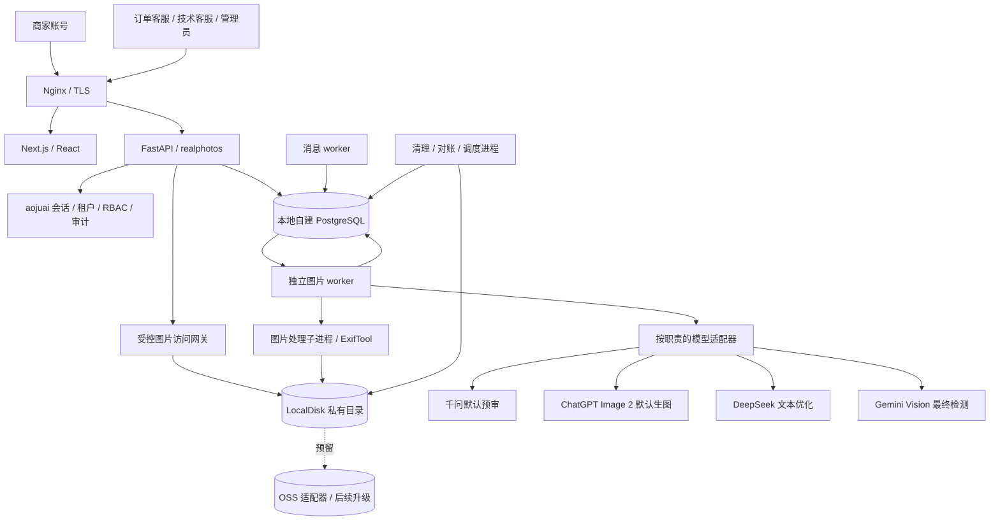
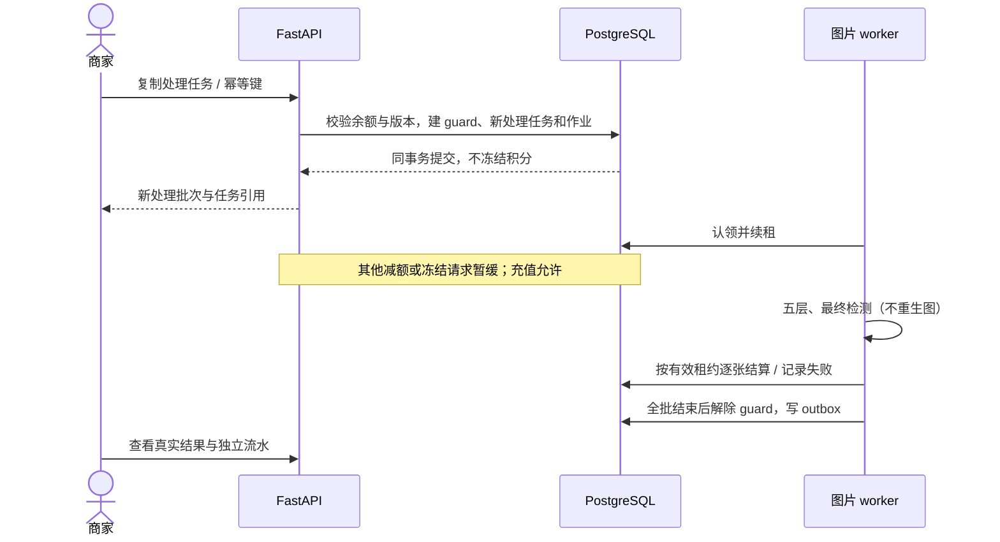
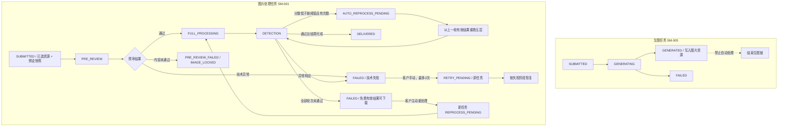
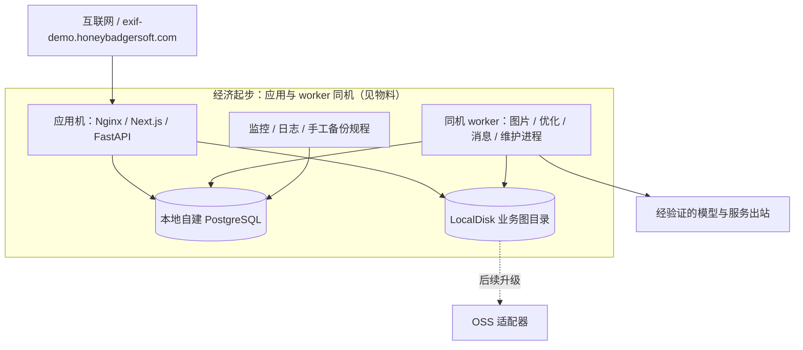

# 蜜獾原图 v2 项目架构

本文件供开发直接分解实现：保留指定 aojuai 底座的 Next.js / React、FastAPI / SQLAlchemy、PostgreSQL 主技术栈，以模块化单体业务 API、独立图片 worker、本地自建 PostgreSQL 和 **LocalDisk 默认存储（OSS 适配器预留）** 作为首版经济起步方案。图像算法从旧版提取原理与参数，以 Python 实现并重新验证。高可用按相同模块和持久数据边界升级。

> **2026-11-04 覆盖：** 以 [生产物料清单](蜜獾原图-v2-生产物料清单-v1.0.md) 与 [grill ADR](architecture_decisions/蜜獾原图-v2-grill-me逻辑架构裁决-2026-11-04.md) 为准，首版**不开 OSS**；下文若仍出现「首版必须采购 OSS」字样，以本覆盖说明与 AD-007 修订为准。

这是目标设计与实施合同，尚未实现或部署。用户明确选择的约束与本文推荐的技术细节分别登记；具体云地域、产品小版本、供应商权限和容量数据仍须补证。文中规划的新文件、API、表及命令，不表示当前源码已经具备。

## 1. 依据、裁决与设计范围

### 1.1 当前依据

| 依据 | 版本与说明 | 权威边界 |
|---|---|---|
| [现行 PRD](蜜獾原图-v2-PRD-v2.0.md) | document_version 2.8 | 现行产品合同 |
| [AidevOps 工作区](mihuanyuantu-v2/progress.yaml) | grill 确认 2026-11-04 | 第一刀切片与阶段确认；不替代本架构全文 |
| [Gemini 检测方案](蜜獾原图-v2-Gemini-Vision检测与自动重做方案-v1.0.md) | 2026-11-02 确认为生产 | FR-018 / FR-026 |
| [PRD v1.0 归档](archive/蜜獾原图-v2-PRD-v1.0.md) | 内部版本 1.27 | 被替代基线 |
| [独立决策清单](蜜獾原图-v2-待决策清单-v1.0.md) | 内部版本 1.28 | 37 项 ND 已确认；实现、供应商与验收证据继续为 PENDING |
| [生产物料清单](蜜獾原图-v2-生产物料清单-v1.0.md) | 首版选用经济起步；高可用仅作升级参考 | 采购资源、询价与配置回填；不替代容量验证 |
| 指定本地底座 | D:\workspace\蜜獾原图v2\aojuai-main；无 .git 元数据 | 本次设计所依据的本地快照；目录名不证明官方分支或 Release |
| 指定旧版源码 | D:\workspace\蜜獾原图；本地 HEAD 为 4a3f2ade0532cab1cd69f01b0b00cdce5c78c5e7 | 提取设备参数与算法参考；不迁入旧用户、Key、积分和图片 |
| [架构裁决与交接](architecture_decisions/蜜獾原图-v2-架构设计裁决与交接-2026-10-23.md) | 用户确认项与核心架构落点 | 保存新增架构口径及后续验证边界 |

底座实读信息：前端 manifest 为 Next.js 15.5.7、React ^19.2.0、TypeScript ~5.9.3；后端为 Python >=3.11、FastAPI、SQLAlchemy 2 异步、Alembic，并有 uv.lock。具体安装版本以各自锁文件为准，不能把范围声明当成已安装版本。底座积分仍使用 Decimal / Numeric(18,2)；队列文件提供认领、租约与 worker 框架，样例消费者没有持久业务队列表。

PRD 的开发启动固定 Release、完整提交、许可证元数据与锁文件要求继续执行。不自动下载或更换指定底座；R0 先核对快照来源及其与官方稳定基线的关系，在受版本控制的下游工作副本固定完整提交与依赖。若源版本变化，先复核差异和本设计；不以本地目录冒充官方 commit。ND-032 排除的许可证专项审查不新增。

### 1.2 用户本次明确的架构约束

- 用途为开发直接落地，交付一份 Markdown 主文档，包含架构与流程图、模块目录、数据与 API、部署和开发顺序。
- 保留 aojuai 现有主技术栈，复用通用模块，按项目需要补齐或改造。
- 首版选用经济起步，写清后续高可用升级路径；同步修改物料清单的首版配置。
- 开发与运行环境没有额外限制，由本设计提出适合的推荐方案。
- 仅**图片处理任务**可复制且免再次冻结（ND-025 例外按 PRD FR-013 限定，不适用于生图）。复制执行期间暂缓同账号其他扣分和冻结请求，充值正常；完成或失败后解除限制。
- 预算与日处理量仍未知；不承诺未经压测的处理量、时延、SLA 或上线日期。

### 1.3 技术取舍索引

以下 AD 编号是本文件的架构设计编号，不是重新打开已确认 ND。除上述用户裁决外，技术细节均为本次推荐设计，按第 14 节验证后固化。

| ID | 推荐决定 | 原因与需求追溯 |
|---|---|---|
| AD-001 | 一个 Next.js 工程；一个 FastAPI 业务应用；图片、消息、清理为独立进程 | 经济起步，隔离 CPU 重计算；FR-015、NFR-008、ND-029 |
| AD-002 | 在 capability 机制中新增 realphotos 业务包，按业务子模块分层 | 保留底座升级边界；复用 capability_registry 与租户、权限能力 |
| AD-003 | PostgreSQL 持久任务表与原子认领；首版不采购 Redis 或独立消息中间件 | 底座已有队列基础抽象；NFR-003/008；容量以压测定标 |
| AD-004 | 一个整数业务账本，version 乐观锁、事务和幂等并用 | 底座 Decimal 账本需适配；FR-016/021、NFR-002/003 |
| AD-005 | 复制处理任务使用持久账号执行门闩，不二次冻结积分；生图任务不提供复制 | PRD FR-013/AC-008；ND-025 例外仅覆盖处理任务 |
| AD-006 | Python 图片处理子进程，Pillow、NumPy、SciPy 和 ExifTool 作为候选依赖 | 保留主栈并复用算法原理；FR-007/009、ND-020/021 |
| AD-007 | **首版 LocalDisk**（按 user/用途前缀）；图片经受控访问网关；逐资产到期与主动删除；**OSS 仅 StorageAdapter 预留**，升级时切换 | NFR-005/009、FR-017/019；对齐物料「不开 OSS」与 grill Q1/Q9；避免裸路径与短签名绕过删除状态 |
| AD-008 | 平台托管、按职责适配模型；每职责单启用配置，不轮询 | FR-012、ND-006/011；官方与第三方均可选 |
| AD-009 | 后端 DTO / 路由生成 openapi.yaml，再生成前端类型与 SDK | 用户 OpenAPI SSOT 约束；跨端类型与错误响应可追溯 |
| AD-010 | Linux + systemd + Nginx 首发；Windows 使用 WSL2 开发作为推荐 | 底座已有独立部署边界；降低首版容器编排负担 |
| AD-011 | 独立 Alembic 业务迁移链，生成成对 SQL 审阅工件 | 保留底座迁移和业务数据；禁止覆写 schema、启动期建表 |
| AD-012 | 备份、日志、监控、模型实测与回滚形成上线证据 | ND-011/013/029/031/034；配置准备不等于上线验收 |
| AD-013 | 自动重做作为同一图片链的持久化新轮次；服务端以配置快照调度五层和检测，不重新生图 | FR-026、AC-018；避免浏览器驱动和重复收费 |
| AD-014 | 任务详情分 generation_task 与 processing task_chain 双标签；检测报告仅作处理详情子资源 | PRD FR-027、AC-019；禁止生成后自动进入五层 |

## 2. 系统组成与依赖方向



HTTP 层只做认证、输入边界、业务命令与查询，不运行长时间图像计算。worker 从数据库认领，不通过轮询客户页面驱动。对图片库、模型、存储的调用经适配器；业务模块不直接 import 其他业务模块的 API 路由。

DeepSeek 可以提出文本或编排建议；执行权仍在确定的状态机与参数校验中。模型不能直接写账本、解冻、选择租户、执行任意命令或绕过五层处理。第一版不因复用底座 AI 助手而新增商家聊天、语音或自主 Agent 功能。

## 3. 源码复用与改造边界

### 3.1 aojuai 指定底座

| 当前文件或模块 | 本次读到的事实 | v2 处理 |
|---|---|---|
| [capability_registry.py](../aojuai-main/backend/app/core/capability_registry.py) 与 sample_items | 可自注册路由、权限、迁移链和 worker；样例生产禁用 | 新建 realphotos pack；使用正式权限与迁移，不直接启用样例 |
| auth、users、roles、TenantBaseModel | 已有会话、用户、租户与权限基础 | 复用并补用户名验证码、30 天会话、连续 5 次密码错误锁定及客服恢复；与预审冻结独立 |
| [credits/models.py](../aojuai-main/backend/app/domain/credits/models.py) | 余额、流水使用 Decimal / Numeric；不是 PRD 的整数冻结账本 | 复用设计经验与审计模式，在业务包实现一个整数账本；商家不得经旧积分端点产生第二套余额 |
| [credits/service.py](../aojuai-main/backend/app/domain/credits/service.py) | 有 tenant 过滤、幂等与行锁代码 | 保留可复用查询及对账思想；新资金写路径另加 version CAS，不能以旧行锁替代 PRD 明确约束 |
| [task_queue.py](../aojuai-main/backend/app/core/task_queue.py)、[worker_runtime.py](../aojuai-main/backend/app/core/worker_runtime.py) | 有交付语义、租约、认领、续租与轮询抽象 | 复用框架，新增任务表、TaskSource、实际消费者和并发测试；不把空样例宣称持久队列已完成 |
| [support 能力包](../aojuai-main/backend/app/capabilities/support/README.md) | 默认未安装；有通用工单与匿名公开入口；匿名限流依赖 Redis | 提取认证工单、权限和界面模式，在 realphotos 内落实三类强关联工单；首版不启用匿名入口 |
| frontend/src/lib/api.ts | 有统一 JSON / Blob 请求封装 | 保留错误处理，按生成合同接入；补齐改造路径的类型、状态码和 SSE 分支验证 |
| main.py、部署 SOP | 生产关闭在线 OpenAPI；Nginx 应将 API 直达 FastAPI | 构建期离线导出合同；保持页面与 API 代理分流，覆盖注入可信代理凭据 |

对商家及客服角色，关闭底座中与首版不符的通用积分消费、个人模型 Key、团队共享、公开匿名工单、语音、外部 API Key 与无关助手操作。必须有后端权限 / 功能守卫；隐藏菜单不能当作禁用证据。底座 assistant 常驻等实际装配规则须核对，不能认为仅设置模块列表就已关闭所有入口。

### 3.2 旧版蜜獾原图

| 可读取来源 | 可提取内容 | 必须改造或禁用 |
|---|---|---|
| [旧版 schema](../../蜜獾原图/drizzle/schema.ts)、[presetSerializer.ts](../../蜜獾原图/server/presetSerializer.ts) | 四类设备及完整参数字段、字段别名和映射 | 映射到版本化 JSON 模板；不迁旧用户归属、账本或 Key；字段数量以实提清单为准 |
| [imagePhysicalizer.ts](../../蜜獾原图/server/imagePhysicalizer.ts) | 噪声、成像参数与处理原理 | 旧函数内部调用频域，需拆开以满足五层顺序；色差 composite 结果丢弃及色调替代逻辑不能照搬 |
| [frequencyProcessor.ts](../../蜜獾原图/server/frequencyProcessor.ts) | FFT 与扰动思路、参数参考 | 使用验证过的 Python 数值实现；记录逐行或整图语义与边界，不宣称翻译即等价 |
| [fingerprintDestroyer.ts](../../蜜獾原图/server/fingerprintDestroyer.ts) | 可验证的细微像素扰动 | 去除旋转、裁切、缩放及可见色彩改变；不可直接调用旧总入口 |
| [exifToolWriter.ts](../../蜜獾原图/server/exifToolWriter.ts)、[exifVerifier.ts](../../蜜獾原图/server/exifVerifier.ts) | 可用 tag 映射、回读检查模式 | 修正 APEX；去掉失败返回原图的静默回退；MakerNote 按实际可写与可回读能力登记 |
| [uploadSimulator.ts](../../蜜獾原图/server/uploadSimulator.ts) | 编码特征、JPEG 参数参考 | 改为通用电商配置；禁用尺寸缩放和平台选择；最后回读元数据防重编码剥离 |
| [sizeOptimizer.ts](../../蜜獾原图/server/sizeOptimizer.ts) | 最终 finalize 后测字节的控制点 | 删除 60%–80% 体积目标；以最终实际字节 >= 五层输入字节为硬约束 |

旧版为 TypeScript / sharp；本设计不常驻运行旧 Node 图片后端，也不引入第二个业务账本。提取结果先做参数清单、固定样本和差异报告，再落到 Python。旧版中的模型轮询、失败跳过、旧上传模拟尺寸以及历史体积目标不能覆盖 v1.27。

## 4. 模块、目录与开发边界

建议后续在独立下游工作副本中实现，保留 aojuai-main 原始参考目录与旧仓库。本轮只写 docs，不建立工程、不复制源码或运行迁移。以下均为规划路径，根表示未来实现工程根目录：

```text
backend/
  app/capabilities/realphotos/
    __init__.py              # CapabilityDefinition，正式 pack，默认关闭、显式安装
    access.py                # 菜单 / 岗位权限声明
    seed.py                  # 幂等初始配置，禁止演示业务数据
    api/                     # auth 适配、resources、generation、processing、tasks、wallet、history、auto-reprocess、support、admin
    schemas/                 # Pydantic 请求 / DTO / 错误
    models/                  # cap_realphotos_* 表，tenant 边界
    services/                # 业务命令与事务，禁止跨网络长事务
    repositories/            # 必传 TenantContext 的数据访问
    states/                  # SM-001～SM-003 与合法事件
    workers/                 # image、prompt、auto-reprocess、notification、maintenance 的 TaskSource
    image_pipeline/          # 五层、最终编码、EXIF 写入回读与验收
    adapters/                # pre_review、generation、optimizer、detector、OSS、geocoder
    migrations/              # 独立 Alembic revision 与 env
    contracts/               # 模型能力、设备映射与接口错误字典
  scripts/                   # 新增离线 OpenAPI 导出与合同一致性检查
  tests/capabilities/realphotos/
frontend/
  src/app/realphotos/         # 工作台、图片资源、批量原图、任务详情、提示词模板、自动重做、充值、消息
  src/app/realphotos-admin/   # 客服 / 管理员按权限可见
  src/components/realphotos/  # 表单、对比、报告、状态与工单
  src/lib/realphotos/         # 生成 SDK 的薄调用及错误处理
  src/generated/realphotos/   # 从 openapi.yaml 生成，不手工补字段
  tests/
contracts/
  openapi.yaml               # 构建产物，来自注册后的 FastAPI 路由
deploy/
  nginx/
  systemd/
  release-manifest.json
```

后端业务包注册 api_prefix=/realphotos、权限前缀 realphotos:；对应实体表统一 cap_realphotos_ 前缀，独立版本表 alembic_version_cap_realphotos。前端 route、菜单、权限与 worker 声明进入底座已有生成 / 对账流程。内核适配单独提交，业务包不得直接复制整套 auth 或替换底座迁移链。

| 子模块 | 所有权与职责 | 依赖 |
|---|---|---|
| 身份与商家绑定 | 核心 User / Tenant 的业务绑定、会话、验证码、预审冻结门禁 | 底座 auth / RBAC；业务账号状态 |
| 资产 | 验证、OSS 对象、站内预览、下载授权、删除 | 租户、存储适配、清理任务 |
| 资源库 | 上传/导入/生图入库、SKU 文件名、长期保留、删除门禁 | 租户、存储、生图任务 |
| 批次与图片处理任务 | 选资源提交、状态机、独立尝试、链/轮次快照、复制与重处理 | 账本、资源、设备、队列、自动重做设置 |
| 生图任务 | 提示词/模板、分张生成入库、按张计费 | 资源库、优化、账本；不得进入五层 |
| 自动重做与任务详情 | 租户设置、处理链轮次调度、阈值判定、双标签历史 | 处理链、检测、账本、历史查询；不得覆盖旧结果 |
| 图片流水线 | 五层、最终编码和元数据回读、检测前物理结果 | 固定参数与算法依赖；不直接扣费 |
| 模型接入 | 四类职责的能力与响应归一化、请求记录 | 版本化配置与平台凭据 |
| 整数账本与订单 | 唯一余额、冻结 / 消费 / 释放、人工收款、复制执行门闩 | 同一个数据库事务；无供应商直接写入口 |
| 客服与消息 | 三类工单、授权解冻、30 天站内消息、发送重试 | 业务事件 outbox；不能倒改任务或账本终态 |
| 运营与运维 | 真实指标、告警、删除清单、对账、恢复和回滚 | 数据库、OSS、模型尝试摘要 |

## 5. 数据模型与一致性

### 5.1 类型和所有权约定

业务主键、tenant_id、外键使用 BIGINT；资金金额 amount_fen、积分、余额、冻结、流水均为有界整数。Python 入参校验到数据库 BIGINT 范围，拒绝布尔伪装整数、分数及溢出；资金运算不经过 Float/Double。JSON 中 ID 和资金单位用十进制整数字符串传输，前端类型与展示适配明确，不经 Number / parseFloat；需本地精确操作时使用 BigInt。此传输格式不改变数据库和业务运算的整数口径。

状态与类型使用 VARCHAR + Python 应用字典，由 OpenAPI 生成客户端类型，不新建数据库业务 ENUM。时间存 UTC 时区时间，API 输出 ISO 8601 带时区，界面经日期函数按 Asia/Shanghai 格式化。图像坐标、噪声和非资金分数可使用与算法匹配的数值类型。

下表 rp_ 是文档简写，物理表统一改为 cap_realphotos_ 前缀。所有业务表携带 tenant_id；所有关联采用带租户的联合唯一键 / 外键或等效事务校验。外部 ID 必须在会话租户内解析。设备和模型公共配置由平台配置作用域持有，仅投影已发布的非敏感字段；配置查询也带受授权的作用域，不能借公共配置读取其他商家。

### 5.2 实体与关键约束

| 逻辑实体 | 关键字段或增量 | 必须落地的约束 |
|---|---|---|
| 核心 Tenant / User + rp_merchant_profile | tenant_id、多个 user_id、pre_review_frozen、version | **一租户多账号**；积分账户按租户共用；资源/任务/消息按 owner_account_id + tenant_id 隔离；管理员也不跨账号看历史；登录锁定与预审冻结分离 |
| rp_session / rp_auth_guard | 会话引用、吊销版本、截止时间、错误次数、验证码哈希和过期时间 | 30 天会话上限；验证码一次性；密码 5 连错锁定；计数并发原子更新 |
| rp_asset / 资源原图 | kind=resource、object_key、sha256、bytes、width、height、name、seller、sku、asn、price、website、url、generation_task_id、deleted_at、purged_at | 原图长期保留直至客户删除或合规删除；处理输出不写入本表；同租户未删除 sku 冲突须重分配 |
| rp_generation_task | mode、prompt_versions、template_id、quantity、status、consumed | 成功入库 1–10 张资源；**禁止**自动创建 processing chain；不预冻，按成功张数各扣 10 |
| rp_prompt_template | scope、tenant_id、owner_account_id、mode、name、prompt、negative | 平台模板只读可见；租户模板不跨租户；选用不扣积分 |
| rp_batch | request_key、kind=generation\|processing、item_count、status、quoted_points、price_version | tenant + request_key 唯一且绑定请求摘要；处理批 1～10；生图数量 1～10；幂等重放不再建任务 |
| rp_task_chain | input_resource_ids、preset_snapshot、round_count、charge_state、status | **仅图片处理**；每张输入资源一条链；该张处理成功最多消费一次 10；自动轮次不叠加 |
| rp_image_task | batch_id、chain_id、round_no、mode、origin_kind、source_task_id、input_asset_id、output_asset_id、status、stage、failure_class、version、manual_retry_count、auto_reprocess_count | 同租户来源；`chain_id + round_no` 唯一；只允许状态机事件更新；自动轮次和 ND-019 重处理均不覆盖原任务 |
| rp_task_attempt / rp_stage_result | task_id、attempt_no、stage、kind、lease_epoch、实际模型配置、请求引用、错误、资产引用、耗时 | task + attempt_no 唯一；阶段输出与尝试关联；旧租约写回拒绝；不覆盖失败尝试 |
| rp_execution_job | task_id 或 optimization_id、job_kind、queue_state、lease_owner、lease_until、lease_epoch、dispatch_no、available_at | durable pending 索引；原子认领；执行代次、业务手动重试和消息重试分别计数 |
| rp_pre_review / rp_pre_review_streak | image_identity、asset_sha256、review_no、rule_version、decision、ordered_event_no、distinct_failed_hashes、version | 同租户同图指纹限制内容重试；三张不同图连续失败；通过清零；技术异常不累计 |
| rp_prompt_version / rp_prompt_optimization | 原始 / 优化 / 确认文本、draft_ref、task_id 可空、实际模型、有效结果状态、报价引用 | 生成任务前即可持久化优化；确认后绑定任务；文本永久；成功未采用仍收费 |
| rp_device_preset_version / rp_task_snapshot | 全量 parameter_json、category、mapping_version、verified_fields、GPS、模型与价格快照 | 发布版本不可变；新版本不覆盖在途任务；保存全部可用模板字段而非只存 UI 字段 |
| rp_model_config_version | role、provider、api_model_id、endpoint_ref、credential_ref、capabilities、activation_state | 每职责单启用；历史不可覆盖；未实测不得标记可用；客户不能提交 Key |
| rp_detection_result | task_id、chain_id、round_no、attempt_no、五维分数、total_score、passed、reason、raw_hash | 每轮独立保存；真实 Schema 验证；总分 >=75 且 passed=true 才是检测通过；自动阈值另由链快照判断 |
| rp_auto_reprocess_setting | tenant_id、enabled、max_count、score_threshold、version、updated_by | 默认关闭、追加 1 次、阈值 70；次数 1—5、阈值 0—100；配置更新不改已提交链 |
| rp_credit_account | available_integer、reserved_integer、version | **tenant 唯一**（店内账号共用）；两项非负；单一余额来源；version 条件更新；扣分/冻结仍记录操作账号 |
| rp_credit_reservation | batch_id / chain_id / optimization_id、task 分配额、remaining、status、idempotency_key | 仅处理与提示词优化冻结；生图不建冻结记录；自动轮次复用该张处理预留；复制处理任务不建冻结记录 |
| rp_credit_ledger_entry | event_key、type、delta_available、delta_reserved、before、after、reference、operator、reason | tenant + event_key 永久唯一；生图成功一张消费 10、处理通过一张消费 10，互不替代；追加不可修改 |
| rp_copy_execution_guard | tenant_id、batch_id、guard_epoch、state、lease_until、version | 每账号最多一个有效复制批次；门闩不修改余额或冻结额；所有减少可用额路径检查 |
| rp_recharge_order | amount_fen、points_integer、channel、price_version、status、confirmed_by | 人工确认、取消、修正均带理由与幂等；不实现现金退款 |
| rp_support_ticket / rp_ticket_event | type、order_id、freeze_event_id、related_task_id、证据资产 / 预审关联、操作者、状态 | 三类条件关联校验；公开匿名入口不安装；证据文件按图片策略清理，永久保留必要摘要 |
| rp_freeze_event | 失败图片与预审引用、触发事件序列、操作者、resolved_at、reason | 冻结、自动派单与 outbox 同事务；解冻保留完整审计 |
| rp_outbox / rp_notification_attempt / rp_inbox_message | event_key、created_at、attempt_no、发送结果、read_at、expires_at | 业务事件唯一；消息自创建起 30 天；最多首次 + 3 次自动重试 |
| rp_deletion_job / rp_asset_replica | asset_id、副本类型、位置引用、清除状态、错误、重试计数 | OSS 版本、复制、缩略图、临时盘及备份均在清单；过期先拒绝访问；**不**生成 ZIP 交付副本 |
| rp_audit_event / rp_provider_usage | actor、target、reason、trace_id、请求费用单位、currency、cost_status | 永久必要审计；未知费用显示不可用；上游成本与客户积分分账 |

原 PRD merchant_account 映射到核心 User + 商家绑定，credit_account 等映射到上述业务表；这是物理设计映射，不更改逻辑实体含义。原通用 Decimal 余额不与新表双写，不从旧版迁余额。底座无关功能不得偷偷消费新账本或旧账本。

索引至少覆盖 tenant + created_at、tenant + task_id / batch_id、queue_state + available_at、lease_until、expires_at、tenant + event_key、tenant + image hash。分业务历史表采用 keyset 分页；运行队列表只保留调度需要，阶段和账本摘要单独永久保存，后续按实测增长分区。

```mermaid
erDiagram
  TENANT ||--|| CREDIT_ACCOUNT : owns
  TENANT ||--o{ BATCH : submits
  BATCH ||--o{ IMAGE_TASK : contains
  IMAGE_TASK ||--o{ TASK_ATTEMPT : records
  IMAGE_TASK ||--o{ STAGE_RESULT : produces
  IMAGE_TASK ||--o{ DETECTION_RESULT : verifies
  IMAGE_TASK }o--|| TASK_SNAPSHOT : uses
  IMAGE_TASK }o--o| IMAGE_TASK : reprocess_source
  IMAGE_TASK }o--o| ASSET : result
  BATCH ||--o{ CREDIT_RESERVATION : normally_reserves
  CREDIT_ACCOUNT ||--o{ CREDIT_LEDGER_ENTRY : records
  CREDIT_ACCOUNT ||--o| COPY_EXECUTION_GUARD : serializes_copy
  TENANT ||--o{ SUPPORT_TICKET : owns
  TENANT ||--o{ OUTBOX : emits
  OUTBOX ||--o{ NOTIFICATION_ATTEMPT : dispatches
```



### 5.3 事务和迁移

固定锁序为租户业务状态 → credit_account → copy_guard → batch / task → reservation / ledger → outbox；涉及相同资源的客服命令也使用同一顺序。数据库行锁可用于短事务协调，但账户写回必须带 tenant_id 与 expected version，CAS 失败整笔事务回滚并有界重试；不能只重试最后一条流水插入。

事务内不执行模型、OSS 上传、地理编码、CPU 处理或等待用户操作。外部副作用先记录请求意图和唯一尝试，返回后以有效租约提交结果。账本、任务终态与消息 outbox 在同一提交点落库；外部文件完成后先作为内部资产登记，只有提交授权条件满足才对客户开放。

业务迁移使用独立 Alembic 链，revision 带时间戳，目标表限定本能力包。与每个 revision 同源生成 .up.sql 和安全 .down.sql 供审阅，不能维护互相独立的两套 schema。降级涉及已写账本或必要审计时拒绝破坏性自动回滚，先采用兼容代码回滚和前向修复。生产执行前必须有备份、影子验证及实际迁移 head 对账。

## 6. 整数账本与复制处理并发

### 6.1 通常任务和独立优化

生图与图片处理是两套报价，不得捆成「一条链只收 10」。

1. **生图提交**按 `生成数量 × 10` 检查可用余额，**不冻结**；每张成功生成并写入资源库后从可用余额扣 10；失败张不扣、不产生冻结。扣费时余额不足则该张不入库。不创建处理链，不扣处理费。
2. **处理提交**按 `拟处理张数 × 10` 检查余额并冻结；每张完成五层且最终检测通过结算 10；自动轮次不新增冻结或消费。正常检测未通过的有效结果在该张全部轮次结束后免费释放，仍可下载。
3. 同一资源「先生成再处理」可先后各收 10/张。一批 N 张处理通过时消费为 `N × 10`，不得整批只扣 10。
4. 图片处理技术失败保留冻结关联，进入客服审计释放路径，不由队列静默退回；技术异常、缺分和无有效结果不触发自动重做。手动重试仍用原任务及独立尝试；自动重做是检测正常返回后的显式新轮次。若冻结已被审计释放，重试前按当前任务原报价重新核验并冻结，不能无余额执行或复用已消费流水。
5. 提示词优化独立预留 1 积分；成功有效结果消费 1，之后未采用也计费；空、超时、解析失败等不消费并幂等释放。模板选用不扣积分。
6. 人工加分、扣分、误充值修正与订单撤销必须有操作者、理由、目标租户和幂等键。现金退款不实现。账本不可被“修正”操作覆盖，只追加反向或调整记录。

### 6.2 复制处理任务的账号执行门闩

仅图片处理任务可复制。用户已选择：复制执行期间暂缓其他扣分和冻结，允许充值，完成或失败解除。执行门闩不是积分冻结：不减少 available_integer、不增加 reserved_integer，也不借用原任务的流水。

- 复制入口校验原处理任务权限、原资源仍可用、预设快照和账号状态；原图已删除则拒绝。保存独立新处理批次和 source 引用，不再次完整预审，不复制为生图任务。
- 短事务锁定账户并以 version 校验当前可用额足以支付整批最大报价，创建唯一 guard 与新任务。若已有 guard，返回 ACCOUNT_SPEND_BUSY；不等待外部模型时持有数据库事务。
- guard 覆盖整个复制批次及其自动重做轮次，直到全部子项达到结算或失败处置点。所有新冻结、其他复制、独立优化及人工减分命令检查 guard，并明确返回“复制任务进行中，请稍后再试”；不暗中提交或扣费。
- 充值、正向加分、冻结释放、读取及已冻结的旧任务结算不减少当前可用额，可正常进行；仍须经过同一账户事务与 version 竞争控制。
- 复制成功图片直接从可用余额幂等扣 10，和其终态 / outbox 同事务；提交同时校验任务租约和批次 guard_epoch。未通过检测的有效结果消费为 0，可下载；技术失败也消费为 0。复制不创建虚假的冻结或释放流水。
- 批次所有子项处理结束或失败被可靠封存后解除 guard。复制任务手动技术重试前重新申请 guard、检查未结算子项所需可用余额，沿用原任务的手动重试计数。
- guard 带持有批次、执行代次与心跳。排队、运行与恢复阶段分别对账，不能把尚在排队误判为已完成。进程崩溃时，恢复器在事务中先废止该批次旧 guard_epoch 及未完成子任务的旧租约写权限、核对已落库结果和消费，再可靠封存剩余失败并解除门闩；不得仅因 TTL 到期无条件放行旧 worker 写回。
- 迟到响应不能重开 guard、覆盖终态或补扣客户积分；保留可审计的供应商请求及未知成本信息。不得用永久锁避免对账。



此门闩是本次确认的操作限制，要在商家提交界面呈现可理解的等待原因。它不扩展成同账号所有读写都被禁止，也不阻止客服审计、充值和解冻。

## 7. 后台任务、状态机与恢复

### 7.1 持久化与交付语义

所有作业先落 PostgreSQL；复用底座 QueuePolicy、TaskSource、WorkerDefinition 作为实现框架。API 返回任务引用不代表执行成功。认领用短事务 FOR UPDATE SKIP LOCKED，按租户公平调度；业务更新另带 tenant_id、task version、lease_owner 与 lease_epoch 条件，丢失租约立即放弃写回。

| 作业 | 推荐交付策略与上限 | 恢复边界 |
|---|---|---|
| 图片执行及外部预审 / 生图 / 最终检测 | 每次外部业务调用 at_most_once、max_attempts=1；技术失败由客户手动重试，最多 2 次；正常检测低于链阈值时由自动重做调度器创建有限新轮次 | 自动轮次是显式新业务轮次，不是 SDK 重试；待认领作业可继续，执行中失联先核对持久阶段与供应商查询，不能盲目再次调用付费模型 |
| DeepSeek 独立优化 | 每次请求 at_most_once、max_attempts=1 | 不确定结果作为失败，释放本次预留；不自动重复消费 |
| 站内消息 outbox | at_least_once，总最多 4 次发送，即首次失败后重试 3 次 | event_key 幂等；达到上限提示后台人工补发，只重发通知 |
| 图片删除、孤儿对象扫描与对账 | at_least_once，建议单轮最多 5 次后转运维待处理 | 具体退避在运维配置固定；与客户手动重试、预审和消息次数完全分离 |

起步建议租约 300 秒、心跳间隔 30 秒，作为待故障演练的技术参数；实际模型超时、心跳容忍及最大阶段时长分别配置，不把 300 秒当供应商延迟承诺。CPU 工作放子进程，使心跳不被 FFT 阻塞。调度进程使用数据库互斥和作业唯一键，多实例升级后仍不能重复投递业务事件。

上游有正式幂等 / 请求查询能力时，适配器使用原请求标识核对结果；无此能力不能承诺端到端 exactly-once。队列去重防止重复本地效果，无法撤回已经发出的远端请求。未知结果不记客户成功消费，保留证据并走技术失败与客服规则。

### 7.2 图片路径与重试分离



全量合法转移仍以 PRD SM-001 / SM-005 为准。生图 `GENERATED` 不得进入五层或最终检测。EXPIRED / DELETED 与访问控制按每个**处理输出**资产处理；资源库原图长期保留，删除或合规指令前不得按 7 天到期隐藏。

- 内容预审：推荐以同租户规范化解码像素的确定性哈希作为 image_identity，并保留原始文件 SHA-256 取证，避免仅改 EXIF 就重新获得次数；不引入模糊相似度阈值误合并不同图片。首次内容失败后客户最多再试 1 次，第二次锁图。不同内容失败图按受序列化的已提交预审事件累计，任一通过清零；第三张不同图失败冻结账号并自动派技术客服工单、写消息事件。同一图反复上传不能当三张不同图。
- 技术异常、网络、格式、分辨率、解码、积分不足不进入内容失败计数。模型不确定不能按内容通过，也不能伪造成正常拒绝来错误冻结账号。
- 图片技术重试沿用原任务，最多手动 2 次；为失败阶段新建尝试，已成功阶段和账务必须核验后再恢复。消费者重启、消息发送和重复 HTTP 不得增加或重置此计数。
- 自动重做：仅图片处理链。链创建时保存 enabled、max_count、score_threshold 快照；每轮 `total_score < score_threshold` 且有有效结果时创建唯一下一轮，以上一轮结果重跑五层和检测，不再生图、不新建冻结、不覆盖报告；等于阈值不触发，技术异常/缺分不触发。该张任一轮 `passed=true` 且有有效结果即消费一次 10，所有轮次未通过才释放。
- ND-019 主动重处理：来源必须是正常最终检测未通过且有效的处理后结果。新任务使用该结果为输入，通常独立冻结，直接进入五层和检测；不再生图、不复用原账务、不套用复制免冻结，也不覆盖原报告。
- 不提供取消任务。配置更新、工单提交和消息补发都不能把已完成任务重新排队。
- 预审冻结账号仍可登录、查看、下载历史有效结果，禁止新任务；登录密码错误锁定单独处理，不能以预审解冻接口解除登录安全锁。

## 8. 图片流水线与模型适配

### 8.1 输入和生成边界

上传端点建议单次传一张文件，前端组成最多 20 张本地入库批次（处理提交另限 1–10 张）；避免把整批 20 MiB 文件一次缓存在应用内存。入口请求体可预留 multipart 开销，例如 Nginx 上传路径目标 25MiB；后端对实际文件流仍严格执行 20,971,520 字节、40MP、魔数、解码和方向阈值。未通过的文件只处于受限临时接收区，不登记为有效资源，失败后清理。URL/JSON 导入单次最多 100 条，缺供应商证据不得真呼。

横图至少 1024×768、竖图至少 768×1024；生成尺寸宽高各 256–2048px，不套用上传最低分辨率。图生图最多一张参考图，数量 1～10，正向必填、负向选填。长度超过实际模型接口限制时调用前拒绝，不截断。未填种子逐张生成并保存，填写种子整批使用同一个；只有实际上游采用的种子才能登记为已使用。

每张进入五层前固定 source_asset_id、原文件实际字节数、方向与像素尺寸、参数快照、pipeline_version 和随机状态，保证重试可追溯。数值算法随机状态与生图 seed 分开记录，不把算法随机数冒充模型种子。

### 8.2 五层与最终产物


| 阶段 | 推荐实现与输入输出 | 验收约束 |
|---|---|---|
| 解码与基线 | Pillow 负责图像解码、颜色管理和 JPEG 候选编码；先检查尺寸与像素，再建立受限工作集 | 统一方向解释并记录基线；解码炸弹拒绝；不把压缩文件大小当作内存峰值 |
| L1 像素物理化 | 提取已验证的细微噪声与成像参数，以 NumPy 实现 | 不改商品主体、颜色、文字、商标、构图、边框；旧色差桩不作为完成能力 |
| L2 频域扰动 | SciPy / NumPy FFT，逐行或分块策略以旧算法对照样本确定 | 不偷偷改成具有不同效果的算法；限制工作集，40MP 峰值必须实测 |
| L3 指纹破坏 | 仅保留获准的细微像素与频域扰动 | 禁旋转、裁切、缩放和可见色彩改变；宽高保持基线 |
| L4 设备参数 / EXIF | ExifTool 子进程 + 完整参数映射 + 可写字段清单 | 固定设备快照；APEX 使用正确换算；写失败抛错，不返回原图冒充成功 |
| L5 编码特征 | 通用电商编码 profile，版本化质量、抽样、噪声等参数 | 不引入旧平台选择、resize 和旧 60%–80% 目标；保持像素尺寸 |
| 最终封装 | sRGB JPEG、.jpg，必要时在最终编码后重写已批准元数据并回读 | 最后一次编码和写入完成后，实际 output_bytes >= source_bytes；不能提前测量或按显示 KB 比较 |
| 最终检测 | Gemini Vision 职责适配器，按旧版五维合同归一化 | 真实总分 >=75 且 passed=true 才通过；正常未通过与响应异常分开 |

旧版 exifVerifier.ts 的五维键已核对为 noise、depthOfField、lighting、colorRealism、overallRealism，分别对应噪点颗粒、景深、光线曝光、色彩真实度和整体真实感。**2026-11-02 确认为生产报告维度**；客户界面与检测合同使用上述名称，不得改成「真实感 / 材质 / 光线 / 设备 / 平台适配」。保留这些维度键与 0～100 分数边界，将旧 score 显式映射为本合同 total_score；不自行平均五维替代模型总分，也不复制旧版异常时返回零分报告的回退逻辑。

ExifTool 必须以参数数组调用，不拼接 shell 命令；输入路径使用服务生成的工作目录和文件名。工具 / 图像库版本在 R0 和样本通过后固定，并归档构建依赖及版本元数据。此处依赖为新增候选，不声称底座已包含或已测试。

设备模板输出逐字段记录 requested、written、read_back、verification_status 和原因。MakerNote 不得写伪造品牌前缀；实际工具无法支持的字段标为未验证或禁用并列出影响，不能在界面显示已写入。关键必需字段失败则阶段失败。GPS **只继承提交时设备预设快照**：`none` 不写入，`fixed` 写入预设纬度/经度/海拔，`random_by_scene` 按预设场景规则随机写入。处理页与 API 不接受客户自选地点，不提供 `locations/resolve`。未写入、失败、跳过分别记录。

五层顺序与最终元数据完整性同时保证：L5 若剥离 L4 的字段，最终封装须恢复该快照并再次回读。最终 JPEG 只保留已批准设备、GPS、颜色与编码字段，清理生图模型标识等非交付元数据；模型、提示词和检测报告留在站内，不另塞入下载文件。

最终字节下限是硬验收，不能为了兼容旧优化器放宽。建议对编码候选做有界尝试；无法同时满足 JPEG、保真、尺寸和字节下限时以 OUTPUT_CONSTRAINT_UNSATISFIED 失败，不静默放宽、不无限循环，也不以填充无关数据伪装算法达标。某些 PNG / 大元数据输入能否满足下限必须通过真实小样确定，不承诺所有合法输入都处理成功。

### 8.3 结果、下载与保留

最终有效结果命名建议为 result_随机公开引用_序号.jpg；文件名不带原上传路径、提示词、账号或密钥。**禁止生成 ZIP 交付包**（PRD RP-009）。批量下载只含勾选的可下载 JPEG：优先目录选择器写入，不支持时降级为浏览器逐文件下载；同名加后缀。最终正常检测未通过的有效结果仍可逐张下载，显示真实未通过且该张消费为 0。

处理输出、缩略图、中间产物默认自生成起 7×24 小时。资源库原图长期保留，不按处理结果 7 天到期。主动删除或到期时，清理关联处理副本，此约束在生命周期验收中逐项确认。

所有预览和下载通过应用访问网关校验会话 / 租户、purpose、资产到期和删除状态；短期授权绑定资源、租户、用途和到期时间，不向客户暴露长期 OSS 裸地址。网关重新检查数据库状态后流式读取 OSS，避免已签直链在主动删除后继续可用。资源库原图允许本账号勾选下载（按其源类型 JPEG/PNG）；处理结果另按 7 天授权下载 sRGB JPEG。已删除或处理输出冒充原图的请求拒绝。设置 private/no-store 缓存策略，代理不缓存图片或签名响应。

永久记录只存必要摘要、资产引用、原始响应哈希与错误类别，不能含可恢复图片 Base64、二进制或长期可用外链。临时解码文件和工作副本在终态后按清理 SLA 删除；建议初始目标为终态后 15 分钟内，需故障演练确认。工作盘不做长期图片快照，OSS 版本 / 复制及调试转储也纳入删除清单。不因下载生成可恢复的 ZIP 工作包。

### 8.4 模型与外部服务合同

| 职责 | 默认名称 / 候选 | 适配器必须证明的能力 |
|---|---|---|
| 预审 PreReviewProvider | 千问默认，可配置替换 | 图片输入、规则版本、可解析允许 / 拒绝 / 不确定 / 技术失败；平台硬校验不交给模型 |
| 生图 GenerationProvider | PRD 名称 ChatGPT Image 2，可配置替换 | 实际 API model ID、文生图 / 图生图、宽高范围、数量、参考图、种子、逐张结果；不凭宣传名称认定能力 |
| 文本 PromptOptimizer | DeepSeek | 客户主动优化、有效结果解析、上下文与长度限制、独立请求和费用口径 |
| 检测 FinalDetector | Gemini Vision，精确型号待固化 | 沿用旧版五维名称和计分合同；可解析分数、总分、passed、原因；不伪造缺失分数 |
| 外部导入 ImportProvider | 服务商待确定 | 合同、鉴权、批量与大小边界、超时 / 查询、允许的取图地址；证据未齐仅未配置或测试替身 |
| 地理编码 GeoProvider | 第一版不接客户选点 | 预设 `fixed` 坐标直接写入；`random_by_scene` 用预设规则，不把客户输入地点当场地理编码 |

官方 API、第三方渠道均可分别为各职责供货；第一版每职责只启用一个验证过的配置，不轮询。API 配置包括实际 provider、model ID、配置版本、服务区域、凭据引用和 capabilities，不接受客户端覆盖。供应商不支持 seed、任意尺寸或响应合同等要求时登记接入缺口并更换可满足的候选，不能保存假种子、静默缩小尺寸或省略参数。

请求、响应均验证 HTTP 状态和 content-type，非预期 HTML / 文本、空响应、无法解析和超时进入明确技术错误；错误含实际状态码与内部请求引用，但不泄露响应密钥。原始错误做脱敏、限长和必要摘要归档。上游重试默认关闭，由第 7 节控制，不能被 SDK 自带重试变相放大。

真实服务必须从最终中国大陆节点按实际配置验证，归档账号权限、区域、网络路径、成本和供应商条款。仅页面可访问不证明 API 可用。未完成 ND-011 证据不能放行；外部导入缺失合同只关闭真实导入能力，不伪造全站已经上线或已经验收。

## 9. API 与前后端合同

### 9.1 SSOT 与通用约定

以 SQLAlchemy 类型和显式 Pydantic DTO 描述后端边界，注册真实 FastAPI 路由，构建时导出 contracts/openapi.yaml，再生成前端类型与 SDK。OpenAPI 为前后端机器合同 SSOT；本章是拟实现的动作和路由设计，不是手工替代生成合同的第二份 YAML。

实现时新增离线导出脚本和生成检查，固定 OpenAPI 与 TypeScript 生成器版本。生产 DEBUG=false 时可关闭在线文档，仍保留构建合同与哈希。缺字段先修后端 DTO / 路由注解、重新导出和生成，前端不能补假字段。前端组件不直接引用数据库列字符串，不手写漂移的响应模型。

JSON 响应沿用底座封装：success、data、message、code；错误另外带受控 details / trace 引用。业务失败必须有对应非 2xx HTTP 状态，不能沿用错误默认 HTTP 200。时间用 ISO 8601，ID 与资金单位按第 5 节的整数字符串表示；查询列表使用底座分页字段或明确的 cursor，不在同一路由混用两套结构。

所有变更请求带 Idempotency-Key；数据库以 tenant + action + key 唯一，并保存规范化请求摘要。相同 key 不同内容返回 409，重放原成功结果不重复建任务、调用或扣分。更新配置、预设和客服处置还带 expectedVersion，冲突返回 409。请求体禁止越界的 tenant、provider、Key、账务状态、跳过处理和任意 origin_kind。

### 9.2 规划端点

除核心认证外，下表统一前缀 /api/v1/realphotos；路径和权限码均为待实现设计，不能作为当前已存在 API 测试结果。

| 方法与路径 | 输入 / 输出合同 | 权限与主要拒绝 |
|---|---|---|
| POST /auth/challenges；POST /auth/register | 一次性随机验证码；用户名密码与 challenge；输出核心 User / Tenant 绑定 | 匿名限流与验证码校验；不开放邮件 / 短信登录 |
| 核心 /api/v1/auth/login、refresh、logout 的适配 | 登录和刷新、吊销会话；复用底座实现 | 所有可进入同一账号的入口统一受验证码、5 次错误锁定及 30 天规则约束，不能留绕过入口 |
| GET /workspace | 余额、冻结 / 复制状态、任务摘要、消息摘要 | 商家本租户；真实可用性字段 |
| POST /resources/uploads | 单文件 multipart；输出有效资源引用及基础校验结果 | 冻结账号新上传拒绝；单次最多 20；超限 413，非法格式 / 像素 / 尺寸 422；**不**创建处理任务 |
| POST /resources/imports | 逐行 URL、JSON 数组或 JSON 文件；最多 100 条 | 缺证据返回 SERVICE_NOT_CONFIGURED；不接受任意公网 URL 直抓；只入库 |
| POST /generation-tasks | 提示词 / 模板 ID、宽高、数量、seed、可选参考图 | 校验余额但不冻结；成功入库后按张扣 10；拒绝「生成并自动处理」 |
| POST /processing-batches | resource_ids[1..10]、启用预设版本 | 按张 ×10 冻结；提交时快照预设（含 GPS）；返回 202 |
| GET /device-presets | 已发布且状态为启用的预设投影 | 公共配置；处理页只读启用项 |
| POST /prompt-templates；GET /prompt-templates | 名称、模式、正/负向、范围 | 平台模板仅管理员写；选用不扣积分 |
| POST /prompt-optimizations；POST /prompt-optimizations/{id}/confirm | 原始提示词 / 优化版本；返回独立优化记录和确认状态 | 客户主动；1 积分独立报价、成功收费；确认不重复扣费 |
| POST /tasks/{id}/copy | 仅处理任务；返回独立新处理批次 | 服务器确定免重复预审 / 冻结资格；申请执行门闩；生图任务 405 |
| POST /tasks/{id}/reprocess | 正常检测未通过的有效处理结果、启用预设版本 | 独立新任务与通常冻结；GPS 随新预设快照；来源过期、删除或越权拒绝 |
| POST /tasks/{id}/retry | 原技术失败任务、expectedVersion | 同任务新尝试，手动最多 2 次；正常检测未通过不能走此动作 |
| GET /preferences/auto-reprocess；PUT /preferences/auto-reprocess | enabled、max_count、score_threshold、expectedVersion | 商家本租户；默认关闭/1/70；次数 1—5、阈值 0—100；配置只影响后续链 |
| GET /history；GET /history/{id} | task_type=generation\|processing、来源、分页 | 任务详情双标签；默认 processing；仅当前账号 + 租户；不注册独立 detection 页面 |
| 内部 `POST /internal/task-chains/{chainId}/auto-reprocess` | 上一轮任务、有效报告、链配置快照、调度幂等键 | 仅调度器；分数 `<` 阈值且有剩余次数才建唯一下一轮；技术异常/缺分/重复回调拒绝 |
| GET /batches/{id}；GET /tasks/{id} | 服务端状态、阶段、失败类别、有效资产、快照和尝试 | 同租户；包含明确可下载与不可下载原因 |
| GET /tasks/{id}/detection；GET /tasks/{id}/prompts | 真实报告、永久提示词版本 | 站内查看；错误和未知报告不伪装通过 |
| GET /tasks/{id}/events | SSE 事件 ID、task version、阶段、进度 | 会话认证，不在 URL 暴露长期 Token；断线后重新查询状态，不能把 SSE 当唯一存储 |
| POST /assets/{id}/grants；GET /assets/{id}/content | 绑定租户、用途与短期时间的应用访问授权；流式图片 | 下载 purpose 允许未删除资源原图，以及仍在保留期内的处理结果；禁止用处理输出冒充原图 |
| POST /downloads；GET /assets/{id}/content | 已选可下载资源或处理结果引用；逐文件授权 | 不额外收图片积分；无 ZIP；未勾选不得默认打包全部 |
| DELETE /assets/{id} | 标记删除、失效访问并登记副本清理 | 同租户；不删除永久账本或检测摘要 |
| GET /wallet；GET /wallet/ledger；POST /recharge-orders | 整数余额 / 流水、渠道、充值档位 / 付款备注 | 仅本租户；实际收款信息由管理员配置 |
| POST /tickets；GET /tickets/{id}；POST /tickets/{id}/comments | order 或 image_appeal；类型必需关联、截图和备注 | 商家不能伪造 account_freeze；无冻结的图片申诉允许无 freeze_event_id |
| GET /messages；POST /messages/{id}/read | 30 天内站内消息与已读状态 | 不提供已读 / 未读筛选和消息回复；沟通走工单 |
| POST /admin/orders/{id}/confirm；POST /admin/wallet-adjustments | 订单确认、人工调整、原因、幂等键 | 订单客服 / 管理员授权；充值可跨复制门闩正常入账，减额须等待 |
| POST /admin/freezes/{id}/resolve；POST /admin/reservations/{id}/release | 授权冻结事件解冻；技术失败冻结的审计释放 | 解冻仅技术客服 / 管理员；释放另按账务岗位配置，不因能解冻自动获得加分权 |
| GET /admin/tickets；POST /admin/tickets/{id}/actions | 三类工单查询、派发、状态与处理记录 | 岗位 + 目标租户 + 事件关联，不能仅按 ticket 主键操作 |
| GET /admin/metrics；POST /admin/notifications/{id}/resend | 真实指标和可用性；通知人工补发 | 最小数据范围；仅重发消息，不重跑任务 |
| POST /admin/model-config-versions；POST /admin/device-preset-versions | 新版本配置、发布与验证证据引用 | 管理员；凭据只接收批准渠道引用，不在普通返回值回显 |

商家路由由会话取得 tenant_id **和** account_id。资源、任务详情、消息查询必须同时带二者；不能只靠租户过滤就返回同事数据。管理路由中的目标租户 / 资源只是待授权对象：先由 PermissionChecker 与授权数据范围校验，再构造目标 TenantContext，不能把客户端目标 ID 当身份。管理员/客服查看任务详情时仍只看到**自己账号**提交的记录，不因岗位而打开商家历史。

### 9.3 DTO 与错误字典

| DTO | 必备语义 |
|---|---|
| GenerationSubmit | prompt / template_id、width / height、quantity、seed、可选参考图；服务器生成生图报价 |
| ProcessingSubmit | resource_ids[1..10]、preset_version；服务器生成处理报价并快照预设（含 GPS） |
| TaskDetail | chain_id、round_no、status、stage、version、failure_class、manual_retry_count、auto_reprocess_count、attempts、result_access、reservation / charge 状态、报告引用 |
| AssetSummary | kind、实际 bytes / width / height、expires_at、deleted 标志、访问用途；不返回永久 OSS URL |
| DetectionReport | 原五维分数、total_score、passed、reason、实际 provider / model / 配置版本及正常 / 异常类别 |
| AutoReprocessSettings | enabled、max_count、score_threshold、version、updated_at |
| HistoryItem / HistoryDetail | task_type、id、origin_kind、first_submitted_at、latest_status、rounds?、charge_state、报告和结果摘要；处理详情按轮次展开，生图无处理时间线 |
| WalletSnapshot | available_integer、reserved_integer、version、copy_in_progress；整数单位与不可操作原因明确 |
| TicketCommand | type、条件关联、证据引用、备注、expectedVersion；后端拒绝不匹配关联 |
| MetricValue | metric、value 可空、unit、time_range、source、availability；不可用与真实零值分开 |

| HTTP / code | 含义 |
|---|---|
| 401 AUTH_REQUIRED / SESSION_REVOKED | 未认证、会话过期或吊销 |
| 403 ACCOUNT_FROZEN / PERMISSION_DENIED | 禁新任务或超岗位范围；历史有效结果按独立访问规则处理 |
| 404 RESOURCE_NOT_FOUND | 当前授权范围内不存在，避免暴露跨租户存在性 |
| 409 VERSION_CONFLICT / IDEMPOTENCY_CONFLICT / ACCOUNT_SPEND_BUSY | 数据竞争、幂等内容不同、复制执行期间暂缓减额 / 冻结 |
| 410 ASSET_EXPIRED_OR_DELETED | 文件已不可访问，不删除其永久业务摘要 |
| 413 FILE_TOO_LARGE | 文件流超过 20MiB |
| 422 INPUT_INVALID / INSUFFICIENT_CREDITS / RETRY_LIMIT_REACHED | 前置合同不满足，不能伪造排队成功 |
| 503 SERVICE_NOT_CONFIGURED / PROVIDER_UNAVAILABLE | 供应商未配置或不可用；保留实际上游 HTTP 状态的脱敏证据 |
| 业务失败 OUTPUT_CONSTRAINT_UNSATISFIED / PROVIDER_RESULT_UNKNOWN | 异步任务失败类别，GET 仍可 200 返回真实 TaskDetail；不冒充 HTTP 请求本身失败 |

前端 fetch 同时检查 response.ok、content-type 与 success/code；SSE 要检查 text/event-stream，Blob 要检查预期 image/jpeg（禁止以 application/zip 交付）。HTML 502、登录页面和非 JSON 响应报包含实际 HTTP 状态的中文错误。Dialog 编辑用外层 key 重挂载；版本号 / 异步回调持有最新引用；不用动态 Tailwind 类名或纯视图假成功。前端提交后以真实 API / SSE 及重新查询结果刷新。

## 10. 认证、岗位权限与凭据

复用底座密码哈希、安全 Cookie、CSRF / 可信代理与 RBAC 基础，在统一认证入口加本项目规则。验证码由 CSPRNG 生成，一次性校验并过期；可用 PostgreSQL 持久化验证码哈希、账号 / IP 限流窗口与锁定计数，首版不能依赖“Redis 挂了就不限制”的缓存降级。

推荐会话绝对有效期 30 天，短访问凭据可轮换；刷新不能无限延长初次登录截止时间，客服吊销和密码恢复使旧会话失效。连续 5 次密码错误锁定登录，恢复走在线客服；预审失败冻结使用独立状态，解冻不解除密码安全锁。用户名规范、规范化唯一键、挑战有效期与限流参数在 R0 适配底座表单并固定；不能新增邮箱必填、邮件验证码或短信费用。

权限按商家、订单客服、技术客服、平台管理员四类组合；客服查询始终带岗位范围、授权目标租户与关联事件。订单工单与图片申诉入口独立；冻结工单必须关联 freeze_event，订单或未冻结图片申诉不能被强迫关联冻结事件。解冻时校验租户、事件、操作者与原因，管理员和技术客服均可在授权范围执行，订单客服默认不能。

模型 Key、数据库口令、签名密钥、代理共享密钥和证书私钥通过批准的保管位置注入。首版 LocalDisk 使用主机权限与应用用户隔离目录；若升级 OSS，优先实例角色，只有必要时使用受限凭据。配置版本保存 credential_ref，历史可追溯引用而不返回密钥。开发、测试、生产凭据和存储根 / 数据库隔离；日志不记录完整签名 URL、Cookie、Authorization、密码或可恢复图片。

## 11. 经济起步部署与运行配置

### 11.1 首版选用拓扑

推荐生产 Linux，初始发行版目标 Ubuntu 24.04 LTS；Windows 开发推荐 WSL2 中使用相同运行时、独立开发 PostgreSQL 与 mock 适配器，真实模型小样另按预算执行。首版以 systemd 管理服务、Nginx 统一入口，无需先购 Docker 编排、GPU、Kubernetes、负载均衡或 Redis。后续需要容器制品时可把相同进程与配置边界装入镜像，不改业务合同。

运行时建议目标：Python 3.12、Node.js 22、pnpm 10、PostgreSQL 16；必须先用指定锁文件在候选系统上完成安装、构建和迁移，再固定具体补丁版本。这里是推荐兼容目标，未验证所有依赖和阿里云实际 SKU，不把版本目标写成现有安装事实。Next.js 保留当前 15.5.7 基线，任何安全更新需单独差异验证。



| 选用资源 | 经济起步规格目标 | 使用与限制 |
|---|---|---|
| 应用 + worker 同机 | 以 [生产物料](蜜獾原图-v2-生产物料清单-v1.0.md) 登记为准（示例生产机 4C/~7GiB） | Nginx + Next.js + FastAPI + 同机 worker；低并发；保留单点 |
| 本地自建 PostgreSQL | 16 系列兼容目标；主机、CPU、内存和数据盘按实际设备登记 | 首版不采购云数据库；必须配置独立备份、恢复演练和磁盘告警；后续可迁移托管 PostgreSQL |
| LocalDisk 图片盘 | 物料登记的 `www/mhyt/` 分前缀目录 | 网关鉴权后读盘；结果 7×24h 过期拒绝；**不承诺跨机复制/自动 RPO** |
| OSS | **首版不采购**；适配器预留 | 升级时切换 StorageAdapter；分资产前缀 / 受控权限 |
| VPC / TLS / 公网出站 | 按物料域名与证书登记 | 模型大陆可用性单独验证；第一刀不得未过门禁对外收费 |
| 队列 / Redis / 负载均衡 | 首版不采购 | PostgreSQL 队列；资金 version CAS |
| 监控、备份、制品与凭据能力 | 首版至少具备手工备份规程与磁盘告警 | 不因经济起步省略生产收费前的恢复说明 |

不以输入上限 20MiB 推导内存或结果上限；40MP 解码、FFT、编码和异常中间文件均可能显著增加工作集。上线前按真实样本记录 RSS、临时盘、耗时、PostgreSQL 连接与带宽，再设进程资源上限、并发和扩容水位。

Nginx 页面与 /_next/* 转发 Next.js，/api/v1/*、/health 和经核验的后端路径转发 FastAPI；不得用 SPA 兜底吞掉 API / SSE。SSE 关闭代理缓存及响应缓冲；上传限制按第 8 节配置。覆盖注入 x-aoju-proxy-key，后端 AOJ_PROXY_SHARED_SECRET 一致，数据库和后端内部端口不对普通公网开放。受控图片网关路径不得落入静态目录公开托管。

### 11.2 进程、配置与发布

| 进程职责 | 起步运行方式 | 健康 / 恢复观察 |
|---|---|---|
| 前端 | 一个 Next.js 生产进程 | 页面与静态资源一致，重启不承担任务恢复 |
| API | 独立 FastAPI 服务 | 就绪检查区分数据库可达和供应商验证状态；不能只返回固定 OK |
| 图片 / 优化 worker | 复用注册框架，独立进程；CPU 工作用受控子进程 | 心跳、租约、pending / running / failed、内存与磁盘；退出停止认领、封存或交接当前尝试 |
| 消息 worker | outbox 独立消费者 | 首次 + 3 次重试、到顶提示、人工补发记录 |
| 调度 / 清理 | 单一维护进程，数据库 job 互斥 | 到期访问先拒绝，副本清理失败可见；队列失联与账本异常可告警 |

以下是配置语义，不将新字段伪装成现有环境变量；实际名称由实现 DTO / 配置模型固化：

| 配置组 | 必填与待落实内容 |
|---|---|
| 底座已有配置 | API 前缀、production / DEBUG、数据库连接、Cookie / JWT、安全代理、启用模块；以源码现有变量为准 |
| 生产定位 | exif-demo.honeybadgersoft.com、实际大陆地域 / 可用区、DNS 管理人、TLS 与备案证据 |
| 业务默认 | 图片 10 积分、优化成功 1 积分、价格版本、四类设备版本、模型职责与激活证据 |
| 持久执行 | 租约 / 心跳、worker 并发、超时、有界恢复、复制门闩、阶段尝试与四个独立计数（预审、技术、自动重做、通知） |
| 存储 / 删除 | LocalDisk 根路径与前缀（物料 `www/mhyt/`）；资源原图长期保留、处理结果 7×24 小时、终态临时清理；OSS 适配器配置仅升级启用；无 ZIP 交付 |
| 认证与岗位 | 验证码、30 天会话、5 次错误锁定、客服人员和授权租户范围、人工收款信息 |
| 日志与恢复 | 日志保留、备份频率 / 期限、RPO / RTO、告警接收人、恢复资源；具体值须管理员与技术人员部署前落实 |
| 外部服务 | 各职责实际 API、凭据引用、服务区域、配额、合同、费用单位与真实验证记录 |

每次发布保存源码完整 SHA、依赖锁、构建版本、迁移 heads、OpenAPI 哈希、模型 / 预设 / 价格版本及配置引用，分别标记待验证项。迁移先在隔离库验证，再执行受控生产步骤；前后端制品版本必须匹配。回滚保留前一制品与兼容配置；不可逆数据变更走前向修复，不删除账本“回滚”。

首版使用本地 PostgreSQL 备份到独立存储，按实际备份工具核对日志恢复 / 时间点恢复能力，不能仅凭“已开备份”承诺 RPO / RTO；后续云化再评估托管备份。永久数据库记录不存可恢复图片；图片副本清理不通过恢复演练重新放开已删 / 过期文件。恢复演练还要核对租约、复制门闩、自动轮次去重、消息去重和账本幂等。

## 12. 高可用升级路径

高可用为后续条件升级，不纳入首版采购数量。扩容触发按实测积压、CPU / 内存、数据库连接、磁盘水位和业务恢复目标确定，当前不写未经验证的固定吞吐阈值。

| 升级步骤 | 资源或改动 | 必须验证 |
|---|---|---|
| 应用多实例 | 至少 2 个应用节点 + 托管负载均衡，支持时跨可用区 | 会话、验证码、限流、访问授权不依赖单机内存；SSE 断线后可重新查询；静态制品同版本 |
| worker 多实例 | 至少 2 台，分租户 / 任务类型逐步提高执行槽 | SKIP LOCKED、公平性、租约代次、重复消费与复制门闩；不能仅靠多启动一个进程宣称恢复可靠 |
| 数据库高可用 | 托管跨可用区切换，计算目标从 2 vCPU / 8GiB 评估 | 切换后的事务、连接重建、会话、CAS 和告警；实际 RPO / RTO 以演练为准 |
| 存储与入口 | 根据验证补复制 / 容灾与带宽能力 | 新增所有图片副本均可到期和主动删除；同城高可用不等于跨地域容灾 |
| 缓存 / 队列演进 | 仅 PostgreSQL 实测瓶颈或新可靠性需求出现时再评估 Redis / 消息中间件 | 数据库仍为任务与账本权威；切换过程没有漏任务、双消费或无界重试 |

业务接口、状态、整数账本和**存储适配器背后的资产身份**保持一致；升级主要改变进程数量、流量入口、存储后端和数据库可用形态。先消除单点并完成故障演练，再对外承诺可用性。

## 13. 监控、审计与费用口径

| 指标 | 建议口径与来源 | 可用性与权限 |
|---|---|---|
| 余额与冻结 | 整数账户当前快照，与流水 / reservation 对账 | 按租户 / 岗位；未知不显示假零 |
| 队列 | 持久表按 pending / running / 过期租约统计，含最老等待时间 | 不以进程内列表代替真实积压 |
| 处理失败率 | 时间窗口内 FAILED / (DELIVERED + FAILED)，另列前置拒绝和失败类别 | 终态按最新合法状态统计；不把检测未通过隐藏成技术异常 |
| 检测通过率 | 正常返回检测报告中符合阈值的数量 / 正常返回报告数，技术异常另列 | ND-019 免费失败仍可见；按任务与尝试分别明确统计 |
| 模型调用量与成本 | 按职责 / provider / model / 配置 / 尝试统计真实请求及确认的费用单位 | 未知结果成本标 UNKNOWN，未获取单价标不可用；不按客户积分倒推上游费用 |
| 存储 | 有效 / 待清理资产字节、LocalDisk（及升级后 OSS）清单对账、临时工作盘、下载流量 | 物理与逻辑占用区分；按授权范围展示 |
| 运维 | worker 心跳、磁盘 / 内存、数据库、备份、TLS 到期、出站错误与欠费 | 告警接收人待配置，必须测试实际送达 |

trace_id 贯穿请求、任务、尝试、资产、账本、工单和 outbox。审计记录必要操作者、授权范围、动作、原因、前后版本和引用；禁止写密钥与完整图片。客户通知只用站内消息，基础设施运维告警渠道由管理员填写，不因此新增客户短信或邮件功能。

费用只区分云固定 / 按量、模型消耗、外部服务及测试额度。所有金额由管理员询价填写；开发里程碑不承诺日历日期、团队人数或人日。

## 14. 开发顺序、验收与当前状态

按相对里程碑推进；本表的测试和运行步骤是后续实施要求，本轮未执行。每一阶段未满足退出证据，不把 mock、静态检查或配置登记当成真实上线验收。

| 阶段 | 落地范围 | 退出证据 |
|---|---|---|
| R0 底座与接口边界 | 固定指定快照来源、Release 关系 / 完整 SHA / 锁文件；建立 realphotos pack、受版本控制的工作副本；确定本地 PostgreSQL 兼容版本；认证与租户基础 | 锁定版本可安装构建；独立迁移 head；用户名验证码 / 30 天 / 5 次锁定；两租户隔离；生成 OpenAPI 和前端类型；未授权旧底座入口拒绝 |
| R1 资源库 + 单张处理 + 整数账本 | 设备映射、40MP / 字节下限 / EXIF 小样；资源入库与单张处理闭环、通常冻结结算 | 生图不得自动处理；处理按张 ×10；删除 / 快照规则有证据 |
| R2 批量处理与下载 | 最多 10 张部分成功、勾选下载、账本并发 | 混合批次对账；不得整批只扣 10 |
| R3 生图入库与任务详情 | 生图按张计费、提示词模板与优化、处理分离、双标签历史、复制处理门闩、ND-019 重处理 | 受控 mock 正常 / 非 JSON / 空 / 超时 / 迟到 / 部分成功；关闭页面后执行 |
| R4 生产验收 | 中国大陆服务路径、经济资源容量、备份、恢复、TLS、发布回滚和告警 | 按 test_run_id 归档实际样本、数量、预算和负责人；容量 / 恢复 / 清理 / 模型条款等证据齐全后才放行 |

必须覆盖的实现验证包括：

- 账本：两个不同幂等请求并发、重复客服确认、批次部分成功、检测正常未通过免费、技术失败客服释放、优化失败释放、溢出拒绝、同一事务回滚一致。
- 自动重做：仅处理链；默认关闭、阈值 69/70/75/90、次数 1/5、等于阈值不触发、通过后续失败仍只对该张消费一次、全部失败免费、技术异常不循环、重复回调仅一轮。
- 任务详情：生图/处理双标签（默认处理）；处理链可展开轮次；生图无处理时间线；跨账号拒绝；独立检测页路由不存在。
- 复制门闩：仅处理任务；两份复制并发只一份进入；复制期间通常冻结 / 优化 / 人工减额被暂缓，充值与原冻结结算正常；全部子项结束解除。
- 预审：同图重传、两次失败锁图、三张不同图连续失败、通过清零、并发结果顺序、技术失败不累计、自动派单与授权解冻。
- 图片：JPG / PNG、20MiB / 40MP、方向边界、256–2048 生成尺寸、完整五层顺序、sRGB JPEG、字节下限、EXIF / APEX / MakerNote / GPS 回读、保真人工小样。
- 访问与恢复：两租户交叉资源、失败有效结果可逐文件下载、过期 / 删除即时拒绝、无 ZIP 包、消息 30 天、永久摘要、断网 / 重启 / 旧 worker 写回。
- 生产：固定机器 / 样本 / 并发 / 模型预算的容量记录，真实大陆 API 小样、备份恢复、迁移与制品回滚、TLS、监控和告警实际送达。

建议实施时在 backend/tests/capabilities/realphotos 按上述行为建立测试，使用 PostgreSQL 集成环境验证锁、CAS、租约和事务，不能用仅 SQLite 的结果代替生产并发证明。前端执行类型检查、相关交互测试和生产构建，E2E 覆盖商家完整操作及客服权限。本轮未新增或执行这些代码测试。

### 14.1 当前待落实事项

| 项目 | 状态与责任 |
|---|---|
| 本地底座来源 / 版本固定与新增依赖补丁版本 | PENDING，开发负责人在 R0 固定；本地目录无官方 SHA 证据不能略过 |
| 算法、完整设备模板及 MakerNote 能力 | PENDING，开发 / 算法负责人做提取、对照小样和回读，不承诺未验证能力 |
| 真实模型 ID、seed / 尺寸兼容与大陆可用性 | PENDING，接入负责人 + 管理员取得账号、合同、额度和真实结果 |
| 地理编码与外部导入服务商 | PENDING；外部导入合同未齐不调用真实服务 |
| 实际云地域 / SKU、报价、收款与岗位人员 | PENDING，管理员按经济起步物料清单填写；不编造预算和规模 |
| RPO / RTO、备份、日志期限、清理 SLA 与容量 | PENDING，技术设计配置并经管理员落实，运行实测后记录 |
| 实现、端到端与生产上线 | NOT_IMPLEMENTED；须按 R0—R4 提交实现与运行证据 |

