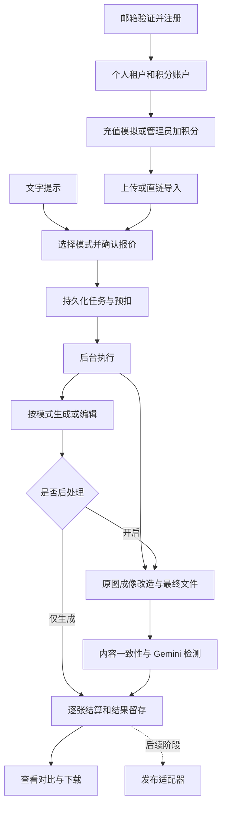
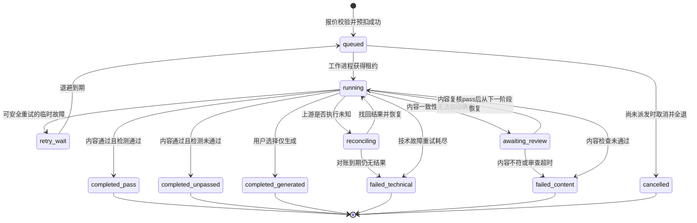
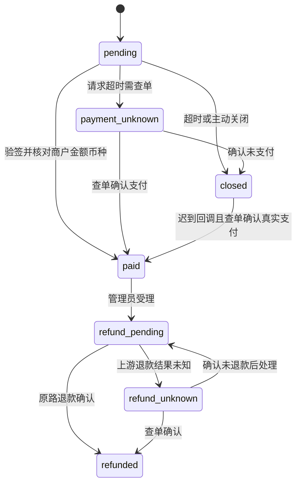
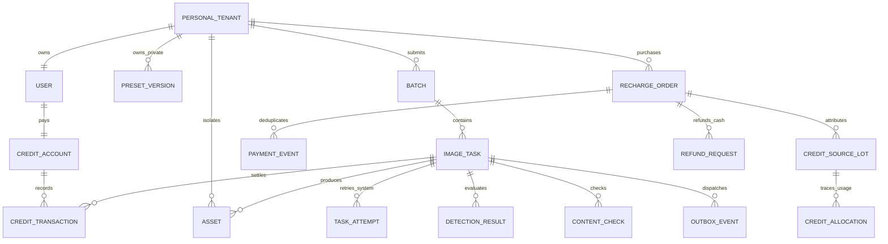
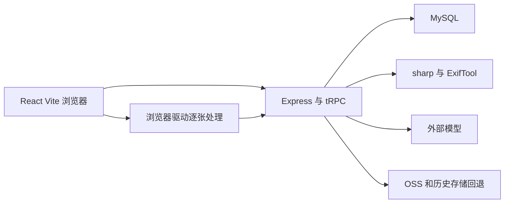
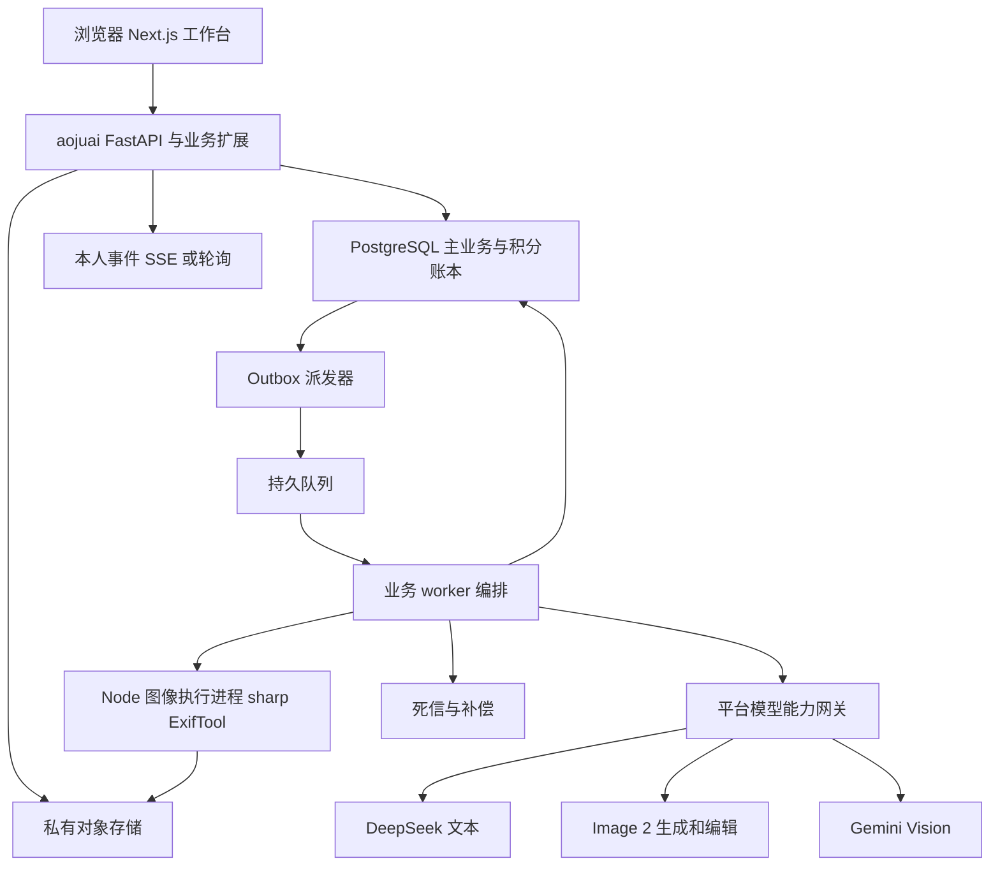
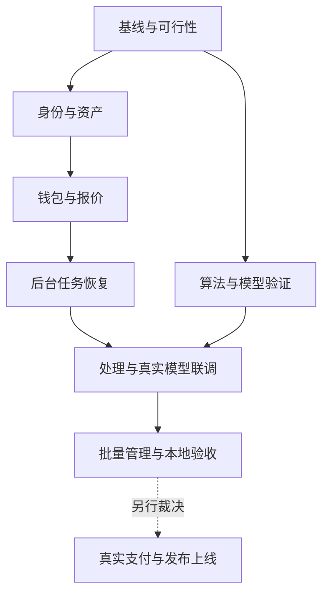

# 蜜獾原图 SaaS PRD v2.0

> **本次交付状态：方案完成。** 本文件没有实施新系统，没有调用收费模型，没有连接支付商户、生产数据库或发布目标。开发、测试通过、部署和业务验收状态均未取得。
>
> **产品目标**：个人用户通过网页上传或导入图片，使用真实设备参数预设完成图片成像改造，获得 Gemini Vision 在固定检测标准下的评分与判定；通过充值积分使用服务，并在后续接入下载 API、上传发布接口。
>
> **当前阶段终点**：本地可运行的完整主流程。开发使用模拟外部服务，最终用少量真实模型调用验收；支付使用本地模拟或具备条件后的官方沙箱。首期不真实发布到外部地址。

## 0. 文档说明与证据基线

### 0.1 用法与阅读顺序

| 读者 | 优先阅读 | 用途 |
|---|---|---|
| 项目负责人 | §0、§1、§18—20、§25—30 | 审核范围、阶段投入和未决条件 |
| 接手开发者 | §4、§8—14、§20—21 | 按契约开发并提交验收证据 |
| 独立复查者 | §0.4、§9—12、§21—22 | 检查隔离、积分和失败恢复 |
| 后续运营与部署人员 | §16—17、§23—26 | 准备商户、数据保留与商业上线 |

本文同时包含 PRD 与实施分析，保留原始模板的 0—31 章。WBS同源导出为本目录的 `蜜獾原图-SaaS-任务清单-v2.0.csv`；模块缺陷要求见§8.1，任务与放行见§19—20，回归见§21.2，统一台账见附录D。不生成 HTML，不覆盖根目录的旧版 PRD，也不修改两份指定现状材料。

### 0.2 来源与适用范围

| 来源 ID | 输入 | 本次读取范围 | 作用 |
|---|---|---|---|
| S-01 | 《蜜獾原图技术原理.md》 | 全文 | 旧流水线、算法模块、队列和存储现状 |
| S-02 | 《蜜獾原图AI模型与Key核验.md》 | 全文 | 2026-10-20 核验记录、Key 用途与协议缺口 |
| S-03 | `server/exifVerifier.ts` | 类型、提示词、解析与调用相关片段 | 纠正文档分级与通过门槛的冲突 |
| S-04 | 最初粘贴的文档要求 | 全文 | 文档结构、编号、可追溯与可测试要求；旧业务范围被本会话决策替代 |
| S-10 | aojuai 固定提交 README、文档地图、backend README、API_ROUTES | 全文 | 底座范围、技术栈、入口；路由文档不视为完整能力清单 |
| S-11 | aojuai 公开版稳定基线、助手底座边界 | 全文 | 底座与下游业务分工 |
| S-12 | aojuai `domain/credits/models.py`、`billing.py` | 相关类型、精度与计费片段 | 账户、流水、定价、两位小数积分 |
| S-13 | aojuai `domain/credits/settlement.py` | 预扣、完成、全退片段 | 复用预扣和补偿；终态须由业务事务仲裁 |
| S-14 | aojuai `domain/credits/service.py` | 账户锁、充值、扣费、退款片段 | 并发控制和充值幂等扩展点 |
| S-15 | aojuai `api/v1/endpoints/auth.py` | 注册相关片段 | 原注册加入既有租户，不是个人租户自动开户 |
| S-16 | aojuai `domain/auth/api_key_models.py` | 全文 | 区分调用本系统的机器凭证与上游模型 Key |
| S-17 | aojuai LICENSE | 许可证识别与网络使用条款 | AGPL-3.0 授权风险 |
| S-18 | OpenAI GPT Image 2 官方模型页 | 型号、快照、输入输出与端点说明 | 核实 `gpt-image-2`，不擅自替换型号 |
| S-19 | OpenAI 图像生成官方指南 | Image API、编辑输入和图像响应相关段落 | 接口分工与 base64 图像响应 |
| S-20 | 《蜜獾原图issues分析.md》 | 缺陷/Issue #17—41、风险和2026-10-17历史实测 | 缺陷覆盖与验证边界，不把旧路线图当新需求 |
| S-21 | 《会话交接摘要.md》 | 历史生产事实及未确认项 | 区分已复现和待验证，不执行其中旧操作指令 |
| S-22 | 当前旧版源码及迁移（HEAD见附录B） | 账户、权限、Key、算法、任务、资产、SQL、前端活跃链路 | 附录D逐项路径行号；只读静态核对 |

本轮按新增缺陷处置要求，必要补读S-20/21既有缺陷记录并定向核对S-22真实源码；它们用于缺陷证据，不扩展已确认产品范围。未读取生产凭据或配置值，未做全仓、全量aojuai或许可证法律审计。2026-10-17/20的生产记录只表示当时结果，本轮没有生产复测、模型外呼或代码修复。

### 0.3 标签、优先级与六态

证据等级：`已确认事实`＝用户明确决定或本次直接核对；`合理推测`＝有依据但未实测；`[ASSUMPTION] A-NN`＝实施建议；`无法确认`＝缺必要输入。

实现状态：`EXISTING`＝旧项目或底座已有相关代码，**不等于新系统可用**；`GAP_APPROVED`＝需求已经确认，需新增或迁入；`CONFLICT_BLOCKED`＝违反明确边界；`NEW_DECISION_REQUIRED`＝条件未定，禁止先接真实写操作。FR 表描述新系统目标；现有代码单独列在 §0.5，避免混合状态。

P0＝阻断本地验收；P1＝首期完整体验；P2＝后续阶段。进展必须区分方案完成、代码完成、测试通过、已部署、授权完成、业务验收完成。本文只达到方案完成；所有新功能运行结果为 **[未经本地验证]：本次仅编写文档**。

### 0.4 已确认决策登记

| 决策 ID | 最终口径 | 对应确认 |
|---|---|---|
| D-01 | aojuai 为主底座，将图片处理能力迁入 | 方案 A |
| D-02 | 个人用户是租户主体，数据与积分独立 | 个人用户 |
| D-03 | 平台统一保管、配置和调用模型 Key | 平台统一配置，用户积分调用 |
| D-04 | DeepSeek 只承担文本任务 | 提示词优化等文本用途 |
| D-05 | ChatGPT Image 2 同时支持文生图、图生图 | 两种都需要 |
| D-06 | 按完整实际流程描述，不再强行称“五层” | 选择完整流程口径 |
| D-07 | 长期发布方向为用户自定义 HTTP 上传 API | 不内置指定社交平台发布 |
| D-08 | 首期发布只预留契约，具体适配后续定制 | 后续对接方式选择 3，覆盖此前笼统配置描述 |
| D-09 | 在线充值＋管理员人工补发或调整 | 两种均支持 |
| D-10 | 支付面向中国大陆，微信支付＋支付宝 | 暂无商户账号 |
| D-11 | 按处理能力定价，并支持用户或套餐差异价 | 管理员维护价格；不等于订阅制 |
| D-12 | 首期仅本地上传、图片直链导入 | 暂无明确下载 API 服务商，下载适配后续做 |
| D-13 | 检测沿用原版提示词和维度 | 对标准的首次选择为 1 |
| D-14 | **最终通过门槛为 score ≥75 且 passed=true** | 核对源码后明确选择 1，替代此前误用 70 分门槛 |
| D-15 | 检测未通过由用户决定是否重新处理 | 不自动为过分数持续改图 |
| D-16 | 检测未通过正常扣费，用户手动重试重新计费 | 已执行处理收费 |
| D-17 | 技术故障导致最终失败，该图片任务全额退积分 | 不是只退失败环节 |
| D-18 | 旧数据暂只迁设备参数预设 | 用户标为“暂定”；不直接执行迁移 |
| D-19 | 默认一键处理，同时有高级配置 | 高级入口不向用户开放平台 Key |
| D-20 | 邮箱验证注册，用户名或邮箱＋密码登录 | 不以短信注册作为首期条件 |
| D-21 | 首期只提供网页；后端任务持久化、独立执行、可恢复 | 不开放用户程序调用的处理 API |
| D-22 | 实际业务量暂未知 | 不虚构每天 1 万张的容量依据 |
| D-23 | 原图与处理结果保存 7 天 | 不把积分与图片保留期绑定 |
| D-24 | 本人＋Codex 完成开发 | 未确认额外开发、测试人员 |
| D-25 | 积分永久有效 | 无积分定时过期任务 |
| D-26 | 单张＋批量；每张独立进度、检测和扣费 | 批次不做全成全败 |
| D-27 | 文生图可选后续处理，默认完整处理＋检测 | 只生成模式须明确展示不含检测 |
| D-28 | 平台公共预设＋用户私有预设 | 不做用户公开分享 |
| D-29 | 严格保留主体、文字、图案与构图，只调成像效果 | 不默认沿用裁切、旋转改变构图 |
| D-30 | 内容一致性不满足，任务失败并全额退积分 | 与检测分数未通过有不同结算 |
| D-31 | 本地验收；开发模拟，最终少量真实模型调用；无硬截止 | 支付先模拟/沙箱；网页无退款入口，管理员人工受理 |

开发模型要求另记：以用户后发的 AGENTS.md 为当前基线，主会话目标 `GPT-6.1-SOL / xhigh`；所有新子会话使用 `gpt-6-luna / xhigh / fork_turns="none"`，仅当网关明确限制时回退 `high`。这取代最初“最新 DeepSeek V4.1 Flash”的子会话要求，且属于**开发工具配置**，与 SaaS 面向用户调用的 DeepSeek 文本模型分开。本次已按该参数启动独立文档复查子会话；未修改 Codex 配置，未据此宣称业务功能已经实现。

### 0.5 现有能力与差距

| 能力 | 状态与证据 | 新系统处理 |
|---|---|---|
| 像素成像、频域、指纹、编码、体积优化 | EXISTING；S-01 §2—10，代码实现程度不同 | 作为候选模块迁入，不把旧接口和安全缺陷整体搬入 |
| MakerNote | 活跃写入链路未消费；S-01 §7.3 | 有效模板必须写入并回读；不支持就拒绝选择 |
| 色差、APEX、EXIF 错误 | 桩实现、规范风险、静默吞错；S-01 §4.4、§7.5—7.7 | 单独技术验证与修复，不拿旧测试绿色作为证据 |
| 后台任务 | 旧项目没有服务端 worker；S-01 §13 | 新增持久任务、工作进程、恢复与死信 |
| 身份与多租户 | aojuai EXISTING；S-10、S-15 | 扩展个人租户自助开户，不默认注册到同一个租户 |
| 积分账本与并发锁 | aojuai EXISTING；S-12—14 | 复用 Decimal、数据库锁、流水和幂等扣退，不另建竞争账本 |
| 预扣、完成、失败全退 | aojuai EXISTING；S-13 | 按每张任务调用，补业务终态锁与价格快照 |
| 微信/支付宝充值闭环 | 这次证据未确认现成可复用实现 | 明确作为新增集成；本地仅验模拟合同 |
| 上游模型配置 | 旧项目有用途隔离，但现有配置不能视为新系统可用；S-02 | 新建平台凭据池与能力注册，管理员重新配置 |
| aojuai `api_keys` | EXISTING，存本系统机器凭证哈希；S-16 | **不是**上游模型 Key 表，不能混用或覆盖 |
| 发布与下载适配 | 旧矩阵链路不满足新范围；S-01 §17、D-08/12 | 首期契约测试，外部写默认关闭 |

### 0.6 冲突纠正

| 编号 | 冲突或过度结论 | 本文处理 |
|---|---|---|
| C-01 | 旧模板“不做 SaaS、自助注册”与新目标冲突 | D-01/02/20/31 已明确替代，旧范围不再冻结新版 |
| C-02 | “五层”同时列出 0—6 | 按 D-06 采用实际阶段名，保留模块对应关系 |
| C-03 | 文档 70 分分级与源码 75＋passed 门槛不同 | D-14 已裁决。70 分不是通过；不展示“合格却未通过”的混淆标签 |
| C-04 | 图片编码“模拟平台上传”与实际发布混同 | 前者是本地算法，后者是网络写操作，完全分开验收 |
| C-05 | S-02 用单次 404 推导“模型全局失效/只能换端点” | 只能证明当时该 Key、模型 ID、端点组合失败；不得泛化为厂商所有模型都不能用 |
| C-06 | S-02 推断 Gemini 生图必须使用 predict | 此结论不是本次实测事实。按具体型号能力适配，不能由 404 排除所有 generateContent 图像能力 |
| C-07 | 脱敏前后缀相同就判断两把 Key 相同 | 只作为待查线索，不据此自动删除或合并 |
| C-08 | “真实设备参数”被理解成物理拍摄证明 | 预设要有来源和验证记录；模拟设备效果不证明图片确由该设备拍摄 |
| C-09 | 原有几何扰动会裁切、旋转，与严格保留构图冲突 | 默认禁用改变构图的几何子步骤；不能为检测分数牺牲 D-29 |

## 1. 产品愿景与定位

面向需要图片生产与成像改造的个人用户，提供一个无需管理模型 Key、可按积分使用的网页工作台。平台以 aojuai 为身份和管理底座，承接上传、直链导入、AI 生成或编辑、设备预设处理、检测、下载与后续发布。

核心命题：一键入口减少参数配置；保留原图关键信息；后台持续处理；每张结果和费用可查；按固定 Gemini Vision 条件验证“看起来像物理实拍”的产品目标。

Gemini Vision 的输出是模型评价，不是来源鉴定或任何外部平台的验收承诺。产品目标须通过真实样本验证，本文没有提供“必然通过所有图片、所有平台或未来所有模型”的保证。

Why now：旧技术已有可复用模块，但队列、Key 能力测试和租户隔离存在缺口；直接在旧架构叠加收费会放大失败和资金风险。先做小规模本地闭环，再决定商业上线。

## 2. 用户、干系人与职责

| 角色 | 需要完成的工作 | 价值时刻 | 非目标 |
|---|---|---|---|
| 个人用户 | 注册、获得积分、上传/导入、选择模式、查询、下载 | 关网页后再回来仍能看到真实结果和费用 | 不管理模型 Key、租户成员或团队共享钱包 |
| 平台管理员 | 管模型、价格、公共预设、用户、人工积分和异常 | 找到失败原因，完成可追溯补偿 | 不能无审计改余额或伪造成功 |
| 项目负责人 | 冻结范围、验收内容与真实调用预算 | 看到本地完整流程和原始检测证据 | 不被要求替开发者决定未经解释的框架细节 |
| 开发与复查角色 | 按契约实现、独立检查、串行验证 | 缺陷有可复现证据 | 同一会话自报通过不能替代用户验收 |

| 工作 | 负责人 A | 执行 R | 复核 C | 知情 I |
|---|---|---|---|---|
| 范围、价格、样本内容标准 | 项目负责人 | 项目负责人 | Codex 主会话 | 开发会话 |
| 开发、返修 | 项目负责人 | 可用且经确认的开发会话 | 主会话或独立复查角色 | 项目负责人 |
| 账本、安全与故障恢复复核 | 项目负责人 | 独立复查角色 | 主会话 | 实现者 |
| 少量真实调用、本地验收 | 项目负责人 | 主会话协助执行 | 独立复查角色 | 实现者 |
| 商户、授权和生产放行 | 项目负责人 | 管理员 | 支付/法律专业人员 | 开发角色 |

暂无独立人工测试人员。M1—M3 的独立复查由未参与该项实现的主会话承担，必要时派发另一个只读复查子会话；不是额外招聘角色。T-08/13/20 分别包含这些阶段的复核证据和放行记录，其投入已含在各任务区间内。T-34 是最终跨模块独立复查，不能替代前面的阶段门槛。复查与实现会话分离，自动测试串行执行；本地业务验收由本人完成。不能假设 AI 并发数量等于可投入的人数。

## 3. 术语与编号

| 术语 | 唯一定义 |
|---|---|
| 个人租户 | 一个个人账号对应一个独立业务空间，首期只有该用户，无团队成员 |
| 平台域 | 由平台管理员管理的模型凭据、公共预设和默认价格所在的受控空间 |
| 积分 | 服务使用记账单位，精度 0.01，永久有效；不是人民币现金 |
| 预扣 | 提交时先扣除该任务的费用上限，终态退差额或全退；界面单列在途金额 |
| 图片任务 | 一张输出图片的一次执行与计费单元；用户重试产生新任务 |
| 批次 | 多个图片任务的集合，不是一个统一收费或统一失败单元 |
| 设备预设 | 相机/手机与镜头、曝光、成像及元数据参数的可版本化配置 |
| 内容一致性 | 主体、文字、图案与构图得到保留；不要求处理前后字节相同 |
| 检测通过 | 正常取得并校验检测结果，score≥75 且 passed 为布尔 true |
| 检测未通过 | 正常取得结果但不满足通过条件，任务完成并计费 |
| 技术失败 | 网络、模型、编码、存储或数据格式问题导致无法完成合同，整张全退 |
| 内容失败 | 内容一致性不符合要求，整张全退；不能当成低分正常收费 |
| 幂等 | 重发相同请求仍只有一次业务效果，例如重复回调不重复充积分 |
| Outbox | 与任务同事务落库的待派发记录，避免数据库已建任务但队列未收到 |
| 租约与栅栏版本 | 工作进程限时领取任务，版本阻止失联旧进程回来覆盖新结果 |
| DLQ 死信 | 重试耗尽的持久异常清单，可查看、处理，任务不能静默消失 |
| 模型 Key | 平台调用上游供应商的可恢复解密凭据；不等于 aojuai 机器访问 Key |

编号：D 决策、S 来源、FR 功能、NFR 非功能、UJ 旅程、US 故事、AC 验收、SM 状态机、T 任务、RK 风险、ND 待决、RP 拒绝路径、A 假设。编号在各前缀内唯一，不复用废弃编号。

## 4. 业务全景与状态

### 4.1 端到端价值链

图示中实际顺序以后台工作流为准：上传先形成受控资产；创建任务后才发生收费模型生成。文生图不是在前端先同步生成后再假入队。仅生成模式跳过成像改造与真实性检测，但仍验输出文件有效性和提示词硬性内容要求。

### 4.2 图片任务 SM-01

完成/失败写状态、结算、审计、通知 outbox 同一数据库事务。检测服务不可用不能写 `score=0` 伪装成正常低分。终态不倒退为 queued；用户重试新建 task_id 并记录 parent_task_id。迟到上游结果不能推翻已退款终态。

在途取消仅保证 queued 状态可取消；running 首期不提供“必然终止上游”的按钮。内容复核为实施建议 A-04，解决自动方法不能保证所有文字图案不变的问题；复核等待不占工作进程，保留期与超时规则见 §10。

复核默认由图片所有者操作；管理员只有受审计的排障权限。页面并排展示基线与最终文件、文字差异/图案和构图检查证据。复核只接受 `pass`（确认未发现内容变化）或 `fail`（内容不符），并保存操作者、理由、时间、两个文件摘要与 expected_version。已由明确证据判为不符的任务直接失败，不能通过用户点击“接受修改”豁免 D-29/30。`pass` 仅恢复到内容检查后的下一阶段，不重新生成、不重复收费；`fail` 或等待满24小时均终态失败并全退一次。复核时任一必要文件已过期/缺失也失败全退，不延长7天保留期。

### 4.3 充值订单 SM-02

支付成功页面不是到账依据。有效迟到支付必须到账或进入可查退款流程，不能静默丢钱。退款期间锁定对应未消耗积分，不允许先消费再重复退款。本地仅模拟上述合同；无商户时不声称已完成真实验签或原路退款。

现金退款另有 `RefundRequest` 子对象跟踪审批和上游结果，不能只靠订单上的 refunded 标签推断退款金额。明确失败的退款请求释放冻结并返回可受理状态；结果未知保持冻结并查单。部分退款与赠送积分处理的正式政策待 ND-02，不在当前模拟合同中冒充已裁决；订单 paid/refunded 的汇总含义随该政策在真实支付实施前补全。真实退款放行前还必须完成 §16 的积分来源归属和消费分摊验证。

### 4.4 图片资产 SM-03 与批次 SM-04

资产：`uploading → available → expired/deleted → purge_pending → purged`；非法文件从 uploading 转 rejected。任务引用 available 资产；过期后禁止新下载与新任务，但任务、扣费和最小审计记录仍可查看。

批次汇总由子任务计算：`queued/running → completed/partial_failed/failed`，并保留待人工复核数。不得用批次 completed 代替逐张通过，也不得因一张失败退回其他已完成任务费用。

## 5. 信息架构与页面目录

| 页面 ID | 页面与主要动作 | FR 映射 | 空、错、无权限状态 |
|---|---|---|---|
| PG-01 | 注册、邮箱验证 | FR-01/02 | 邮箱错误、验证码失效、重复注册 |
| PG-02 | 登录、找回密码 | FR-03/04 | 通用凭据错误、限流、邮件不可用 |
| PG-03 | 用户工作台、余额与在途任务 | FR-05/22/35 | 零余额、无任务、后台不可达 |
| PG-04 | 图片导入、默认与高级处理配置 | FR-06—10/16/36 | 超限、无可用模型、预设失效 |
| PG-05 | 文生图和图生图 | FR-11—13 | 禁用能力、提示词校验错误 |
| PG-06 | 批次与任务列表 | FR-22—26 | 部分失败、等待复核、网络中断 |
| PG-07 | 单图详情、对比、检测、费用、下载 | FR-17—21/27 | 低分、技术失败、过期、非本人 |
| PG-08 | 我的预设、复制公共预设 | FR-09/10 | 公共只读、私有无权限、版本过期 |
| PG-09 | 积分充值、账单、订单 | FR-28—35 | 支付模拟标识、余额不足、结果未知 |
| PG-10 | 个人资料与安全 | FR-04/05 | 邮箱重新验证、会话过期 |
| PG-11 | 管理员用户与人工积分 | FR-30/39 | 越权拒绝、并发冲突、审计必填 |
| PG-12 | 模型、协议、Key 和能力测试 | FR-14/15/38 | 只显示掩码、未验证、额度耗尽 |
| PG-13 | 公共设备库与迁移预览 | FR-09/37 | 缺来源、模板不支持、迁移待确认 |
| PG-14 | 定价、充值档位、用户覆盖价 | FR-28/29/36 | 无生效价格、重复版本、非法负数 |
| PG-15 | 后台任务、重试、死信与健康 | FR-23—25/40 | 消费者离线、补偿失败、未知结果 |
| PG-16 | 留存、审计与环境设置 | FR-27/39—42 | 清理延迟、敏感配置无权限 |

沿用 aojuai 的菜单、通用管理组件和权限能力。用户导航只露业务入口；底座团队、语音、飞书、助手通用聊天入口不是本期产品页面。响应式桌面网页为首期设计基线 A-01，不新增 App、小程序或 HTML 原型交付。

## 6. 关键用户旅程

| 旅程 | 主角、入口状态 | 路径与价值时刻 | 结束与边缘情况 |
|---|---|---|---|
| UJ-01 | 小林，新用户无余额 | 验证邮箱注册→独立空间→本地充值模拟→上传→确认报价→关网页→回来查看 | 图片内容保留且检测通过，下载并看到逐项费用；余额不足不入队、不调用模型 |
| UJ-02 | 小林，有 8 张图片 | 批量导入→默认处理→查看逐张进度 | 5 张通过、1 张检测未通过、2 张技术失败：前 6 张收费，后 2 张全退；不是全批退款 |
| UJ-03 | 阿敏，需要从文字生成图片 | 输入提示词→可用 DeepSeek 优化文本→确认文生图与默认后处理报价 | 生成源图成为内容保留基线；仅生成模式不显示“已检测通过” |
| UJ-04 | 阿敏，想修改现有图片成像 | 原图＋预设→明确选择图生图→高级约束→后台编辑与处理 | 文字/图案改变则失败全退；不能通过更换提示词抹去失败记录 |
| UJ-05 | 老周，平台管理员 | 看到 provider 错误与死信→停用坏 Key→修复配置→核对补偿 | 原任务退款一次；用户重试独立报价；不手改账本原流水 |
| UJ-06 | 小林，7 天后返回 | 打开旧任务详情 | 看得到历史评分和费用，图片显示过期；不能产生失效下载链接或重新存活旧文件 |

## 7. 用户故事与验收标准

| 故事 | 状态/优先级 | 用户故事 | 验收标准 |
|---|---|---|---|
| US-01 | GAP_APPROVED/P0 | 用户验证邮箱后拥有独立空间 | AC-01：两个新用户注册后 tenant_id 不同，互查资产、任务、预设、订单均拒绝 |
| US-02 | GAP_APPROVED/P0 | 用户不用配置模型 Key 也能处理 | AC-02：用户端无 Key 明文，网络响应和错误日志不含明文凭据 |
| US-03 | GAP_APPROVED/P0 | 用户关网页后任务仍继续 | AC-03：提交后关闭浏览器、重启 worker，任务最终有结果且只结算一次 |
| US-04 | GAP_APPROVED/P0 | 用户了解低分和失败的费用区别 | AC-04：75＋true 正常通过；74＋true 和 90＋false 未通过但收费；超时/非法 JSON 全退 |
| US-05 | GAP_APPROVED/P0 | 用户的文字图案不被改坏 | AC-05：测试集文字一致、图案和构图人工复核；发现变化为内容失败并全退 |
| US-06 | GAP_APPROVED/P0 | 用户不因网络重发重复扣钱 | AC-06：相同提交/回调重放 10 次，只有一个订单入账、一个任务预扣和一次最终结算 |
| US-07 | GAP_APPROVED/P1 | 用户批量操作并单独重试 | AC-07：批次有不同结果，逐张汇总和净扣一致；手动重试产生新 ID 和报价 |
| US-08 | GAP_APPROVED/P1 | 用户能分别使用两种 Image 2 能力 | AC-08：真实文生图与图生图各至少一例；图生图请求确实带图片，不只是提示词 URL |
| US-09 | GAP_APPROVED/P1 | 管理员能按用户配置价格 | AC-09：修改价格不影响在途任务；新任务明确显示新版本与费用 |
| US-10 | GAP_APPROVED/P0 | 管理员能恢复故障并核对账本 | AC-10：数据库与 worker 故障注入后无负余额、无重复退款、无永久失联任务 |
| US-11 | GAP_APPROVED/P1 | 用户明确知道图片保留期限 | AC-11：到期拒绝下载并在清理窗口删除原图、结果、缩略图和临时副本 |
| US-12 | GAP_APPROVED/P1 | 用户知道本地模拟与真实调用区别 | AC-12：模拟环境有标识；真实验收任务有 provider/model/request_id 和实际输出证据 |

横切验收补充：AC-13（FR-46/47）验证普通用户不能创建图片业务机器 Key、用 machine auth 调图片业务、添加租户成员、共享钱包或公开私有预设；网页无入口且底座相关接口也拒绝越界。AC-14（FR-48）验证正常低分不自动生成新收费任务，技术/内容失败不能被改成低分结算，重复失败通知只全退一次。AC-15（FR-18）覆盖人工复核 pass/fail/timeout、已确认差异不可豁免、重复/过期版本提交及恢复不重新生成。

## 8. 功能需求

各行“来源”同时是批准依据或实施推导依据；纯技术建议标注 A-NN。所有 FR 均至少含一项可测后果。未列出的企业团队、订阅制和外部平台适配不得以“底座现成”为由自动开放。

| FR | 状态/优先级 | 页面 | 要求与可测后果 | 来源或拒绝路径 |
|---|---|---|---|---|
| FR-01 | GAP_APPROVED/P0 | PG-01 | 验证邮箱后注册；验证码一次性、过期、限尝试；未验证不创建可使用的账号 | D-20；A-02 |
| FR-02 | GAP_APPROVED/P0 | PG-01 | 注册事务创建个人租户、普通用户角色、唯一钱包；重复请求不重复开户 | D-02/20；S-15 |
| FR-03 | GAP_APPROVED/P0 | PG-02 | 用户名或邮箱＋密码登录，不要求用户选租户代码；错误统一且限流 | D-20 |
| FR-04 | GAP_APPROVED/P1 | PG-02/10 | 找回/修改密码；邮件不包含原密码，重置后吊销旧会话 | D-20；S-01 §14—15；A-02 |
| FR-05 | GAP_APPROVED/P0 | PG-03/10 | 服务端解析身份与 tenant_id，用户不能改前端 tenant_id 访问他人数据 | D-02；AC-01 |
| FR-06 | GAP_APPROVED/P0 | PG-04 | 本地上传校验真实文件、大小和解码像素；不合格文件拒绝，不收费 | D-12；A-03 |
| FR-07 | GAP_APPROVED/P0 | PG-04 | 图片直链由后台安全下载；限制协议、重定向、内网地址、字节和超时 | D-12；NFR-04 |
| FR-08 | GAP_APPROVED/P1 | PG-04/06 | 单张或批量导入；逐张报错误；无效一张不阻断其他合法导入 | D-26；A-03 |
| FR-09 | GAP_APPROVED/P1 | PG-08/13 | 公共设备预设管理员维护、只读给用户；记录来源、版本、兼容性和验证状态 | D-28；S-01 §11 |
| FR-10 | GAP_APPROVED/P1 | PG-08 | 用户复制或创建私有预设；更新只形成新版本，不改在途任务快照 | D-28 |
| FR-11 | GAP_APPROVED/P1 | PG-05 | Image 2 文生图，生成数量拆为逐张任务；可选后处理且默认开启 | D-05/26/27；S-18 |
| FR-12 | GAP_APPROVED/P1 | PG-05 | Image 2 图生图真实提交图像输入，强约束主体、文字、图案与构图 | D-05/29；S-02 §5；S-18/19 |
| FR-13 | GAP_APPROVED/P1 | PG-05 | DeepSeek 仅文本优化；独立点击优化明确报价，若作为任务内环节则纳入整张退款范围 | D-04/11/17；A-05 |
| FR-14 | GAP_APPROVED/P0 | PG-12 | 平台管理员维护 provider、base_url、model_id、协议、能力和凭据引用；用户不能配置或读取 | D-03；S-02 |
| FR-15 | GAP_APPROVED/P0 | PG-12 | 按用途测试文本、看图、生图、编辑；文本连通不得自动标记视觉可用 | S-02 §3.4；D-03 |
| FR-16 | GAP_APPROVED/P0 | PG-04 | 一键默认配置＋高级入口；提交冻结预设、处理开关、价格和检测版本 | D-19；AC-09 |
| FR-17 | GAP_APPROVED/P0 | PG-07 | 完整处理依次编排选定 AI 编辑、成像、频域/指纹、编码、EXIF、最终质检 | D-06；S-01 §2—10 |
| FR-18 | GAP_APPROVED/P0 | PG-07 | 内容一致性独立于 Gemini 分数；不确定转复核，确认不符为内容失败并全退 | D-29/30；A-04 |
| FR-19 | GAP_APPROVED/P0 | PG-07 | 固定原版五维提示词和元数据上下文；服务端校验结果后以 ≥75 且 true 判通过 | D-13/14；S-03:84—142 |
| FR-20 | GAP_APPROVED/P0 | PG-07 | 未通过仅显示真实结果；不自动改参数再烧积分；允许查看、下载或手动新建重试 | D-15/16；下载为 A-05 |
| FR-21 | GAP_APPROVED/P0 | PG-07 | 技术故障和内容失败全额退本张积分；无有效检测响应不能按低分收费 | D-17/30 |
| FR-22 | GAP_APPROVED/P0 | PG-03/06 | 提交只负责持久化和返回 task_id；不在网页或长 HTTP 请求里执行全链路 | D-21；S-01 §13 |
| FR-23 | GAP_APPROVED/P0 | PG-15 | worker 领取租约、心跳、持久阶段和输入输出；重启后从可安全恢复点恢复 | D-21；A-07 |
| FR-24 | GAP_APPROVED/P0 | PG-15 | 按错误类型有限重试；未知上游结果先查证，耗尽进死信并执行一次补偿 | D-17/21；NFR-08 |
| FR-25 | GAP_APPROVED/P1 | PG-06/15 | 进度从后台状态与真实阶段产生；SSE 只传本人事件，断线可轮询恢复 | D-21/26；S-01 §2.3 |
| FR-26 | GAP_APPROVED/P1 | PG-06/07 | queued 可取消并全退；手动重试新建任务、新报价，不覆盖旧检测和费用 | D-15/16；A-05 |
| FR-27 | GAP_APPROVED/P0 | PG-07/16 | 原图和结果保留 7 天；授权下载、到期拒绝、可主动删除、后台物理清理 | D-23；A-08 |
| FR-28 | GAP_APPROVED/P1 | PG-09/14 | 充值档位人民币金额与积分数分别配置、快照冻结；积分永久有效 | D-09/25；金额细值 ND-01 |
| FR-29 | GAP_APPROVED/P1 | PG-09/14 | 本地实现微信/支付宝支付适配契约与可注入模拟；不持商户凭据时不标真实支付可用 | D-10/31；ND-02 |
| FR-30 | GAP_APPROVED/P0 | PG-11 | 管理员加、减、补积分有理由、操作者和幂等键；减到负数拒绝，不能改原流水 | D-09；S-14 |
| FR-31 | GAP_APPROVED/P0 | PG-09 | 订单确认到账后才充值；回调金额、币种、商户、订单、验签均校验，重放只到账一次 | D-09；S-14:789—811；本地只验模拟 |
| FR-32 | GAP_APPROVED/P0 | PG-09/15 | 每张任务先预扣上限；成功/正常低分后结算，未执行能力退差额，禁止超报价追扣 | D-11/16/17/26；S-13；A-05 |
| FR-33 | GAP_APPROVED/P0 | PG-09/15 | 并发结算、失败补偿与迟到响应只允许一个终态赢家，余额和流水同事务 | D-17；S-12—14 |
| FR-34 | GAP_APPROVED/P1 | PG-09/11 | 无用户自助退款入口；管理员人工受理现金退款并记录对应订单、冻结积分与处理结果 | D-31；ND-02；A-05 |
| FR-35 | GAP_APPROVED/P1 | PG-03/09 | 展示可用余额、在途预扣、历史消费、退还和人工调整；与服务端账本一致 | D-09/26；S-12—14 |
| FR-36 | GAP_APPROVED/P1 | PG-04/14 | 平台默认价、套餐价、用户覆盖价有明确优先级与版本；提交前展示每张上限 | D-11；A-05 |
| FR-37 | GAP_APPROVED/P1 | PG-13 | 仅提供设备预设迁移预览/校验/导入；真正导入待 D-18 最终确认，不迁旧账号、Key 与流水 | D-18；ND-03 |
| FR-38 | GAP_APPROVED/P1 | PG-12 | 模型 Key 用途隔离、额度并发预留、熔断恢复、版本轮换；故障不无穷命中同一坏 Key | S-01 §12；S-02 |
| FR-39 | GAP_APPROVED/P0 | PG-11/16 | 敏感管理与资金动作写审计；普通用户不因拥有个人租户而获得平台管理权限 | D-02/03/09 |
| FR-40 | GAP_APPROVED/P1 | PG-15 | 监控消费者心跳、积压、退款失败、存储清理；空数据显示空态，禁止示例数字冒充真实 | S-01 §18—19；D-21 |
| FR-41 | GAP_APPROVED/P0 | PG-16 | 模拟与真实 provider 明确隔离，真实调用总预算与次数可限制；无 Key 仍可启动模拟环境 | D-31；S-11 |
| FR-42 | GAP_APPROVED/P1 | PG-16 | 本地初始化、启动、健康、备份恢复步骤可复现；数据库迁移按增量执行 | D-24/31；S-10/11 |
| FR-43 | GAP_APPROVED/P2 | 无首期用户页 | 定义下载适配器和发布适配器；本地伪服务验证输入输出，不发生真实投递 | D-08/12 |
| FR-44 | NEW_DECISION_REQUIRED/P2 | 后续页面待定 | 真实第三方图片下载 API 对接，服务商与费用未定；不得自动调用第三方付费下载 | ND-06；RP-01 |
| FR-45 | NEW_DECISION_REQUIRED/P2 | 后续页面待定 | 真实 HTTP 上传/发布，鉴权、字段、回调、验签、限额与目标尚未确认 | ND-07；RP-02 |
| FR-46 | CONFLICT_BLOCKED/P0 | 无 | 首期禁止向普通用户开放处理机器 Key 与公共开发者 API | D-21；RP-03 |
| FR-47 | CONFLICT_BLOCKED/P0 | 无 | 首期禁止团队成员、共享钱包和用户公开预设分享 | D-02/28；RP-04 |
| FR-48 | CONFLICT_BLOCKED/P0 | 无 | 低分不能自动收费重跑，不能绕过内容失败或技术失败退款 | D-15—17/30；RP-05 |

### 8.1 旧版问题纳入模块实现

缺陷证据保留在附录D；下表是对应模块的实现要求，估时只计§20任务。RG为§21.2的回归编号。

| 模块/FR | 缺陷与处置 | 开发任务 | 新实现必须满足 | 回归 |
|---|---|---|---|---|
| 身份权限 FR-01—05/39/46 | LD-01—05/07/08/27/37/43替换；LD-06下线 | T-06—08/20/42 | 本人资料白名单、会话吊销、安全验证码；个人开户原子化；身份解析租户，拒绝匿名、跨租户及普通机器Key；站内安全回跳 | RG-01/02/10 |
| 模型与Key FR-11—15/38/41 | LD-09—12/20/41替换 | T-24—27 | 上游Key密文存储，额度原子预留、熔断与轮换；用途/协议分开验证，编辑真实带图；调用记录来自冻结配置 | RG-03 |
| 成像与EXIF FR-09/10/16/17 | LD-13—17/39修复或先验证；LD-18下线；LD-40比例专项延期 | T-10/21/22/28/42 | 修MakerNote消费、色差输出、参数映射和吞错；APEX/工具兼容按最终文件判断；几何步骤不可启用；超比例原因持久化 | RG-04/10 |
| 内容与检测 FR-18—21/48 | LD-15修复；LD-19替换 | T-13/16/23/27 | 必须阶段失败不能回退为成功；内容不符全退；检测≥75且true；无有效响应按技术失败，不伪装低分 | RG-05/07 |
| 后台任务 FR-22—26/40 | LD-23—25/30/46替换 | T-16—20/28/29 | 持久任务和worker替代网页调度；未知外呼先查证；幂等、租约、死信和一次补偿；本人事件及真实状态计数 | RG-02/06 |
| 积分充值 FR-28—36 | LD-26/28/29替换 | T-11—15/30 | 复用同一aojuai账本，补订单幂等与图片终态仲裁；不迁旧quota、不直接把管理员加分原语接回调 | RG-07 |
| 资产下载 FR-06—08/27 | LD-21/22替换；LD-38修复 | T-09/28/29/31 | 私有全副本清单、不可变原件、7天授权；ZIP按实际成功项报告；临时缩略图及异常残留回收 | RG-08 |
| 数据运营 FR-35/37/39/40/42 | LD-31—33/42替换 | T-05/30/32/37 | 增量迁移、业务唯一约束、真实统计及必要审计；不迁旧SQL、假数据或吞错广播 | RG-09 |
| 下线与待办 FR-43/46/47 | LD-06/18/34下线；LD-35/36/40/45延期；LD-44走E0 | T-42；E0-01/02；B-01—04 | 核新制品全部入口/接口/任务/依赖；旧站独立评估；延期功能保持禁用，不补做范围外功能 | RG-10/11 |

## 9. 权限与敏感数据

| 动作 | 未登录 | 个人用户 | 平台管理员 | 后台服务身份 |
|---|---|---|---|---|
| 注册/验证/登录/找回 | 允许并限流 | 按账号状态 | 按账号状态 | 无需 |
| 图片、任务、检测、下载、账单 | 拒绝 | 仅本人个人租户 | 工单授权后受审计查看 | 携带任务租户与最小权限 |
| 私有预设 CRUD | 拒绝 | 仅本人 | 排错受审计 | 仅读取该任务冻结快照 |
| 公共预设修改、平台定价 | 拒绝 | 拒绝 | 允许并版本化 | 只读已生效快照 |
| 模型 Key/协议/额度维护 | 拒绝 | 拒绝 | 写入/轮换，不能明文回显 | 仅调用时临时解密 |
| 积分调整、人工退款登记 | 拒绝 | 拒绝 | 强制理由、幂等与审计 | 仅执行已批准工作流 |
| 任务重试、queued 取消 | 拒绝 | 仅本人且状态允许 | 不替用户静默创建收费任务 | 系统重试不新增用户报价 |
| 支付回调 | 仅验签专用入口 | 无直接权限 | 无手工伪造权限 | 以商户身份校验，不能信 body 的 tenant_id |
| 清理与补偿 | 拒绝 | 可请求删除本人资产 | 可查异常 | tenant_id 明确、范围受控 |

| 字段 | 用户读取 | 管理员读取 | 存储和日志要求 |
|---|---|---|---|
| 密码 | 永不回显 | 永不回显 | 单向强哈希；hash 也不进入 API |
| 上游模型 Key | 无 | 只掩码与状态 | 可恢复加密＋独立主密钥引用；仅哈希无法用于上游调用 |
| 机器访问 Key | 首期无入口 | 默认禁用业务范围 | 不复用为上游 Key，S-16 的语义保持 |
| 邮箱 | 本人完整 | 最小必要，列表掩码 | 日志脱敏，不作为分析事件明文属性 |
| 直链 URL | 本人任务可见，含签名时掩敏 | 受审计最小查看 | 不记录 query 凭据；导入后只持私有副本 |
| 图片、原始模型响应 | 7 天内本人可见 | 有必要时受审计 | 私有存储；响应删敏，不向公开 URL 暴露 |
| 钱包、订单和流水 | 仅本人 | 授权可查 | 追加更正流水，不覆盖历史 |

底座“租户管理员”不直接授予个人用户。前端隐藏菜单不能代替后端拒绝。平台域的共享 Key/公共价格通过受控 resolver 读取，业务请求始终带经过认证的个人 tenant_id；不能用任意 tenant_id 参数绕过过滤。

## 10. 非功能需求

下列未被用户指定的数值为 **[ASSUMPTION] A-02/03/07/08/09**，用于可实施与可测的起点，不是既有容量事实。

| NFR | 指标/边界 | 验证方式 |
|---|---|---|
| NFR-01 | 租户隔离测试：对资产、任务、预设、SSE、下载、订单、账单逐类验证，越权成功数 0 | A/B 用户交叉读写与任务恢复 |
| NFR-02 | 人民币用整数分 BIGINT，积分用 Decimal/Numeric(18,2)，半入四舍五入到 0.01；禁止二进制浮点计算金额 | 0.10、0.20、小数累计、并发扣退测试 |
| NFR-03 | 同一账户 20 个并发提交不出现负余额或丢失更新；相同幂等键仅一笔业务效果 | PostgreSQL 真库竞争测试 |
| NFR-04 | URL 仅 HTTPS 默认；禁 loopback/private/link-local/metadata/IPv6 内网，DNS 与每次重定向重新校验；最多 3 次跳转 | 受控 SSRF 测试集；本地模拟地址仅专用测试 transport |
| NFR-05 | JPEG/PNG/WebP 静态图；单文件≤20 MiB、解码≤40 MP，批次≤50 张；动画、SVG、HEIC 暂拒绝并说明 | MIME 魔数、解码炸弹、边界样本 |
| NFR-06 | 提交接口本地 20 并发时 p95≤2 秒，不含上传传输和模型执行；超时不等于重复创建 | 固定机器配置记录后的本地压测 |
| NFR-07 | 网页进度轮询间隔 3 秒，SSE 断开后≤10 秒恢复到可见后台状态 | 断网、刷新、关页重开 |
| NFR-08 | 安全可重试外呼最多 3 次总尝试，退避约 1/3 秒并服从 Retry-After；未知执行结果不盲目重发 | 请求超时、429、5xx、迟到结果注入 |
| NFR-09 | 单图本地计算阶段≤120 秒；模型阶段可配超时默认 180 秒；整张执行预算默认 10 分钟，不含人工复核 | 超时可观测，失败全退 |
| NFR-10 | worker 心跳 15 秒、租约 60 秒；失联后≤120 秒进入恢复处理；未知上游结果最长对账 30 分钟 | 杀进程和旧 worker 迟到测试 |
| NFR-11 | 内容复核最多等待 24 小时，超时按内容失败全退；每次状态更新不延长资产 TTL | 时钟推进测试 |
| NFR-12 | 图片与缩略图下载授权 URL≤5 分钟，且不晚于 expires_at；到期即时拒绝访问，24 小时内物理清理 | 时间边界＋存储对象核对 |
| NFR-13 | 原图从导入完成、结果从生成完成分别计算 7×24 小时；临时中间文件完成/失败后 1 小时内清理 | 模拟时钟与全副本清单 |
| NFR-14 | 初始单用户最多 2 个活跃子任务、全站最多 4 个图像执行槽；可配，不能由前端无限增加 | 调度上限与公平性测试 |
| NFR-15 | 日业务量 UNKNOWN，不承诺生产吞吐或 99.9% SLA；本地样本记录耗时、峰值内存与单张成本 | 容量报告留机器配置、样本大小和并发数 |
| NFR-16 | 验证码有效 10 分钟、单地址发送间隔 60 秒、最多 5 次尝试；登录失败 5 次锁定 15 分钟 | 重放、爆破、跨实例重启测试 |
| NFR-17 | 本地支持完整停启和数据库备份恢复；演练 RPO≤24小时、RTO≤60分钟作为本地目标 | 从实际备份恢复到账本一致；非生产承诺 |
| NFR-18 | 日志包含 trace/task/attempt/tenant/provider/model/elapsed，凭据、密码、签名 URL query 明文出现数 0 | 脱敏扫描与故障样例 |
| NFR-19 | 普通操作键盘可达，进度/错误不只靠颜色表示；日期以 Asia/Shanghai 展示，后台存 UTC | 键盘走查与日期边界 |
| NFR-20 | 所有前端请求验证 HTTP 状态与 content-type；API 回 HTML 明确显示状态错误而非假成功 | 502 HTML、401、204、畸形 JSON 样例 |
| NFR-21 | 本地模拟对外访问默认 0；真实模型模式须显式启用能力、预算、有效凭据；单独记录 test_run_id | 不配置 Key 的启动、误连防护 |
| NFR-22 | 财务/必要审计记录不随图片 7 天删除；本地非图片业务记录暂保留 180 天，商业期限上线前依法确认 | A-08；删除检查不删账本，ND-08 |

## 11. 产品数据模型

### 11.1 关系图

图中 PERSONAL_TENANT 是首期产品约束；aojuai 底座仍能表达多用户租户，但当前产品服务层禁止给个人租户添加第二个成员。公共预设和模型凭据归平台域，不属于个人用户可写内容。

### 11.2 核心字典

| 实体 | 必要字段与类型 | 关键约束 | 敏感级别/来源 |
|---|---|---|---|
| Tenant/User | 沿用底座 ID；个人绑定 owner_user_id、tenant_kind VARCHAR、email_verified_at | owner 唯一；规范化邮箱、用户名唯一；用户非 superuser | 身份；S-10/15、D-02/20 |
| CreditAccount | 复用底座，tenant_id/user_id、balance Numeric(18,2)、status | 一人一个账户；数据库锁；非负 | 财务；S-12/14 |
| CreditTransaction | 复用底座，amount/before/after、type、reference、idempotency_key | tenant＋key 唯一；不可改旧金额；不删除历史 | 财务；S-12 |
| RechargeOrder | UUID、tenant_id、user_id、channel、amount_fen BIGINT、points DECIMAL、offer_version、status | 价格来自服务端；订单与 provider_trade_no 唯一 | 财务；D-09/10 |
| PaymentEvent | channel、event_id、order_id、validated_payload_hash、result | provider＋event 唯一；不持支付敏感原文 | 财务；FR-31 |
| CreditSourceLot | tenant_id、account_id、source_tx_id、recharge_order_id可空、source_kind、paid/gift积分、allocation_policy_version | A-05：来源归属侧表，不是第二套钱包；真实退款前必需 | 财务；FR-34、ND-01/02 |
| CreditAllocation | tenant_id、task/adjustment/refund引用、lot_id、reserved/consumed/released积分、source_tx_id | 与底座账本同事务；消费/补偿可追溯回原来源，不能凭当前总余额反推 | 财务；FR-32/34 |
| RefundRequest | tenant_id、order_id、request_id、cash_fen、锁定的来源积分引用、provider_refund_id、status、reason | 独立幂等；现金/积分分别记账；未知结果不解冻或盲重发 | 财务；FR-34、ND-02 |
| Asset | UUID、tenant_id、owner_id、kind、object_key、sha256、mime、bytes、width/height、expires_at、state | object key 含租户＋不可猜随机 ID；无公共裸 URL | 内容；D-23 |
| DevicePreset/PresetVersion | stable_id、version、scope、owner、device/lens/exposure JSON Schema、source_ref、verified_at | 公共可读不可写；私有归属；版本不可变 | 配置；S-01 §11、D-28 |
| Batch | UUID、tenant_id、request_key、created_at | 聚合子任务；不持可被独立篡改的成功数 | 业务；D-26 |
| ImageTask | UUID、tenant_id、user_id、batch_id、parent_task_id、mode、input_asset_id、baseline_asset_id、status、version、stage、reserved_tx_id | 终态 CAS 或行锁；预设/报价/prompt/model 配置快照 | 业务；D-21/26 |
| TaskAttempt | task_id、attempt_no、lease_token、fence_version、heartbeat、provider_request_id、error_class | task＋attempt 唯一；过期租约不能落终态 | 业务；FR-23/24 |
| DetectionResult | task_id、output_sha256、prompt_version/hash、provider/model、model_passed BOOLEAN、score/confidence、5 维评分、effective_pass、conclusion | 数值有限且 0—100；真实与模拟分列；结果绑定最终字节 | 内容；S-03、D-14 |
| ContentCheck | task_id、baseline_sha、output_sha、OCR/几何/主体检查摘要、decision、reviewer、reason | 不以 pHash 相似度单独认定内容正确；内容失败退款唯一键 | 内容；D-29/30 |
| PlatformModelCredential | 平台域 tenant_id、provider、encrypted_secret、key_version、capabilities、quota、status | 独立命名，禁止复用 aojuai api_keys；写入不回显 | 机密；D-03、S-16 |
| PriceVersion | scope、ability、model、unit、unit_price DECIMAL、effective_at、version | 不变快照；用户价覆盖套餐价再覆盖平台价 | 配置；D-11 |
| Outbox/DeadLetter/Audit | event_id、tenant_id、aggregate_id、event_type、payload_ref、attempts、status、operator | 同事务写 outbox；异常有终态；审计不含 Key | 业务/审计；FR-24/39 |

旧 MySQL `user_id varchar` 不直接当成新 PostgreSQL 身份主键。JSON 字段须有版本化 Schema；金额与关键查询字段不用无约束 JSON 代替。状态与类型用 VARCHAR＋应用数据字典，不用物理 ENUM。

### 11.3 ID、金额、时间、幂等

新业务外部 ID 使用 UUID；底座既有 ID 保留，不为统一外观改主键。前端所有可能超安全整数的 ID 用字符串。日期通过 OpenAPI 定义 RFC3339 UTC 字符串，前端按 Asia/Shanghai 格式化。

金额统一人民币分；积分统一两位小数，前端接收十进制字符串。费率计算后按每张任务汇总一次量化，不能逐 token 四舍五入后再累加。每张净消费＝预扣－退差额－全额补偿，不能同时把预扣和结算算作两笔消费。

幂等键范围：注册 `registration_request_id`；提交 `tenant_id+client_request_id+image_index`；模型调用 `task_id+stage+logical_call_id`；预扣 `task_id:reserve`；结算 `task_id:complete`；失败全退 `task_id:refund`；支付 `channel+provider_trade_no`；人工调整 `admin_operation_id`。同 key 不同请求体返回冲突，不悄悄沿用旧金额。

## 12. 接口与集成合同

### 12.1 内部网页 API

以下为目标合同名称，不是声称已经存在的 aojuai 路由。正式路径、Pydantic 类型与 SDK 由 FastAPI OpenAPI 唯一生成；复用底座接口先检查兼容性，不手改生成客户端。

| 动作 | 角色 | 主要输入 | 返回/错误 |
|---|---|---|---|
| 注册发送验证码/完成注册 | 未登录 | 邮箱、用户名、密码、一次性验证码、request_id | user/session；EMAIL_UNVERIFIED、RATE_LIMITED、REQUEST_CONFLICT |
| 登录/找回/重置 | 未登录或本人 | login_identifier、密码或验证凭证 | 安全会话；AUTH_FAILED、RATE_LIMITED |
| 上传/直链导入资产 | 本人 | multipart 图片或 URL | asset_id、过期时间；INVALID_IMAGE、IMPORT_BLOCKED、LIMIT_EXCEEDED |
| 预设列表/私有新版本 | 本人/管理员 | scope、preset_version、typed_fields | 受控预设；NOT_FOUND、PRESET_UNSUPPORTED |
| 报价 | 本人 | 资产/提示词、mode、生成数量、配置 | 每张上限、price_version、quote_id、expires_at；MODEL_UNAVAILABLE |
| 创建批次/任务 | 本人 | quote_id、request_id、输入引用 | batch_id、逐张 task_id；QUOTE_EXPIRED、INSUFFICIENT_CREDITS |
| 任务列表/详情/事件 | 本人 | task_id 或 batch_id、分页游标 | 真实状态、stage、detection、billing；NOT_FOUND |
| 内容复核 | 本人 | task_id、expected_version、decision、reason | 复核版本；STATE_CONFLICT |
| queued 取消/新建重试 | 本人 | task_id、expected_version、新报价 | cancelled 或新 task_id；STATE_CONFLICT |
| 获取下载授权 | 本人 | asset_id | 短期 URL；ASSET_EXPIRED、NOT_FOUND |
| 充值档位/订单 | 本人 | offer_id、channel、request_id | 模式明确的支付信息；PAYMENT_NOT_CONFIGURED |
| 支付回调/查单 | 专用身份 | 原始签名消息或订单 ID | 校验成功才确认；PAYMENT_INVALID、PAYMENT_UNKNOWN |
| 人工积分/退款登记 | 平台管理员 | 用户引用、金额、原因、request_id | 流水或处理记录；FORBIDDEN、STATE_CONFLICT |
| 模型配置/能力测试 | 平台管理员 | credential_ref、model_id、capability | 掩码配置、测试证据；CAPABILITY_UNSUPPORTED |

统一错误包含稳定 code、message、trace_id、retryable，不含上游 Key 或内部 SQL。对他人资源统一 NOT_FOUND；普通用户访问平台管理返回 FORBIDDEN。提交成功表示“已持久入队”，不是图片已经处理成功。

### 12.2 模型协议合同

| 能力 | 首选接入 | 必须做到 | 不接受的假适配 |
|---|---|---|---|
| 文本优化 | DeepSeek 文本模型，精确 ID 配置 | 有文本能力、长度/计费限制，记录所用模型 | 为纯文本任务发送无意义 image_url |
| 文生图 | OpenAI `gpt-image-2` | Image API generations；按目标型号参数；解析图像并入受控资产 | 把聊天模型名当成生图模型、只认返回 URL |
| 图生图 | OpenAI `gpt-image-2` | Image API edits 的真实图片输入；核对输入尺寸/格式与能力 | 只把原图 URL 拼进提示词正文 |
| 真实性检测 | 管理员验证可用的 Gemini Vision 型号 | 最终图片＋冻结原版提示词＋预设上下文，JSON Schema 校验 | 无图文本测试算视觉通过、吞异常返回零分 |

S-18 已确认 `gpt-image-2` 和快照 `gpt-image-2-2026-04-21` 有官方说明，支持文本/图片输入与图像生成/编辑；这不证明本平台账号获授权。保留用户指定型号，不因指南推荐较新型号而擅自替换。实际适配时核对参数和响应合同；`base_url` 规范化保证 `/v1` 只出现一次，支持 `b64_json`。上游镜像或第三方网关如改变协议必须单独注册并测试。

Gemini 的提示词不宣称读取到了原始 EXIF 二进制：当前视觉输入是图片字节和文字描述的预设字段。检测结果与文件 EXIF 回读是两种验证，必须分别保存。

### 12.3 外部服务与通知

| 服务 | 本地开发 | 最终本地验收 | 后续上线条件 |
|---|---|---|---|
| DeepSeek / OpenAI / Gemini | 默认 mock，零外呼 | 少量真实调用，管理员自配 Key 和预算 | 账号权限、额度、地区可达、供应商条款 |
| 邮件 | 本地 Mailpit 等收信器 | 可用本地收信器验证注册；真实邮件另列实测项 | 邮件服务、投递与限流配置 |
| 微信/支付宝 | 本地签名/验签夹具与回调模拟 | 无商户仍可模拟；不能标真实支付通过 | 商户、证书、回调公网地址、查单与退款实测 |
| 存储 | 私有本地对象存储 | 本地持久化与清理恢复 | 后续 OSS/S3 provider 选择与权限 |
| 第三方下载 API | 仅契约桩 | 不调用 | ND-06 |
| 上传/发布 API | 仅契约桩 | 不调用、不生成真实发布成功 | ND-07 |

事件通知：注册验证码发邮箱；任务完成/未通过/失败退款写站内通知；钱包调整通知用户；死信、补偿失败、清理积压通知管理员。默认不为每张进度发送邮件，不向不相关第三方发消息。通知 outbox 可重试但通知失败不能改变资金结算。

### 12.4 后续适配契约

`ImageSourceAdapter` 至少提供能力描述、拉取请求、结果查询、受控文件输出与错误分类；`PublishAdapter` 至少提供 validate、submit、query、verifyCallback 和幂等键支持声明。发布单独对象记录目标、产物版本、外部 ID、最终状态及凭证。

首期仅用本地契约测试替身验证合同。网页没有“已发布”按钮假状态，不能把平台编码处理当成真实上传。未来发布任务失败不应回滚已经完成的图片处理收费；发布自身的收费与退款需另行确认，不能沿用图片任务规则猜测。

## 13. 系统架构与技术栈

### 13.1 旧系统

来源 S-01。图表示旧结构；旧版当前在线状态待E0核验。本次不修复、停机或迁库。

### 13.2 目标结构

**推荐架构为 A-07，需通过 M0 技术验证再冻结**：保留 aojuai Next.js＋FastAPI＋PostgreSQL 为主；图像算法保留 TypeScript/sharp/ExifTool，封装为独立 Node 执行进程，不一次性翻译成 Python。Python worker 编排任务、Node 只负责计算并回结构化结果；Node 无权自行扣积分或读取用户身份数据库。输入输出使用对象引用与摘要；服务间限制大小、超时和网络访问。

| 层 | 推荐 | 备选与取舍 |
|---|---|---|
| 用户和管理前端 | aojuai Next.js＋Tailwind＋shadcn/ui | 不再维持独立旧 React/Vite 产品主入口，减少两套身份系统 |
| 主 API | aojuai FastAPI＋Pydantic＋SQLAlchemy Async | 不把整个旧 tRPC 服务作为主底座，避免双账本双身份 |
| 数据库 | PostgreSQL，沿用底座迁移 | 不在本地读写旧生产 MySQL；预设经离线导出导入 |
| 图像计算 | Node＋sharp＋ExifTool 版本固定 | Python 重写只作未来候选，需重新验证输出与成本 |
| 队列 | Redis＋Celery 持久配置＋DB outbox/任务真源 | 低依赖候选为 PostgreSQL 任务领取；两者只选一个编排体系 |
| 任务正确性 | DB 终态锁、租约、幂等、outbox、恢复扫描 | 不能把 Redis 去重当成账本一致性依据 |
| 存储 | 本地私有 MinIO 类对象存储，接口兼容 OSS/S3 扩展 | 本地文件存储可降低依赖，但必须同样验证鉴权、过期与备份 |
| 本地环境 | Docker Compose 承载 PostgreSQL/Redis/存储/邮件；应用可在本机开发 | Windows 容器可用性 M0 验证；不可用时换等价本地依赖，不改产品需求 |

aojuai Redis 原本可选是底座缓存语义；如果选择上述队列，Redis 在本产品异步执行环境中变为必需。不得因为缓存可降级就让收费任务悄悄丢队列。

### 13.3 图片流水线的迁入合同

| 阶段 | 输入/输出 | 实施与验收要求 |
|---|---|---|
| 输入归一化 | 用户原图或文生图源图→可解码基线 | EXIF orientation 正确显示；保留基线摘要，不提前破坏内容 |
| 可选 AI 编辑 | 基线＋约束→候选图 | 明确启用、单独报价；失败不能静默跳过收费步骤 |
| 像素成像 | 设备/曝光→噪声、暗角、色差、锐化 | 迁入现有算法并修桩；参数在范围内；日志对应真实完成 |
| 频域与指纹 | 图像→候选图 | 保留模块边界与版本；默认关闭裁切/旋转等改变构图的子功能 |
| 编码模拟 | 成像候选→sRGB/JPEG 等目标文件 | 只改变文件成像/编码，不能表示完成外部上传 |
| 体积与 EXIF | 编码图→最终文件 | 先完成最后一次重编码，再正确写元数据并回读；最终字节测体积 |
| 内容检查 | 基线＋最终图→内容决策 | OCR、主体/图案、构图组合检查；不确定需复核，不因检测高分放行 |
| Gemini 检测 | 同一最终文件＋冻结提示词→结构化结果 | score 与布尔 passed 均通过 Schema 后判断；保存输出摘要与型号 |
| 入库与结算 | 内容/检测/文件证据→单一终态 | 原子结算、可恢复，下载文件摘要与检测文件一致 |

参数继承不是复制所有旧默认值：原图 60%—80% 的体积目标仅作为候选策略，低于 40KB、小尺寸或内容保真难以兼顾时明确记录 skipped/out_of_band 原因，不静默冒充达标。体积比例不作为本期高于内容保真的硬放行条件，A-04 技术验证后确定实际质量界限。

设备预设可包含 ISO、快门、光圈、焦距、设备/镜头、传感器、色彩空间、可选时间和 GPS。元数据中的处理填充值属于模拟配置，不能回写成“真实拍摄来源已证实”。MakerNote 仅在支持且回读可验证时开放，未知厂商模板明确不支持，不编造不可验证二进制。APEX 字段须按 EXIF/ExifTool 对具体写法验证，不能仅因代码字符串看起来像 f 值就判定正确。

### 13.4 底座扩展边界

遵循 S-11：图片页面、模型能力路由、图片任务、支付订单和业务 prompt 放下游业务模块，底座不反向 import 图片业务。沿用底座角色、菜单、通知、账户和事务能力；必要的通用修复经最小改动与契约回归。

平台模型 Key 统一池不依赖每个用户租户的助手配置副本。平台可下发受控能力及价格，但个人用户不能经底座设置接口改自己的免费价、模型地址、平台 Key 或积分。关闭未选用语音和消息网关轮询，空集成不阻断本地启动。

## 14. 数据迁移与初始化

暂按 D-18 只迁设备预设设计，**真正写入前须确认 ND-03**。先支持标准化离线文件：版本、旧 ID、设备类别、所有允许字段、来源、归属意图、校验结果。禁止为取预设连接生产库或读取旧 Key。

| 步骤 | 产物 | 放行条件/回退 |
|---|---|---|
| 预览 | 总数、重复、空值、未知机型、非法参数、来源缺失报告 | 不写业务表；旧 ID 不等于新 ID |
| 映射 | old_id→new_id/version，snake_case→规范 Schema | 数值 0/false 不因真值判断丢失；APEX 与单位复核 |
| 确认归属 | 公共/隔离待确认；不带旧用户自动归户 | 原有私有预设不能默认公开；来源不明项隔离 |
| 本地导入 | 有 import_batch_id 的新版本 | 重复文件不重复导入；原子或可定位失败项 |
| 回退 | 撤销本批未被任务引用的导入；已引用版本停用留历史 | 不删除账本或被引用快照，不覆盖旧源文件 |

新系统用户、钱包、订单从零开始；不把旧配额转换成充值积分，不搬旧密码或模型 Key，不补造历史检测。所有 schema 变更走 Alembic 增量，底座 core 与业务扩展分清迁移链。能逆转的提供真实 down 验证；涉及数据删除须标不可逆并前置备份，禁止伪造回退。

演示数据只出现在专用 mock 环境并有标记。默认账号不能用于任何真实上线环境。管理员引导通过安全初始化流程创建，不把固定默认口令写进 PRD 或代码。

## 15. 埋点与分析

| 事件 | 最小属性 | 去重与指标 |
|---|---|---|
| registration_completed | tenant_id、source、test_run_id | registration_request_id；注册成功数 |
| asset_imported/rejected | asset_id、origin_kind、bytes、mime、reason | import_request_id；合法导入率 |
| quote_accepted | task_id、mode、price_version、upper_limit | task_id；报价到入队转化 |
| task_started/stage_finished | task_id、attempt、stage、elapsed | task＋attempt＋stage；分阶段耗时 |
| task_terminal | task_id、terminal、error_class、content_decision、mock/real | task＋terminal_version；完成率与技术失败率 |
| detection_completed | task_id、prompt_version、model、score、effective_pass | detection_id；只统计有效真实响应的通过率 |
| credits_reserved/settled/refunded | ledger_tx_id、task_id、decimal_amount | ledger_tx_id；净扣费、补偿一致性 |
| recharge_confirmed | order_id、channel、amount_fen、mock/real | channel＋trade_no；模拟和真实收入分开 |
| asset_expired/purged | asset_id、due_at、purged_at | asset＋state_version；清理时延 |

服务端事实是统计真源头，浏览器埋点只补交互。不得上传图片、提示词全文、邮箱、含签名 URL 或 Key 作为事件属性。排除内部 mock 测试数据后再计算真实调用指标；空数据不填示例成功率。

## 16. 商业化与积分政策

收入模式为预付费积分，不预设月订阅或自动扣款。平台可以配置充值档位、赠送积分和套餐费率；“套餐”首先是价格方案，不暗含续费、团队或会员等级。

每张报价组成：可选文生图/图生图、物理处理、检测，以及纳入此任务的文本优化。优先采用“每能力固定积分单价＋型号/尺寸等可解释维度”，上游 token、图片成本用于平台内部成本分析；价格调整需发布新版本。建议优先级为用户价→关联套餐价→平台默认价，见 A-05。

| 结果或动作 | 用户积分 | 平台承担 |
|---|---|---|
| 完成且检测通过 | 按冻结报价结算，退未执行部分 | 上游真实成本 |
| 完成但正常检测未通过 | 同上，不能声称失败退费 | 分数波动风险 |
| 技术故障最终失败 | 整张全退，包括已执行环节 | 已发生的全部上游成本 |
| 内容不一致失败 | 整张全退 | 已发生的全部上游成本 |
| queued 取消 | 全退 | 无新模型调用 |
| 系统内部安全重试 | 不新增用户报价或重复扣费 | 额外上游成本，受次数/预算限制 |
| 用户手动重试 | 新任务，重新报价并扣费 | 新的一次执行成本 |
| 单独购买文本优化 | 独立动作独立结算 | 不被另一个后续图片任务失败自动冲销 |
| 人工现金退款 | 管理员核实未消耗余额和对应充值后处理 | 记录原路退款、积分冲销、手续费事实 |

【假设示例，仅说明记账，不是销售价格】：有 100.00 积分，某张上限 8.00，预扣后可用 92.00；正常低分实际价 8.00，净扣 8.00；技术失败退回 8.00，可用恢复 100.00。余额不把 8.00 预扣再作为额外一次消费累加。

积分永久有效；现金退款资格、赠送积分消耗顺序、价格数值和折扣上限尚未冻结，见 ND-01/02/08。开发可用明确标记的测试价，不将其作为真实销售价格。管理员调整必须防重、审计，禁止直接编辑余额 SQL。

退款来源合同 A-05：汇总余额不能证明某笔充值还剩多少可退。复用 aojuai 唯一账本，增加来源批次与消费分摊侧表：付费充值、赠送和人工增加各有来源；预扣时按冻结的分摊策略绑定来源，退差额/失败全退还原同一来源，不能伪造一次新充值。管理员扣减也必须分摊，历史数据无法可靠归属的余额不能直接认定可现金退款。待退款来源积分在同一账户锁事务下冻结，不得同时进入新任务预扣；未知退款结果持续冻结并查证。

本地测试夹具采用明确标为测试策略的来源顺序，覆盖“两笔充值＋赠送＋消费＋任务全退＋重复退款”的混合场景，验证各来源与底座账本核对一致，不虚构真实现金到账。ND-01 冻结正式消耗顺序；ND-02 冻结部分退款、可退人民币计算/舍入、赠送回收与手续费规则。真实退款实施前必须补全这些规则和对应状态迁移，锁定的付费积分、已确认退款分与历史退款总额分别校验，累计退款不超原实付；现金比例计算仅用整数分及积分最小单位的整数/Decimal。T-15交付合同、归属结构和本地演练，T-39承接生产政策与真实退款。

## 17. 合规与许可证

本章列上线准备项，**需相关专业人员确认，不构成法律意见**。本地技术验证不等于已满足商业运营要求。

| 编号 | 主题 | 要求/风险与动作 |
|---|---|---|
| CP-01 | aojuai 授权 | 固定提交 LICENSE 为 GNU AGPL v3。改版向远程用户提供网络服务可能触发提供相应源码等义务；公开服务前确定履约方案或取得权利人允许的其他授权，不能写成 MIT/可无条件闭源 |
| CP-02 | 图片与商标权利 | 用户确认拥有处理和使用权；公开服务前确定投诉处理与禁用机制 |
| CP-03 | AI 来源及发布规则 | 保留生成/处理来源记录；Gemini 高分不能作为真实拍摄证明，也不能证明目标平台允许无标识发布；上线按适用 AI 标识及平台要求处理 |
| CP-04 | 个人信息和跨境传输 | 图片、邮箱和提示词可能发往模型服务商；明确用途、保留期、子处理者与必要同意；有个人敏感内容时单独评估 |
| CP-05 | 支付和预付费积分 | 商户资质、交易条款、退款规则、对账、用户权益与积分永久有效承诺应一致 |
| CP-06 | 税务与票据 | 确认收款主体、服务类别、开票与财务记录期限，不把积分流水当发票 |
| CP-07 | 网络服务运营 | 部署地区、域名、备案、访问控制、数据安全与当地要求上线前确认 |
| CP-08 | 供应商条款 | OpenAI、Google、DeepSeek 的服务区域、账号权限、内容规则与成本政策分别核实 |
| CP-09 | 数据删除与备份 | 图片 7 天政策覆盖缩略图、中间副本、下载包；数据库日志不能成为图片长期副本 |
| CP-10 | 可用性与无障碍 | 收费状态、错误和退款清楚可读，避免颜色单独传达结果 |

## 18. MVP 与迭代

MVP 主角色为个人用户，核心对象为一张图片任务。主旅程：邮箱验证→独立租户→本地充值/管理员加积分→上传→报价预扣→后台处理→内容检查→Gemini 判定→结算→下载。必要异常覆盖无积分、Key 不可用、检测正常低分、内容变化、技术失败退款、关页、重启和重复请求。

| 迭代 | 目标与范围 | 退出条件 |
|---|---|---|
| R0 技术验证 | FR-02/14/17—19/23/32/33；框架、算法、内容保留及模拟模型合同验证 | 只放行本地架构与开发；真实模型权限与检测目标保留为M5待验证，不宣布产品已经可行 |
| R1 单张闭环 | FR-01—07/09/16—25/27/30—33/39/41/42 | mock 完整旅程，真库账本与关页恢复通过 |
| R2 生成和高级能力 | FR-10—15/36/38 | 文生图/图生图/文本路由独立，能力测试和 Key 轮换可查 |
| R3 本地完整首期 | FR-08/26/28/29/34/35/37/40/43 | 批量、模拟支付、运营页、少量真实调用、备份清理完成；本人验收 |
| R4 真实商业准备 | FR-29/31/34 的真实支付部分，FR-44/45 及上线治理 | 先完成商户、具体适配器、授权与合规裁决，再另行排期 |

横切项：所有版本同时落实服务端租户隔离、生成式契约、幂等、资金精度、故障证据、状态诚实与数据留存。不把安全和退款留到发布前最后一周。

## 19. 里程碑、相对排期与关键路径

资源为本人＋Codex，无固定交付日期。**[ASSUMPTION] A-06**：以一个人维护一条主开发线、每个工作日 6 小时有效投入估算；AI 辅助已计入估算，不能再次乘加速系数。§20 给任务基础投入，另加 20% 缓冲；不沿用旧版 51—74 人日结论。

| 里程碑 | 放行者 | 必要退出证据 |
|---|---|---|
| M0 基线与开发可行性 | 本人 | 固定提交、环境复现、接口/账本/算法小样、mock检测合同与真实验收计划；真实检测可行性尚未验证 |
| M1 身份和基础资产 | 本人＋独立复查角色 | 双用户隔离、邮箱注册、上传导入和私有存储验证 |
| M2 钱包与收费合同 | 本人＋独立复查角色 | 真库并发、预扣/补偿、订单回调重放与价格冻结 |
| M3 持久后台执行 | 本人＋独立复查角色 | 关页/重启/迟到响应/死信与退款恢复证据 |
| M4 图片与模型 | 本人 | 最终文件回读、内容一致性、真实输入/输出及固定检测证据 |
| M5 本地完整验收 | 本人 | 批量与管理页面、真实小样、保留期演练、备份恢复、未决清单 |
| M6 商业上线准备 | 本人 | 不计入当前总工期；商户、授权、上线范围另行批准 |

关键路径以依赖为准：M0→身份资产→钱包预扣→后台任务→图片/模型联调→本地验收。单人实际会串行推进；图中分支是依赖关系，不代表存在多名全职开发者。

Gantt 使用**相对投入日**，起点为 0，不表示现实日期；仅展示各组任务按上限串行投入的示意。正式周数须以 §20 实际合计和本人每周可投入时间换算。

```mermaid
gantt
  title 本地首期相对投入顺序示意
  dateFormat X
  axisFormat %j
  section 主线
  基线与可行性 :m0, 0, 11d
  身份与资产 :m1, after m0, 16d
  钱包与报价 :m2, after m1, 15d
  后台任务 :m3, after m2, 12d
  图片模型与界面 :m4, after m3, 23d
  本地验收与交付 :m5, after m4, 22d
```

图横轴的 `%j` 为从模拟年起点计算的日序，读作相对进度；它不承担精确工作日历或资源平衡。实际排期以任务依赖和投入表为准，不从图推断某月某日交付。

### 19.1 缺陷处置与放行

M0/T-41固定实际aojuai版本、接入入口与待验证计划。M1身份权限、M2钱包、M3任务恢复、M4成像/模型逐模块满足§8.1及RG回归；M5由T-42下线检查→T-34独立复查→T-35串行回归→T-36真实小样→T-38签核汇总。

M5前41项首期记录必须有关闭证据（可验证证伪）；31项替换不能凭底座宣称关闭，3项下线须证明入口、接口、后台任务及依赖均已处理。4项延期保留边界检查。LD-44及旧站暴露独立走E0，不能用新本地验收代替现网处置。

§20“放行”区分M5阻断、M6前置和旧版继续服务条件。开发mock不能代替T-36真实能力验证；商业上线还需M6商户、生产及真实集成验收。

## 20. 可交付任务清单 WBS

Owner：负责人＝本人；开发会话＝按当前AGENTS.md派生的实现者；独立复查与实现分离。所有开发任务未开始；文档完成不等于代码、测试、部署或业务验收完成。

人日按A-06估算，只在本节计一次；台账投入/依赖取本节。CSV同源48行17列：42项T任务、2项E0维护、4项延期复核。“闭环主责LD”是关单责任，关联ID只表示参与，不能凭配合任务完成就销项。放行栏中35/36/40/45只验延期边界、44仅E0，数字为LD尾号。结果待验证/复核；实施后填版本、test_run_id、证据路径、结论和复查者，分别更新代码、测试、部署及业务验收状态。

| ID | 里程碑 | 任务 | Owner | 依赖 | 完成定义 | FR | 投入下限 | 投入上限 | 优先级 | 状态 | 关联缺陷ID | 放行 | 关闭验证 | 验收结果 | 闭环主责LD |
| --- | --- | --- | --- | --- | --- | --- | --- | --- | --- | --- | --- | --- | --- | --- | --- |
| T-01 | M0 | 固定输入、底座版本和许可证清单 | 主会话 | 无 | 来源、提交、哈希与许可证边界可查 | FR-42 | 1 | 1 | P0 | NOT_STARTED | LD-02;LD-11;LD-27;LD-28;LD-29;LD-33;LD-39;LD-44 | M5：本行首期LD；44仅E0 | 版本/哈希/许可清单 | 待验证 | 无 |
| T-02 | M0 | 本地运行环境和依赖验证 | 开发会话 | T-01;T-41 | aojuai 与独立数据库可启动，无生产连接 | FR-42 | 1 | 2 | P0 | NOT_STARTED | LD-39 | M5：本行首期LD | RG-04：Windows依赖与独立数据库启动 | 待验证 | 无 |
| T-03 | M0 | 处理与内容保留技术小样 | 开发会话 | T-02 | 参数真实消费、内容保留；风险样本与后续回归基线留存 | FR-17;FR-18 | 2 | 3 | P0 | NOT_STARTED | LD-13;LD-14;LD-15;LD-16;LD-17;LD-18;LD-38;LD-39;LD-40 | M5：本行首期LD；延期仅边界40 | RG-04/05：参数、内容基线小样 | 待验证 | 无 |
| T-04 | M0 | 模型合同与真实验收计划 | 主会话 | T-03 | 固定mock合同及M5真实能力、预算和样本计划 | FR-14;FR-19;FR-41 | 1 | 2 | P0 | NOT_STARTED | LD-11;LD-19;LD-20 | M5：本行首期LD | RG-03/05：mock合同和真实验收计划 | 待验证 | 无 |
| T-05 | M1 | 业务扩展骨架与 OpenAPI 类型链 | 开发会话 | T-02 | OpenAPI生成类型；增量迁移/唯一约束；底座不反向依赖业务 | FR-42 | 1 | 2 | P0 | NOT_STARTED | LD-27;LD-31;LD-33;LD-46 | M5：本行首期LD | RG-09：新建/升级迁移及生成类型 | 待验证 | LD-33 |
| T-06 | M1 | 邮箱验证与个人租户开户 | 开发会话 | T-05 | 验证码安全核销；个人租户、用户、唯一钱包原子开户；邮件配置一致 | FR-01;FR-02 | 2 | 3 | P0 | NOT_STARTED | LD-04;LD-05;LD-27;LD-33 | M5：本行首期LD | RG-01：验证码、重复注册与独立开户 | 待验证 | LD-04;LD-05;LD-27 |
| T-07 | M1 | 用户名邮箱登录和密码恢复 | 开发会话 | T-06 | 两种登录、改密/重置/退出吊销、限流、站内回跳；真实会话缺配置拒绝 | FR-03;FR-04 | 1 | 2 | P0 | NOT_STARTED | LD-02;LD-03;LD-04;LD-05;LD-06;LD-37;LD-43 | M5：本行首期LD | RG-01：旧会话拒绝、限流与安全回跳 | 待验证 | LD-02;LD-03;LD-43 |
| T-08 | M1 | 用户与平台权限隔离和阶段复核 | 开发会话＋主会话复核 | T-06 | DTO白名单与服务端租户隔离；匿名/跨站写入、机器Key及平台越权拒绝 | FR-05;FR-39;FR-46;FR-47 | 2 | 3 | P0 | NOT_STARTED | LD-01;LD-07;LD-08;LD-10;LD-27;LD-30;LD-37 | M5：本行首期LD | RG-01/02：敏感字段、越权与跨站拒绝 | 待验证 | LD-01;LD-07;LD-37 |
| T-09 | M1 | 私有资产上传和直链导入 | 开发会话 | T-08 | 魔数、像素、大小、SSRF 和私有下载通过 | FR-06;FR-07 | 2 | 3 | P0 | NOT_STARTED | LD-21 | M5：本行首期LD | RG-08：文件/SSRF边界、私有持久资产 | 待验证 | LD-21 |
| T-10 | M1 | 预设模型、公共私有权限和版本 | 开发会话 | T-08 | 公共只读、私有隔离、支持字段与模板校验；快照不漂移 | FR-09;FR-10 | 2 | 3 | P1 | NOT_STARTED | LD-07;LD-13;LD-17;LD-33 | M5：本行首期LD | RG-02/04：私有预设、模板和版本 | 待验证 | 无 |
| T-11 | M2 | 复用积分账本并补业务唯一约束 | 开发会话 | T-08 | 真库账户锁、幂等、精度和审计基线完成 | FR-30;FR-33 | 2 | 3 | P0 | NOT_STARTED | LD-26;LD-27;LD-28;LD-29;LD-33 | M5：本行首期LD | RG-07/09：精度、锁、唯一约束与审计 | 待验证 | 无 |
| T-12 | M2 | 能力价格、覆盖价和报价快照 | 开发会话 | T-10;T-11 | 逐张报价、价格优先级和版本冻结通过 | FR-28;FR-36 | 2 | 3 | P1 | NOT_STARTED | LD-26 | M5：本行首期LD | RG-07：价格优先级和快照 | 待验证 | 无 |
| T-13 | M2 | 预扣结算和失败补偿适配 | 开发会话＋主会话复核 | T-12 | 预扣/结算/全退终态互斥；低分收费、技术/内容失败全退一次；资金独立复核 | FR-21;FR-32;FR-33;FR-48 | 2 | 3 | P0 | NOT_STARTED | LD-15;LD-19;LD-26;LD-29;LD-42 | M5：本行首期LD | RG-05/07：失败全退与结算竞争 | 待验证 | LD-26;LD-29 |
| T-14 | M2 | 充值订单与支付模拟适配 | 开发会话 | T-11 | 微信/支付宝模拟合同；签名/金额/商户校验，订单锁与唯一引用防重复到账 | FR-29;FR-31 | 2 | 3 | P0 | NOT_STARTED | LD-28 | M5：本行首期LD | RG-07：回调20并发单次到账，错签/额拒绝 | 待验证 | LD-28 |
| T-15 | M2 | 人工积分、来源归属与退款合同 | 开发会话 | T-14 | 混合充值赠送消费可归属，冻结与回退幂等，现金积分分别记账 | FR-30;FR-34 | 2 | 3 | P1 | NOT_STARTED | LD-26;LD-28 | M5：本行首期LD | RG-07：人工调整/冻结/回退幂等 | 待验证 | 无 |
| T-16 | M3 | 图片任务状态和事务 outbox | 开发会话 | T-09;T-13 | 入队、outbox与预扣同事务；幂等重发，必须阶段完成后才终态 | FR-22;FR-33 | 2 | 3 | P0 | NOT_STARTED | LD-15;LD-19;LD-23;LD-25;LD-26;LD-29;LD-33 | M5：本行首期LD | RG-06/07：outbox故障、重复提交单效果 | 待验证 | 无 |
| T-17 | M3 | worker 租约、阶段快照和恢复 | 开发会话 | T-16 | 关页重启仍执行，旧 worker 不能覆盖新终态 | FR-23 | 2 | 3 | P0 | NOT_STARTED | LD-23 | M5：本行首期LD | RG-06：关页、杀worker、旧租约迟到 | 待验证 | LD-23 |
| T-18 | M3 | 外呼重试、未知结果与死信 | 开发会话 | T-17 | 有限重试，未知结果先查证；DLQ/退款可恢复，迟到不能改已结算终态 | FR-24 | 2 | 3 | P0 | NOT_STARTED | LD-24;LD-25;LD-29 | M5：本行首期LD | RG-06/07：未知外呼、重试上限、死信补偿 | 待验证 | LD-25 |
| T-19 | M3 | 进度、轮询、通知与隔离 | 开发会话 | T-17 | 仅本人真实进度/统计；SSE断线轮询恢复；通知失败可见，不假报送达 | FR-25;FR-39 | 1 | 2 | P0 | NOT_STARTED | LD-05;LD-23;LD-30;LD-42;LD-46 | M5：本行首期LD | RG-02/06：本人事件、断线、非空状态计数 | 待验证 | LD-30;LD-46 |
| T-20 | M3 | 取消、手动重试与阶段复核 | 开发会话＋主会话复核 | T-18 | queued取消全退；本人手动重试新ID/报价；无低分自动重跑，保留旧结果 | FR-26;FR-48 | 1 | 1 | P0 | NOT_STARTED | LD-08;LD-24;LD-25 | M5：本行首期LD | RG-02/06/07：混入他人ID、取消/手动重试 | 待验证 | LD-08;LD-24 |
| T-21 | M4 | 图像执行进程与算法迁入 | 开发会话 | T-03;T-17 | 参数真实映射；取消几何步骤；算法失败显式上抛；体积偏离原因持久化 | FR-17 | 2 | 3 | P0 | NOT_STARTED | LD-15;LD-17;LD-18;LD-36;LD-38;LD-40 | M5：本行首期LD；延期仅边界36/40 | RG-04/10：参数真实变化、无几何步骤、体积偏离可查 | 待验证 | LD-17 |
| T-22 | M4 | EXIF 色差与最终文件回读修复 | 开发会话 | T-10;T-21 | 活跃writer修MakerNote/色差/吞错；最终文件回读APEX/元数据，thumb异常清理 | FR-09;FR-17 | 3 | 4 | P0 | NOT_STARTED | LD-13;LD-14;LD-15;LD-16;LD-38;LD-39;LD-40 | M5：本行首期LD；延期仅边界40 | RG-04/08：最终EXIF/APEX/色差、逐层异常与thumb清理 | 待验证 | LD-13;LD-14;LD-15;LD-16;LD-39 |
| T-23 | M4 | 内容一致性与人工复核分支 | 开发会话 | T-22 | pass/fail/timeout、不可豁免已知差异、恢复不重新生成；失败全退 | FR-18;FR-21 | 2 | 3 | P0 | NOT_STARTED | LD-15;LD-18;LD-19 | M5：本行首期LD | RG-05：内容pass/fail/timeout和不可豁免差异 | 待验证 | 无 |
| T-24 | M4 | 平台模型凭据与按用途能力测试 | 开发会话 | T-05;T-11 | 密文Key/掩码/指纹；用途分测；原子额度、熔断轮换；记录实际配置版本 | FR-14;FR-15;FR-38 | 3 | 4 | P0 | NOT_STARTED | LD-09;LD-10;LD-11;LD-12;LD-20;LD-41 | M5：本行首期LD | RG-03：密文/脱敏、同掩码不同Key、额度并发及熔断 | 待验证 | LD-09;LD-10;LD-11;LD-12;LD-41 |
| T-25 | M4 | DeepSeek 文本优化适配 | 开发会话 | T-24 | 不发图，报价和消费合同可测 | FR-13 | 1 | 1 | P1 | NOT_STARTED | LD-07;LD-20 | M5：本行首期LD | RG-02/03/07：仅文本请求、授权与报价消费 | 待验证 | 无 |
| T-26 | M4 | Image 2 生成与编辑适配 | 开发会话 | T-24 | 生成/编辑分协议；编辑真实带图；URL/base64落有效资产，可幂等恢复 | FR-11;FR-12 | 2 | 3 | P0 | NOT_STARTED | LD-11;LD-20;LD-41 | M5：本行首期LD | RG-03：编辑带图、URL/base64、配置快照与错误响应 | 待验证 | LD-20 |
| T-27 | M4 | Gemini 固定标准检测适配 | 开发会话 | T-24 | 五维 Schema、75 且 true 门槛与技术失败区分 | FR-19;FR-20 | 1 | 2 | P0 | NOT_STARTED | LD-11;LD-19;LD-20 | M5：本行首期LD | RG-05：74/75×布尔/字符串、空/HTML/超时全退 | 待验证 | LD-19 |
| T-28 | M4 | 一键高级模式与详情对比网页 | 开发会话 | T-23;T-26;T-27;T-19 | 一键/高级/详情真实API；站内回跳、状态计数与部分下载失败可见 | FR-16;FR-18;FR-20 | 2 | 3 | P1 | NOT_STARTED | LD-17;LD-20;LD-21;LD-22;LD-30;LD-32;LD-43;LD-46;LD-40 | M5：本行首期LD；延期仅边界40 | RG-04/06/08/09：高级参数、状态、回跳与下载 | 待验证 | 无 |
| T-29 | M5 | 批量导入与逐张计费汇总 | 开发会话 | T-28 | 批量逐张执行/费用；ZIP成功数=条目数，失败ID/原因可查 | FR-08;FR-26;FR-35 | 1 | 2 | P0 | NOT_STARTED | LD-08;LD-22;LD-24;LD-26 | M5：本行首期LD | RG-02/06/07/08：混合批次、单张重试与ZIP缺项 | 待验证 | LD-22 |
| T-30 | M5 | 充值账单与管理员运营页面 | 开发会话 | T-15;T-29 | 充值账单/统计/监控来自真API；空态及错误可见，mock收入隔离 | FR-28;FR-29;FR-35;FR-40 | 1 | 2 | P1 | NOT_STARTED | LD-26;LD-31;LD-32;LD-42;LD-46 | M5：本行首期LD | RG-07/09：API变更页面随动、空态、错误、账本对账 | 待验证 | LD-31;LD-32;LD-42 |
| T-31 | M5 | 7 天留存、主动删除与清理 | 开发会话 | T-22;T-29 | 7天到期/主动删除拒绝访问；全部资产副本和临时残留清理，不删账本 | FR-27 | 2 | 3 | P0 | NOT_STARTED | LD-21;LD-22;LD-38 | M5：本行首期LD | RG-08：过期/删除/杀进程、全副本清理与账本保留 | 待验证 | LD-38 |
| T-32 | M5 | 预设迁移预览和幂等导入工具 | 开发会话 | T-10;T-05 | 无需旧生产凭据，报告归属和隔离项 | FR-37 | 1 | 2 | P1 | NOT_STARTED | LD-33 | M5：本行首期LD | RG-09：预设归属、校验、重放；无旧用户/Key/账本 | 待验证 | 无 |
| T-33 | M5 | 下载发布契约与本地替身测试 | 开发会话 | T-18 | 契约可扩展且不发生真实外部发布 | FR-43 | 1 | 1 | P2 | NOT_STARTED | LD-34 | M5：本行首期LD | RG-10：本地替身合同、真实投递次数为0 | 待验证 | 无 |
| T-34 | M5 | 独立安全资金与状态复查 | 独立复查 | T-30;T-31;T-42;T-32 | 独立检查首期P0/P1、替代/下线证据及延期边界；不替实现者自证 | FR-05;FR-21;FR-33;FR-39;FR-46;FR-47;FR-48 | 2 | 2 | P0 | NOT_STARTED | 全表首期项（不代替模块主责） | M5交付前置 | RG-01—10：独立复查报告与首期台账证据 | 待验证 | 无 |
| T-35 | M5 | 串行真库和故障恢复回归 | 主会话 | T-34 | 真库并发/重放/迟到/DLQ/恢复及跨租户、下载、非空统计串行回归 | FR-23;FR-24;FR-33 | 3 | 4 | P0 | NOT_STARTED | 全表首期项（见RG-01—10） | M5交付前置 | RG-01—10：串行测试日志、最终文件与资金对账 | 待验证 | 无 |
| T-36 | M5 | 少量真实模型与内容业务验收 | 负责人 | T-04;T-35 | 各已确认模型能力真实小样；完整输出、元数据和费用证据；失败如实登记 | FR-11;FR-12;FR-13;FR-19;FR-41 | 1 | 2 | P0 | NOT_STARTED | LD-11;LD-19;LD-20 | M5：本行首期LD | RG-03/05：各真实能力及完整流程通过样本 | 待验证 | 无 |
| T-37 | M5 | 启停备份恢复与交付文档 | 主会话 | T-31;T-35 | 新环境复现，本地备份恢复与限制说明齐全 | FR-42 | 1 | 1 | P1 | NOT_STARTED | LD-21;LD-42;LD-45 | M5：本行首期LD；延期仅边界45 | RG-08/09：新环境复现、备份恢复与故障可查 | 待验证 | 无 |
| T-38 | M5 | 最终范围与本地验收签核 | 负责人 | T-32;T-33;T-36;T-37 | 逐LD签核关闭证据或明确延期；线上遗留单列，不冒充已部署/已验收 | FR-41;FR-42;FR-43 | 1 | 1 | P0 | NOT_STARTED | 全表复核（不代替模块主责） | M5：全表41项＋延期边界；E0另列 | RG-01—10：41项关闭、4项延期边界，E0现网另列 | 待验证 | 无 |
| T-39 | M6 | 商户授权与真实支付验收 | 负责人 | T-38 | 商户与生产回调、对账退款验证后单独放行 | FR-29;FR-31;FR-34 | 0 | 0 | P2 | BLOCKED_ND-02 | LD-28 | M6前置（非M5） | RG-07：真实支付/查单/对账/退款证据 | 待验证 | 无 |
| T-40 | M6 | 真实下载发布适配与商业部署 | 负责人 | T-38 | 服务商、发布目标与生产条件确认后，另估真实接入及商业部署 | FR-44;FR-45 | 0 | 0 | P2 | BLOCKED_ND-06_ND-07_ND-08 | LD-34;LD-45 | M6前置（非M5） | RG-10及M6另定：真实下载发布、生产回滚证据 | 待验证 | 无 |
| T-41 | M0 | 旧版缺陷证据与底座实际接入核验 | 主会话＋独立复查 | T-01 | 核实际checkout/依赖锁/迁移头及接入函数，登记46项计划和E0状态 | FR-05;FR-17;FR-33;FR-42 | 2 | 3 | P0 | NOT_STARTED | 全表复核（不代替模块主责） | M0：全表核验计划；不代替关闭 | 附录D：版本、接入入口、逐项主责/验证阶段 | 待验证 | 无 |
| T-42 | M5 | 旧功能下线与替代闭环验收 | 开发会话＋独立复查 | T-08;T-28;T-30;T-31;T-33 | 发密码/几何/矩阵/评级/暂停及团队共享入口、API、任务、依赖均处理；新制品不带死模块 | FR-05;FR-17;FR-39;FR-43;FR-46;FR-47;FR-48 | 1 | 2 | P0 | NOT_STARTED | LD-06;LD-18;LD-34;LD-35;LD-36 | M5：本行首期LD；延期仅边界35/36 | RG-10：入口/接口/任务/依赖四项停用证据 | 待验证 | LD-06;LD-18;LD-34 |

T-39/40的0＝未估算，不是零工作量；不计首期。T-32只交工具，导入受ND-03控制；T-36按D-31以有效Key、预算和样本为前置。

### 20.1 工作量与排期

沿用已计入缺陷核验/修复/回归的**66—99人日**，缓冲后80—119；本轮只重组关联，不新增估时。

阶段：M0 7—11、M1 10—16、M2 10—15、M3 8—12、M4 16—23、M5 15—22。依赖见任务行；T-22先有预设合同，T-28先有真实进度，迁移工具先过T-34复查。E0占用同一人时顺延v2；M6与延期复核未估算。

### 20.2 旧版条件维护与延期待办

E0先核现网事实再决定维护；下表估算与D.3为同一工作，不能再次计费。B项只承诺目标阶段复核，不承诺开发范围。

| ID | 里程碑 | 任务 | Owner | 依赖 | 完成定义 | FR | 投入下限 | 投入上限 | 优先级 | 状态 | 关联缺陷ID | 放行 | 关闭验证 | 验收结果 | 闭环主责LD |
| --- | --- | --- | --- | --- | --- | --- | --- | --- | --- | --- | --- | --- | --- | --- | --- |
| E0-01 | E0 | 旧版在线与严重风险只读核验 | 负责人＋安全/运维 | 无 | 核当前在线/部署版本、暴露、费用及原件风险；只取脱敏证据，回映新版主责任务 | 无 | 0.5 | 1 | P0 | NEEDS_VERIFICATION | LD-01;LD-02;LD-06;LD-07;LD-08;LD-09;LD-10;LD-15;LD-18;LD-21;LD-22;LD-25;LD-26;LD-30;LD-34;LD-44 | 旧版继续服务前核验 | RG-11：版本、暴露与轮换/扣费/原件证据 | 待验证 | 无 |
| E0-02 | E0 | 按核验结果最小止血与新版复核 | 安全/运维＋旧版开发 | E0-01 | 确认严重暴露、错误扣费或丢图即限制相关路径；必要时受控轮换；不得等待新版替换 | 无 | 1 | 3 | P0 | CONDITIONALLY_BLOCKED | LD-01;LD-02;LD-06;LD-07;LD-08;LD-09;LD-10;LD-15;LD-18;LD-21;LD-22;LD-25;LD-26;LD-30;LD-34;LD-44 | 有严重风险则阻断旧版接单 | RG-11：止血前后证据；同风险新版RG未通过则阻断M5 | 待验证 | LD-44 |
| B-01 | M6 | 团队/订阅席位需求复核 | 负责人 | T-38 | 影响：首期无共享能力；超范围延期；临时个人租户/钱包，团队入口保持关闭 | 无 | 未估 | 未估 | P2 | DEFERRED_NOT_APPROVED | LD-35 | 非M5；边界T-42阻断 | RG-10：团队共享不可调用；M6另立需求后估算 | 待复核 | LD-35 |
| B-02 | M6 | 旧仓死代码清理复核 | 技术负责人 | T-38 | 影响：旧仓维护成本；退役前冻结无关模块；仅核新制品不引入，不全仓清理 | 无 | 未估 | 未估 | P2 | DEFERRED_NOT_APPROVED | LD-36 | 非M5；迁入污染则阻断 | RG-10：新制品无死模块；M6或退役时先查引用 | 待复核 | LD-36 |
| B-03 | M6 | 固定压缩比例需求复核 | 负责人＋算法开发 | T-38 | 影响：不保证60—80%；非批准承诺；临时保真优先并记录偏离，专项待新决策 | 无 | 未估 | 未估 | P2 | DEFERRED_NOT_APPROVED | LD-40 | 比例非M5；文件有效性阻断 | RG-04：有效图和偏离原因；M6再定比例阈值 | 待复核 | LD-40 |
| B-04 | M6 | 生产Release专项范围复核 | 负责人＋运维 | T-38 | 影响：仅本地使用；生产交付不在首期；商业上线前定义发布/备份/回滚，再由T-40承接 | 无 | 未估 | 未估 | P2 | DEFERRED_NOT_APPROVED | LD-45 | 商业上线前置（非M5） | T-37验证本地恢复；M6/T-40另定生产发布验收 | 待复核 | LD-45 |

E0-01为0.5—1人日；如需E0-02另加1—3，共1.5—4人日的初步核验/最小止血。完整恢复、历史清理和事件处理另估，不作为事故成本上限；生产写变更仍需既定授权。

## 21. 测试与验收

### 21.1 证据层次

1. 模拟单元/契约：稳定覆盖请求结构、状态、失败分类和外部错误，不能证明真实模型能力。
2. 真 PostgreSQL 集成：验证锁、唯一约束、事务和补偿，不能只断言 SQL 字符串。
3. 本地后台端到端：真实存储、worker、任务和网页，外部模型/支付可模拟。
4. 少量真实模型：出图、编辑、看图与文本能力逐类验证，有文件和调用元数据。
5. 本人业务验收：确认主体、文字、图案、构图和网页费用符合预期。

### 21.2 模块回归与关闭标准

RG是模块关闭证据索引；执行时逐LD记录实际结果。相同用例可关联多个缺陷，每次执行只计所属WBS一次。

| 回归 | 对应缺陷 | 必测触发与关闭判据 | 验证任务 |
|---|---|---|---|
| RG-01 账户 | LD-01—05/27/37/43 | 本人DTO无哈希；空/弱配置拒绝真实会话；改密/重置/退出后旧会话拒绝；验证码过期/重放/并发/重启及限流；A/B独立开户；邮件失败显式；站内回跳且拒绝外站；跨站写入无状态变化 | T-06—08/34/35 |
| RG-02 权限 | LD-07/08/27/30及全部私有对象 | 匿名、普通用户调平台接口、伪造tenant、A混入B的任务/预设/资产ID、机器Key调用均拒绝；B状态/费用不变，无外呼/额度消耗；事件仅本人 | T-08/19/20/29/34/35 |
| RG-03 模型Key | LD-09—12/20/41 | 库/导出密文，响应日志无凭据；同掩码不同Key不误合并；额度并发不超额、坏Key熔断和轮换生效；文本/视觉/生成/编辑分测；编辑带图、URL/base64有效；401/404/HTML/超时明确失败；元数据=实际请求 | T-24—27/35；真实能力T-36 |
| RG-04 成像EXIF | LD-13—17/39/40 | 活跃链最终文件回读MakerNote/APEX、曝光、型号与工具版本；1/30、1/250秒及多光圈；色差像素确变、支持参数生效/关闭不执行；逐层异常不假成功；体积偏离原因可查，不以比例单独拒绝 | T-03/10/21/22/28/35 |
| RG-05 内容检测 | LD-15/18/19 | 文字/图案/构图改变即失败全退；pass/fail/timeout及重复/过期复核；74/75/100×true/false/字符串、缺字段/空/HTML/超时；仅≥75且布尔true通过，技术失败不记0分低分；检测与下载摘要相同 | T-23/27/35/36 |
| RG-06 后台任务 | LD-23—25/30/46 | 关页后未派发项继续；worker杀进程/旧租约/重复消息/迟到响应/outbox失败可恢复；未知外呼先查证，总尝试≤3；DLQ补偿一次；低分不自动重跑；手动重试新ID/报价；非空混合状态计数正确，HTML不假成功 | T-16—20/28/29/35 |
| RG-07 钱包充值 | LD-26/28/29及失败计费链 | 真PostgreSQL验证小数精度、20并发余额不负；同提交/回调重放无重复业务效果；错签/金额/商户/前端假成功不入账；成功/退款竞争只有一个财务终态；正常低分收费，技术/内容/取消全退，审计/余额/流水同事务 | T-11—16/18/20/29/30/35；真实支付T-39 |
| RG-08 资产下载 | LD-21/22/38 | 上传魔数/像素/SSRF边界；原件不可变、刷新不丢结果；跨租户/到期/删除拒绝；3张缺1张时ZIP=2且缺项有原因，全失败不返回成功包；成功/抛错/超时/杀进程后全副本按TTL清理，临时文件≤1小时，不删账本 | T-09/22/28/29/31/35 |
| RG-09 数据运营 | LD-31—33/42 | 新建/升级迁移、业务唯一约束和回退诚实性；预设导入幂等且不迁旧账号/Key/账；空/非空统计与真任务/账本对账，API断开不显示假数；审计/日志故障可定位，资金不假成功；备份可恢复 | T-05/30/32/35/37 |
| RG-10 下线边界 | LD-06/18/34；LD-35/36延期边界 | 新制品入口、直调接口、后台/回调消费者、依赖配置四面核对：不能发密码、启几何步骤、调旧矩阵/评级/暂停/团队共享；本地发布替身无真实外呼，不引旧死模块；旧站另取停用证据 | T-21/33/42/34 |
| RG-11 旧版应急 | E0关联项，尤其LD-44 | 固定现网版本与在线证据；严重暴露/费用/原件风险证实即止血并验证；历史凭据有失效与受控启用脱敏证据；同风险映射新版任务并回归。新版通过不关闭仍暴露旧站 | E0-01/02；新版T-34/35 |

§19—21的产品测试、模型、支付、迁移和部署均 **[未经本地验证]：本次仅改文档**。文档引用/一致性校验不能登记为产品测试通过。

### 21.3 少量真实调用建议 A-09

先固定 4 张有使用权的基线图：主体简单商品、含清晰文字、含细节图案、复杂构图各 1 张。另测试 Image 2 文生图 1 次、图生图 1 次、DeepSeek 文本 1 次；对 4 张基线处理图及 1 张生成后处理图做 Gemini 检测，建议首轮约 **8 次业务调用**。可将图生图使用上述基线之一，避免为了凑样本额外计费。连接测试额外收费调用也计入预算，不能隐瞒。

实际调用前由本人配置以人民币分表示的预算上限 B、供应商额度和允许次数；所有重试都计入 B，超过停止，不无限跑至通过。8 次是建议，不是本次已获授权的自动支出或统计充分样本。

本地产品目标通过条件：合同和资金安全项全部通过；样本无主体、文字、图案、构图破坏；至少取得一个真实完整流程检测通过样本并保存最终图片与原始有效判定。其他未通过样本照实计入报告，未满足用户选定范围的真实文生图/图生图能力不能用 mock 顶替。小样通过不等于总体通过率，若真实目标可行性未成立则M5不放行并回到算法验证。按D-31，开发期使用模拟；M0只允许进入开发，不代表真实模型可行性已证实。真实问题可能在M5暴露并产生返工，应计入风险和重新估算。

原版提示词会把预设信息作为文字上下文送给 Gemini，可能影响判定。主指标固定原版，不暗改为更容易过的提示词；如果后续增加盲测，须另立版本单独报告，不能混进原指标。

### 21.4 验收包

包含代码/镜像版本、机器配置、迁移号、test_run_id、模式、脱敏请求结构、provider/model/request_id、输入输出 SHA256、预设与价格版本、内容复核记录、检测 JSON、积分前后流水、关页/重启日志与缺陷清单。缺有效真实响应只能标“未验证”，不能借历史 S-02 的一次文本成功证明新能力通过。

## 22. 治理容差与裁决

| 类别 | 容差与动作 |
|---|---|
| 零容忍 | 越权、Key/密码泄露、浮点金额、重复扣退、假支付到账、假进度、静默跳过收费步骤、技术失败按低分收费：阻断验收 |
| 可带明示限制 | 本地容量未定、图片某些格式不支持、低分不保证通过、无真实支付商户、发布仅契约：界面/验收报告明确后可完成本地阶段 |
| 必须升级 | 内容保留或真实检测目标小样不成立；当前开发工具实际调用失败；许可证与商业方向冲突；真实外部结果无法核对 |

同一修复点连续两次修复失败停止该处改动，保存复现、日志与假设，继续其他不依赖任务；架构争议超过两次仍无结论，由本人裁决。任何 side-effect 超时先查证，不能直接重放支付、模型生成或退款。

研究与文档不授权部署、付款、模型 Key 写入、生产迁移或对外发布。未来确需人工操作时，先完成独立工作，再按项目要求在 `logs/会话协助指引/标题-操作指引-YYYYMMDD-HHMMSS.md` 提供命令、影响、成功判据和回退；当前尚无必须由本人立即执行的阻断操作，不生成空泛操作清单。

## 23. 治理与后续更新任务

进入开发前建立需求→FR→任务→测试→证据映射；每个里程碑更新唯一 `.agent/checkpoint.md`，技术裁决写 ADR 并维护当前状态，不叠加相互矛盾的补丁。新需求继续一次一个关键问题确认，已确认决策不反复索要同一授权。

模型目录、Key 能力测试、价格、预设和 prompt 各有独立版本。更新模型后重跑检测和内容小样，旧记录保留旧版本，不重算历史成功率。商业阶段重新审查 ND、数据保留期限、价格、授权与商户，不把当前本地方案直接当生产放行文件。

## 24. 维护注意事项

| 阶段 | 维护要求 |
|---|---|
| 本地开发 | mock 默认、专用数据库、假支付标识；可重复 seed；外部调用显式开关；不读取旧生产 .env 或系统认证文件 |
| 本地真实验收 | 最小样本与预算；记录真实 Key 的引用和版本，不记值；失败成本由平台侧预算承担 |
| 后续生产 | 先完成备份/恢复、代理与证书、商户与验签、私有存储、观测告警和授权；默认账号禁用 |
| 算法维护 | 优先检查实际活跃执行模块，特别是色差、EXIF、MakerNote；不因同名旧测试通过认定生产链路正确 |
| 任务维护 | 先查看状态、租约、上游 request_id、账本；人工重放需新的逻辑执行授权，不能清队列抹掉债务 |
| 财务维护 | 更正用补偿流水，支付与积分定期对账；永不过期余额作为持续服务义务管理 |

## 25. 预算与投入估算

§20的T-01—38及T-41/42合计 **66—99 人日**；按20%缓冲为 **79.2—118.8 人日**，向上取整按 **80—119 人日**安排。若本人每周能投入5个A-06人日，则约 **16—23.8 周**；实际投入不同按相同比例换算。此为技术和产品范围估算，不是固定工期、承诺日期或对 AI 效率的保证。

阶段投入分别为M0：7—11、M1：10—16、M2：10—15、M3：8—12、M4：16—23、M5：15—22人日。Gantt采用各阶段上限，共99日，未计缓冲；T-39/40未估算，E0旧版应急另列，均不在上述合计内。

| 成本 | 当前估算方式 | 限制 |
|---|---|---|
| 人力 | WBS 66—99＋20%缓冲，取整80—119人日 | 仅本人＋Codex；真实商户/生产发布不在内 |
| 模型真实验收 | 建议首轮约 8 次业务调用＋明确列出的连接测试 | 金额 B 未定，不造模型单价，供应商价格以执行前报价核实 |
| 开发工具 | 当前 Codex/网关实际用量账单 | 按当前 AGENTS.md 使用子模型；费用以实际账单为准 |
| 本地基础设施 | 复用本机计算、磁盘和容器资源 | 机器配置未知，T-02 实测后填写 |
| 正式运营 | 模型、对象存储、网络、邮件、支付手续费、服务器和备份 | 无业务量与商户，不给无依据月费用数字 |
| 开源授权 | AGPL 履约成本或权利人授权价格 | 未确认替代商业授权可获得或价格，不能写零授权成本 |

可按“每图平均模型费＋失败及退款成本＋存储/流量费＋运营成本”计算销售底价。若失败也大量发生上游成本，应先优化内容和任务可恢复性，再放大充值用户量。上游成本超预扣上限不追扣用户，计入平台成本和告警。

## 26. 风险登记

| 风险 | 可能性/影响 | 缓解与退出条件 | Owner |
|---|---|---|---|
| RK-01 检测目标不可泛化或模型漂移 | 高/高 | 固定原版 prompt 与型号，小样真实验证；无结果不放行可行性 | 主会话/本人 |
| RK-02 图生图改变文字图案 | 高/高 | 内容硬门槛、风险复核、失败全退，先小样再产品化 | 开发会话/本人 |
| RK-03 复用旧桩算法或静默错误 | 中/高 | 活跃链路回读、可观测阶段与真实图像断言 | 独立复查 |
| RK-04 资金和终态竞争 | 中/高 | 真库锁、唯一键、同事务、故障重放测试 | 独立复查 |
| RK-05 个人租户获得底座管理权限 | 中/高 | 普通角色最小化，服务端阻止改价和 Key | 开发会话 |
| RK-06 上游调用结果未知导致重复消费 | 高/高 | request_id、对账、幂等、预算和有界恢复 | 开发会话 |
| RK-07 AGPL 与闭源商业意图冲突 | 无法确认/高 | 本地阶段继续，公开服务前裁决授权及源码方案 | 本人 |
| RK-08 商户未开通 | 已确认/商业阶段高 | 当前用模拟，真实支付单独里程碑不冒充完成 | 本人 |
| RK-09 7 天清理遗漏副本 | 中/中 | 资产派生关系、到期拒绝、清理扫描与证据 | 开发会话 |
| RK-10 开发工具模型路由或网关发生变化 | 中/中 | 遵循当前 AGENTS.md；实际调用失败时记录错误，不能假切换或擅换模型 | 主会话/本人 |
| RK-11 日量未知导致成本和容量失控 | 已确认/高 | 初始并发/配额、压测与成本采样，再调整 | 本人 |
| RK-12 原版提示词携带预设上下文影响检测 | 中/中 | 固定版本并在报告披露；盲测独立指标 | 主会话 |
| RK-13 私有旧预设迁移泄露 | 中/高 | 归属待确认隔离，禁止默认公开和旧账号映射 | 开发会话 |

## 27. 成功指标与反指标

| 指标 | 本地目标 | 关联与计算 |
|---|---|---|
| 隔离正确性 | 越权通过数 0 | FR-05/39；按实体类别测试 |
| 钱包一致性 | 重复扣退、负余额、账本不平数 0 | FR-30—33；真库和竞争测试 |
| 后台持续性 | 规定关页/worker 重启用例 100% 有终态或明确待处理异常 | FR-22—25；不要求所有业务成功 |
| 内容保留 | 验收样本符合主体、文字、图案、构图要求；变化样本必进内容失败 | FR-18/21；自动＋本人复核 |
| 真实能力 | DeepSeek 文本、Image 2 文生图/图生图、Gemini 检测各有有效证据 | FR-11—15/19/41 |
| 目标可行性 | 至少一个真实完整处理样本满足 ≥75 且 true，所有样本如实报告 | FR-17—20；不等于总体通过率承诺 |
| 退款正确性 | 技术/内容失败的积分全退一次，正常低分不误退 | FR-21/32/33 |
| 存储留存 | 到期即时拒绝、24 小时内清理 | FR-27；资产对象清单 |
| 易用性 | 默认流程不要求配置模型 Key，单张与批次能完成 | FR-08/14/16/25 |

反指标：不能靠更换更宽松提示词、删未通过样本、只报最高分、改变文字图案、伪造 EXIF 成功日志、把异常写成 0 分收费、用浏览器假状态、把模拟收入算真实收入、无限收费重试提高指标。Gemini 分数不能替代来源证明或外部发布成功。

## 28. 非目标与拒绝路径

| RP | 当前不做或禁止项 | 拒绝实现 |
|---|---|---|
| RP-01 | 未指定供应商的真实下载 API | 只有 adapter 合同与本地桩；没有真实下载 API 配置入口 |
| RP-02 | 首期真实 HTTP 发布、矩阵/社交平台适配 | 没有外部发布按钮/凭据/出站任务；契约测试标 simulated |
| RP-03 | 对外处理 API 和用户机器 Key | 不开放开发者页面和 machine auth 访问图片业务的 scopes |
| RP-04 | 企业团队、共享积分、公开分享预设 | 无产品入口，后台角色/接口拒绝相应个人租户操作 |
| RP-05 | 低分自动收费重试、静默跳过收费能力 | 无此策略开关；非法状态迁移返回冲突 |
| RP-06 | 无商户就标真实支付成功/发布成功 | mock 环境强标识，不计真实现金收入或发布统计 |
| RP-07 | 旧账号、旧流水、旧 Key 自动迁移 | 导入 Schema 不接受这些实体，遇到字段明确拒绝 |
| RP-08 | 本次实际开发、配置 Key、支付或生产操作 | 本次只交付文档；后续操作需要对应实施任务与有效授权 |

另不做：原生 App、小程序、视频处理、自动订阅续费、全行业模型商店、语音/飞书产品化、首期多语言、用户自带 Key、生产 SLA 承诺。未被本会话重新确认的旧 Issue/路线图任务不会自动进入 WBS。

## 29. 开放问题

不再把已确认的个人租户、Key 管理、收费、保留期和验收终点列为开放问题。以下按到达实施节点时逐个确认，当前文档交付不受阻。

| ND | 问题 | 阻塞范围 | 决策者与相对期限 |
|---|---|---|---|
| ND-01 | 人民币兑积分、充值档位、能力价格、来源批次与赠送/付费积分消耗顺序 | 正式计费策略；本地可用明确测试值，不能用汇总余额推断退款来源 | 本人，M2策略冻结前；不阻塞mock合同 |
| ND-02 | 商户、收款主体、原路/部分退款金额算法、赠送回收、手续费及状态细则 | 所有真实收付款；T-39前补齐来源分摊和退款合同，不阻塞本地模拟 | 本人，M6 前 |
| ND-03 | “仅迁预设”最终范围、私有预设归属与可用导出 | 真实写入旧数据迁移；预览可继续 | 本人，执行导入前 |
| ND-04（已关闭） | 原 DeepSeek 开发子模型与后发运行规范冲突 | 用户后发 AGENTS.md 已规定 gpt-6-luna/xhigh/fork_turns="none"；本次按此启动独立复查，无此阻塞 | 用户后发指令已裁决；未来变化另行记录 |
| ND-05 | Node 执行进程、队列选择和内容保真检查可行性 | 目标架构冻结；M0 小样后决定 | 主会话提出证据，本人确认，M0 退出前 |
| ND-06 | 下载 API 服务商、合同、鉴权、计费 | FR-44 | 本人，相关后续迭代开始前 |
| ND-07 | 发布目标地址、协议、字段、回调、权限与费用 | FR-45，真实发布完整闭环 | 本人，相关后续迭代开始前 |
| ND-08 | AGPL 履约/其他授权、运营法域、财务保留及用户条款 | 公开商业服务，不阻塞私有本地验证 | 本人/专业人员，M6 前 |
| ND-09 | 真实模型 Key、账户权限、预算 B、最终样本与精确 Gemini 型号 | 少量真实调用验收 | 本人，M5实调前；开发期仅模拟 |

## 30. 假设索引

| 假设 | 内容 | 出处与确认节点 |
|---|---|---|
| A-01 | 简体中文桌面优先响应式 Web，用户端精简、管理员复用底座组件 | D-19/21 推导；页面设计时 |
| A-02 | 邮箱和登录安全阈值、找回密码与会话吊销 | §8/10，S-01 缺陷导出；M1 |
| A-03 | 首期格式、20MiB/40MP/50张、受控URL导入 | §10；M1 验证后可调 |
| A-04 | 不确定内容需复核；体积目标不压倒内容保真；初始一致性检测方案 | §4/10/13；M0 小样必须评估，ND-05 |
| A-05 | 用户价优先级、预扣上限、来源分摊、现金退款合同、仅生成/独立文本、取消与低分下载细则 | §8/11/16；M2，与明确退款规则一致，正式资金政策ND-01/02 |
| A-06 | 单人主线、6小时/人日、区间估算＋20%缓冲，Gantt 只表达相对投入 | §19/20/25；本人投入改变即重新计算 |
| A-07 | FastAPI 主编排＋Node算法进程、Redis/Celery候选、outbox/租约/超时并发默认值 | §10/13；M0 形成 ADR 后冻结 |
| A-08 | 7天从各资产生成计时、清理24小时窗口、本地非图片记录180天 | §10/14；M5 验证；商业期限 ND-08 |
| A-09 | 4张基线＋生成编辑文本与5次视觉评估，约8次真实业务调用及预算上限 | §21；执行前本人确认预算与样本 |

假设不是已确认需求，不能以“用户已同意所有细节”记录。未影响当前文档交付的细节保留为可追溯建议，实施前按对应节点决定。

## 31. 变更记录与交付自检

| 版本 | 日期（Asia/Shanghai） | 变更 |
|---|---|---|
| 2.0（模块整合） | 2026-10-20 | 旧缺陷并入模块要求、WBS及RG回归；清单增加主责/放行/关闭验证/结果和E0、延期复核行；保留46项统一台账并压缩重复说明；估时不变 |
| 2.0（缺陷处置补充） | 2026-10-20 | 新增附录D旧版缺陷处置表、来源覆盖、底座实际复用验收及E0线上应急判断；WBS新增T-41/42并扩充必要回归，基础投入由59—89调整为66—99人日；仅文档，无代码修复 |
| 2.0 | 2026-10-20 | 以两份指定材料、固定 aojuai 基线及逐项会话决定重写。新增个人租户、积分充值、完整后台任务和多模态能力；首期改为本地验收，后续接真实下载/发布；检测统一75且true；不生成HTML |

| 自检 | 状态与证据 |
|---|---|
| 两份指定本地材料全文读取 | 完成；附录B有哈希；交付前再次核对，两份原件哈希未变化；仅定向读取必要源码 |
| 需求来源、状态与可测试后果 | FR逐行提供；NEW_DECISION_REQUIRED 对应 ND/RP |
| 范围变更与旧口径冲突 | §0.4/0.6 明确替代关系 |
| 假设可定位 | A-01—09 全部归档；开放项不冒作用户确认 |
| 页面、权限、数据、接口、状态机、失败与恢复 | §4—14、§21覆盖；前后端不能假成功 |
| 资金与并发、退款、未知结果 | 有真库测试合同和补偿约束；产品尚未实现 |
| 本地与商业阶段 | §18—20/29 区分，无真实支付/发布完成声明 |
| 结构、编号与任务依赖 | 校验通过：0—31共32章，48条FR、22条NFR、42项开发/交付任务＋2项E0＋4项延期复核、15项AC与11组RG；任务依赖均存在且无环，全部FR有任务映射 |
| Mermaid图表 | 8张均经Mermaid 11.4.1解析并在本地浏览器生成预览；Markdown阅读器的缩放和排版可能不同 |
| 同源CSV与投入 | 48行任务、17列，UTF-8 BOM；逐字段对照WBS一致；阶段、总投入、缓冲及Gantt数字复算一致；M6未估算 |
| 独立文档复查 | 前轮三组只读审计及独立复核证据保留；本轮核模块/主责/放行/RG/估时一致性；不代表产品运行测试 |
| 旧版缺陷处置覆盖 | 附录D共46项；技术原理28条、Issue #1—41（含历史关闭记录）、AI核验F1—F6逐项映射；静态证据与历史/待验证分开 |
| 产品测试/部署/业务验收 | [未经本地验证]：本次仅文档交付，没有代码修复 |

## 附录 A：追溯索引

| 主题 | 需求 | 验收 | 主要任务 |
|---|---|---|---|
| 个人租户与身份 | FR-01—05 | AC-01/02 | T-06—08 |
| 导入和预设 | FR-06—10/37 | AC-01/05 | T-09/10/32 |
| 模型与图片改造 | FR-11—21/38 | AC-04/05/08/12 | T-03/04/21—28 |
| 后台任务 | FR-22—26 | AC-03/07/10 | T-16—20/29 |
| 积分和支付 | FR-28—36 | AC-04/06/09/10 | T-11—15/30/35 |
| 留存与运维 | FR-27/39—42 | AC-10—12 | T-31/34—38 |
| 后续下载和发布 | FR-43—45 | 本地只测契约；真实验收后定 | T-33/40 |
| 禁用机器API/团队共享/自动低分重跑 | FR-46—48 | AC-13/14；内容复核AC-15 | T-08/13/20/23/34 |

## 附录 B：输入固定版本与校验值

### B.1 本地材料

| 来源 | 路径、大小与最后修改时间（本地） | SHA256 |
|---|---|---|
| S-01 | `D:\workspace\蜜獾原图\版本现状\蜜獾原图技术原理.md`；63,092字节；2026-10-17 16:12:28 Asia/Shanghai | `8AB63D7D2C59DAC82348A71A482D591E125894CAF4EBA481949A7CCD8589D1A5` |
| S-02 | `D:\workspace\蜜獾原图\版本现状\蜜獾原图AI模型与Key核验.md`；18,175字节；2026-10-20 11:26:53 Asia/Shanghai | `3D034F6D3D473A86FFC74D2EF9ADF5F5A68CBD5DECF90822A2125C8D493F0022` |
| S-03 | `D:\workspace\蜜獾原图\server\exifVerifier.ts`；重点84—142行及调用错误处理 | `60AF1298139B56DE44DE5666F78FE91EFAC68A1731D425A434243D9AC8D4A487` |
| S-04 | `C:\Users\zhouxinting\.codex\attachments\4e44022b-1e2a-43af-bbc8-fdf62eaeb8ab\已粘贴的文本.txt`；19,498字节；2026-10-17 18:10:06 Asia/Shanghai；仅沿用结构，旧范围由D登记替代 | `B690FB7F6FABF0BFF05493C03D3F025900977BBF29280123C961A88A6EBF3E28` |
| S-20 | `D:\workspace\蜜獾原图\版本现状\蜜獾原图issues分析.md`；61,899字节；本轮只读 | `1A764ADC41AB43A6C211B115361C7DC976FED42B6FA940C067AEA70E8668F5C9` |
| S-21 | `D:\workspace\蜜獾原图\版本现状\会话交接摘要.md`；10,970字节；本轮只读 | `0122AA46D8071C6CB65E4305CA1ADAA1B151729F032FBBAFC442F6EC0535FF7D` |

本地活动仓库 HEAD 已核对为 `4a3f2ade0532cab1cd69f01b0b00cdce5c78c5e7`。不据此声称旧系统测试在本机通过。附录D列出本轮定向静态核对和未执行的运行验证；行号对应此HEAD。本地源码行号不代表现网部署版本。

### B.2 aojuai 固定提交

基线：[suwubee/aojuai @ add4ddb28916a8745f1be200e15e5a504fb4b4b3](https://github.com/suwubee/aojuai/tree/add4ddb28916a8745f1be200e15e5a504fb4b4b3)，2026-10-20 检索。GitHub API 曾限流、Git 连接重置；已通过仓库网页 currentOid 与固定提交 raw/codeload 读取核对，不将失败的 API 空返回当数据。

| 来源 | 固定链接与定位 |
|---|---|
| S-10 | [README](https://github.com/suwubee/aojuai/blob/add4ddb28916a8745f1be200e15e5a504fb4b4b3/README.md)、[DOCS_MAP](https://github.com/suwubee/aojuai/blob/add4ddb28916a8745f1be200e15e5a504fb4b4b3/DOCS_MAP.md)、[backend README](https://github.com/suwubee/aojuai/blob/add4ddb28916a8745f1be200e15e5a504fb4b4b3/backend/README.md)、[路由索引](https://github.com/suwubee/aojuai/blob/add4ddb28916a8745f1be200e15e5a504fb4b4b3/backend/API_ROUTES.md)；最后一项可能滞后，实际能力按源码片段判断 |
| S-11 | [公开底座基线](https://github.com/suwubee/aojuai/blob/add4ddb28916a8745f1be200e15e5a504fb4b4b3/docs/public/open-edition-base-hardening.md)、[助手边界](https://github.com/suwubee/aojuai/blob/add4ddb28916a8745f1be200e15e5a504fb4b4b3/docs/public/assistant-foundation-boundary.md) |
| S-12 | [账户/流水模型](https://github.com/suwubee/aojuai/blob/add4ddb28916a8745f1be200e15e5a504fb4b4b3/backend/app/domain/credits/models.py#L53)、[统一积分精度](https://github.com/suwubee/aojuai/blob/add4ddb28916a8745f1be200e15e5a504fb4b4b3/backend/app/domain/credits/billing.py#L38) |
| S-13 | [reserve/complete/refund_all](https://github.com/suwubee/aojuai/blob/add4ddb28916a8745f1be200e15e5a504fb4b4b3/backend/app/domain/credits/settlement.py#L208)；complete 243—323，refund_all 326—356；冻结价格由调用方确保 |
| S-14 | [账户行锁](https://github.com/suwubee/aojuai/blob/add4ddb28916a8745f1be200e15e5a504fb4b4b3/backend/app/domain/credits/service.py#L712)、[充值](https://github.com/suwubee/aojuai/blob/add4ddb28916a8745f1be200e15e5a504fb4b4b3/backend/app/domain/credits/service.py#L789)；现有 recharge 在811行传 idempotency_key=None，接支付回调不可直接照搬，须补订单唯一约束与事务仲裁 |
| S-15 | [注册解析既有租户](https://github.com/suwubee/aojuai/blob/add4ddb28916a8745f1be200e15e5a504fb4b4b3/backend/app/api/v1/endpoints/auth.py#L682)；695—726解析已有租户，759—783建用户/角色 |
| S-16 | [机器访问 Key 模型](https://github.com/suwubee/aojuai/blob/add4ddb28916a8745f1be200e15e5a504fb4b4b3/backend/app/domain/auth/api_key_models.py#L1) |
| S-17 | [LICENSE](https://github.com/suwubee/aojuai/blob/add4ddb28916a8745f1be200e15e5a504fb4b4b3/LICENSE)，GNU Affero GPL v3，特别关注 §13 网络交互义务 |

### B.3 官方动态资料

[GPT Image 2 模型页](https://developers.openai.com/api/docs/models/gpt-image-2) 和 [图像生成指南](https://developers.openai.com/api/docs/guides/image-generation) 于2026-10-20获取。型号页存在 `gpt-image-2` 与对应快照；指南的当前推荐型号可能变化，不能据此替换本次指定型号。账号权限、实时单价、地区可达性和真实生成均未实测，开发时再次核对。

## 附录 C：文件与状态声明

交付文件为本Markdown（含附录D旧版缺陷处置表）和同源任务CSV（含legacy_defect_ids）。CSV 状态字段描述未来实施任务，不表示本次文档生成任务状态。未修改旧 PRD、现状输入或业务源码；没有读取模型 Key 值或认证配置。

**本文件不证明任何新功能已实现、测试通过、已部署、授权完成或业务验收完成。**

## 附录 D：旧版缺陷处置表与排期闭环

### D.1 核查与关闭规则

依据D-01—31、FR-01—48、旧HEAD `4a3f2ade0532cab1cd69f01b0b00cdce5c78c5e7`、S-01/02/20/21及固定aojuai源码。server/client/drizzle路径相对项目根；来源号与行号见附录B。保留已确认缺陷、待验证风险、新增需求/能力缺失的区别，历史记录不代表现网复测。

本表是统一追溯台账：LD→主责/配合任务（§20）→模块要求（§8.1）→RG/行内用例（§21）→实际验收证据。四种处置不变；替换须证明新链消除触发条件，下线须核入口/接口/后台/依赖，延期须有责任和目标阶段；风险证伪也需留证，不为推测强改代码。

**S0＝已制定方案；代码未完成；测试未执行；未部署；业务未验收。** 每行S0均展开为这五个独立状态，本轮无代码修复或生产操作。实施后逐LD分别更新状态及结果，关联§20验收结果中的版本、test_run_id、日志/文件、复查者；缺证据不得称已修复。现网关闭与本地新服务验收分别记录。

### D.2 逐项处置（46项）

| 缺陷编号 | 所属模块 | 问题与触发条件 | 证据及验证状态 | 影响范围与优先级 | v2.0是否保留相关功能/代码 | 处置方式及理由 | 修复或替代方案 | 工作量与依赖 | 计划阶段及责任角色 | 验收标准与回归用例 | 当前状态 |
|---|---|---|---|---|---|---|---|---|---|---|---|
| LD-01 | 账户/敏感信息 | auth.me 直接返回用户整行，可能包含密码哈希。 | 已确认缺陷：server/routers.ts:405；S-20:484/555/596记载2026-10-17生产响应含passwordHash。本轮只静态复核，现网未复测。 | P0；所有登录账户，哈希暴露风险。 | 保留本人资料；旧响应代码不迁 | 随替换解决：旧实现不迁入 | 业务用户DTO只返回必需字段；响应、错误与日志脱敏。 | 主责T-08；配合T-34 | M1；开发会话；M5独立复查。 | RG-01；白名单及匿名/他人资料拒绝 | S0 |
| LD-02 | 账户/启动配置 | JWT密钥空默认且无启动校验；当前线上是否缺失未知。 | 已确认配置缺陷：server/_core/env.ts:3、sdk.ts:157—160；“空密钥可伪造会话”为待验证推论，未运行jose或读取配置值。 | P0；会话可信性；若旧版在线进入E0核验。 | 保留会话；旧JWT/空默认不迁 | 随替换解决：旧实现不迁入 | 真实会话缺失/弱配置拒绝启动；模拟隔离，明确轮换与会话版本。 | 主责T-07；配合T-35/T-41 | M0核验/M1实现；开发会话、主会话复核。 | RG-01；缺失/弱配置拒绝真实会话 | S0；待验证 |
| LD-03 | 账户/会话 | JWT默认一年；改密/重置未吊销旧会话，logout仅清Cookie。 | 已确认缺陷：server/_core/sdk.ts:181—211；routers.ts:406—409/493—510/543—556。S-01:603—605；2026-10-17的会话Cookie记录不证明JWT已撤销。 | P0；账号被盗后持续访问风险。 | 保留登录/改密；旧生命周期替换 | 随替换解决：旧实现不迁入 | 统一有效期；改密/重置吊销旧会话，退出使当前会话失效。 | 主责T-07；配合T-08/T-35 | M1；开发会话；M5回归。 | RG-01；改密/重置/退出后旧会话拒绝 | S0 |
| LD-04 | 账户/验证码 | Math.random＋明文进程Map；无失败尝试上限，重启/多实例口径不稳定。 | 已确认缺陷：server/routers.ts:56—58/379—384/413—430/500—509；S-01:631—638、S-20:281。 | P0；注册与找回入口可滥用。 | 保留邮箱验证；替换生成/存储/限流 | 随替换解决：旧实现不迁入 | 安全随机、哈希存储、一次核销、持久限流；不泄露注册状态。 | 主责T-06；配合T-35 | M1；开发会话。 | RG-01；时效/重放/并发核销、重启及限流 | S0 |
| LD-05 | 账户/邮件 | SMTP_PASS与历史部署说明SMTP_PASSWORD不一致；不能据此断言当前邮件全失效。 | 待验证风险：server/mailer.ts:17—24；S-01:674—689、S-20:274历史记录；本轮未读环境文件或验证投递。 | P0（若复现）；邮箱注册/重置主流程受阻。 | 保留邮件；统一配置合同 | 随替换解决：旧实现不迁入 | 统一配置名与发送结果；本地邮件替身，真实缺配置不假报送达。 | 主责T-06；配合T-41 | M0/M1；开发会话；负责人准备邮件服务。 | RG-01；模拟注册/重置可用；真实缺配置明确失败 | S0；待验证 |
| LD-06 | 账户/旧管理员建号 | 欢迎邮件将管理员输入的初始密码放进正文。 | 已确认缺陷：server/routers.ts:2630—2645；server/mailer.ts:30—64；S-01:691—696。 | P1；密码经邮件传播；旧版若仍使用应立即停发该字段。 | 旧管理员建号发密码取消 | 随功能下线关闭：首期取消 | 停旧建号入口、发信模板及调用；重置邮件不含原密码。 | 主责T-42；配合T-07 | M1控制；M5关闭；开发会话、独立复查。 | RG-10；旧建号不能发密码；模板/日志/任务无原密码 | S0；待下线 |
| LD-07 | 权限/业务接口 | bulkImport、optimizePrompt等公开写入或外呼入口；平台管理权限与普通登录混用。 | 已确认缺陷：server/routers.ts:2014—2055/2206—2293；S-20:278。评级/暂停开关的下线另见LD-34。 | P0；匿名篡改、平台调用成本与权限边界。 | 保留导入/文本优化；旧接口不迁 | 随替换解决：旧实现不迁入 | 服务端解析归属，平台管理单独授权，拒绝机器Key调用图片业务。 | 主责T-08；配合T-25/T-34 | M1授权/M4文本；开发会话、独立复查。 | RG-02；匿名/平台越权拒绝，无调用消耗 | S0 |
| LD-08 | 权限/批量重试 | batchRetry接收用户参数但SQL未使用所有权过滤。 | 已确认源码缺陷：server/routers.ts:1667—1673；server/rds.ts:160—198；S-20:277。本轮未验证线上可利用性。 | P0；跨用户操作检测记录。 | 保留手动新任务；旧按ID改状态不迁 | 随替换解决：旧实现不迁入 | 逐张tenant过滤；原任务只读，新任务新报价，不裸改旧状态。 | 主责T-20；配合T-08/T-29/T-35 | M1/M3/M5；开发会话；独立复查。 | RG-02；混入B的ID不改B，A重试只生成/收费一次 | S0 |
| LD-09 | 模型Key/保密 | 上游Key明文写入数据库；列表脱敏并不能证明静态加密。 | 已确认缺陷：server/rds.ts:1102—1134/1284—1293；列表剥离明文见579—613/1353—1400；S-01:461—469、S-02:16—20。 | P0；数据库或备份访问面；未证明已有泄露。 | 保留平台Key池；旧Key/明文表不迁 | 随替换解决：旧实现不迁入 | 上游Key可恢复加密、调用时解密；掩码出口；与机器Key哈希表分开。 | 主责T-24 | M4；开发会话；M5安全复查。 | RG-03；库/导出密文；响应日志无明文；轮换生效 | S0 |
| LD-10 | 模型Key/额度与熔断 | 普通用户可调用rotate；SELECT后UPDATE非原子；error_count未递增。 | 已确认缺陷：server/routers.ts:2351—2365；server/rds.ts:1147—1168；S-20:301（#34）。rotate自身只递增本地额度，不证明已向上游扣费。 | P0；本地额度可耗尽，并发超额与坏Key反复命中风险。 | 保留选Key；旧轮换入口/计数不迁 | 随替换解决：旧实现不迁入 | 内部按用途原子预留/释放额度；失败分类、熔断及轮换受事务控制。 | 主责T-24；配合T-11/T-35 | M4；开发会话。 | RG-03；普通用户轮换拒绝；额度并发/熔断/计费正确 | S0 |
| LD-11 | 模型配置/历史可用性 | legacy detection类型不被选择器识别；历史特定Key/模型/端点出现404或inactive。 | 类型缺陷已确认：S-02 §3.3/F2；历史调用失败：S-02 §3/F1/F3/F5，2026-10-20。模型全球失效、换ID即可解决均未被本轮证明。 | P0；选不到模型或请求合同不匹配。 | 保留能力注册；旧Key/无效配置不迁 | 随替换解决：旧实现不迁入 | 按provider/base_url/model/protocol/能力版本配置；无候选按技术失败。 | 主责T-24；配合T-26/T-27/T-36 | M0合同/M4实现/M5真实验收；开发会话、负责人。 | RG-03；mock错误合同＋M5各用途真实输出 | S0；待验证 |
| LD-12 | 模型Key/疑似重复 | 两个Key列表掩码相同；不能证明明文相同或已重复消耗。 | 待验证风险：S-02 §七F4（2026-10-20）；未读取明文或进行指纹比对。 | P1；若同凭据多条配置，可能配额/熔断统计分裂。 | 保留新配置；旧Key不迁 | 随替换解决：旧实现不迁入 | 服务端带密钥摘要识别同凭据；允许合法多模型绑定，不按掩码删除。 | 主责T-24 | M4；开发会话；旧版判断纳E0。 | RG-03；同掩码不误合并；同凭据多能力额度可追溯 | S0；待验证 |
| LD-13 | EXIF/MakerNote | 活跃writer声明模板字段但未写入MakerNote；回显不等于文件存在。 | 已确认缺陷：server/routers.ts:46/850—852；server/exifToolWriter.ts:66/334—501；S-01:263—297，S-20:117。 | P0；设备预设承诺与最终文件不符。 | 保留候选算法；修正后迁入 | 修复：拟复用算法缺陷 | 只开放已验证厂商模板；最终JPEG写后回读，不支持明确拒绝。 | 主责T-22 | M4；开发会话；主会话最终文件验收。 | RG-04；最终MakerNote品牌/模板一致，不支持明确拒绝 | S0 |
| LD-14 | 成像/色差 | 构建composite后丢弃，只返回饱和度调整，日志仍报完成。 | 已确认缺陷：server/imagePhysicalizer.ts:247—265/388—391；routers.ts:824—825；S-01:177—187。 | P1；处理效果与完成记录不符。 | 保留成像；修正色差 | 修复：拟复用算法缺陷 | 实际返回通道合成输出；不支持则能力不可选，失败不记完成。 | 主责T-22；配合T-21 | M4；开发会话。 | RG-04；最终像素通道变化真实，失败不记完成 | S0 |
| LD-15 | 处理流水线/吞错 | AI、物理化、指纹或EXIF失败可回退输入；主路由仍标completed。 | 已确认缺陷：server/routers.ts:814—817/886—896；imagePhysicalizer.ts:407—410；fingerprintDestroyer.ts:395—398；exifToolWriter.ts:520—523；S-01:322—331。 | P0；无效结果、状态错误及新版扣费/退款正确性。 | 算法修复后迁入；旧路由/终态替换 | 修复：拟复用算法缺陷 | 必须阶段结构化失败；不可变原件，无假成功资产；一次全退。 | 主责T-22；配合T-13/T-21/T-35 | M2资金合同/M4算法；开发会话、独立复查。 | RG-04/05/07；逐层坏文件/异常/超时均失败全退一次，原件可恢复 | S0 |
| LD-16 | EXIF/APEX | 传入ShutterSpeedValue/ApertureValue的显示值能否正确换算为APEX待回读。 | 待验证风险：server/exifToolWriter.ts:394—408；S-01:312—320曾断言错误，但ExifTool PrintConv可能换算；本轮未执行。 | P0（若最终值不一致）；曝光元数据正确性。 | 保留EXIF；以最终输出判断 | 修复：先验证再必要修复 | 最终JPEG数值/显示双回读；Tv=log2(1/t)、Av=2log2(N)，偏差才修。 | 主责T-22 | M4；开发会话；主会话复核。 | RG-04；多曝光/光圈数值与显示回读一致，留工具/文件证据 | S0；待验证 |
| LD-17 | 指纹/参数消费 | 只由ISO推intensity，其他强度固定且开关全true。 | 已确认配置缺口：server/fingerprintDestroyer.ts:405—419；routers.ts:830—831；S-01:217—219。 | P1；高级配置不真实生效。 | 保留指纹/编码；修参数映射 | 修复：拟复用算法缺陷 | 列支持字段及范围并真实消费；未知字段拒绝；取消几何步骤。 | 主责T-21；配合T-22 | M4；开发会话。 | RG-04；支持参数逐项生效，未知字段拒绝，关闭不执行 | S0 |
| LD-18 | 图像/几何扰动 | 默认随机旋转、裁切再缩放，与D-29严格保留构图冲突。 | 已确认相对v2范围冲突：server/fingerprintDestroyer.ts:275—313/340—345；routers.ts:827—831；S-01:246—248。 | P0；文字图案或构图损失；旧版在线需单独评估停用。 | 保留指纹；取消旋转/裁切步骤 | 随功能下线关闭：首期取消 | 移除默认链、参数入口、队列快照与依赖中的几何步骤；内容不符全退。 | 主责T-42；配合T-21 | M4实现/M5关闭；开发会话、独立复查。 | RG-05/10；构图/边框文字完整，客户端不能开启几何步骤 | S0；待下线 |
| LD-19 | 检测/状态与结算 | 旧70分门槛忽略passed；检测前completed；调用异常被编码成0分或吞掉。 | 已确认缺陷：server/routers.ts:886—896/941—944/981—991；exifVerifier.ts:431—444；S-01:375—394。 | P0；真假通过、技术失败收费与任务终态错误。 | 保留固定检测；旧解析/编排替换 | 随替换解决：旧实现不迁入 | ≥75且布尔true才通过；非法响应按技术失败全退，必须阶段后才终态。 | 主责T-27；配合T-13/T-16/T-35 | M2/M3合同、M4实现、M5回归；开发会话。 | RG-05/07；有效分数/布尔才判定，技术故障不冒充0分 | S0 |
| LD-20 | 生成/编辑/能力测试 | 文本探测不能证明视觉；OpenAI兼容编辑把参考图URL拼prompt，且仅接URL响应。 | 条件性旧缺陷＋新增适配缺口：apiKeyConnectivity.ts:58—123；aiImageProcessor.ts:271—322；DashScope分支194—204确有图像字段，不能泛化全链无图；S-02 §6.1—6.3/F6。 | P0；能力误报；Image 2生成/编辑不能正确接入。 | 保留生成/编辑；新增Image 2适配 | 随替换解决：旧实现不迁入 | 分用途适配；编辑带真实图片，校验URL/base64字节；DeepSeek仅文本。 | 主责T-26；配合T-24/T-36 | M4实现/M5真实小样；开发会话、负责人。 | RG-03；编辑带图、真实图像有效；文本探测不能代替视觉 | S0 |
| LD-21 | 资产/下载/保留期 | 公开结果URL、组件state资产、OSS异常降级S3、删除只尝试OSS；旧上传路由被SPA遮蔽，无统一7天授权合同。 | 新增能力缺失＋已确认路径风险：server/oss.ts:47—81/116—125；server/_core/index.ts:272—274/373；S-20:543记载2026-10-17上传API返回HTML；routers.ts:37/1029—1035；client/src/pages/TextToImage.tsx:137—151/176—188；S-01:705—729。不宣称全仓绝无清理。 | P0；越权下载、遗留副本、结果丢失风险；未证实已有数据丢失。 | 保留私有资产/下载；旧公开URL/state不迁 | 随替换解决：旧实现不迁入 | 记录owner/backend/摘要/期限；授权短签URL，禁止静默公开降级，清理全副本。 | 主责T-09；配合T-31 | M1资产/M5清理；开发会话。 | RG-08；授权/刷新/到期/删除及全部存储副本一致 | S0 |
| LD-22 | 结果下载/ZIP | 单张获取失败被跳过，返回count仍为原记录数。 | 已确认缺陷（本轮新增静态发现）：server/routers.ts:1065—1089/1710—1730；BatchGeneration.tsx:874—884、DetectionResults.tsx:118—127（均client/src/pages）。 | P1；用户误以为全部结果已下载，完整性风险。 | 保留批量下载；旧打包代码不迁 | 随替换解决：旧实现不迁入 | 逐项鉴权/期限校验；按ZIP实际条目报成功数和缺项原因。 | 主责T-29；配合T-28/T-35 | M4/M5；开发会话。 | RG-08；3张缺1张：ZIP实际2项，缺项原因可查；全失败拒绝 | S0 |
| LD-23 | 任务/伪队列与恢复 | 同一HTTP请求先生成，随后才插pending；浏览器调度批次/超时扫描，无worker。 | 已确认架构缺口：server/routers.ts:1363—1364/1536—1575；BatchGeneration.tsx:681—689/786—808；TextToImageQueue.tsx:84—91；S-01:519—560、S-20 #28/29。关页不等于必然杀死已运行请求。 | P0；未派发任务无人接手、中断恢复不可靠。 | 保留后台任务；旧伪队列不迁 | 随替换解决：旧实现不迁入 | 提交持久化返回ID；outbox＋worker租约/快照/心跳；网页只订阅。 | 主责T-17；配合T-16/T-35 | M3；开发会话、主会话验证。 | RG-06；关页未派发项继续、重启恢复、旧worker不能改终态 | S0 |
| LD-24 | 任务/人工重试 | reprocess/重试全部只改pending，无消费者执行。 | 已确认缺陷：server/routers.ts:1173—1216/1606—1646；消费者缺口同LD-23。 | P0；用户看到重试但无实际工作。 | 保留手动新任务；旧状态重置不迁 | 随替换解决：旧实现不迁入 | 后端新建并关联原任务；旧结果/费用保留，新报价确认后收费。 | 主责T-20；配合T-18/T-35 | M3/M5；开发会话。 | RG-06；失败/低分手动重试均新ID并实际执行；重发不重复 | S0 |
| LD-25 | 任务/重复执行 | 响应丢失后浏览器最多3次重试processImage；服务端无终态/幂等重入保护。 | 待验证风险：client/src/pages/BatchGeneration.tsx:600—617/681—689；server/routers.ts:723—735；未证明实际重复外呼或重复扣费。低分自动重跑代码见BatchGeneration.tsx:693—720。 | P0；新版重复执行、重复计费、迟到结算风险。 | 保留安全技术重试；禁止低分自动重跑 | 随替换解决：旧实现不迁入 | 持久幂等、外呼≤3次，未知先查证，死信一次补偿；低分仅手动新任务。 | 主责T-18；配合T-16/T-35 | M3/M5；开发会话、主会话。 | RG-06/07；丢响应/迟到/重放只一终态一扣费，低分不自动外呼 | S0；待验证 |
| LD-26 | 积分/旧配额缺口 | quotaUsed只读，处理入口无扣减；无不可变使用账本。 | 已确认旧能力缺口：server/routers.ts:689/1346；server/rds.ts:1599/1651—1652；S-20:276/#32。不能记作“旧积分已双扣”。 | P0；旧入口资源可无配额约束；新版资金需完整闭环。 | 保留新钱包；旧quota取消 | 随替换解决：旧实现不迁入 | 复用同一账本；逐张报价/预扣/结算/全退；Decimal，不迁旧配额为积分。 | 主责T-13；配合T-11/T-30/T-35 | M2/M5；开发会话、独立资金复查。 | RG-07；真库余额不负；逐张费用与不可变流水可对账 | S0 |
| LD-27 | 身份/个人租户开户 | 旧注册只建users；aojuai注册加入既有租户，不自动创建个人租户与唯一钱包。 | 新增需求或能力缺失（不是上游bug）：server/routers.ts:389—399、server/db.ts:129—152；aojuai固定提交auth.py:695—726/759—783。 | P0；错误共用租户将破坏全部数据/积分隔离。 | 复用身份原语；补个人开户 | 随替换解决：旧实现不迁入 | 邮箱验证后同事务建个人租户、普通用户及唯一钱包；禁团队切换共享。 | 主责T-06；配合T-41 | M0/M1/M2；开发会话。 | RG-01/02；A/B独立租户钱包，并发开户单赢家，无加入他人租户 | S0 |
| LD-28 | 充值/重复到账 | aojuai管理员recharge原语未携带业务幂等键，不能直接接支付回调。 | 待验证集成风险/新增适配缺口：固定提交backend/app/domain/credits/service.py:789—825，811传idempotency_key=None。原用途管理员加分，不据此认定上游缺陷或已发生重复充值。 | P0；回调重放与并发重复入账。 | 复用账本锁/流水；新增回调适配 | 随替换解决：旧实现不迁入 | 验订单/金额/币种/商户/签名；订单锁＋唯一引用，到账流水同事务。 | 主责T-14；配合T-11/T-35/T-39 | M2/M5模拟；开发会话、独立资金复查。 | RG-07；20并发回调到账一次；错签/额/假前端成功拒绝 | S0 |
| LD-29 | 积分/结算退款竞争 | 存在预扣/完成/退款原语不代表图片业务终态竞争已解决。 | 待验证集成风险：aojuai settlement.py:208/243—356；service.py:712—727含tenant条件和行锁；models.py:138—143有幂等唯一约束。尚无本项目接入代码/真库验证。 | P0；迟到成功、重复退款、结算退款竞争。 | 复用原语；补任务终态仲裁 | 随替换解决：旧实现不迁入 | 任务锁/版本＋预扣引用；结算与全退互斥、审计同事务、补偿可恢复。 | 主责T-13；配合T-35 | M2/M3/M5；开发会话、独立复查。 | RG-07；成功/退款竞争及补偿中断均只有一个财务终态 | S0 |
| LD-30 | 进度/WS/SSE | SSE被SPA兜底遮蔽；WS无连接鉴权且广播全表最近20条。 | 已确认代码及历史缺陷：server/_core/index.ts:272—274/291；vite.ts:24—47/61—66；wsLogs.ts:28—46；S-20:543记载2026-10-17 SSE返回HTML。当前线上未复测。 | P0；跨用户日志泄露和进度假成功。 | 保留本人进度；旧WS广播/路由顺序不迁 | 随替换解决：旧实现不迁入 | 鉴权SSE按tenant过滤；轮询恢复，校验HTTP/content-type，不广播全局日志。 | 主责T-19；配合T-08/T-35 | M1/M3/M5；开发会话。 | RG-02/06；匿名/B事件拒绝、断线恢复，HTML明确报错 | S0 |
| LD-31 | 数据/统计SQL | users时间/删除列名错配；管理员统计历史500。 | 已确认SQL错配：server/rds.ts:1480—1484/1597—1601对照drizzle/0000_omniscient_mauler.sql:8—10；S-20:545确认2026-10-17 stats.adminDashboard 500；userPersonal的实际500仍待验证（S-21:47）。 | P1；管理与个人统计不可用/失真。 | 保留统计；旧MySQL SQL不迁 | 随替换解决：旧实现不迁入 | 新Schema/ORM类型与真实账本聚合；空库及升级迁移验证。 | 主责T-30；配合T-05/T-35 | M1/M5；开发会话。 | RG-09；空/非空统计与新任务/账本一致，无不存在列 | S0 |
| LD-32 | 运营页/假数据 | 已挂路由的配额与监控页使用硬编码用户/数字，无真实请求。 | 已确认缺陷：client/src/pages/AdminQuotaManagement.tsx:75/120/150；AdminMonitoring.tsx:64/74/101；App.tsx:146—150；S-20:310/492记载历史页面无数据请求。 | P1；运营判断与用户余额展示失真。 | 保留运营页；旧假数据页不迁 | 随替换解决：旧实现不迁入 | 真实任务/账本API；空态及错误可见，mock专用标识且收入隔离。 | 主责T-30；配合T-28/T-35 | M4/M5；开发会话。 | RG-09；服务端变化页面随动，失败不显假数，mock收入隔离 | S0 |
| LD-33 | 数据/Schema与约束 | schema/迁移/启动DDL漂移，email/taskId缺唯一，user_id类型不一致。 | 已确认结构缺口：drizzle/schema.ts:21/200/214/231—232/342；server/_core/index.ts:171—182；S-20:287—289（#25—27）。旧称userPromptPresets无定义已过时，应为缺标准迁移。 | P0；重复开户/任务和数据归属不一致风险。 | 仅预设拟迁；旧库/运行时DDL不迁 | 随替换解决：旧实现不迁入 | 增量迁移、统一ID及tenant业务唯一/关联约束；禁启动DDL，不补旧野表。 | 主责T-05；配合T-41 | M0—M3、M5迁移工具；开发会话。 | RG-09；新建/升级/唯一约束及回退验证，不迁旧账号/Key/账 | S0 |
| LD-34 | 旧功能/矩阵评级暂停 | 矩阵账号/发布按ID越权、回调无验签且路由遮蔽；评级公开写；队列暂停仅内存无消费者。 | 已确认源码缺陷：server/routers.ts:1244—1247/1595—1604/2147—2202/2776—2795；rds.ts:1758—1778；_core/index.ts:314；S-20:277/278/301/557（矩阵列表历史500）。 | P0（旧版暴露时）；首期没有这些功能。 | 旧矩阵/回调/评级/暂停取消；保留FR-43契约 | 随功能下线关闭：首期取消 | 停入口/接口/扫描/回调/凭据依赖；本地不真实投递，未来平台按新合同实现。 | 主责T-42；配合T-33/T-40 | M5关闭；旧版在线E0；开发会话、独立复查。 | RG-10；直调接口拒绝，无后台/回调/外呼/凭据依赖 | S0；待下线 |
| LD-35 | 范围外/团队订阅席位 | 旧Issue #30/31/36/37的组织成员、切换器、邀请、共享钱包、订阅席位未实现。 | 新增需求或能力缺失；S-20:297—309；不是已确认旧版bug。个人租户与权限子集由LD-27/FR-02/05覆盖。 | P2；不影响个人用户首期；共享相关入口必须关闭。 | 个人租户保留；团队/订阅/席位不开放 | 延期：范围外或非阻断 | 临时个人租户独立钱包；禁团队切换共享，未来经新决策拆需求。 | 主责B-01；T-42只核禁用 | M6需求复核；负责人负责；非M5阻断。 | RG-10；首期禁共享；未来批准后另定隔离/席位/迁移用例 | S0；延期 |
| LD-36 | 范围外/旧脚手架死代码 | 旧DashboardLayout未接线、死writer/权限矩阵/依赖造成认知成本。 | 待验证风险/维护债：S-01 §20 #24；S-20:309（#37）；client/src/components/DashboardLayout.tsx:33—34。未全仓证明零动态/外部引用，不直接删除。 | P2；旧仓维护成本；不影响新主流程时可延期。 | 新页面替换旧外壳；不迁死模块 | 延期：范围外或非阻断 | 冻结无关旧模块，明确迁入依赖；污染新制品则升级修复，旧仓清理另估。 | 主责B-02；T-21/41/42只核迁入边界 | M6或旧版退役归档时；技术负责人。 | RG-10；新制品不引死模块；旧仓删除前核静态/动态/外部引用 | S0；延期 |
| LD-37 | 账户/CSRF边界 | Cookie sameSite none；是否存在有效跨站写入链路尚未复现。 | 待验证风险：server/_core/cookies.ts:45；S-01 §20 #15、S-20:281。仅凭Cookie属性不足以确认可利用，需核Origin/CORS/CSRF与实际请求。 | P0（若可跨站写入）；账户和资金写操作。 | 保留Cookie；验证新认证防护 | 随替换解决：旧实现不迁入 | 按部署合同验证同源/Origin、CSRF及Cookie策略；高风险写操作校验身份。 | 主责T-08；配合T-07/T-34 | M1/M5；开发会话、独立复查。 | RG-01/02；跨站改密/预设/钱包均无状态变化；同源正常 | S0；待验证 |
| LD-38 | 文件/临时缩略图 | 创建_thumb.jpg但finally仅删除输入/输出文件；多次finalize会放大残留。 | 已确认清理缺陷：server/exifToolWriter.ts:496—498/524—529；sizeOptimizer.ts:87/149/171—175一次基线＋最多6轮候选；S-01:333—345/846。本轮未检查实际磁盘残留量。 | P1；本地磁盘和图片隐私；不能直接断言现有磁盘已发生泄露。 | 保留临时文件能力；补清理 | 修复：拟复用算法缺陷 | 任务独立临时目录，finally＋启动残留回收；1小时内清理，原件不可变。 | 主责T-31；配合T-21 | M4/M5；开发会话。 | RG-08；成功/失败/超时/杀进程临时文件按期清理，原件/账本不受损 | S0 |
| LD-39 | EXIF/依赖与最终文件 | 旧npm ExifTool与文档指定系统版本不同；上传模拟器仍用piexifjs贴回EXIF。 | 待验证兼容风险，非仅版本不同即bug：server/exifToolWriter.ts:17；server/uploadSimulator.ts:226—233；S-01 §20 #19/20。 | P1；跨平台执行及后续重编码可能影响最终EXIF。 | 保留必要工具；旧固定版本/禁库不自动继承 | 修复：先验证再必要修复 | 锁定工具/许可/平台依赖；最后重编码后回读，发现兼容错误再最小替换。 | 主责T-22；配合T-02/T-41 | M0环境/M4输出；开发会话。 | RG-04；Windows可重现，最终字段/格式/可解码及工具版本留证 | S0 |
| LD-40 | 范围外/体积比例 | sizeOptimizer允许best-effort超带并输出比例/原因；旧60—80%硬比例不属v2承诺。 | 已确认旧行为＋范围外额外目标：server/sizeOptimizer.ts:80—88/120—142/217—224；server/routers.ts:854—866已有比例/reason日志；S-01 §20 #23。v2 §13.3明确候选策略允许偏离，不把超带当已确认bug。 | P2；不影响本次成像主目标时延期；文件损坏/无法解码仍属P0。 | 保留编码安全；不承诺60—80%硬比例 | 延期：范围外或非阻断 | 保真优先；持久记录skipped/out_of_band、比例和原因；硬比例专项待新决策。 | 主责B-03；T-21/22含偏离记录 | M6需求复核；负责人、算法开发。 | RG-04；文件有效/内容一致，偏离比例与原因可查，不单独拒绝 | S0；延期 |
| LD-41 | 模型/元数据 | QWEN_IMG2IMG_MODEL默认值分歧；路由值用于provider标签，不能据此认定实际模型调错。 | 待验证追溯风险：server/aiImageProcessor.ts:43—45/559—572实际取override或默认；server/routers.ts:882—895只写provider标签；S-01:505—515/#22。两默认名均含qwen，未证实最终标签错误。 | P1；将来模型/成本归因的追溯准确性。 | 保留调用元数据；取消分散默认读取 | 随替换解决：旧实现不迁入 | provider/model/protocol/配置版本取冻结能力快照，日志不再自行读默认值。 | 主责T-24；配合T-35 | M4；开发会话。 | RG-03；新/历史配置版本分开，记录模型=实际请求 | S0 |
| LD-42 | 可观测性/吞日志 | 7处broadcastLogs空catch；缺审计/失败可见性，不能直接把旧Issue全部照搬为监控项目。 | 已确认吞错代码：server/routers.ts:734/897/1004/1137/1168/1217/1645；S-20:312（#40）。缺某个固定audit_logs表名本身不是v2缺陷。 | P1；故障难查；资金敏感动作审计为P0。 | 保留审计/健康；旧广播不迁，生产告警范围外 | 随替换解决：旧实现不迁入 | 关联trace/task/attempt/tenant；敏感/资金审计同事务，心跳/积压/退款/清理可查。 | 主责T-30；配合T-13/T-35 | M2—M5；开发会话、主会话。 | RG-09；故障可定位无凭据；审计失败不假报资金成功 | S0 |
| LD-43 | 登录/回跳 | ProtectedRoute携redirect去登录，但Login成功固定跳首页。 | 已确认缺陷：client/src/App.tsx:64—66；client/src/pages/Login.tsx:27—31；S-20:311（#39）。 | P1；登录后原操作上下文丢失。 | 保留登录回跳；旧前端替换 | 随替换解决：旧实现不迁入 | 鉴权后仅站内回跳；失效或外站目标退回默认页。 | 主责T-07 | M1/M4；开发会话。 | RG-01；任务页登录后返回原页，外站拒绝且不循环跳转 | S0 |
| LD-44 | 历史凭据/旧版应急 | 既有报告记录生产配置曾入Git；删除跟踪不证明旧密钥已轮换。 | 待验证严重风险：S-20:279及§8.4（#22）；本轮禁止读取历史凭据blob，未读取/打印任何密钥，轮换和历史清理状态未确认。 | P0；若凭据仍有效且暴露，不能等待v2替换。 | 旧Key/密码不迁；历史暴露独立处理 | 修复：现网风险独立 | 只取轮换/失效脱敏证据；必要时吊销重配；历史重写另行授权，不替代吊销。 | 主责E0-02；先E0-01，T-41登记 | 下一次旧版维护前立即核验；安全/运维负责人。 | RG-11；旧凭据失效及新版本受控启用脱敏证据，不以移出Git代替 | S0；E0待核 |
| LD-45 | 范围外/生产发布 | 旧Issue要求正式GitHub Release与生产回滚；当前批准终点为本地验收。 | 新增需求或能力缺失：S-20:313（#41）记录当时无Release/tags/回滚SOP；本轮未重新查询GitHub发布状态。 | P2；不阻断本地M5，但商业上线不可缺生产方案。 | 保留本地恢复；生产另规划 | 延期：范围外或非阻断 | 首期仅本地；M6先定Release、备份、告警/回滚及商户/域名授权，再估算。 | 主责B-04；T-37本地恢复，T-40承接后续 | M6上线准备前；负责人、运维/主会话。 | RG-09；T-37本地恢复通过；商业部署另验Release/回滚 | S0；延期 |
| LD-46 | 任务页/字段合同 | 队列页按gen_status计数，generation查询返回status；历史空队列不能验证实际误计。 | 待验证风险：client/src/pages/TextToImageQueue.tsx:93—97；server/routers.ts:630—636；server/rds.ts:114—127；S-01:567—588。 | P1；非空任务状态统计可能错误。 | 保留队列页；旧裸字段/页面不迁 | 随替换解决：旧实现不迁入 | OpenAPI生成类型和同源状态字典；未知状态报错，页面不伪造健康零。 | 主责T-19；配合T-05/T-35 | M1契约/M3进度/M5回归；开发会话。 | RG-06；非空混合状态数一致，未知字段不能显示健康零 | S0；待验证 |

### D.3 旧版在线应急

当前在线状态、部署版本、凭据轮换及故障均待验证。历史2026-10-17/20证据不能代替现网复测。E0-01/02已纳§20.2维护清单，预算只在该处计一次。

先核安全暴露、错误扣费与原件/副本风险；确认严重问题即优先限制相关接口、外呼或处理路径，必要时受控轮换、对账与恢复，不能等待v2。SMTP/统计/路由可用性按活跃用户影响决定最小维护或停用提示；复现后另估。

E0-01将每个现网问题回映D.2主责任务：新版相同风险需通过RG，不重复修被替换旧实现；LD-44的历史凭据责任独立。旧版已退役时取停用证据，仍须核凭据失效。生产写变更按既定授权执行，本次均未执行。

### D.4 aojuai实际复用与接入验证

**计划复用版本**：`add4ddb28916a8745f1be200e15e5a504fb4b4b3`；不是未经确认的latest。本轮重新读取该提交6个源码文件，尚未将其实现为本地新系统。开发时T-41记录实际checkout/依赖锁/迁移头；若变更提交，重新核以下契约与估算，不能沿用本表当成验证通过。

| 底座能力/源码证据 | 业务接入方式 | 必须补的验证及任务 |
|---|---|---|
| credits/models.py:78—95 Numeric(18,2)，138—143 tenant/idempotency唯一；billing.py:38统一0.01 HALF_UP；service.py:712—727 tenant条件＋行锁 | 复用同一钱包/流水服务；业务支付与任务仅扩展引用/价格快照，不建第二账本 | T-11/13/35：真库精度、并发、幂等冲突、审计/余额同事务；不能仅检查SQL字符串 |
| settlement.py:208 reserve、243 complete、326 refund_all | 每张任务预扣、正常结算或技术/内容失败全退；由图片状态机锁定唯一财务终态 | T-13/16/18/35：成功/退款竞争、迟到响应、重复补偿与恢复；原语存在不能关闭LD-29 |
| service.py:789—825 recharge，811幂等键为None | 管理员原语不直接当支付回调；适配层先验签/查单、订单锁和唯一约束 | T-14/15/35：重放及并发仅到账一次；真实商户验证归T-39，不能在mock阶段关闭真实支付验证 |
| api/v1/endpoints/auth.py:695—726解析既有租户，759—783创建用户与默认角色 | 扩展邮箱验证后的个人开户事务，不开放加入任意既有租户 | T-06/08/41：一人一租户一钱包、并发注册、普通用户不是平台管理员 |
| domain/auth/api_key_models.py:2—5/25—30机器Key哈希及空scope语义 | 与上游模型密文Key池分开；网页业务服务层拒绝普通机器Key调用 | T-08/24/34/35：直接请求也拒绝，不能仅隐藏菜单；不由机器Key表推定上游Key已安全配置 |

上述credits文件路径均相对`backend/app/domain/`，完整固定链接见B.2。6个本轮副本SHA256如下，便于接手者判断证据是否漂移（副本在本地`.work/prd-v2-defects/aojuai/`，不含凭据）：

| 文件（backend/app/下） | SHA256 |
|---|---|
| domain/credits/models.py | 204B0C0583BCBEF37C77859E988DD7EFDE28DDB0BC838693841074EFF2F8835E |
| domain/credits/billing.py | C2A55B3321E641AF6577D15650A854950A9EBD0DD96EBA6D880CAA701FA6F48F |
| domain/credits/settlement.py | E14F38A097DDAED2A87C4B4D823996F9BAF3E0A8DD8E1FF72345A47262A38470 |
| domain/credits/service.py | 1156E1675586B8EDF5C991C1DDCEA540B994B0BD5C4C2DACE741BA0FAE600D5F |
| api/v1/endpoints/auth.py | 55AB27B06365A630CFB28236BA39ED8A6F11E2ABD8BC402AD57BFC57A388818C |
| domain/auth/api_key_models.py | 70B70991E94A66F620EE00390C0BF31D746CC8D640040A2CAC458717A3C77DB8 |

### D.5 既有记录逐条覆盖

源编号只是追溯引用；已关闭#1—16也按S-20历史复核分类映射，不把关闭状态当已修复证据；合并根因后仍保留每个源编号。旧报告的已关闭Issue不能代替新版验收；此表不重新宣称Github Issue的当前open/closed状态。

| 来源及编号 | 处置项映射 | 校正或边界 |
|---|---|---|
| S-01 §20 #1 | LD-30/LD-34；上传部分LD-21 | SSE/回调/上传的历史HTML记录分别由新进度、新资产和旧回调下线覆盖 |
| #2/#3/#4/#5 | LD-13/LD-16/LD-15/LD-14 | APEX降为最终输出待验证，其余按活跃链证据 |
| #6/#7/#8/#9/#10 | LD-23/LD-26/LD-07/LD-02/LD-05 | 关页、空JWT、SMTP的运行影响不能无条件外推 |
| #11/#26 | LD-31 | 同一users列名根因合并；admin历史500与userPersonal待验证分开 |
| #12/#13/#14/#15/#16 | LD-42/LD-30/LD-04/LD-37/LD-03 | CSRF待复现；广播隔离、验证码与会话按新链验证 |
| #17/#18/#19/#20/#21 | LD-38/LD-21/LD-39/LD-39/LD-46 | 临时清理/依赖最终回读；队列非空统计仍待验证 |
| #22/#23/#24/#25/#27/#28 | LD-41/LD-40/LD-36/LD-01/LD-34/LD-03 | 比例/旧仓清理范围外；矩阵退役、Cookie/JWT生命周期合并 |
| S-20 Issue #17/#18/#19/#20/#21/#22/#23/#24 | LD-05/LD-02/LD-26/LD-08+LD-34/LD-07+LD-34/LD-44/LD-31/LD-04+LD-37 | 安全应急另见E0；SMTP/历史凭据当前状态待核 |
| Issue #25/#26/#27 | LD-33/LD-31+LD-34/LD-33 | 不为退役旧表补全套迁移；userPromptPresets已有schema定义 |
| Issue #28/#29/#30/#31/#32/#33 | LD-23/LD-23/LD-27+LD-35/LD-07+LD-27+LD-35/LD-26/LD-24+LD-25 | 个人租户/钱包/后台保留，团队/组织切换不自动带入 |
| Issue #34/#35/#36 | LD-10+LD-34/LD-07+LD-08+LD-27+LD-30/LD-27+LD-35 | Key原子/熔断保留；矩阵验签首期下线；隔离回归列入T-35 |
| Issue #37/#38/#39/#40/#41 | LD-35+LD-36/LD-32/LD-43/LD-42/LD-45 | 旧脚手架/通用UI与生产专项不扩大范围；新运营页用真实数据 |
| S-20 §3 已关闭Issue #1/#2/#5 | LD-45（生产治理后续） | 当前授权终点为本地；历史仓库门禁/Secrets存在性结论不等于当前验证，不重做旧发布工程 |
| 已关闭Issue #3/#9 | LD-44 | 脱敏/移出跟踪的历史完成不能代替凭据轮换证据；不读取历史blob |
| 已关闭Issue #4 | LD-36 | 旧文档归一化维护债延期；v2以本PRD为基线，不把旧文档矛盾带入新范围 |
| 已关闭Issue #6/#10 | LD-36/LD-39 | Electron/SQLite残留依赖不整包迁入；迁入算法只带必要且已验证依赖，旧仓清理另列 |
| 已关闭Issue #7/#11 | LD-13；FR-09/10、T-10/22 | 历史回显修复不重新登记为未修bug；消费端MakerNote缺口独立处置 |
| 已关闭Issue #8/#12 | LD-11/LD-20/LD-41 | 目录/掩码已有不等于配置与协议可用；新能力注册替代散落模型假设 |
| 已关闭Issue #13/#14/#15/#16 | LD-45、T-37/38；不重开旧缺陷 | CI/生产工作流、版本显示和静态包历史已核实部分只留记录；本轮未重跑。legacy部署残留归LD-36，不自动扩大为生产开发 |
| S-02 F1/F2/F3/F4/F5/F6 | LD-11/LD-11/LD-11/LD-12/LD-11/LD-20 | 404限当时组合；同掩码不是同Key证据；分用途测试 |
| S-02 §5—6 DeepSeek/Image 2协议 | LD-20/LD-41 | DeepSeek文本、Image 2生成/编辑按既定FR实现，不擅自换模型 |
| 本轮新增核对 | LD-06/LD-09/LD-15/LD-17/LD-18/LD-19/LD-21/LD-22/LD-25/LD-27/LD-28/LD-29/LD-38等 | 含新版新增能力或底座适配风险，均不伪装成旧版已复现bug |

### D.6 处置汇总

46项包含缺陷、风险和能力缺口。修复计划8项：已确认算法5（LD-13/14/15/17/38），先验后修2（LD-16/39），独立E0风险1（LD-44）；替换31项；下线3项（LD-06/18/34）；延期4项（LD-35/36/40/45）。

M5必须关闭41项首期记录；延期功能的禁用/迁入边界仍需通过。LD-44走E0，不计v2工期。待验证的配置/协议、APEX/工具输出、CSRF、重复外呼、统计及现网影响按主责阶段取证，不能直接标bug或自动销项。

§20估时仍为66—99人日；已有验证成本不重复累加。额外算法返工、真实商户条件、生产维护或事件恢复经事实确认再估；延期M6仅复核，未承诺新增开发。
