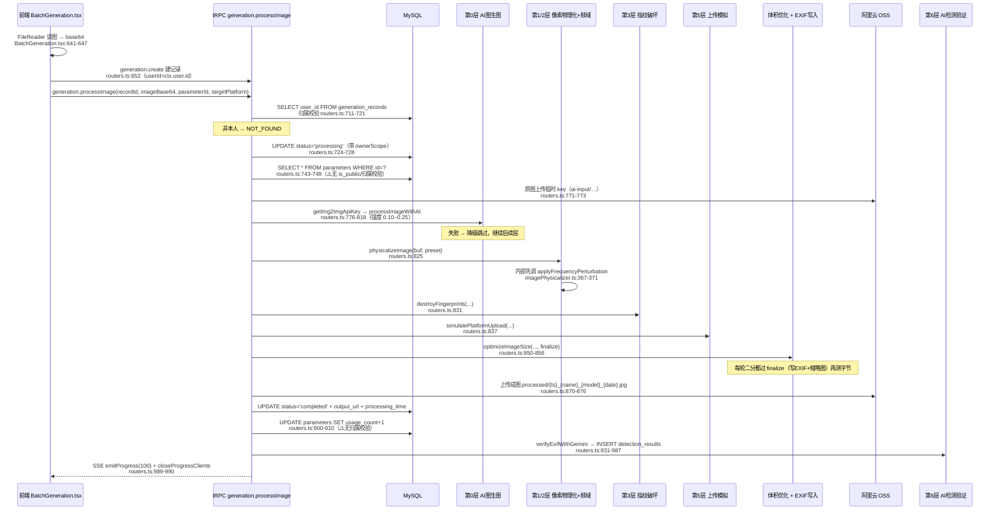
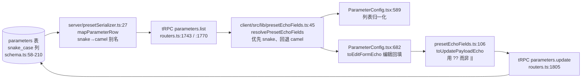
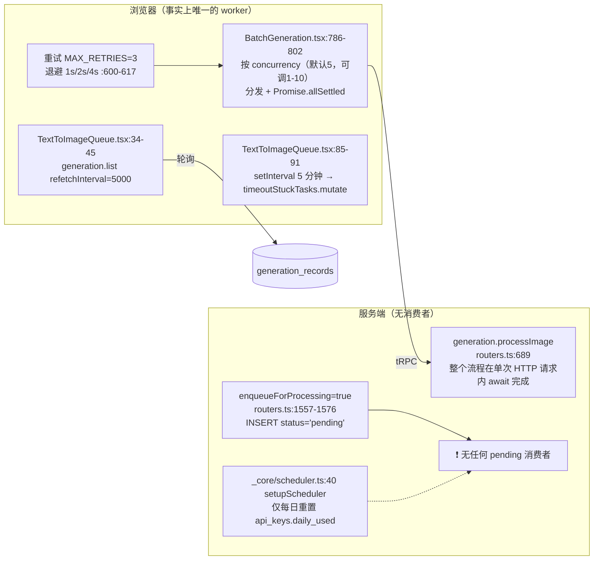

# 蜜獾原图技术原理

> 创建日期：2026-10-16
> 文档定位：基于蜜獾原图仓库 `main` @ `4a3f2ad`（V-1.7.0）源码逐层读取写成的**技术原理说明**，讲的是"**怎么做到的**"（算法、数据流、协议、状态机），不是"有哪些文件"。所有结论带 `路径:行号` 锚点；算法参数为源码实测值。
> 当前结论：图片物理化流水线**确实存在且实现得相当细**（自研 FFT 频域扰动、CMOS 噪声模型、暗角/色差模型、pHash 棋盘格扰动、6 平台上传模拟、二分法体积优化）。但有 **4 处"看起来实现了、实际没生效"** 的关键缺口必须在改代码前知道：**① 活跃的 EXIF 写入器完全不写 MakerNote；② 色差模拟是桩（计算结果被丢弃）；③ `ShutterSpeedValue`/`ApertureValue` 写成了非 APEX 值；④ EXIF 写入失败会被静默吞掉并返回原图。** 另：所谓"文生图队列"是**伪队列**——没有任何服务端消费者。详见第 7、4、13 章。
> 配套文档：《蜜獾原图项目架构.md》（结构与运行）、《蜜獾原图issues分析.md》（要做什么）。

---

## 0. 阅读前提

- 本文的"第 N 层"编号沿用代码与 `AI GUIDE.md:142` 的口径（**但该口径本身自相矛盾，见第 1 章**）。
- 所有图像处理依赖 **`sharp`**（libvips）；所有写入使用 `imageBuffer`（`Buffer`/base64）而非临时文件，**唯一例外是 ExifTool 写入器**（它必须落盘）。
- 流水线入口是 `generation.processImage`（`server/routers.ts:689`，`protectedProcedure`）；文生图入口是 `generation.textToImage`（`:1346`），两者**互相独立**。
- 全套文档脱敏口径见《蜜獾原图项目架构.md》第 0.5 节。

---

## 1. 防御体系总览（⚠️ 口径冲突先澄清）

### 1.1 仓库内的两种说法

| 出处 | 说法 |
|---|---|
| `AI GUIDE.md:19` | "通过 EXIF 信息注入、像素级物理化处理、频域扰动、指纹破坏、平台上传模拟等**五层防御体系**" |
| `AI GUIDE.md:142` | "**五层防御体系**：AI 图生图（第 0 层）→ 像素物理化（第 1 层）→ 频域扰动（第 2 层）→ 指纹破坏（第 3 层）→ EXIF 写入（第 4 层）→ 平台上传模拟（第 5 层）→ AI 检测验证（第 6 层）" |

→ 同一条定义里"5 层"却列了 **7 个层级编号（0–6）**。**本文以代码实际存在的模块为准**。

### 1.2 代码实际存在的环节

| 环节 | 实现文件 | 在 `processImage` 中的调用点 | 是否真实生效 |
|---|---|---|---|
| 第 0 层 AI 图生图 | `server/aiImageProcessor.ts` | `server/routers.ts:760-818` | ✔（失败降级跳过） |
| 第 1 层 像素物理化 | `server/imagePhysicalizer.ts` | `:825` | ✔（**色差子功能是桩**，见 4.4） |
| 第 1 层 频域扰动 | `server/frequencyProcessor.ts` | 由 `imagePhysicalizer.ts:334` 内部调用（`:367-371`） | ✔ |
| 第 3 层 指纹破坏 | `server/fingerprintDestroyer.ts` | `:831` | ✔ |
| 第 5 层 上传模拟 | `server/uploadSimulator.ts` | `:837` | ✔ |
| 第 4 层 EXIF 写入 | **`server/exifToolWriter.ts`（活跃）** / `server/exifWriter.ts`（**生产链路已死**） | `:850-856`（`finalize`） | ⚠️ **部分**：不写 MakerNote、APEX 值错误、失败静默 |
| 体积优化 | `server/sizeOptimizer.ts` | `:850-856` | ✔ |
| 第 6 层 AI 检测验证 | `server/exifVerifier.ts` | `:931-987` | ✔（写 `detection_results`） |

### 1.3 防线的目标清单（按平台）

目标平台与其影响的编码参数定义在 `server/uploadSimulator.ts:80-151` `PLATFORM_PROFILES`：

| 平台 | JPEG 质量 | 噪声 bias | 噪声 | 最大边长 | 色度抽样 |
|---|---|---|---|---|---|
| `tiktok` | 92 | 2 | ✔ | 4096×4096 | 4:2:0 |
| `小红书` | 90 | 3 | ✔ | 4096×4096 | 4:2:0 |
| `instagram` | 92 | 2 | ✘ **不加噪声** | 4096×4096 | 4:2:0 |
| `微信` | 90 | 5 | ✔ | 4096×4096 | 4:2:0 |
| `微博` | 90 | 4 | ✔ | 4096×4096 | 4:2:0 |
| `抖音` | 92 | 2 | ✔ | 4096×4096 | 4:2:0 |
| `generic` | 92 | 2 | ✔ | 4096×4096 | 4:2:0 |

> ⚠️ `AI GUIDE.md:144` 说目标平台是"TikTok/小红书/Instagram/微信/微博/抖音/通用"——**注意产品定位是跨境电商，但平台清单里有相当比例是境内平台**，这与"适配海外电商平台"的定位存在张力。

---

## 2. 主处理流水线（端到端）

### 2.1 时序图



### 2.2 进度节点（`emitProgress`）

| 进度 | 行号 | 阶段 |
|---|---|---|
| 5% | `server/routers.ts:735` | 开始处理 |
| 10% | `:752` | 读到预设 |
| 15% | `:768` | 准备 AI 输入 |
| 40% | `:820` | AI 图生图完成/跳过 |
| 55% | `:827` | 像素物理化完成 |
| 68% | `:833` | 指纹破坏完成 |
| 74% | `:839` | 上传模拟完成 |
| 88% | `:869` | 体积优化完成 |
| 95% | `:878` | 成图上传完成 |
| 100% | `:989` | 检测验证完成 |

失败路径：`emitProgress(0, {error: true})` + 记录 `status='failed'` + 抛 `INTERNAL_SERVER_ERROR`（`server/routers.ts:992-1008`）。

### 2.3 进度推送的两种通道

| 通道 | 实现 | 现状 |
|---|---|---|
| **SSE（单条记录）** | 后端 `server/progressEmitter.ts:55 emitProgress` 写 `data: {...}\n\n`；HTTP 端点 `server/_core/index.ts:291-311` `/api/progress/:recordId`（⚠️ **无鉴权**）；前端 `client/src/hooks/useProgressSSE.ts:52`（单条）、`:96`（批量 `useMultiProgressSSE`） | 🔴 **2026-10-17 生产实测：该端点被 SPA 兜底遮蔽，返回 896 字节 `index.html`（`text/html`），SSE 从未生效** → 进度条不可能动。根因见架构文档 3.3 |
| **WebSocket（全局日志）** | `server/_core/wsLogs.ts:38-61`；`broadcastLogs()` 在写库后调用（`server/routers.ts:658/679/734/897/1004/1137/1168/1217/1645`）；前端 `client/src/hooks/useWsLogs.ts:44-88`（5 秒重连） | ✔ 挂 `http.Server`，不受遮蔽影响；⚠️ **广播内容是全表最近 20 条，无用户隔离** |

> ⚠️ **WS 日志通道会跨用户泄露**：`getRecentGenerationLogs`（`wsLogs.ts:31`）取全表最近 20 条并广播给所有连接。

---

## 3. 第 0 层：AI 图生图（`server/aiImageProcessor.ts`）

| 项 | 值 | 证据 |
|---|---|---|
| 供应商 | 阿里千问图生图 API | `AI GUIDE.md:187`；`QWEN_IMG2IMG_API_KEY` / `QWEN_IMG2IMG_MODEL` |
| 强度约束 | **0.10–0.25**，超出必须拒绝 | `AI GUIDE.md:187` |
| 重试 | `MAX_RETRIES = 2`、`RETRY_DELAY_MS = 3000`；仅对可重试错误（`AbortError`/`TimeoutError`/`fetch failed`/`ECONNRESET`/5xx） | `server/aiImageProcessor.ts:29-31`、`:48-62`、调用点 `:448-499` |
| 结果落地 | `downloadAndUploadToS3`（`:505-526`）→ 存 `ai-processed/{ts}-{rand}.png`；⚠️ 若 URL 含 `cloudfront.net`/`amazonaws.com` 则跳过 | `:507-509` |
| 失败语义 | **降级跳过，继续执行后续层，不中断整体流程** | `AI GUIDE.md:180` |
| ⚠️ 默认模型不一致 | `server/aiImageProcessor.ts:44` 用 `QWEN_IMG2IMG_MODEL ?? 'qwen-vl-plus'`，而 `server/routers.ts:882` 用 `?? 'qwen-image-2.0-pro'` —— **同一变量两处默认值不同** | 同上 |

---

## 4. 第 1 层：像素物理化（`server/imagePhysicalizer.ts`）

入口：`physicalizeImage`（`:334`）。步骤顺序（`:378-399`）：

1. 步骤 0：调用频域扰动（见第 5 章）
2. 步骤 1：CMOS 噪声
3. 步骤 2：暗角
4. 步骤 3：色差（**仅 `focalLength ≤ 50`**，且**是桩**）
5. 步骤 4：JPEG 重压
6. 步骤 5：轻微模糊 + 锐化

### 4.1 CMOS 噪声模型（核心算法）

| 项 | 值 | 证据 |
|---|---|---|
| 噪声 sigma 与 ISO 的关系 | **`σ = 0.5 × √(ISO / 100)`** → ISO100→0.5，ISO6400→4.0 | `:76-78` `isoToNoiseSigma` |
| 随机数 | Box–Muller 变换生成高斯噪声 | `:140-148` |
| 暗部增强 | 像素值 `< 64` 时噪声 **×1.5**（泊松噪声近似） | 同上 |
| 通道 | **每通道独立**注入 | 同上 |

### 4.2 暗角模型

| 项 | 值 | 证据 |
|---|---|---|
| 强度表 | f/1.4→0.35、f/2→0.28、f/2.8→0.22、f/4→0.16、f/5.6→0.10、f/8→0.06、≥f/11→0.04 | `:85-93` |
| 几何模型 | `cos4 = cos(atan(r × 1.5))^4`；`factor = 1 - strength × (1 - cos4)`；`r` 为对角线归一化半径 | `:188-189` |

### 4.3 JPEG 重压（模拟相机内置编码器）

| 项 | 值 | 证据 |
|---|---|---|
| 质量 | 默认 88；按 ISO 调整：≥3200→82、≥1600→85、≥800→87、≤200→92、其余 88 | `:273-289`、`:416-441` |
| 色度抽样 | `4:2:0` | 同上 |
| 优化开关 | `mozjpeg` / `trellisQuantisation` / `overshootDeringing` / `optimiseScans` **全为 false**（刻意贴近相机固件行为） | 同上 |

### 4.4 ⚠️ 色差模拟是**桩实现**

| 事实 | 证据 |
|---|---|
| 强度表定义完整：≤14mm→2.0、≤24→1.5、≤35→1.0、≤50→0.7、≤85→0.5、≤135→0.4、其余 0.3 | `:99-107` |
| `applyChromaticAberration`（`:208-266`）确实做了 R/G/B 分离与缩放（`:217-244`） | 同上 |
| ⚠️ **但 `:247-256` 的 `composite([...])` 结果被丢弃**，函数实际返回 `sharp(imageBuffer).modulate({ saturation: 1.02 })`（`:260-264`） | 同上 |
| **实际效果 = 饱和度 +2%，没有任何像素错位** | — |
| 但日志仍打印"✓ 色差模拟完成" | `:391` |

→ 改图前须知：这一层**没有**真正的色差通道错位。若要实现，把 `composite` 的结果 `return` 出来即可（注意 sharp 的 channel 语义）。

### 4.5 自然锐化

先 `blur(0.3)` 再 `sharpen({ sigma: 0.5, m1: 0.5, m2: 0.3 })`（`:296-312`）—— 先轻微模糊再锐化，模拟镜头+机内锐化链路。

### 4.6 参数提取（预设 → 算法参数）

`extractPhysicalizerOptions`（`:416-441`）：读 `iso` / `aperture` / `focal_length`；JPEG 质量按 ISO 映射见 4.3。

---

## 5. 第 1 层·频域扰动（`server/frequencyProcessor.ts`）

入口：`applyFrequencyPerturbation`（`:175`）。**自研 FFT，无第三方依赖**。

| 项 | 值 | 证据 |
|---|---|---|
| FFT | 自实现 Cooley–Tukey（`:43-93`）/ IFFT（`:96-102`） | 同上 |
| 处理维度 | **逐行**处理（不是整图二维 FFT） | `:201`（`processAllRows: false` → 隔行） |
| 通道 | 仅亮度通道，按 `0.299R + 0.587G + 0.114B` 加权 | `:210` |
| 扰动方式 | **只改相位、不改幅度** | `:127-145` |
| 频段保护 | **保护低频前 5%**，只扰动 **5%–45%** 频段 | `:124-125` |
| 扰动强度 | `perturbStrength: 0.004`（由调用方显式传入） | `imagePhysicalizer.ts:367-371` |
| 出口编码 | JPEG q92 | `:261` |

**原理要点**：人类视觉对相位扰动相对不敏感、对幅度改变敏感；而 AI 检测器常依赖频域幅度谱特征（如 GAN 指纹的周期性峰）。改相位可打散这类特征而不显著降低观感。

---

## 6. 第 3 层：指纹破坏（`server/fingerprintDestroyer.ts`）

入口：`destroyFingerprints`（`:336`）。**四种子破坏顺序执行，全部在 EXIF 写入之前**（`:366` 频谱 → `:372` pHash → `:378` 色彩 → `:384` 几何）。

### 6.1 pHash 破坏（棋盘格扰动）

| 项 | 值 | 证据 |
|---|---|---|
| 幅度表 | `{ 1: 3, 2: 6, 3: 10 }` | `:86-87` |
| 块大小 | `blockSize = max(8, floor(min(w,h) / 32))` | `:98` |
| 扰动概率 | 每块 **60%** 概率被扰动 | `:103` |
| 正负交替 | 块内按 `(dx + dy) % 2` 决定正负 | `:114` |
| 出口编码 | JPEG q93 | `:131` 附近 |

**原理**：pHash 先降采样再取 DCT 中频符号；棋盘格正负交替的微扰会让相邻块的中频符号翻转，从而改变 hash 而几乎不影响观感。

### 6.2 频谱指纹破坏（正弦扰动）

| 项 | 值 | 证据 |
|---|---|---|
| 目标周期 | `[8, 16, 32]` 像素 | `:166` |
| 幅度 | `baseAmplitude = 1.2 × intensity`；第 i 个周期的幅度除以 `(i+1)` | `:179` |
| 相位 | 随机 | `:170-171` |
| 出口编码 | JPEG q93 | `:203` 附近 |

### 6.3 色彩指纹破坏

`modulate` 参数：hue 0–4°、saturation 0.95–1.03、brightness 0.98–1.02、gamma 1.0–1.08（`:227-253`）。

### 6.4 几何微扰

旋转 ±0.2°；四边各裁 0–1px；再 resize 回原尺寸（`lanczos3`）（`:275-314`）。

### 6.5 参数提取（⚠️ 有一个硬编码）

`extractFingerprintOptions`（`:405-419`）：

| 项 | 值 |
|---|---|
| ⚠️ `pHashDestructionLevel` | **恒为 2，不读预设**（`:414`） |
| `intensity` | ISO ≥1600→1.2、≥800→1.0、否则 0.9（`:411`） |

---

## 7. 第 4 层：EXIF 写入（**最需要注意的一层**）

### 7.1 ⚠️ 两套实现，生产链路只用其中一套

| 实现 | 文件 | 状态 |
|---|---|---|
| ExifTool 版 | `server/exifToolWriter.ts`（26.7KB） | **生产活跃**：`server/routers.ts:46` 导入 `writeExifToJpeg`，`:850-856` 用于 `finalize` |
| piexifjs 版 | `server/exifWriter.ts`（52.5KB） | ⚠️ **生产链路已死**：唯一引用是它自己的测试 `server/exifWriter.test.ts:2` |

**这意味着**：那一份 52KB、含完整 MakerNote 库和 GPS 区域库的实现**不在生产链路上**；而活跃的 ExifTool 版功能**明显更弱**。接手时若"照着测试改"，会改到死代码。

### 7.2 活跃实现（`exifToolWriter.ts`）写入的字段

| 类别 | 内容 | 证据 |
|---|---|---|
| 入口 | `writeExifToJpeg`（`:304`） | 同上 |
| 参数标准化 | `normalizeISO`（`:220`）、`normalizeAperture`（`:236`）、`normalizeFocalLength`（`:251`）—— 例如 ISO 677→640、f/7.9→f/8.0、111mm→105mm | 同上 |
| 机型传感器库 | `CAMERA_SPECS`（`:70+`） | — |
| FocalPlane | `:376-383`（缺省 unit=2 英寸） | — |
| 版本字段 | `ExifVersion='0230'`、`FlashpixVersion='0100'` | `:351-357` |
| 子秒 | `SubSecTime` 随机 2 位 | `:314` |
| 色彩空间 | `ColorSpace=1`（AdobeRGB→65535） | `:359` |
| 唯一 ID | `ImageUniqueID` = 时间戳 hex + 随机 | `:372-373` |
| 其它 | `ExposureBiasValue=0`、`SensingMethod=2`、`Contrast/Saturation/Sharpness=0` | `:362-369` |
| GPS | 见 7.4 | `:448-488` |
| **MakerNote** | ⚠️ **完全没有写入** | 见 7.3 |

### 7.3 ⚠️ 缺口一：MakerNote 从未被写入

| 事实 | 证据 |
|---|---|
| `exifToolWriter.ts:66` **声明**了 `maker_note_template` 字段 | 同上 |
| 但 `:334-501` 的**全部 tag 赋值中没有任何 MakerNote 字段**（文件内 MakerNote 只出现在注释 `:6`、`:11`、`:12`） | 同上 |
| 完整 MakerNote 实现只存在于**已死的** piexifjs 版：`server/exifWriter.ts:599-620` `buildMakerNote` 按品牌分派 —— Canon（`:277`，纯 IFD 小端，写 `0x0001 CameraSettings` / `0x0004 ShotInfo` / `0x0010 ModelID=0x80000421` / `0x0096 InternalSerialNumber`）、Nikon3（`:369`）、Sony（`:440`）、Apple（`:489`，头部 `Apple iOS\0\0\1MM` + big-endian 条目数，按机型查 entryCount 0x0b–0x31）、Pentax AOC（`:545`）、Fujifilm（`:557`）、Olympus2（`:572`）、Panasonic（`:586`）、Samsung（`:627`） | 同上 |
| **后果**：UI 上的 `maker_note_template` 下拉（`client/src/pages/ParameterConfig.tsx:981-992`，12 个模板选项）与其说明文案"将写入厂商专属 MakerNote…显著提升 AI 检测通过率"（`:3017-3019`）**对实际输出零影响** | 同上 |

> 这是"图片物理化"这一核心卖点的**实质性缺口**。open issue #7 修的是"回显"（列表页/编辑页显示为"无"），**值的消费端从未实现**。

### 7.4 GPS 伪造（活跃实现）

| 项 | 值 | 证据 |
|---|---|---|
| 模式 | `gps_mode`：`none` / `fixed` / `auto` / `random_by_scene` | `:448-488` |
| fixed | 用预设的经纬度 | 同上 |
| 其它模式 | `generateGpsCoords` 按场景区域随机（`:144-215`） | 同上 |
| 写入字段 | `GPSLatitude` / `GPSLongitude` / `GPSLatitudeRef` / `GPSLongitudeRef` / `GPSAltitude` / `GPSAltitudeRef` / `GPSTimeStamp` / `GPSDateStamp` / `GPSMeasureMode='3'` / `GPSImgDirectionRef='T'` / `GPSImgDirection=rand(0,360)` / `GPSSpeedRef='K'` / **`GPSSpeed=0`（硬编码）** | `:486` |
| ⚠️ 缺失字段 | **无 `GPSProcessingMethod`、无 `GPSDOP`、无 `GPSVersionID`** | — |
| 格式要求 | `AI GUIDE.md:178` 要求 GPS 必须用 **DMS（度分秒）**，禁止十进制 —— 活跃实现通过 ExifTool 写，符合；已死的 piexifjs 版有显式 `decimalToDms`（`server/exifWriter.ts:253-264`）与 `GPS_DMS` 构造（`:1036-1121`），更完整 | 同上 |

**对照（已死实现的功能，供参考/迁移）**：`exifWriter.ts` 含 `GPS_REGIONS` 区域库（landscape 7 区、urban 6 城、portrait/indoor/food/sports/macro，`:178-222`），且 indoor/studio 有 **50% 概率不写 GPS**（`:234-237`）；速度按场景取值（landscape 0–5 km/h、sports 5–35 km/h，`:1098-1102`）；`GPSProcessingMethod` 手工构造 11 字节 `'ASCII\0\0\0'+'GPS'`（`:1108-1112`）；`GPSDOP` 1.0–3.0（`:1119-1120`）。

### 7.5 ⚠️ 缺口二：`ApertureValue` / `ShutterSpeedValue` 写成非 APEX 值

| 实现 | 写法 | 是否符合 EXIF 规范 |
|---|---|---|
| **活跃** `exifToolWriter.ts:398` | `ShutterSpeedValue = 曝光时间字符串`（如 "1/125"） | ❌ **规范要求 APEX 值** |
| **活跃** `exifToolWriter.ts:408` | `ApertureValue = f 值`（如 2.8） | ❌ **规范要求 APEX 值** |
| 已死 `exifWriter.ts:923`、`:933` | 正确的 APEX 换算 | ✔ |

**后果**：元数据内部自相矛盾（`FNumber` 与 `ApertureValue` 不满足 `APEX = 2·log2(FNumber)`），可被取证工具/平台识别为伪造。

### 7.6 ⚠️ 缺口三：EXIF 写入失败被静默吞掉

```
try { ...exiftool.write... }
catch { return 原始 base64 }   // server/exifToolWriter.ts:520-523
```

- 调用方 `server/routers.ts:850-853` 的 `finalize` **无从判断 EXIF 是否写成功**。
- 与 `AI GUIDE.md:179`（"任何一层失败必须记录具体错误原因到 `error_message`，禁止静默失败"）**直接冲突**。
- 还让 `sizeOptimizer` 的"以 finalize 后的字节数为准"失去意义：EXIF 没写进去时体积自然"轻松达标"。

### 7.7 ExifTool 调用细节（并发 / 超时 / 重试 / 临时文件）

| 项 | 实测 | 证据 |
|---|---|---|
| 库与版本 | `exiftool-vendored@^35.16.0`，**自带二进制** | `package.json:83`、`server/exifToolWriter.ts:17` |
| ⚠️ 与文档不符 | `CLAUDE.md:43`/`Agent.md:36`/`AI GUIDE.md:51,176` 均称"**系统级 ExifTool v12.76**"，但代码**无任何系统路径配置**（全仓 grep `exiftoolPath`/`EXIFTOOL`/`maxProcs`/`taskTimeout` 只命中导入那一行） | 同上 |
| 调用点 | `await exiftool.write(inputFile, tags, ['-overwrite_original','-charset','UTF8','-m'])` | `:505-509` |
| 并发 | 无显式 `maxProcs`；进程级单例，每个请求串行（2 次 `fs.writeFileSync` + 1 次 `write`） | 同上 |
| 超时 | 无自定义超时 | 同上 |
| 重试 | ⚠️ **无重试**（失败即返回原图）；仅前端有一次外层重试：`BatchGeneration.tsx:600` `MAX_RETRIES=3` + 退避 1s/2s/4s（`:617`） | 同上 |
| 临时文件 | `os.tmpdir()` 下 `exif_{Date.now()}_{rand}_input.jpg`/`_output.jpg`（`:319-322`）、`_thumb.jpg`（`:496-498`） | 同上 |
| ⚠️ 临时文件泄漏 | `finally`（`:524-529`）**只删 `inputFile` 与 `outputFile`**，**`_thumb.jpg` 永久残留在系统 temp**；且 `outputFile` 从未被创建/读取（实际用 `-overwrite_original` 覆盖 input） | 同上 |
| ⚠️ 未优雅关闭 | 全仓无 `exiftool.end()` | 同上 |

---

## 8. 第 5 层：平台上传模拟（`server/uploadSimulator.ts`）

入口：`simulatePlatformUpload`（`:270`）。六步（`:287-339`）：

| 步骤 | 内容 | 证据 |
|---|---|---|
| 1 | 尺寸归一化：**仅当 >4096 才缩**，`fit: 'inside'` + `lanczos3` | `:287-293` |
| 2 | 转 sRGB | `:297` |
| 3 | 色彩微调（按平台 bias） | `:300-303` |
| 4 | **第一次 JPEG q95、4:4:4**（模拟高质量中间态） | `:308-314` |
| 5 | 平台噪声 | `:319-324` |
| 6 | **第二次 JPEG（平台质量、4:2:0）** | `:329-339` |

### 8.1 平台噪声模型（`uploadSimulator.ts:171-242`）

| 项 | 值 | 证据 |
|---|---|---|
| 块效应边界 | `y % 8 ∈ {0, 7}` 的 8×8 块边界像素 | `:198`、`:201` |
| 边界噪声放大 | **×1.4** | `:203` |
| 重建方式 | 用 sharp 重建 JPEG q95（`:217-221`）后，**用 `piexifjs` `dump`/`insert` 把原 EXIF 贴回**（`:226-233`） | 同上 |
| 失败回退 | 返回无 EXIF 图（`:236-237`） | 同上 |

> 注意：这是 `piexifjs` 在**活跃链路上的唯一用途**（另一个引用在 `server/exifWriter.ts:19`，属死代码）。`AI GUIDE.md:176` 明令"禁止使用 piexifjs 等纯 JS 库（精度不足）" —— 这里与红线冲突，但它是**重新贴回已有 EXIF** 而非写入伪造字段，风险等级不同。

---

## 9. 第 6 层：AI 检测验证（`server/exifVerifier.ts`）

| 项 | 值 | 证据 |
|---|---|---|
| 入口 | `verifyExifWithGemini`（`server/routers.ts:931-987` 调用） | 同上 |
| 默认模型 | ⚠️ `process.env.GEMINI_MODEL ?? 'gemini-2.5-flash'`（硬编码） | `server/exifVerifier.ts:390` |
| Key 来源 | `api_keys` 表 `key_type='verify'` 按 priority 轮询 | `AI GUIDE.md:188` |
| 结果 | 写入 `detection_results`（`server/routers.ts:958`），含 5 个评分列 + `used_provider`/`used_model`（由迁移 `0009` 添加） | `drizzle/0009_tan_green_goblin.sql:1-7` |
| 分数语义 | 0–100；≥70 合格、≥80 良好、≥90 优秀 | `AI GUIDE.md:143` |

---

## 10. 体积与尺寸优化（`server/sizeOptimizer.ts`）

入口：`optimizeImageSize`（`:104`）。**优化目标是文件体积（不是分辨率）**。

| 项 | 值 | 证据 |
|---|---|---|
| 目标带 | **原图的 60%–80%**（`targetLow: 0.6`、`targetHigh: 0.8`） | `:80-83` |
| 早退分支 | ⚠️ 原图 **<40KB 直接跳过**，标记 `tiny-original-skipped` | `:137` |
| 质量区间 | 60–96，初值 88 | `:84-86` |
| 搜索方式 | **二分，最多 6 次** | `:87`、`:171-215` |
| 防累积掉质 | **每轮都从 `processedBuffer` 重新编码**（不是在上轮结果上再压） | `:174` |
| ⚠️ 关键设计 | **每轮都要过一遍 `finalize`（写 EXIF + 缩略图）再测字节** | `:117-118`、`:149-150`、`:175` |
| 基准字节 | `originalBytes` 取**用户原始上传**的字节（不是平台处理后） | `server/routers.ts:848` |

⚠️ **两个隐患**：

1. "每轮过 finalize"意味着**一次成图会触发最多 7 次 ExifTool 写入 + 7 组临时文件**；结合 7.7 的 `_thumb.jpg` 泄漏，临时目录会被快速污染。
2. `tiny-original-skipped` 分支下 `inBand` 可能为 false，但 `server/routers.ts:854-856` **不检查 `sizeResult.inBand`/`reason`**，只 `console.log`（`:857-864`）→ **超带结果静默通过**。

---

## 11. 参数与预设体系

### 11.1 数据流



| 环节 | 机制 | 证据 |
|---|---|---|
| 预设结构 | `parameters` 表约 60+ 字段（EXIF 全参数），按设备四类 phone/dslr/mirrorless/action | `drizzle/schema.ts:58-210` |
| 归属 | `user_id varchar(128)`、`is_public tinyint` | `:200`、`:202` |
| 序列化 | `mapParameterRow` 保留全部 snake_case 原值 + 追加 30+ camelCase 别名；**GPS/MakerNote 显式重点映射**：`gpsLatitude/gpsLongitude/gpsAltitude/gpsMode/sceneType`（`:63-67`）、`makerNoteTemplate`（`:73`）、`isPublic`（`:83`）、`ownerId`（`:84`） | `server/presetSerializer.ts:27` |
| 回显归一化 | 优先 snake、回退 camel，末位安全默认 `gps_mode='none'` / `scene_type='urban'` / `maker_note_template=''` | `client/src/lib/presetEchoFields.ts:45-52` |
| ⚠️ 关键细节 | `toUpdatePayloadEcho` 用 **`?? undefined` 而非 `|| undefined`**，防 `"none"`/`"urban"` 被判 falsy 而丢失（`:101-105` 注释说明） | 同上 |
| ⚠️ 绕过序列化的路径 | `server/routers.ts:743-749`（processImage 直接 `SELECT *`）、`:2130`（healthSummary 手工拼 SQL）**不走 `mapParameterRow`** | 同上 |

### 11.2 ⚠️ 测试目标与被测实现不是同一份代码

| 事实 | 证据 |
|---|---|
| 只有 `server/normalizeParams.test.ts`，**仓库中不存在 `normalizeParams.ts`** | 同上 |
| 该测试测的是 `exifWriter.ts` 的 `normalizeISO/normalizeAperture/normalizeFocalLength`（`normalizeParams.test.ts:6`） | 同上 |
| 但生产链路实际导入的是 **`exifToolWriter.ts`** 的同名函数 | `server/routers.ts:46` |
| → **该测试通过不代表生产链路正确** | — |

### 11.3 相关单测（真实但覆盖有限）

`server/presetSerializer.test.ts`（14 例）、`client/src/lib/presetEchoFields.test.ts`（12 例）—— **只测纯函数映射，无 UI 渲染断言**（项目未引入 `@testing-library`）。

---

## 12. AI 供应商与 API Key 轮询

### 12.1 供应商目录（SSOT）

`shared/aiProviderCatalog.ts:70-227` 的 `AI_PROVIDER_CATALOG` 含 **10 条**：`gemini` / `openai` / `claude` / `deepseek` / `kimi` / `doubao` / `qwen` / `zhipu` / `midjourney` / `other`。

| 机制 | 说明 | 证据 |
|---|---|---|
| 条目字段 | `id` / `label` / `protocol` / `defaultBaseUrl` / `defaultVerifyModel` / `defaultTestModel` / `recommendedModels[]` / `isCustomEntry` | `:45-62` |
| 协议族路由 | 内置平台用目录 `protocol` 并**忽略** `api_format`（`:266-268`）；未登记/`other` 按 `api_format` 映射（`:234-239`）；否则 `unknown` 安全失败 | `:261-273` |
| provider 标识校验 | `/^[a-z0-9][a-z0-9_-]{0,31}$/`，与 `api_keys.provider varchar(32)` 对齐 | `:242-243`；`server/routers.ts:74-79` |
| 派生表 | `PROVIDER_DEFAULT_BASE_URLS` / `_VERIFY_MODELS` / `_TEST_MODELS` 由目录派生，消除三处硬编码 | `:276-288` |

### 12.2 Key 存储、掩码与用途隔离

| 项 | 实现 | 证据 |
|---|---|---|
| 掩码 | ≤8 位全 `*`，否则 `<前4>****<后4>` | `server/rds.ts:564-573` |
| 列表出口剥离明文 | `getApiKeys`（`:607-613`）、`getApiKeysPaged`（`:1392-1398`） | 同上 |
| 明文读取 | 仅 `getApiKeyPlaintextById`（`:1284`，注释声明仅服务端内部用）+ 4 个按 `key_type` 的选择器（`:1178`/`:1204`/`:1232`/`:1258`） | 同上 |
| `key_type` 严格四值 | `verify` / `img2img` / `image_gen` / `ai_optimize`；四个选择器 SQL 只匹配各自值，**失败不回退 legacy `both`** | `server/aiKeyTypeCanonical.test.ts:69`；`server/rds.ts:1184/1210/1238/1264` |
| 前端 | `AdminAPIManagement.tsx:15` 导入目录；`:631`/`:788` 渲染下拉；`:518` 只展示 `maskedKey`；`:180-183` 编辑 legacy key_type 时留空等待重选 | 同上 |

### 12.3 ⚠️ 轮询算法的并发缺陷 + 熔断是桩

**`rotateApiKey`（`server/rds.ts:1147`）与 `getImg2ImgApiKey`（`:1178`）同构**：

```sql
SELECT ... FROM api_keys
WHERE deleted_at IS NULL AND status='active' AND daily_used < daily_limit [AND key_type=?]
ORDER BY FIELD(priority,'high','medium','low'), daily_used ASC, last_used_at ASC
LIMIT 1
-- 命中后：usage_count+1, daily_used+1, last_used_at=NOW()
```

| 缺陷 | 说明 | 关联 issue |
|---|---|---|
| ⚠️ **SELECT + UPDATE 非原子**（同构 5 处） | 并发下多个请求可选中同一 Key 并各自 `+1`，**可超 `daily_limit`** | #34 |
| ⚠️ **`error_count` 熔断是桩** | 从不递增 → 坏 Key 会被**无限轮询** | #34 |

### 12.4 连通性测试

`server/apiKeyConnectivity.ts:58` `testApiKeyConnection`：

| 项 | 值 | 证据 |
|---|---|---|
| 默认超时 | 15000ms | `:63` |
| Key 长度下限 | <4 位直接失败 | `:69` |
| gemini | `POST {base}/models/{model}:generateContent?key=` | `:81` |
| claude | `{base}/messages` + `x-api-key` + `anthropic-version: 2023-06-01` | `:93-100` |
| openai 兼容 | `{base}/chat/completions` + Bearer | `:108-111` |
| none 协议 | 仅格式校验（需 ≥10 位） | `:117-120` |
| 未知协议 | 抛"不支持的平台" | `:122-123` |
| 返回 | `{ success, latency, response(≤100字), model, provider }` | 同上 |
| 可测性 | `fetcher` 可注入以 mock | `:27` |
| 入口 | `server/routers.ts:2389` `apiKeys.test`（adminProcedure） | 同上 |

### 12.5 ⚠️ 硬编码模型名仍然存在（与 open issue #8 验收标准"不硬编码模型"不符）

| 位置 | 硬编码内容 |
|---|---|
| `server/routers.ts:2255-2264`（`optimizePrompt`） | 按 provider 内联三元兜底：gemini→`gemini-2.0-flash`、openai→`gpt-4o-mini`、deepseek→`deepseek-chat`、kimi→`moonshot-v1-8k`、doubao→`doubao-pro-4k`、qwen→`qwen-turbo`、zhipu→`glm-4-flash`，兜底 `gpt-4o-mini` |
| `server/routers.ts:1403` | 文生图兜底 `wanx2.1-t2i-turbo` |
| `server/routers.ts:882` | `QWEN_IMG2IMG_MODEL ?? 'qwen-image-2.0-pro'` |
| `server/aiImageProcessor.ts:44` | `QWEN_IMG2IMG_MODEL ?? 'qwen-vl-plus'`（**同变量、不同默认值**） |
| `server/exifVerifier.ts:390` | `GEMINI_MODEL ?? 'gemini-2.5-flash'` |
| `server/_core/llm.ts:283` | `model: "gemini-2.5-flash"` |
| `shared/aiProviderCatalog.ts:76+` | 目录本身就是一份**硬编码模型清单**（这是设计选择，但需与上面的兜底逻辑对齐） |

---

## 13. 任务与进度：**伪队列真相**

### 13.1 明确结论

> **不存在任何服务端 worker。** 全仓**没有** `SELECT ... WHERE status='pending'` 的消费者；处理由**前端逐条调用** `processImage` 驱动。

### 13.2 架构图



### 13.3 逐项证据

| 问题 | 结论 | 证据 |
|---|---|---|
| 状态存哪张表 | `generation_records.status`（`varchar(32) default 'pending' not null`） | `drizzle/schema.ts:239` |
| 状态机取值 | `pending → processing → completed \| failed` | `shared/domain-dictionaries.ts:3`；`detection_result` 另有 `pass/fail/pending`（`:4`） |
| **谁消费 pending** | **没有人**。写侧出现在 `server/routers.ts:1132`/`:1205`/`:1566`/`:1633`，**无任何 SELECT 消费者** | grep 全仓 |
| 服务端唯一定时器 | `server/_core/scheduler.ts:15-38` 只做 `UPDATE api_keys SET daily_used=0`；`server/_core/index.ts:422` 调 `setupScheduler()` | 同上 |
| 遗留死代码 | `server/_core/imageGeneration.ts:34` `generateImage` 是 Manus 模板遗留，**全仓无导入方** | grep |
| "入队"的真实含义 | 仅在 `enqueueForProcessing=true` 时 `INSERT` 记录并返回 `enqueuedIds`；而文生图**已在同一 mutation 内同步生成完毕**（`server/routers.ts:1536-1545` 的 for 循环 `await generateSingle()`；DashScope 异步任务用 3s×40 次轮询凑成同步等待，`:1440-1462`） | 同上 |
| 并发实际在哪 | **前端**：`BatchGeneration.tsx:794-802` 分批 `Promise.allSettled`，并发数 UI 可调 1–10（`:131`） | 同上 |
| 暂停队列是否有效 | ⚠️ **无效**。`text2imgQueuePaused` 是**模块级内存变量**（`server/routers.ts:61`），只有 `setQueuePaused`（`:1597`）写、`getQueueStatus`（`:1603`）读，**无任何代码读取该变量来跳过任务**；重启即重置（注释 `:60`、`:1596` 自认） | 同上 |
| 重试层次 | ① 客户端 `BatchGeneration.tsx:600-617`（3 次 + 指数退避）② `aiImageProcessor.ts:29-31`（2 次，仅可重试错误）③ 人工"一键重试全部失败" `server/routers.ts:1607`（把 `failed` 改回 `pending` —— **但因无消费者，改回后永远停在 pending**）④ 超时兜底 `timeoutStuckTasks`（`:1145`，默认 15 分钟，把 `processing` 且 `updated_at < cutoff` 的置为 `failed`）—— ⚠️ **由前端每 5 分钟触发**（`TextToImageQueue.tsx:85-91`），即"超时检测"也依赖浏览器开着页面 | 同上 |
| ⚠️ 多开页签 | 每个页签都会各自触发 `timeoutStuckTasks` → 重复扫描 | open issue #29 |

### 13.4 ⚠️ `TextToImageQueue` 页面疑似"装饰页"（**生产实测未能区分**）

| 事实 | 证据 |
|---|---|
| 该页读 `r.gen_status` | `client/src/pages/TextToImageQueue.tsx:94-97`、`:332` |
| 而 `generation.list` → `rds.getGenerationRecords` 返回字段是 **`status`** | `server/rds.ts:115` |
| `gen_status` 别名只存在于 **detection** 查询 | `server/rds.ts:260` |
| 按代码推论：若接口返回的任务对象只有 `status` 而没有页面读取的 `gen_status`，四个计数会按空值计为 0，`StatusBadge` 会显示"等待中"；"暂停队列"横幅与"重试全部失败"按钮的显示仍取决于真实任务数据 | `TextToImageQueue.tsx:131` |

### 13.5 🔬 该页的实测结论：**样本为空，无法区分**

2026-10-17 生产实测（管理员登录后打开 `/text2img-queue`）：

| 观察 | 值 |
|---|---|
| 页面显示 | 等待中 **0** / 生成中 **0** / 已完成 **0** / 失败 **0**，列表显示"暂无文生图任务" |
| 网络请求 | 只有 `auth.me` + 两次 `generation.list`（均 200），**无报错** |
| 任务列表 | **确实为空** |

→ 因为**当时没有任何文生图任务**，四个 0 既可能是"字段读错"，也可能是"本来就没有"。**本条不构成"字段名 bug"的证据。**

旁证（倾向支持代码推论）：同一账号在 `/history` 能看到 **20 条**生成记录，但那些是**图片处理类**（预设名 `Apple iPhone 15 Pro - 室内拍摄 …`、`使用API qwen`），不是文生图；因此不能用来反证。

> 要真正验证，需要**先创建一条文生图任务**（会写库），或直接对 `generation.list` 的返回体断言存在 `status` 而无 `gen_status`。本次为遵守"不产生业务数据"，未创建任务。

**应当保留的结论**：13.3 的"暂停标志无人读取"是**代码级确定**的；而"四个计数因字段名读错而恒为 0"目前是**代码推论、未经实测**。

---

## 14. 认证与会话原理

### 14.1 JWT 与会话

| 项 | 实现 | 证据 |
|---|---|---|
| 库 | **只用 `jose`**（`SignJWT` / `jwtVerify`，**HS256**） | `server/_core/sdk.ts:6`、`:181-198`、`:200-233` |
| 密钥 | `new TextEncoder().encode(ENV.cookieSecret)`，而 `ENV.cookieSecret = process.env.JWT_SECRET ?? ""` | `:157-160`；`server/_core/env.ts:3` |
| ⚠️ 空默认 | 缺失 `JWT_SECRET` 时用**空密钥**签 HS256，**无启动校验** → 可伪造任意会话（open issue #18） | 同上 |
| 存放 | HttpOnly Cookie `app_session_id` | `shared/const.ts:1`；写入点 `server/routers.ts:398`(注册)/`:488`(登录)/`server/_core/oauth.ts:45` |
| ⚠️ Cookie 属性 | `httpOnly: true`、`path: '/'`、**`sameSite: "none"`**、`secure: isSecureRequest(req)`；**无 CSRF token** | `server/_core/cookies.ts:43-46` |
| ⚠️ 过期双口径 | **JWT**：默认 `ONE_YEAR_MS`（**1 年**，账号密码注册/登录未传 `expiresInMs`）vs OAuth 显式 **8 小时**（`SESSION_DURATION_MS`）；**Cookie**：2026-10-17 生产实测为**浏览器会话级**（无 `Max-Age`，关闭浏览器即失效；重开新会话后受保护接口返回 401） | `server/_core/sdk.ts:186`；`shared/const.ts:2-3`；`server/_core/oauth.ts:41,45`；2026-10-17 实测 |
| 🔴 `auth.me` 泄露 `passwordHash` | `me: publicProcedure.query(opts => opts.ctx.user)` 直接返回**完整用户行**；生产实测响应含 `passwordHash`（bcrypt）、`email`、`openId`。同类哈希实测为 **cost 10** | `server/routers.ts:405`；`server/_core/context.ts:11-28`；2026-10-17 实测（架构文档 7.1.1） |
| ⚠️ 吊销 | 无会话表、无黑名单 | — |
| OAuth 回调 | `state` = `atob` 后的 redirectUri，**无防伪校验** | `server/_core/sdk.ts:41-44`；`server/_core/oauth.ts:12-53` |
| 每请求 | `authenticateRequest` 按 `openId` 查库；用户不存在时用 OAuth 服务回同步 | `server/_core/sdk.ts:259-301` |

### 14.2 登录锁定（服务端真实实现）

`server/routers.ts:451-485`：
1. `lockedUntil` 在未来 → 直接 `FORBIDDEN`（`:455-457`）
2. bcrypt 校验失败 → `loginAttempts += 1`
3. 达到 `MAX_ATTEMPTS = 5` → 锁定 `LOCK_MINUTES = 15`（`:463-468`）
4. 成功 → 计数清零（`:481-485`）

### 14.3 密码哈希（⚠️ 自身不一致）

| 路径 | cost | 证据 |
|---|---|---|
| 注册 | 12 | `server/routers.ts:389` |
| 重置密码 | 12 | `:508` |
| 管理员建号 | 12 | `:2621` |
| 管理员重置 | 12 | `:2656` |
| ⚠️ **修改密码** | **10** | `:554` |

### 14.4 邮箱验证码（原理与缺陷）

| 项 | 实现 | 证据 |
|---|---|---|
| 存储 | ⚠️ **模块级内存 `Map<string, {code, expiresAt, type}>`** —— 明文、重启丢失、多实例不共享 | `server/routers.ts:57` |
| 生成 | ⚠️ **`Math.floor(100000 + Math.random() * 900000)`（非 CSPRNG、无哈希）** | `:58` |
| TTL | 10 分钟 | `:429` |
| 限流 | 同 email+type **1 分钟内**拒绝（用 `expiresAt - 9*60*1000 > now` 反推） | `:420-423` |
| ⚠️ 尝试上限 | **无**；校验失败不删除 → 窗口内可反复试 | `:380`、`:501` |
| 一次性 | 校验成功后 `delete(key)`（重置 `:505`、注册 `:384`） | 同上 |
| ⚠️ 比较 | 普通 `!==`（非常量时间） | `:381`、`:502` |
| ⚠️ 枚举 | `sendVerificationCode` 是 `publicProcedure`（`:413`），且注册路径会先查邮箱是否存在（`:424-427`）→ **可枚举已注册邮箱** | 同上 |

### 14.5 图形验证码（`server/captcha.ts`）——**死模块**

| 项 | 值 | 证据 |
|---|---|---|
| 实现 | `CaptchaManager`：TTL 60s（`:21`）、`MAX_ATTEMPTS=5`（`:22`）、过期/超次即删（`:57-66`）、成功即删（`:79`）、不区分大小写（`:69`）、`cleanupExpiredCaptchas`（`:147`） | 同上 |
| ⚠️ 生成 | 仍用 `Math.random()`（`:90`），非 CSPRNG、明文 Map、无哈希 | 同上 |
| ⚠️ 接线 | **全仓无任何调用方引用 `captchaManager`** → 从未接入登录/注册流程 | grep |

### 14.6 前端权限矩阵——**死文件**

`client/src/lib/auth/permissions.ts:18-122` 定义 `ROLE_PERMISSIONS`（admin 60 项 / user 16 项 `{resource, action}`）、`:125-142` `ROUTE_PERMISSIONS`、`:147-234` `PermissionChecker`。
⚠️ **grep 只命中该文件自身** → 未被任何页面/路由消费。真正生效的只有后端 tRPC 三档 procedure。

### 14.7 前端超时登出（纯客户端）

`client/src/hooks/useInactivityLogout.ts`：3 小时阈值（`:11`）、监听 6 类事件（`:58`）、`localStorage['mihuanyuantu_last_activity']`（`:40`）、刷新后补检（`:49-56`）、超时调 `auth.logout` + `setLocation('/login?reason=inactivity')`（`:31-36`）；由 `client/src/App.tsx:34,40` 挂载。**服务端不感知**。

---

## 15. 邮件链路原理与失效点（open issue #17 根因）

### 15.1 传输器

`server/mailer.ts:17-25` `nodemailer.createTransport`：

| 参数 | 值 | 行号 |
|---|---|---|
| host | `process.env.SMTP_HOST \|\| "<硬编码的邮件服务商默认主机>"`（**默认值硬编码在代码里**，具体域名见 `server/mailer.ts:18`） | `:18` |
| port | `Number(process.env.SMTP_PORT \|\| 465)` | `:19` |
| secure | **硬编码 `true`**（SSL） | `:20` |
| user | `process.env.SMTP_USER \|\| ""` | `:22` |
| **pass** | ⚠️ **`process.env.SMTP_PASS \|\| ""`** | `:23` |
| 发件人 | `"蜜獾原图" <${SMTP_USER \|\| "no-reply@example.invalid"}>` | `:40`、`:101` |

### 15.2 ⚠️ 三重错位（这就是"注册验证码在生产全失效"的根因）

| 位置 | 使用的变量名 |
|---|---|
| **代码** | `SMTP_PASS`（`server/mailer.ts:23`） |
| **部署手册** | `SMTP_PASSWORD`（`DEPLOYMENT_AND_RELEASE_GUIDE.md:122`；同处 `:121` 的 `SMTP_USER` 与代码一致） |
| **另一份旧文档** | `SMTP_PASS`（`docs/v1.3.0-deployment-guide.md:151`） |
| **`.env.example`** | ⚠️ **完全没有 `SMTP_*`**，只有永不生效的 `VITE_EMAIL_SMTP_HOST/PORT/USER/PASSWORD`（`.env.example:46-49`）—— 服务端代码**从不读取 `VITE_*` 前缀变量** |

**故障链**：按部署手册注入 `SMTP_PASSWORD` → `auth.pass` 取到空串 → SMTP 认证必然失败 → 注册验证码、重置密码、欢迎邮件、失败报告**全部静默失败**。

**放大因素**：

- `createTransport` 在**模块加载期**构造（`:17`），**无 `verify()` 健康检查、无启动告警**；
- `sendVerificationCode` 抛错直接冒泡到 `server/routers.ts:430` → 注册/重置整链中断；
- 与 11.4 的"静默吞异常"叠加，故障不可观测。

### 15.3 三套邮件模板

| 模板 | 函数 | 行号 | 调用点 | 备注 |
|---|---|---|---|---|
| 欢迎邮件 | `sendWelcomeEmail` | `:30-83` | `server/routers.ts:2634-2641`（失败仅 warn，`:2643-2645`） | 含用户名/初始密码/角色/登录链接 |
| 验证码邮件 | `sendVerificationCode(to, code, type)` | `:88-124` | `server/routers.ts:430` | 正文声明"有效期 10 分钟"（`:115`） |
| 失败报告 | `sendTaskFailureReport` | `:129-198` | `server/routers.ts:2710`（`protectedProcedure`） | ⚠️ **唯一做了 HTML 转义**（`escapeHtml` `:7-15`，逐字段应用 `:140-149`）；固定 `from/to` 为 `<技术支持邮箱>`，`cc` 为用户邮箱（`:152-154`） |

### 15.4 无关模块说明

`server/_core/notification.ts:66` `notifyOwner` 是 **Manus 通知服务代理**（用 `BUILT_IN_FORGE_API_URL/KEY`，端点 `webdevtoken.v1.WebDevService/SendNotification`，`:20-23`；title ≤1200、content ≤20000，`:9-10`），**与邮件无关**，且**全仓无调用方** → 死模块。

---

## 16. 存储原理

| 通道 | 原理 | 证据 |
|---|---|---|
| **OSS（主）** | `getOssClient`（`server/oss.ts:18-38`）读 `OSS_ACCESS_KEY_ID/SECRET/BUCKET/REGION`，缺凭证返回 `null`；`storagePutOss`（`:47-82`）`client.put(key, buffer, { Content-Type })` → URL 优先 `OSS_CDN_DOMAIN`，否则用默认域名 | 同上 |
| **失败回退** | ⚠️ OSS 失败**自动回退 Manus S3**（`:73-77`）→ 同一次上传可能落到两套存储，需注意排查 | 同上 |
| **签名 URL** | `getPresignedUrl`（`:90-111`）`client.signatureUrl(key, { expires })`，**默认 48 小时**（`:92`）；无凭证时回退公开 URL | 同上 |
| **删除** | `storageDeleteOss`（`:116-125`），失败仅 `console.error` | 同上 |
| **Manus 代理** | `server/storage.ts`：`storagePut`（`:70`）→ POST `v1/storage/upload?path=` + Bearer；`storageGet`（`:95`）→ GET `v1/storage/downloadUrl`；凭证 `BUILT_IN_FORGE_API_*`（`:8-19`） | 同上 |
| **S3 SDK** | ⚠️ 零引用死依赖；所谓"S3"实为上述 HTTP 代理 | `package.json:27-28` |
| **前端直传** | ⚠️ 不是直传，且是**死模块**：`client/src/lib/aliyun/oss.ts` 调的 `/api/oss/*` 路由**服务端不存在** | `client/src/lib/aliyun/oss.ts:50/93/144/175` |
| **真实上传端点** | 🔴 `POST /api/upload/image`（`server/_core/index.ts:373-416`）**手写 multipart 解析**：找 `\r\n\r\n` 分割头体、去尾部 boundary；MIME 从 header 正则取（默认 `image/jpeg`）；key = `ref_images/{Date.now()}_{Math.random().toString(36).slice(2,8)}.{ext}`。**无鉴权、无大小限制、无类型白名单**；**2026-10-17 生产实测：已被 SPA 兜底遮蔽（返回 896 字节 `index.html`），该端点在生产不存在** | 同上；架构文档 3.3 |

### 16.1 上传路径规范

| 场景 | key 模式 | 证据 |
|---|---|---|
| AI 输入临时图 | `ai-input/...` | `server/routers.ts:771-773` |
| 最终成图 | `processed/{ts}_{name}_{model}_{yyyymmdd}.jpg` | `:870-876` |
| 文生图 | `text2img/...` | `:1511-1512` |
| 头像 | `avatars/{userId}-{ts}.{ext}` | `:535` |
| 文生图参考图 | `ref_images/{ts}_{random}.{ext}` | `server/_core/index.ts:409` |
| AI 处理后 | `ai-processed/{ts}-{rand}.png` | `server/aiImageProcessor.ts:505-526` |

⚠️ `AI GUIDE.md:163` 要求"OSS 上传路径必须包含随机后缀，防止枚举"，但**成图路径不含随机后缀**（可预测的时间戳+文件名+机型+日期）→ 与红线不符。

---

## 17. 矩阵发布与外呼回调

### 17.1 发布链路

| 步 | 内容 | 证据 |
|---|---|---|
| 1 | `generation.pushToMatrix`（`server/routers.ts:1229`） | 同上 |
| 2 | ⚠️ `SELECT id, output_url, task_id FROM generation_records WHERE id = ?` —— **无 `user_id` 过滤**（IDOR，open issue #20） | `:1244-1247` |
| 3 | 取签名 URL（默认 48 小时） | `:1257-1261`；`server/oss.ts:92` |
| 4 | 向 `MATRIX_PUBLISH_URL` 发起发布请求（带 `MATRIX_API_KEY`） | 环境变量 |
| 5 | 回写 `matrix_push_status`（如 `published_success`） | `:1296-1299` |
| 6 | 外部中枢处理完成后回调 `/v1/webhook/publish_result` | `server/_core/index.ts:314-370` |

### 17.2 🔴 回调端点无验签（**且已被实测证实遮蔽**）

| 事实 | 证据 |
|---|---|
| 只校验 `task_id` + `status` 两个字段，**无签名/共享密钥校验** | `server/_core/index.ts:317-321` |
| 全 `server/` 目录 grep `hmac`/`createHmac`/`timingSafeEqual`/`signature` → **仅命中 `server/oss.ts:97` 的 OSS URL 签名**，**无任何回调验签实现** | grep 结果 |
| 成功分支更新 `matrix_push_status='published_success'`、`publish_url`、`proof_image`、`published_at` | `:334-348` |
| 失败分支更新 `matrix_push_status='published_failed'`、`publish_error_reason` | `:350-363` |
| ⚠️ **异常被吞成 200** | `:366-369`（catch 里仍返回 `code:200`） |
| ⚠️ 端点注册位置早于 SPA 兜底 | 见架构文档 3.3 |

**后果**：任何知道 `task_id` 的一方都能伪造"发布成功"（open issue #34 的第三条）。

---

## 18. 埋点与统计原理

### 18.1 ⚠️ "全局埋点统计"实际是每台浏览器各自的本地视图

| 事实 | 证据 |
|---|---|
| 前端追踪器 | `client/src/lib/analytics/tracker.ts`：单例 `AnalyticsTracker`（`:224`）；会话 id = `session_{Date.now()}_{rand}`（`:41`）；用户 id 存 `localStorage['mihuanyuantu_user_id']`（`:101-106`）；事件存 `localStorage['mihuanyuantu_analytics']`，上限 **1000 条**（`:87-89`）；异步 `navigator.sendBeacon('/api/analytics')`（`:114-132`）；`CoreEvents` 22 个事件名（`:227-270`） | 同上 |
| 管理页 | `client/src/pages/AdminAnalytics.tsx:5` 导入 `analyticsTracker`；`:20-21` `getTopFeatures(10)` / `getSessionInfo()`；`:32` `exportData()`；`:45` `clearData()` → **只读浏览器 localStorage，不读服务端** | 同上 |
| ⚠️ 无消费者 | 全仓 `grep "analytics.stats"` 在 client 端**零命中** → `analytics.stats`/`analytics.record` 两个 procedure 与 `analytics_events` 表**没有 UI 消费者** | 同上 |
| 写入口 1 | tRPC `analytics.record`（`server/routers.ts:2801`，**public**）→ `server/rds.ts:854-866` INSERT；`user_id` 取自 `ctx.user?.id`（`:2813`） | 同上 |
| 写入口 2 | HTTP `POST /api/analytics`（`server/_core/index.ts:231-259`，**无鉴权**）；`hasDatabaseConfig()` 为假时返 204；⚠️ **该路径完全不带用户**（`:248-253`）→ 写入的 `user_id` **恒为 NULL** | 同上 |
| 服务端统计 | `server/rds.ts:789-850` `getDashboardStats`：`todayGenerated` 按 `DATE(created_at)`（`:811-814`）；`detectionPassRate` = `SUM(detection_result='pass')*100/NULLIF(COUNT(*),0)`（`:816-821`）；`totalApiCalls` 用户态**用生成记录数近似**（`:826-831`）、管理态用 `SUM(api_keys.usage_count)`（`:833-837`）；`avgProcessingTime` = `AVG(processing_time) WHERE processing_time > 0`（`:839-842`） | 同上 |
| 统计路由 | `server/routers.ts:2687-2707`：`stats.dashboard`(R)、`adminUserStats`(A)、`adminDashboard`(A)、`userPersonal`(R → `server/rds.ts:1594`) | 同上 |
| ⚠️ 文件不存在 | **不存在 `server/dashboardStats.ts`**，只有 `server/dashboardStats.test.ts` | 同上 |

### 18.2 🔴 野表与 `users` 列名错配的运行时后果（**2026-10-17 生产实测已证**）

| 事实 | 后果 |
|---|---|
| **`users` 的列名是 camelCase**：迁移 `drizzle/0000_omniscient_mauler.sql:8-10` 建的是 `createdAt`/`updatedAt`/`lastSignedIn`；而 `server/rds.ts:1480-1484` 用 `updated_at`、`:1599` 用 `created_at` | 🔴 **生产实测：`stats.adminDashboard` 直接 500**，错误 `Unknown column 'updated_at' in 'field list'` → **管理员仪表盘不可用** |
| `users` 表**没有 `deleted_at`**（迁移链 + 快照 `0013` 的 19 列均无），而 `server/rds.ts:1484`、`:1599` 都 `WHERE deleted_at IS NULL` | 按当前 SQL 与迁移快照推导，`stats.userPersonal`（`server/routers.ts:2703`）及 `Dashboard.tsx:178-179` 的配额卡片存在 `Unknown column` 风险（open issue #23）；该接口尚未直接生产复测。`stats.adminDashboard` 在修好 `updated_at` 后是否继续撞上这一条，也需线上列清单确认 |
| `matrix_accounts` 表**存在但没有 `deleted_at`**，而 `server/rds.ts:1727` 写死 `WHERE deleted_at IS NULL` | 🔴 **生产实测：`matrix.listAccounts` 直接 500**，错误 `Unknown column 'deleted_at' in 'where clause'` → `/history` 页的矩阵账号区块报错、**矩阵账号功能完全不可用**（open issue #26） |
| `analytics_events` 不在 `schema.ts` 也不在任何迁移，但 `server/rds.test.ts:44` **断言线上必须存在该表** | "库即真相、schema 非真相"的自证 |
| `users.display_name` / `local_email` 被 `server/db.ts:282-283/294`、`server/rds.ts:900/911` 大量使用，但**迁移里没有**（迁移加的是旧名 `nickname`） | 靠 `server/_core/index.ts:104-137` 启动期补列+回填 —— 若该 DDL 失败（异常被吞），这些查询全部报错 |

**为什么"camelCase 与 snake_case 混用"是根因**：`users` 是迁移 `0000` 里最早建的表，Drizzle 当时没写显式列名映射，于是列名直接取了 TS 属性名（`createdAt`/`updatedAt`）；后续的表（`api_keys`/`parameters`/`generation_records`/`user_feedback`/`changelog`/`detection_results`）都是 snake_case。**`rds.ts` 的作者按 snake_case 的直觉写了 `users` 的查询，形成列名错配风险；当前线上已直接实测 `stats.adminDashboard` 500，其他相关 SQL（包括 `stats.userPersonal`）仍需线上列清单或带会话复测确认**——这些 SQL 在本地从未被真实执行过（`rds.test.ts` 缺环境变量即 skip）。

---

## 19. 测试体系真相

### 19.1 规模与配置

| 项 | 值 |
|---|---|
| `server/*.test.ts` | **33 个** |
| `client/**/*.test.ts(x)` | **5 个** |
| `tests/` | 1 个 Playwright spec |
| `test/`（单数） | `e2e-runner.mjs` + `.ts`，**不在 vitest/playwright 发现范围内，从不执行** |
| `vitest.config.ts` | `environment: "node"`（`:19`）；`include` 四个 glob（`:20-25`）；别名 `@`/`@shared`/`@assets`（`:12-16`）；`esbuild.jsx: "automatic"`（`:10`） |
| 3 个 UI 测试 | 各自带 `// @vitest-environment jsdom`（`client/src/components/SocialShare.test.tsx:1`、`client/src/pages/About.test.tsx:1`、`client/src/pages/AdminAnalytics.test.tsx:1`）；用 `react-dom/client` + `act` **手写渲染**，**未用 testing-library**（devDeps 里也没有） |
| `playwright.config.ts` | `testDir: './tests'`（`:7`）、仅 chromium（`:24-29`）、`fullyParallel: false`、CI retries 2、`workers: 1`（`:9-11`）、`webServer` 用 `scripts/safe-browser-server.mjs` 端口 3100 + `STRICT_PORT: true`、超时 180s（`:31-41`） |

### 19.2 可运行性分级（⚠️ 别被"33 个测试文件"误导）

| 类别 | 文件 | 判断 |
|---|---|---|
| **真实纯函数/序列化测试**（可离线跑） | `normalizeParams.test.ts`、`presetSerializer.test.ts`、`presetEchoFields.test.ts`、`aiProviderCatalog.test.ts`、`apiKeyConnectivity.test.ts`（注入 mock fetch）、`aiImageProcessor.test.ts`（26 例含重试分类）、`textToImageCount.test.ts`、`sizeOptimizer.test.ts`（真 sharp 编码）、`fingerprintDestroyer.test.ts`（真 sharp）、`uploadSimulator.test.ts`（真 sharp）、`brandsAndPurge.test.ts`、`categoryAndImport.test.ts`、`mailer.failureReport.test.ts` | ✔ 真实测试 |
| **真实图像断言，但测错对象** | `exifWriter.test.ts`（22 例：GPS 三模式、MakerNote 品牌分派、ColorSpace、缩略图、标准化）—— ⚠️ **测的是生产链路已弃用的 piexifjs 实现**（`:2`）；**活跃的 `exifToolWriter.ts` 没有任何专门测试文件** | ⚠️ 绿色不代表生产正确 |
| **mock 驱动的 tRPC 守卫/契约测试** | `router.guards.test.ts`、`auth.routes.test.ts`、`auth.security.test.ts`、`multitenant.test.ts`、`feedback.*.test.ts`、`apiKeyTypeCanonical.test.ts`、`apiKeyMasking.test.ts`、`aiProviderConfig.test.ts`、`exifVerifier*.test.ts`、`promptOptimize.keyType.test.ts`、`generation.create.test.ts`、`generation.retry.test.ts`（含 40+ 例 **SQL 字符串形状正则断言**，如 `expect(sql).toMatch(/WHERE status = 'processing'/)`） | ⚠️ 验证的是"代码里写了什么 SQL"，**不连库、不验证执行结果** |
| **需环境变量，缺则静默 skip** | `rds.test.ts`（需 `RDS_*`，否则 `describe.skip`，`:6-12`）、`qwen.secret.test.ts`（`:5-8`）、`qwenApiKey.test.ts`（需 `QWEN_IMG2IMG_API_KEY/MODEL`） | ⚠️ **CI 无 secret 时全部 skip，红灯不会亮** |
| **E2E** | `tests/safe-regression.spec.ts`（83 行）：`open()` 捕 `pageerror` + 等 `#root > *`（`:24`），只测首页标题与 `/login`、`/register` 文案（`:48-60`） | ✔ 可运行，但**仅覆盖 3 个未登录页面渲染**；零登录、零业务流、零出图 |

### 19.3 覆盖缺口（明确清单）

- 无 `processImage` 端到端测试
- 无 **`exifToolWriter.ts`** 测试（活跃实现零覆盖）
- 无 `oss.ts` 测试
- 无 `captcha.ts` 测试
- 无 `scheduler.ts` 测试
- 无任何队列/worker 测试（**因为不存在 worker**）
- 无配额测试（**因为无实现**）

---

## 20. 原理级缺陷与红线冲突汇总

| # | 缺陷 | 严重度 | 与文档红线的冲突 | 证据 |
|---|---|---|---|---|
| 1 | 🔴 **三条自定义路由被 SPA 兜底遮蔽**（SSE / 回调 / 上传）—— **2026-10-17 生产实测证实** | **高** | — | 架构文档 3.3 |
| 2 | MakerNote **完全未写入**（UI 与文案空转） | **高** | `AI GUIDE.md:177`（要求按厂商规范写 MakerNote） | `server/exifToolWriter.ts:334-501` |
| 3 | `ApertureValue`/`ShutterSpeedValue` 非 APEX 值 | **高** | EXIF 规范 | `:398`、`:408` |
| 4 | EXIF 写入失败**静默返回原图** | **高** | `AI GUIDE.md:179`（禁静默失败） | `:520-523` |
| 5 | 色差模拟是桩（composite 结果被丢弃），日志却报成功 | 中 | 虚假日志 | `server/imagePhysicalizer.ts:247-264`、`:391` |
| 6 | 伪队列：无服务端 worker，关页面即永久 pending | **高** | `AI GUIDE.md:146`（文生图队列） | 第 13 章 |
| 7 | 配额零执行（`quotaUsed` 只读） | **高** | `AI GUIDE.md:148`（超配额须拒绝） | `server/routers.ts:689/1346` |
| 8 | 鉴权等级错误（多个 `publicProcedure` 消耗付费 Key） | **高** | `AI GUIDE.md:168` | `server/routers.ts:2014/2206` 等 |
| 9 | `JWT_SECRET` 空串可伪造会话 | **高** | `AI GUIDE.md:164` | `server/_core/env.ts:3` |
| 10 | SMTP 变量名错位 → 邮件全失效 | **高** | — | `server/mailer.ts:23` |
| 11 | 🔴 **`users` 缺 `deleted_at` 且缺 `updated_at`（真实列名是 `updatedAt`）** → `rds.ts:1484`/`:1599` 必报错；**生产已实测：`stats.adminDashboard` 500** | **高** | `AI GUIDE.md:169`（软删除口径） | `server/rds.ts:1480-1484`、`:1599`；`drizzle/0000_omniscient_mauler.sql:8-10` |
| 12 | 7 处 `broadcastLogs().catch(() => {})` 静默吞异常 | 中 | `AI GUIDE.md:179` | `server/routers.ts:734/897/1004/1137/1168/1217/1645` |
| 13 | WS 日志广播**全表最近 20 条**，跨用户泄露 | 中 | `AI GUIDE.md:161`（租户边界） | `server/_core/wsLogs.ts:31` |
| 14 | 验证码非 CSPRNG、明文内存、无尝试上限 | 中 | `AI GUIDE.md:166` | `server/routers.ts:57-58` |
| 15 | `sameSite:"none"` 且无 CSRF | 中 | — | `server/_core/cookies.ts:45` |
| 16 | 会话过期 1 年 vs 8 小时双口径、无吊销 | 中 | — | `server/_core/sdk.ts:186`；`server/_core/oauth.ts:41` |
| 17 | `_thumb.jpg` 临时文件永久泄漏（且一次成图最多 7 轮 finalize） | 中 | — | `server/exifToolWriter.ts:496-529`；`server/sizeOptimizer.ts:117-175` |
| 18 | 成图 OSS 路径无随机后缀（可枚举） | 中 | `AI GUIDE.md:163` | `server/routers.ts:870-876` |
| 19 | 改用 npm 版 ExifTool 而非文档要求的系统级 v12.76 | 低（功能可用） | `AI GUIDE.md:176` | `server/exifToolWriter.ts:17` |
| 20 | 活跃链路仍使用 `piexifjs`（贴回 EXIF） | 低 | `AI GUIDE.md:176`（禁用 piexifjs） | `server/uploadSimulator.ts:226-233` |
| 21 | `TextToImageQueue` 读错字段名（代码推论；**生产实测未能区分**，因当时无任务） | 中 | `AI GUIDE.md:266`（未实现项须提示而非假数据） | `client/src/pages/TextToImageQueue.tsx:94-97`；13.5 |
| 25 | 🔴 **`auth.me` 返回整行用户记录，含 `passwordHash` 与邮箱** | **高** | 凭据卫生（`AI GUIDE.md`§6） | `server/routers.ts:405`；架构文档 7.1.1 |
| 26 | 🔴 **`users` 用 camelCase 列名，`rds.ts` 用 snake_case 查询** → 管理员仪表盘 500 | **高** | — | `drizzle/0000_omniscient_mauler.sql:8-10` vs `server/rds.ts:1480-1484` |
| 27 | 🔴 **`matrix_accounts` 缺 `deleted_at`** → `matrix.listAccounts` 500，矩阵账号功能不可用 | **高** | open issue #26 | `server/rds.ts:1727`；2026-10-17 生产实测 |
| 28 | 会话 Cookie 为浏览器会话级（无 `Max-Age`），但 JWT 本身 1 年且无吊销 | 低（记录） | — | 2026-10-17 生产实测 |
| 22 | 同一 `QWEN_IMG2IMG_MODEL` 两处默认值不同 | 低 | — | `server/aiImageProcessor.ts:44` vs `server/routers.ts:882` |
| 23 | `sizeOptimizer` 超带结果无人检查 | 低 | `AI GUIDE.md:175`（60–80% 体积红线） | `server/routers.ts:854-864` |
| 24 | 死代码/死依赖成群（含 52KB 的 `exifWriter.ts` 与 235 行的权限矩阵） | 中（认知成本） | 禁假状态 | 架构文档 2.3、5.5、14.5、14.6 |

---

## 附录：核验状态（**2026-10-17 生产只读实测后更新**）

### 已闭环

| 项 | 结论 |
|---|---|
| 路由遮蔽（第 20 章 #1） | ✅ **实测证实**：三条路由均返 896 字节 `index.html`；对照 `system.health` 正常返 JSON |
| 线上 RDS 表结构（部分） | ✅ 通过 500 错误文本确证：`users` 无 `updated_at`（真名 `updatedAt`）、无 `deleted_at`；`matrix_accounts` 无 `deleted_at` |
| `auth.me` 是否泄露敏感字段 | ✅ **实测证实泄露 `passwordHash`/`email`** |
| 会话 Cookie 是否长期有效 | ✅ **实测为浏览器会话级** |
| `/admin/quota`、`/admin/monitoring` 是否假页面 | ✅ **实测证实**：零数据请求，且显示与真实用户不符的假数据 |

### 仍未核验

| 项 | 原因 |
|---|---|
| ExifTool 内置二进制版本、库默认 `maxProcs`/`taskTimeout` | `node_modules` 不存在（本机无 pnpm） |
| `pnpm test` / `playwright test` 的**实际执行结果** | 同上，只做静态可运行性判断 |
| `stats.userPersonal` 是否 500 | Cookie 会话级、浏览器关闭即失效，本轮未能二次登录；`users` 缺 `created_at`/`deleted_at` 只能支持静态推导，尚未取得该接口的直接生产错误，不能写成必然 500 |
| `TextToImageQueue` 四计数是否因字段名错 | 生产实测该页四项全 0，但**当时无任何文生图任务**，无法区分 |
| `.env.production` 历史中的实际密钥值 | **刻意未读取** |
| 各 AI 供应商 API 的真实响应行为 | 未联网调用（生产测试全程未触发任何 AI 调用） |
| 完整列结构（`SHOW COLUMNS`） | 本机无数据库凭据 |
