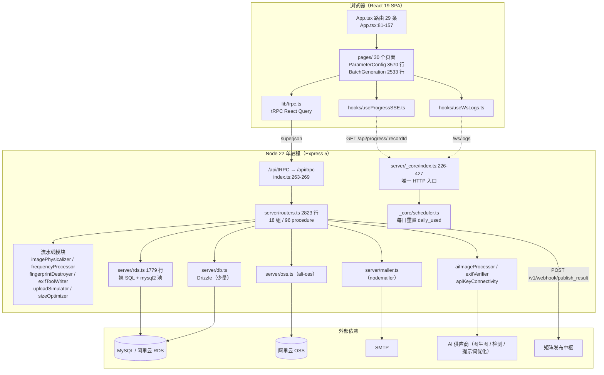
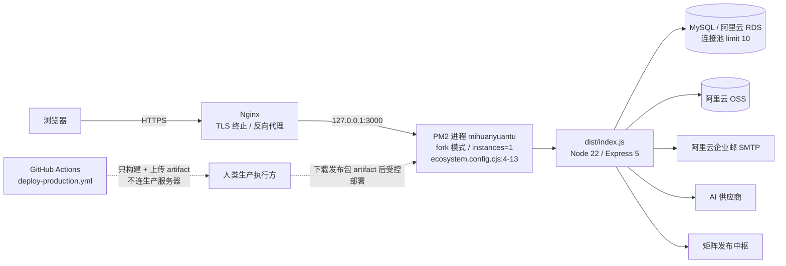
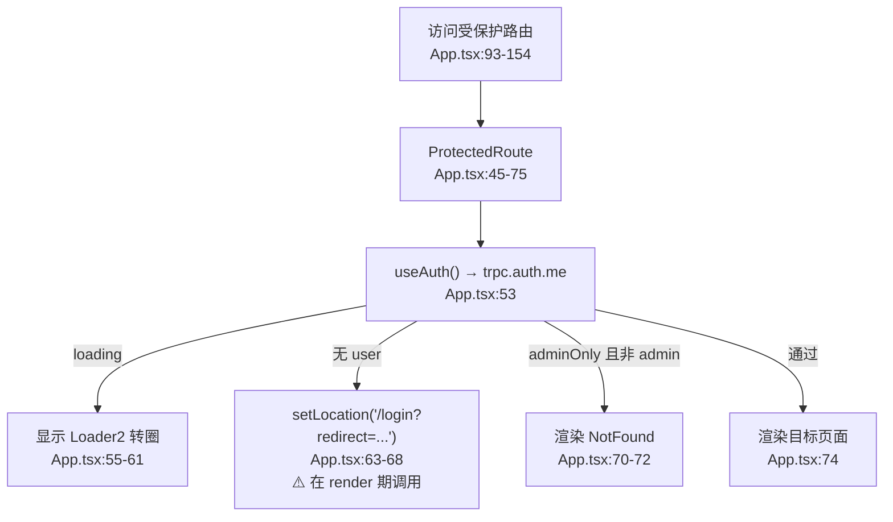
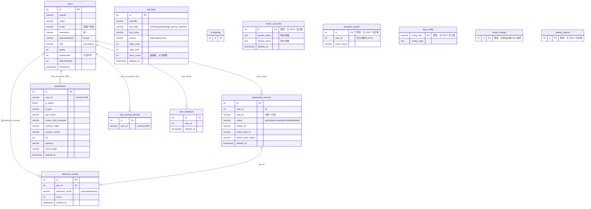

# 蜜獾原图项目架构

> 创建日期：2026-10-16
> 文档定位：基于蜜獾原图仓库（`<仓库 owner>/mihuanyuantu`，私有，TypeScript）`main` 分支的**全量代码取证**（含全部远程分支比对、46 条 Issue/PR 原文读取、关键结论逐条代码核验）写成的**交接用架构说明**。面向接手本项目的开发者与 AI 会话，目标是"读完能安全地在本仓库继续开发"。
> 当前结论：项目是**单体全栈 TypeScript 应用**（Express 5 + tRPC 11 + Drizzle/原生 MySQL + React 19 + Vite），形态为「AI 图片物理化 SaaS」的 **V-1.7.0 测试版**。架构上有四件事必须在动手前知道：**① 三条自定义 HTTP 路由（SSE 进度 / 矩阵回调 / 图片上传）已被 2026-10-17 生产只读实测证实：它们永远返回 `index.html`，功能从未生效；② 数据库存在"迁移链 + 启动期 DDL"双轨，且 `users` 表用 camelCase 列名而 `rds.ts` 用 snake_case 查询，导致管理员仪表盘与矩阵账号接口在生产直接 500；③ `auth.me` 会把含 `passwordHash` 的整行用户记录返回给前端；④ 存在 30 个历史分叉分支，误合即生产事故。** 详见第 3.3、6.4、6.5、7.1 节与《蜜獾原图issues分析.md》第 5、11 章。
> 配套文档：《蜜獾原图技术原理.md》（怎么做到的）、《蜜獾原图issues分析.md》（要做什么、哪些说法不可信）。

---

## 0. 文档定位与正确阅读顺序

### 0.1 三份文档的分工

| 文档 | 回答的问题 | 不回答 |
|---|---|---|
| 本文件 | 项目是什么、由哪些部分组成、怎么跑起来、文档里哪些能信 | 算法细节、待办清单 |
| 《蜜獾原图技术原理.md》 | 图片物理化流水线**怎么做到的**、数据怎么流 | 目录结构、部署 |
| 《蜜獾原图issues分析.md》 | 46 条 Issue/PR 哪些真落地、30 个分支怎么处置、P0 风险在哪 | 架构原理 |

### 0.2 ⚠️ 正确阅读顺序（**不要**照 `AI GUIDE.md` 的自述顺序读）

仓库内并存三份"项目宪法"级别文件，且**角色分工互相矛盾**：

| 文件 | 自称 | 实际权威性 |
|---|---|---|
| `CLAUDE.md:3` | v2-gov.1 / 2026-07-11，"ClaudeCode 唯一入口" | **最新，优先**。`CLAUDE.md:15` 声明 `AI GUIDE.md` §14 的角色分工已被本文件取代 |
| `Agent.md:3` | v2-gov.1 / 2026-07-11，"远端 Codex 唯一入口" | **最新，与 CLAUDE.md 一致**（分别写给两个角色） |
| `AI GUIDE.md:3` | "本文件是…项目宪法和**唯一**项目级 AI/Agent 指令入口" | **部分是过时的**：`:373` 的角色分工与上面两份**完全相反**；且 `:12` 与 `CLAUDE.md:14` 互称"以本文件为准"，构成未消解的双 SSOT |

**冲突实例（务必先看这条）**：

- `AI GUIDE.md:373`：「**Codex 负责审计**、巡检、验收、Issue/PR 质量门禁和合并前判定；**远端 Claude Code 负责功能开发**」
- `docs/agent/codex接续开发提示词.md:35-36`：同上口径
- `CLAUDE.md`§一 与 `Agent.md`§一：**正好相反**——ClaudeCode 负责审计/合并/门禁，远端 Codex 负责实现/提交

→ **结论**：正确顺序是 **`CLAUDE.md`（或按你的角色读 `Agent.md`）→ `docs/ClaudeCode工程经验.md` / `docs/Codex工程经验.md` → 再用 `AI GUIDE.md` 只做"通用工程红线"参考**。若照 `AI GUIDE.md:11` 规定的顺序（先读 AI GUIDE，再读资源清单）开工，拿到的角色分工是**错的那一版**。
补充证据：`AI GUIDE.md:377` 自身后半段又写"PR 由 `<实现方账号>` 创建、`<仓库 owner>` 执行 approve/squash merge"，即 §14 **内部自相矛盾**。

### 0.3 另外两条悬空指针（宪法的权威路径不存在）

- `CLAUDE.md:35` 指向 `docs/docs/GithubPAT.txt` —— **`docs/docs/` 整个目录不存在**（`Test-Path docs/docs` = False）
- `CLAUDE.md:45`、`Agent.md:38` 指向 `docs/docs/蜜獾原图项目架构以及业务流程.md` —— **同样不存在**（该文档实际存放在**仓库外的控制面交付目录**，不在任何 Git 仓库内）

→ 接手人若按宪法去读"架构以及业务流程"，会找不到文件。**本文件即为该文档的仓库内替代品。**

### 0.4 取证基线与方法

| 项 | 值 |
|---|---|
| 基线提交 | `main` @ `4a3f2ad`（2026-07-11，`docs(governance): 完整重命名 Codex工程文件.md → Codex工程经验.md (#46)`） |
| 版本号 | `package.json:3` = `1.7.0`；`shared/version.ts` `APP_VERSION = "1.7.0"` |
| 提交总数 | 173（`main` 线），首提交 2026-04-08 `7a06478` Initial project bootstrap，末提交 2026-07-11 |
| 受跟踪文件 | **339**（`git ls-files`）；顶层目录 11 个 |
| 分支 | 远程 31 个 = `main` + **30 个非 main 分支**（全部为迁移前历史线，见第 10 章与 issues 文档第 5 章） |
| Issue/PR | 46 条 = 33 Issue + 13 PR；`main` **无 tag、无 Release** |
| 取证方式 | SSH 全量克隆（含全部分支）+ GitHub API 读取全部 Issue/PR 与评论 + 逐条代码核验（grep/read） |
| **生产实测** | 2026-10-17 对生产域名做**只读探测**（未登录 HTTP 探针 4 条）+ **管理员登录后的只读浏览**（8 个页面，路由拦截全部写端点）。详见第 3.3、5.5、6.5、7.1.1 节与附录 A/B |

⚠️ **时效提醒**：代码取证日期为 **2026-10-16**，而 `main` 末次提交为 **2026-07-11**，仓库 `pushed_at` 为 2026-07-21。**代码基线落后约 3 个月**；但 2026-10-17 的生产实测证明**生产运行的仍是 `V-1.7.0`**（`/about` 显示 `V-1.7.0`，静态包 `index-ChBaDO7b.js`），因此实测结论对"线上现状"有效。接手第一件事仍应确认这 3 个月是否有未推送/未合并的进展（见第 13 章）。

### 0.5 脱敏声明（本套文档的统一口径）

本套文档遵循「只登记**种类、位置、注入方式、责任通道**，不登记任何值」的口径，该口径来自仓库自身惯例（`docs/agent/蜜獾原图生产环境资源清单.md:7-9`、`CRITICAL_NOTES.md:24-31` 的 `<set-xxx>` 占位写法）。

| 类别 | 写法 |
|---|---|
| 生产域名、公司官网域名、第三方 API 域名 | `<生产域名>`、`<公司官网域名>` |
| 服务器 IP、主机名 | `<生产服务器IP>` |
| GitHub 账号（owner / 实现方 / 初始管理员） | `<仓库 owner>`、`<实现方账号>`、`<初始超级管理员>` |
| 历史旧仓库 | `<旧仓库>` |
| 数据库名 / 实例 | `<生产库>`、`<开发库>`（`scripts/_shared/safe-db.mjs:5-22` 登记的两套目标） |
| 密钥、口令、Token、AccessKey、PAT | **一律不出现**，只写变量名与存放位置 |

> 需要具体值时，从对应责任通道（服务器 `.env`、GitHub Secrets、云控制台、线下密码库）读取；**禁止回显到日志、提交、文档、PR/Issue 评论中**（`docs/agent/蜜獾原图生产环境资源清单.md:70-71`）。

---

## 1. 产品定位与业务上下文

### 1.1 产品是什么

**蜜獾原图** 是面向**跨境电商 POD（Print on Demand）卖家**的 **AI 图片物理化 SaaS 平台**（`AI GUIDE.md:19`、`CLAUDE.md`§三）。

核心业务：把 AI 生成图 / 商品图，通过一整套处理流水线变成"**像是真实相机拍出来的原创图**"，从而通过 TikTok、小红书、Instagram、微信等平台的 **AI 生成内容检测**，并适配海外电商平台的主图与场景图要求（`mihuan-ui/products/yuantu.html:7` 的官网口径：「AI 驱动的跨境商品图原创化批量处理工具」）。

### 1.2 卖给谁、解决什么问题

| 维度 | 内容 |
|---|---|
| 目标客户 | 跨境电商 POD 卖家 / 跨境店铺运营团队（**明确是 B 端，不是 C 端**——`CRITICAL_NOTES.md:4` 记录了用户的三次强调） |
| 客户痛点 | 平台查重与 AI 内容识别导致商品图被限流/下架；手工改图无法批量 |
| 产品价值 | 批量把图"物理化"（EXIF 注入 + 像素物理化 + 频域扰动 + 指纹破坏 + 上传模拟），并给出可量化的"检测分数" |
| 交付形态 | 目标形态是 **多租户 SaaS**（不同商户订阅、配额管理、邮箱注册验证）；**当前实际是单实例 Web 应用 + 按 `user_id` 的单用户隔离** |

### 1.3 与公司产品矩阵的关系

蜜獾原图是**广州蜜獾软件有限公司**（该公司定位为某境外自动化软件厂商在中国的运营实体，品牌名与生产域名同源，故此处脱敏为 `<母公司品牌>`）产品矩阵中的一个产品。同门项目 `D:\workspace\mihuan_software` 是**另一个独立仓库**（公司官网静态站，产品页 `mihuan-ui/products/yuantu.html` 即"蜜獾原图"的介绍页）。

| 对比项 | 蜜獾官网（`mihuan_software`） | 蜜獾原图（本仓库） |
|---|---|---|
| 形态 | 静态 HTML/CSS/JS 多语言站点 | 全栈 TypeScript 应用（SaaS） |
| 数据 | 前端结构化内容文件 | MySQL + OSS |
| 交付 | 站点上线 | 生产部署 + PM2 + Nginx |
| 已有文档体例 | `docs/蜜獾官网项目架构分析.md`（头块：创建日期 / 文档定位 / 当前结论） | 本套三份文档沿用同体例 |

> **不要混用两个仓库的结论**。官网项目"不做账户/交易/数据变更功能"（见其架构文档），本仓库恰恰相反。

### 1.4 目标形态 vs 当前现状（差距一览）

| 能力 | 目标（V2） | 当前（V-1.7.0） | 证据 |
|---|---|---|---|
| 多租户组织 | `organizations`/`org_members`/RBAC | **零实现**：全仓 `org_id`/`orgId`/`organization` 仅命中治理文档文字（`Agent.md:64`、`CLAUDE.md:74`） | issues #30/#31 |
| 配额计量 | Redis 原子扣减 + `usage_records` | **零执行**：`quotaUsed` 全仓只读，处理入口无检查 | `server/rds.ts:911/1599/1652`；`server/routers.ts:689/1346` |
| 任务队列 | Redis + BullMQ + 独立 worker | **伪队列**：无任何服务端 pending 消费者 | issues #28/#29；`server/_core/scheduler.ts:1-43` |
| 计费订阅 | `plans`/`subscriptions` | 零实现 | issue #36 |
| 邮箱注册闭环 | 6 位验证码可用 | **生产静默失效**（SMTP 变量名不匹配） | `server/mailer.ts:23`；issue #17 |
| 新版 UI | 侧边栏 + 组织切换器 + 暗色模式 | `DashboardLayout` **未接线**，无侧边栏 | issue #37 |

### 1.5 核心术语表（读代码前必须理解）

| 术语 | 含义 | 代码锚点 |
|---|---|---|
| **参数预设（preset）** | 一整套 EXIF 参数的模板（约 60+ 字段：ISO/快门/光圈/焦距/GPS/MakerNote…），按设备分 phone/dslr/mirrorless/action 四类 | `drizzle/schema.ts:58`（`parameters` 表） |
| **批量生成任务** | 用户上传原图后，对每张图依次执行完整流水线，结果写 `generation_records` | `drizzle/schema.ts:229` |
| **防御体系** | AI 图生图（第 0 层）→ 像素物理化 → 频域扰动 → 指纹破坏 → EXIF 写入 → 平台上传模拟 → AI 检测验证（**层数口径不统一，见原理文档第 1 章**） | `AI GUIDE.md:142` |
| **检测分数** | 视觉验证 API 返回的真实性评分（0–100），≥70 合格 / ≥80 良好 / ≥90 优秀 | `AI GUIDE.md:143` |
| **API KEY 轮询** | 按 priority（high/medium/low）+ 每日用量从 `api_keys` 表选可用 Key | `server/rds.ts:1147` |
| **文生图队列** | 文本生成图片的任务管理 | ⚠️ **`text_to_image_queue` 表不存在**（issue #28） |
| **矩阵发布** | 把处理完成的图推送到外部矩阵发布中枢 | `server/routers.ts:1229`；`MATRIX_PUBLISH_URL` |
| **IP-GEO** | 预设中绑定的 IP 地址，用于矩阵发布的账号-IP 地理位置绑定 | `parameters.ip_geo`（`server/_core/index.ts:76-88` 启动期补列） |
| **多租户隔离（现状）** | 实为**按 `user_id` 的单用户隔离**，管理员看全量 | `server/rds.ts:72-75`、`:299-302` |

---

## 2. 仓库与技术栈

### 2.1 顶层目录（339 个受跟踪文件）

| 目录/文件 | 文件数 | 职责 | 关键锚点 |
|---|---|---|---|
| `client/` | 131 | 前端。`index.html` + `public/` + `src/`（`components` 73，其中 `ui/` 53；`pages` 32；`lib` 10；`hooks` 6） | `client/src/App.tsx:1-175` |
| `server/` | 72 | 后端。**39 个非测试 `.ts` + 33 个 `*.test.ts`**；`_core/` 为框架层（OAuth/tRPC/Vite/WS/调度） | `server/_core/index.ts`（唯一 HTTP 入口，429 行） |
| `shared/` | 6 | `aiProviderCatalog.ts`、`const.ts`、`domain-dictionaries.ts`、`types.ts`、`version.ts`、`_core/errors.ts` | `shared/version.ts` |
| `drizzle/` | 20 | 14 个 `.sql`（0000–0013）+ `schema.ts`(379 行) + `relations.ts`(27 字节，空) + `meta/`（**仅 0012/0013 两份 snapshot**） | `drizzle/meta/_journal.json:1-104` |
| `scripts/` | 8 | `dev-server.mjs`、`safe-cli.mjs`、`_shared/safe-db.mjs`、`safe-browser-server.mjs`、`db-safe-template.mjs`、`publish-release.sh`、`align-prod-api-keys.mjs`、`check-prod-api-keys.mjs` | `scripts/safe-cli.mjs:138-153` |
| `docs/` | 17 | 根 8 + `docs/agent/` 3 + `docs/architecture_decisions/` 5 + 1 | 见第 10 章 |
| `.github/` | 7 | `CODEOWNERS` + 6 个 workflow | 见第 9 章 |
| `tests/` | 1 | 仅 `tests/safe-regression.spec.ts`（Playwright） | `playwright.config.ts:7` |
| `test/` | 2 | `test/e2e-runner.mjs` + `test/e2e-runner.ts`（**同名双实现，均无入口脚本，从未被执行**） | `package.json:7-24` 无引用 |
| `.vite/` | 2 | ⚠️ **Vite 依赖预构建缓存被提交进 Git**（`.vite/deps/_metadata.json`、`deps/package.json`）；`.gitignore` 无 `.vite` 规则 | `git ls-files` 命中 |
| `patches/` | 1 | `patches/wouter@3.7.1.patch` ⚠️ **未被应用**（`pnpm-workspace.yaml:1-11` 无 `patchedDependencies`，锁文件亦无记录） | — |
| 根目录 md | **49** | 历史文档堆积（全仓 md 共 **66**），分级见第 10 章 | — |

### 2.2 技术栈真相（**声明 vs 实际**）

强制约束来源：`AI GUIDE.md:29-70`、`CLAUDE.md`§三、`Agent.md:32-38`。实际以下表为准：

| 层 | 技术 | 声明 | 实际 | 证据 |
|---|---|---|---|---|
| 运行时 | Node | 22（文档/CI） | ⚠️ **无机器可读声明**（无 `engines`/`.nvmrc`/`.node-version`） | `CLAUDE.md:43`、`.github/workflows/ci.yml:15` |
| 包管理 | pnpm | 10 | 无 `packageManager` 字段；CI 固定 10；且 `pnpm` 被塞进 devDependencies | `package.json:144`、`ci.yml:24` |
| 后端框架 | Express | **Express 4**（`AI GUIDE.md:46`） | **`express@^5.2.1`**（`package.json:84`），而 `@types/express` 仍是 `4.17.21`（`:125`） | 类型与运行时版本错配 |
| RPC | tRPC 11 | ✔ | ✔ 真实使用，挂载于 `/api/tRPC` → `/api/trpc` | `server/_core/trpc.ts:6`、`server/_core/index.ts:263-269` |
| ORM | Drizzle | ✔ | ⚠️ **只覆盖少数函数**；绝大多数查询走 `server/rds.ts` 的**裸 SQL + mysql2 连接池** | `server/db.ts:32-42` vs `server/rds.ts:4-48` |
| 数据库 | MySQL（阿里云 RDS） | ✔ | ✔ | `server/rds.ts:6-48` |
| 对象存储 | 阿里云 OSS | ✔ | ✔ `ali-oss`；⚠️ **AWS S3 SDK 是零引用死依赖**；另有 Manus 存储代理作为回退 | `server/oss.ts:13`、`server/storage.ts`、`package.json:27-28` |
| 图像处理 | sharp | ✔ | ✔ 10 处使用；另有 `canvas` 仅 1 处（验证码） | `package.json:70/105`、`server/captcha.ts:5` |
| EXIF | 系统级 ExifTool v12.76 | `AI GUIDE.md:176`「必须使用系统级 ExifTool，禁止 piexifjs」 | ⚠️ **不成立**：用的是 npm 包 `exiftool-vendored`（自带二进制），**无任何系统 exiftool 可执行文件调用**；且 `piexifjs` 仍在依赖中并被两处使用 | `server/exifToolWriter.ts:17/505`、`package.json:83/98` |
| 前端框架 | React 19 | ✔ | 清单写 `^19.0.0-rc-66a7dbc0-20240801`，但 **caret 允许解析到正式版，锁文件实际为 19.2.1**；`@types/react` 仍是 18 | `package.json:99/101/130`、`pnpm-lock.yaml:228-229` |
| 前端构建 | Vite | ✔ | ✔ dev 模式**内嵌在 Express 进程内**（非独立端口） | `server/_core/vite.ts:9-23` |
| 路由 | wouter | ✔ | ✔ | `client/src/App.tsx:4` |
| 样式/组件 | Tailwind 4 + shadcn/ui | ✔ | ✔（`components/ui/` 53 个文件）；⚠️ 文档规定的 `components/app/` **目录不存在** | `AI GUIDE.md:132` |
| 状态 | tRPC React Query（禁 Redux/Zustand） | ✔ | ✔ | — |
| 进程/代理 | PM2 + Nginx | ✔ | ✔ | `ecosystem.config.cjs` |
| 定时任务 | — | — | `node-schedule`，仅每日重置 `api_keys.daily_used` | `server/_core/scheduler.ts:1-43` |
| 邮件 | SMTP | ✔ | `nodemailer`（阿里云企业邮） | `server/mailer.ts:17-25` |

### 2.3 ⚠️ 死依赖与僵尸配置（接手时先知道，别浪费时间）

| 项 | 状态 | 证据 |
|---|---|---|
| `jsonwebtoken@^9.0.3` | **全仓库零引用**（JWT 只用 `jose`） | `package.json:89`；grep 仅命中声明 |
| `@aws-sdk/client-s3`、`@aws-sdk/s3-request-presigner` | **零 import** | `package.json:27-28` |
| `electron`、`electron-builder`、`electron-is-dev`、`electron-log`、`electron-updater` | 零引用；**`electron/` 目录不存在** | `package.json:80/81/135/138/139/140/147` |
| `better-sqlite3`、`sqlite3` | 零引用 | `package.json:135/147` |
| `package.json:6` `"main": "dist/electron/main.js"` | 指向**不存在**的产物 | — |
| `dev:electron`/`build:electron`/`build:win/mac/linux` | 依赖**不存在**的 `electron/tsconfig.json` | `package.json:9-14` |
| `electron-builder.json` **与** `electron-builder.yml` | 两份并存、互相冲突（输出目录 `dist` vs `dist/packages`，target 不同），且引用的 `assets/`、`electron/installer.nsi`、`customSign.js` **均不存在** | 根目录 |
| `nsis@^0.0.0` | 占位包 | `package.json:143` |
| `patches/wouter@3.7.1.patch` | 未生效 | `pnpm-workspace.yaml` |
| `.vite/deps/*` | 缓存误提交 | `git ls-files` |

### 2.4 模块依赖关系



### 2.5 本地启动与自检（**嵌入本节，因为这是接手第一步**）

#### 2.5.1 ⚠️ `.env.example` **不能用来启动后端**

这是本仓库**最容易踩的第一个坑**。`.env.example`（105 行）是**早期 Vite 前端时代的模板**，只有 `VITE_*` 与 `ALIYUN_OSS_*` 两套命名；而服务端**真正读取的 30 个变量**与之**交集为空**。

| | 内容 |
|---|---|
| `.env.example` 提供的 | `VITE_APP_TITLE`、`VITE_DB_*`（PostgreSQL 5432！）、`VITE_OSS_*`、`VITE_EMAIL_*`、`VITE_GEMINI/SEEDREAM/SEAART/RECRAFT_*`、`VITE_USE_MOCK_DATA`、`DOCKER_*`、`SLACK_WEBHOOK_URL` 等（`.env.example:7-105`） |
| 服务端实际读取的 30 个 | `DATABASE_URL`、`RDS_HOST`、`RDS_USER`、`RDS_PASSWORD`、`RDS_DATABASE`、`JWT_SECRET`、`OAUTH_SERVER_URL`、`OWNER_OPEN_ID`、`OSS_ACCESS_KEY_ID`、`OSS_ACCESS_KEY_SECRET`、`OSS_BUCKET`、`OSS_REGION`、`OSS_CDN_DOMAIN`、`SMTP_HOST`、`SMTP_PORT`、`SMTP_USER`、**`SMTP_PASS`**、`GEMINI_API_KEY`、`GEMINI_MODEL`、`QWEN_IMG2IMG_API_KEY`、`QWEN_IMG2IMG_MODEL`、`MATRIX_API_KEY`、`MATRIX_PUBLISH_URL`、`BUILT_IN_FORGE_API_URL`、`BUILT_IN_FORGE_API_KEY`、`VITE_APP_ID`、`VITE_APP_URL`、`VITE_OAUTH_PORTAL_URL`、`PORT`、`STRICT_PORT`、`NODE_ENV` |

> **变量名清单可以照抄，值必须从责任通道取。** 建议接手时**自己写一份 `.env.local`（勿提交）**，至少填 `DATABASE_URL` 或 `RDS_*` 四件套 + `JWT_SECRET`（否则认证形同虚设，见 7.1）。

#### 2.5.2 启动链路

| 命令 | 实际行为 | 证据 |
|---|---|---|
| `pnpm dev` | `node scripts/dev-server.mjs` → `pnpm exec tsx watch server/_core/index.ts`，`NODE_ENV=development` | `package.json:8`、`scripts/dev-server.mjs:5-11` |
| ↑ 效果 | **单进程**：Express 监听 3000（默认）+ **进程内嵌 Vite 中间件**（无独立 5173） | `server/_core/index.ts:271-272`、`server/_core/vite.ts:9-23` |
| `pnpm build` | `vite build`（→ `dist/public`）**然后** `esbuild server/_core/index.ts --platform=node --packages=external --bundle --format=esm --outdir=dist` → `dist/index.js` | `package.json:10` |
| `pnpm start` | `NODE_ENV=production node dist/index.js` ⚠️ **POSIX 环境变量前缀写法，Windows cmd 下不可直接执行** | `package.json:15` |
| `pnpm check` | `tsc --noEmit`（`tsconfig.json:2` 仅含 `client/src`、`shared`、`server`；`:3` 排除 `**/*.test.ts`） | `package.json:16` |
| `pnpm test` | `vitest run`（`vitest.config.ts:20-25`，`environment: "node"`） | `package.json:18` |
| `pnpm db:push` | `drizzle-kit generate && drizzle-kit migrate`，需要 `DATABASE_URL`，缺失即抛错 | `package.json:19`、`drizzle.config.ts:3-6` |
| `pnpm safe:script:audit` | 脚本安全审计，**必须保持 0 条发现** | `scripts/safe-cli.mjs:78-109` |
| `pnpm test:e2e:safe` | Playwright + `scripts/safe-browser-server.mjs`，端口 **3100**、`STRICT_PORT=true` | `playwright.config.ts:3-4`、`:31-41` |

#### 2.5.3 端口与探测

- `PORT` 默认 **3000**；启动时 `findAvailablePort` 探测 3000–3019，被占用则**自动换端口**（`server/_core/index.ts:277-288`）。
- `STRICT_PORT=true` 时禁止回退，端口被占直接抛错（同上 `:282-286`）。E2E 与安全浏览器服务即用此模式。
- 启动期会先执行**建表/补列 DDL**（见 3.4），因此**首次启动需要数据库可写**。

#### 2.5.4 自检顺序（建议）

```
1. node -v / pnpm -v                      → 期望 Node 22 / pnpm 10（无机器可读声明，只能人工确认）
2. 自建 .env.local（勿提交），填 DATABASE_URL 或 RDS_* + JWT_SECRET（≥32 位）
3. pnpm install                            → 注意：生产部署必须全量安装，禁 --prod（AI GUIDE.md:364）
4. pnpm check                              → 类型检查（electron 残留不影响，因 tsconfig 不含它）
5. pnpm test                               → 注意：rds/qwen 相关测试在缺环境变量时会静默 skip
6. pnpm dev                                → 期望 "Server running on http://localhost:3000/"
7. 打开 http://localhost:3000/             → 首页；再试 /login、/register
8. curl -I http://localhost:3000/api/trpc/system.health   → tRPC 可达性
```

> ⚠️ 第 8 步之后**不要**急着测 `/api/progress/:id`、`/v1/webhook/publish_result`、`/api/upload/image`——它们**很可能返回 HTML 而非预期响应**（原因见 3.3），这是已知风险而非你配错了环境。

---

## 3. 运行时架构

### 3.1 部署拓扑



| 项 | 值 | 证据 |
|---|---|---|
| PM2 应用名 | `mihuanyuantu` | `ecosystem.config.cjs:4` |
| 入口 | `./dist/index.js` | `:5` |
| 工作目录 | `/opt/mihuanyuantu` | `:6` |
| 实例/模式 | `instances: 1`、`exec_mode: 'fork'` ⚠️ **非 cluster** | `:7-8` |
| 环境 | `env_file: /opt/mihuanyuantu/.env`、`NODE_ENV=production`、`PORT: 3000` | `:9-13` |
| 日志 | `/var/log/mihuanyuantu/{out,error}.log`，`merge_logs: true` | `:15-18` |
| 守护 | `autorestart: true`、`max_restarts: 10`、`restart_delay: 3000`、`max_memory_restart: '512M'` | `:20-24` |
| 优雅关闭 | `kill_timeout: 5000`、`listen_timeout: 10000` | `:26-27` |

⚠️ **路径口径冲突**：PM2 用 `/opt/mihuanyuantu`，而 `AI GUIDE.md:77,116` 与 `CRITICAL_NOTES.md:16-21` 写的是 sandbox 路径 `/home/ubuntu/mihuanyuantu-ui`。**以 `ecosystem.config.cjs` 为准**（它是实际执行物）。

### 3.2 服务器入口与中间件顺序（`server/_core/index.ts`，429 行）

| # | 行号 | 内容 | 备注 |
|---|---|---|---|
| — | `:222-224` | 启动期 DDL（`ensureDbSchema` / `ensurePresetRatingsTable` / `ensureUserPromptPresetsTable`） | **早于 `express()`**，见 3.4 |
| — | `:226` | `const app = express()` | — |
| 1 | `:229` | `express.json({ limit: "50mb" })` | — |
| 2 | `:230` | `express.urlencoded({ limit: "50mb", extended: true })` | — |
| 3 | `:231` | `POST /api/analytics` | ⚠️ **无鉴权** |
| 4 | `:261` | `registerOAuthRoutes(app)` → `/api/oauth/callback` | `server/_core/oauth.ts` |
| 5 | `:263-269` | **tRPC 挂载点 `/api/trpc`** | `createExpressMiddleware({ router: appRouter, createContext })` |
| 6 | `:271-275` | dev → `setupVite(app, server)`；prod → `serveStatic(app)` | ⚠️ **这里的 catch-all 是 3.3 的根因** |
| 7 | `:277-288` | 端口探测；`STRICT_PORT` | — |
| 8 | `:291-311` | **`GET /api/progress/:recordId`（SSE）** | ⚠️ 无鉴权 + 疑似被遮蔽 |
| 9 | `:314-370` | **`POST /v1/webhook/publish_result`** | ⚠️ 无验签 + 疑似被遮蔽 |
| 10 | `:373-416` | **`POST /api/upload/image`** | ⚠️ 无鉴权 + 疑似被遮蔽 |
| 11 | `:419` | `setupWsLogs(server)` → **WebSocket `/ws/logs`** | 直挂 `http.Server`，**绕开 Express**，因此不受 3.3 影响 |
| 12 | `:422` | `setupScheduler()` | 每日 0 点重置 `api_keys.daily_used` |
| 13 | `:424-426` | `server.listen(port)` | — |

**关键结论**：**Express 层没有全局鉴权中间件**。所有鉴权依赖 tRPC 的 procedure 级别中间件（见 4.2），而第 3/8/9/10 条是**绕过 tRPC 的裸路由**。

### 3.3 🔴 路由可达性缺陷（**已于 2026-10-17 生产实测证实**）

**事实（代码层面，已逐行确认）**：

- `server/_core/vite.ts:24-47`（dev）：`app.use("/{*splat}", async (req, res, next) => { ... res.status(200)...end(page) })` —— **成功路径不调用 `next()`**，对**任意 HTTP 方法、任意路径**都以 `client/index.html` 应答。
- `server/_core/vite.ts:64-66`（prod）：`app.use("/{*splat}", (_req, res) => { res.sendFile(.../index.html) })` —— 同样是**永不 `next()`**。
- 这两个 handler 分别通过 `setupVite` / `serveStatic` 注册在 `server/_core/index.ts:272` / `:274`，**早于** SSE（`:291`）、Webhook（`:314`）、上传（`:373`）。
- Express 按注册顺序执行中间件；`app.use(path, fn)` 对任意方法生效。

**生产实测结论（2026-10-17，只读探测，未写入任何数据）**：三条路由**全部被 SPA 兜底吃掉**，从未生效。

| 探测 | 期望（若路由可达） | 生产实际返回 | 判定 |
|---|---|---|---|
| 控制组 `GET /api/trpc/system.health` | tRPC JSON | `400` + `application/json` + tRPC 错误体 | ✅ `/api` 路由链路正常 |
| `GET /api/progress/1`（SSE） | `Content-Type: text/event-stream` | `200` + **`text/html`** + **896 字节** | ❌ 被兜底 |
| `POST /v1/webhook/publish_result`（body `{}`） | `400` + JSON `Missing required fields` | `200` + **`text/html`** + **896 字节** | ❌ 被兜底 |
| `POST /api/upload/image`（无 multipart） | `400` + JSON `Missing boundary` | `200` + **`text/html`** + **896 字节** | ❌ 被兜底 |

三条响应的 `ETag: W/"380-19f4042e650"`、`Last-Modified: Wed, 08 Jul 2026 05:45:54 GMT`、`Content-Length: 896` **完全一致**——即同一个 `index.html`，由 `serveStatic` 的 `res.sendFile`（`server/_core/vite.ts:64-66`）发出。

**因此以下三个功能在生产上是"代码写了但接口不存在"**：

| 功能 | 表现为 |
|---|---|
| 批量生成进度条（SSE） | 前端 `useProgressSSE` 拿到 HTML，无法解析，进度永远不动 |
| 矩阵发布结果回写 | 矩阵中枢回调打不进来，`matrix_push_status` **永久停在 pending** |
| 文生图参考图上传 | `TextToImage` 拿到 HTML，上传必然失败 |
| 静态资源/API 之外的普通页面 | 正常（这本来就走兜底） |

**受影响的真实调用方**：

| 调用方 | 期望 | 证据 |
|---|---|---|
| 批量生成进度订阅 | SSE | `client/src/hooks/useProgressSSE.ts:52`、`:96`（批量）、`:110` |
| 文生图参考图上传 | JSON `{url}` | `client/src/components/TextToImage.tsx:98` |
| 矩阵发布结果回写 | 200 + 状态更新 | `server/routers.ts:1270`（回调 URL 由服务端下发给矩阵中枢） |

**为什么必须复核**：这三条恰好是"看起来实现了但可能从未生效"的功能。若确认被遮蔽，则"矩阵发布结果永远是 pending""进度条不动""参考图上传失败"都属预期现象，而不是随机 bug。

> ✅ **本条已不再是推断**：2026-10-17 对生产域名的只读探测直接证实（见上表）。根因是**中间件注册顺序**——`setupVite`/`serveStatic` 的 catch-all 注册在 `server/_core/index.ts:272`/`:274`，早于 `:291`/`:314`/`:373`，且兜底 handler 成功路径**不调用 `next()`**（`server/_core/vite.ts:24-47`、`:64-66`）。
> 唯一确定不受影响的是 WebSocket `/ws/logs`（`server/_core/index.ts:419`、`server/_core/wsLogs.ts:39`），因为它挂在 `http.Server` 上、绕开 Express。
> **修复方向（仅说明，不代劳）**：把这三条路由的注册**上移到 `setupVite`/`serveStatic` 之前**，或让兜底 handler 对 `/api/`、`/v1/` 前缀调用 `next()`。二者取其一即可，改动量都很小。

**旁证**：`server/_core/wsLogs.ts:11`、`:28-36` 的 WS 通道工作正常，说明"实时通道被遮蔽"只发生在经 Express 的那三条上——这与推断一致。

### 3.4 ⚠️ 启动期 DDL：第二套、无版本的迁移机制

每次启动都会执行三段**绕过 Drizzle 迁移**的 DDL（`server/_core/index.ts:222-224`，全部在 `express()` 之前）：

| 函数 | 行号 | 做什么 |
|---|---|---|
| `ensureDbSchema()` | `:15-142` | 对 `generation_records` 逐列 `ALTER TABLE ... ADD COLUMN IF NOT EXISTS`（`:23-74`）；`parameters.ip_geo/user_id/is_public`（`:76-88`）；`users.avatar/bio/display_name/local_email/phone`（`:91-121`）；并**回填旧列** `nickname→display_name`、`email_local→local_email`（`:124-137`） |
| `ensurePresetRatingsTable()` | `:144-165` | 建 `preset_ratings` |
| `ensureUserPromptPresetsTable()` | `:167-187` | 建 `user_prompt_presets` |

**风险**：

1. **异常被静默吞掉**：`.catch(() => {})` 遍布 `:26, :30, :35, :40, :45, :50, :54, :58, :62, :66, :70, :74, :79, :84, :88, :96, :102, :108, :114, :120, :129, :136` —— 补列失败**不会有任何提示**。
2. **线上库真实结构可能是"启动期补丁"的产物**，既不是 `schema.ts` 也不是迁移链（这直接解释了 6.5 的全部漂移）。
3. 与 `pnpm db:push`（`drizzle-kit generate && migrate`）**并行且无版本门禁**；CI 与发布工作流**都不跑迁移**，迁移只在人工本地执行。

### 3.5 生产静态托管细节

| 模式 | 行为 | 证据 |
|---|---|---|
| dev | `createViteServer({ middlewareMode: true, appType: "custom", allowedHosts: true })` → `app.use(vite.middlewares)` → catch-all 注入 `?v=<nanoid>` 后返回 `client/index.html` | `server/_core/vite.ts:9-47` |
| prod | `express.static(distPath)` → catch-all `sendFile(index.html)`；`distPath = <dist>/public` | `server/_core/vite.ts:50-66` |
| 构建产物 | `vite build` → `dist/public`；esbuild → `dist/index.js` | `package.json:10` |
| 调试收集器 | Vite 插件暴露 `POST /__manus__/logs`，日志写 `.manus-logs/*.log`（1MB 上限，裁剪到 60%）；⚠️ `.gitignore` **未忽略** `.manus-logs` | `vite.config.ts:18-19`、`:80-151` |
| 生产 `/api` 反向代理 | Nginx 终止 TLS 并反代到 127.0.0.1:3000 | 部署文档 + `ecosystem.config.cjs` |

> ⚠️ `vite.config.ts:169-171` 别名 `@assets` → `attached_assets`，但**该目录不存在**。

---

## 4. 后端接口面（tRPC）

### 4.1 路由结构总览

- `export const appRouter = router({` 起于 `server/routers.ts:402`，止于 `:2821`；`export type AppRouter` 在 `:2823`。文件 **2823 行 / 119.8KB**。
- **只有 1 个外置子路由**：`system: systemRouter`（`server/routers.ts:403` → `server/_core/systemRouter.ts:5`）。其余 **17 组为同文件内联 `router({...})`**，无 spread 合并。
- ⚠️ **不存在 `admin`/`user`/`preset` 命名空间**（实际命名是 `adminUsers`/`promptPresets`/`parameters`），照直觉 grep 会找不到。
- **procedure 总数 = 96**（另有 `_core/systemRouter.ts` 2 个）。

**级别缩写**：P = `publicProcedure`（**完全无鉴权**）｜R = `protectedProcedure`（需登录）｜A = `adminProcedure`（需 admin）。

| 分组 | 起始行 | procedure（级别:行号） |
|---|---|---|
| `system`（外置） | `:403` | health:`_core/systemRouter.ts:6`(P)、notifyOwner:`:16`(A) |
| `auth` | `:404` | me:405(P)、logout:406(P)、sendVerificationCode:413(**P**)、loginWithPassword:440(P)、resetPassword:493(P)、updateProfile:514(R)、uploadAvatar:527(R)、changePassword:543(R)、getLocalInfo:560(R)、adminUpdateLocalInfo:566(A) |
| `promptPresets` | `:582` | list:583(R)、create:587(R)、update:598(R)、delete:611(R) |
| `dashboard` | `:620` | stats:621(R) |
| `generation` | `:629` | list:630(R)、delete:638(R)、batchDelete:645(R)、create:652(R)、updateStatus:661(R)、processImage:689(R)、batchDownload:1016(R)、batchReprocess:1095(R)、timeoutStuckTasks:1145(R)、reprocess:1176(R)、pushToMatrix:1229(R)、textToImage:1346(R)、setQueuePaused:1597(**R，但应为 A**)、getQueueStatus:1603(**P**)、retryAllFailedText2Img:1607(R)、expandPrompt:1650(R)、promptComplete:1653(R) |
| `detection` | `:1659` | list:1660(R)、batchRetry:1667(R)、batchDownload:1675(R)、batchDelete:1732(R) |
| `parameters` | `:1742` | list:1743(R)、categoryCounts:1773(P)、brands:1782(P)、models:1788(P)、create:1793(R)、update:1805(R)、delete:1841(R)、random:1861(**P**)、fixAll:1871(A)、listInvalid:1929(A)、purgeInvalid:1967(A)、bulkImport:2014(**P**)、healthSummary:2121(**P**)、getRatings:2147(**P**)、submitRating:2167(**P**)、deleteRating:2191(**P**)、optimizePrompt:2206(**P**) |
| `apiKeys` | `:2307` | list:2308(A)、create:2311(A)、update:2334(A)、delete:2345(A)、rotate:2351(**R**)、recentLogs:2367(A)、logsPaged:2373(A)、keysPaged:2379(A)、test:2389(A)、providerCatalog:2407(A) |
| `changelog` | `:2413` | list:2414(**P**)、listAll:2419(A)、create:2422(A)、update:2428(A)、delete:2435(A) |
| `feedback` | `:2444` | list:2445(A)、create:2458(**P**)、update:2480(A)、updateStatus:2491(A)、softDelete:2497(A)、exportCsv:2503(A) |
| `reports` | `:2544` | list:2545(**P**) |
| `adminUsers` | `:2558` | list:2559(A)、updateRole:2571(A)、update:2582(A)、create:2605(A)、resetPassword:2650(A)、updateQuota:2661(A)、delete:2671(A)、unlockUser:2678(A) |
| `stats` | `:2687` | dashboard:2692(R)、adminUserStats:2697(A)、adminDashboard:2700(A)、userPersonal:2703(R) |
| `failureReport` | `:2709` | send:2710(R) |
| `appConfig` | `:2737` | get:2738(**P**)、update:2741(A) |
| `matrix` | `:2757` | listAccounts:2758(R)、createAccount:2764(R)、updateAccount:2776(R)、deleteAccount:2791(R) |
| `analytics` | `:2800` | record:2801(**P**)、stats:2817(**P**) |

### 4.2 鉴权中间件（`server/_core/trpc.ts`，45 行）

| 中间件 | 行号 | 行为 |
|---|---|---|
| `initTRPC.context<TrpcContext>().create({ transformer: superjson })` | `:6-8` | — |
| **`publicProcedure = t.procedure`** | `:11` | ⚠️ **完全无鉴权**（不是"可选登录"） |
| `requireUser` | `:13-26`（判定 `:16-18`） | `if (!ctx.user) throw TRPCError({ code: "UNAUTHORIZED" })` |
| `protectedProcedure = t.procedure.use(requireUser)` | `:28` | 需登录 |
| `adminProcedure` | `:30-45`（判定 `:34-36`） | `if (!ctx.user \|\| ctx.user.role !== 'admin') throw FORBIDDEN` |
| `ctx.user` 来源 | `server/_core/context.ts:11-28`（`:17`、`:20`） | `sdk.authenticateRequest(req)`（cookie 会话），**失败静默为 `null`** |

### 4.3 ⚠️ 鉴权等级错误清单（与 open issue #21 一致，已逐条核验）

| procedure | 行号 | 当前级别 | 应有级别 | 风险 |
|---|---|---|---|---|
| `parameters.bulkImport` | `:2014` | **P** | A | 匿名者可批量导入 ≤500 条预设并 `overwrite`；查重（`:2062-2064`）还是**全局跨用户**的 |
| `parameters.optimizePrompt` | `:2206` | **P** | R | 匿名者可消耗 `key_type=ai_optimize` 的**付费 Key** 刷费用 |
| `parameters.getRatings` | `:2147` | **P** | R | 可读任意预设评价 |
| `parameters.submitRating` | `:2167` | **P** | R | `userId` 由**客户端传入**（`:2170`）→ 可冒充任意用户写评价 |
| `parameters.deleteRating` | `:2191` | **P** | R | 同上（`:2194`），`DELETE ... WHERE preset_id=? AND user_id=?` 用的就是输入值 |
| `generation.setQueuePaused` | `:1597` | R | A | **任意登录用户可暂停全局队列**（DoS） |
| `parameters.random` | `:1861` | **P** | R | 见 6.6 的 IDOR 条目：`getRandomPreset` 的 SQL **无 `is_public`/`user_id` 过滤** |
| `parameters.healthSummary` | `:2121` | **P** | A | 暴露全库预设健康度 |
| `analytics.record` / `analytics.stats` | `:2801` / `:2817` | **P** | R | 未登录可写可读埋点 |
| `reports.list` | `:2545` | **P** | R | 报告列表 |
| `appConfig.get` | `:2738` | **P** | R | 应用配置 |
| `apiKeys.rotate` | `:2351` | R | A | 非 admin 可轮询出 Key 元数据与用量（返回体已剔除 `key_value`，`:2357-2365`） |
| `auth.sendVerificationCode` | `:413` | P | P（合理） | 但会先查邮箱是否存在（`:424-427`）→ **可枚举已注册邮箱** |

> 这些正是 open issue **#21** 的内容，且**当前 main 上一条未修**。完整清单与验收标准见《蜜獾原图issues分析.md》第 6 章。

---

## 5. 前端结构

### 5.1 路由表（`client/src/App.tsx`，175 行，wouter `Switch`，共 29 条）

| 类型 | 路径 | 组件 | 行号 |
|---|---|---|---|
| 公开 | `/` | `Home` | `:83` |
| 公开 | `/installation` | `Installation` | `:84` |
| 公开 | `/login` | `Login` | `:85` |
| 公开 | `/register` | `Register` | `:86` |
| 公开 | `/forgot-password` | `ForgotPassword` | `:87` |
| 公开 | `/about` | `About` | `:88` |
| 公开 | `/product-showcase` | `ProductShowcase` | `:89` |
| 公开 | `/404` | `NotFound` | `:90` |
| 受保护 | `/dashboard` | `Dashboard` | `:93-95` |
| 受保护 | `/parameters` | `ParameterConfig` | `:96-98` |
| 受保护 | `/history` | `GenerationHistory` | `:99-101` |
| 受保护 | `/batch` | `BatchGeneration` | `:102-104` |
| 受保护 | `/detection` | `DetectionResults` | `:105-107` |
| 受保护 | `/settings` | `Settings` | `:108-110` |
| 受保护 | `/parameter-settings` | `ParameterSettings` | `:111-113` |
| 受保护 | `/reports` | `MyReports` | `:114-116` |
| 受保护 | `/feedback` | `UserFeedbackNew` | `:117-119` |
| 受保护 | `/profile` | `Profile` | `:120-122` |
| 受保护 | `/text2img-queue` | `TextToImageQueue` | `:123-125` |
| 管理员 | `/admin/dashboard` | `AdminDashboard` | `:128-130` |
| 管理员 | `/admin/users` | `AdminUserManagement` | `:131-133` |
| 管理员 | `/admin/api` | `AdminAPIManagement` | `:134-136` |
| 管理员 | `/admin/monitor` | `AdminSystemMonitor` | `:137-139` |
| 管理员 | `/admin/analytics` | `AdminAnalytics` | `:140-142` |
| 管理员 | `/admin/feedback` | `AdminFeedbackManagement` | `:143-145` |
| 管理员 | `/admin/monitoring` | `AdminMonitoring` | `:146-148` |
| 管理员 | `/admin/quota` | `AdminQuotaManagement` | `:149-151` |
| 管理员 | `/admin/changelog` | `AdminChangelog` | `:152-154` |
| 兜底 | 其他 | `NotFound` | `:156` |

⚠️ `docs/user-manual.md:7` 写检测结果页是 `/results`，**代码里是 `/detection`** —— 以代码为准。

### 5.2 鉴权实现（`ProtectedRoute`，同文件内）



| 项 | 说明 | 证据 |
|---|---|---|
| 登录态来源 | `useAuth()` → tRPC `auth.me`（cookie 会话） | `client/src/App.tsx:53`、`client/src/_core/hooks/useAuth.ts` |
| redirect 参数 | **写了但没人读**：`App.tsx:64-66` 拼 `?redirect=`，而 `Login.tsx:27-31` 的 `onSuccess` 固定 `window.location.href = "/"` | open issue #39 |
| ⚠️ React 反模式 | `setLocation` 在 **render 期**调用（`:66`），非 `useEffect` | 同上 |
| 全局超时登出 | 3 小时无操作 → `auth.logout` + 跳 `/login?reason=inactivity`；纯客户端 `setInterval`，**服务端不感知** | `client/src/App.tsx:34,40`、`client/src/hooks/useInactivityLogout.ts:11,31-36,58` |
| 前端权限矩阵 | `client/src/lib/auth/permissions.ts`（235 行，admin 60 项 / user 16 项）**未被任何页面或路由消费**（grep 仅命中自身） | ⚠️ **死文件** |

### 5.3 ⚠️ `DashboardLayout` 从未接线

| 事实 | 证据 |
|---|---|
| `DashboardLayout.tsx` 存在（9.7KB），但**全 `client/` 只有 2 处引用**：它自己 + `DashboardLayoutSkeleton.tsx:3` | grep 结果 |
| `client/src/App.tsx` **全文无 `DashboardLayout` import**，没有任何 `pages/*.tsx` 引用它 | `App.tsx:1-36` |
| 其菜单仍是脚手架占位：`{ label: "Page 1", path: "/" }`、`{ label: "Page 2", path: "/some-path" }` | `client/src/components/DashboardLayout.tsx:33-34` |
| 后果 | **全站无侧边栏导航，页面之间无法直接切换**，违反 `AI GUIDE.md:260`（"所有受保护页面使用 DashboardLayout 侧边栏布局"） |

→ 该组件是**死组件**，`AI GUIDE.md:260` 的 UI 范式**当前未被执行**。open issue #37 即为此。

### 5.4 超巨文件（可维护性风险）

| # | 文件 | 大小 | 行数 |
|---|---|---|---|
| 1 | `client/src/pages/ParameterConfig.tsx` | 201.7 KiB | **3570** |
| 2 | `client/src/pages/BatchGeneration.tsx` | 117.4 KiB | **2533** |
| 3 | `client/src/pages/ComponentShowcase.tsx` | 56.9 KiB | 1437（**未接线**） |
| 4 | `client/src/pages/AdminAPIManagement.tsx` | 45.7 KiB | 948 |
| 5 | `client/src/pages/GenerationHistory.tsx` | 43.8 KiB | 1006 |
| 6 | `client/src/pages/Settings.tsx` | 37.0 KiB | 814 |
| 7 | `client/src/pages/AdminUserManagement.tsx` | 36.7 KiB | 908 |
| 8 | `client/src/pages/AdminSystemMonitor.tsx` | 33.9 KiB | 707 |
| 9 | `client/src/pages/DetectionResults.tsx` | 32.2 KiB | 730 |
| 10 | `client/src/pages/AdminDashboard.tsx` | 20.8 KiB | 553 |

后端同样：`server/routers.ts` 2823 行 / 119.8KB，`server/rds.ts` 1779 行 / 63KB，`server/exifWriter.ts` 52KB。
**接手建议**：改这两类文件前先用 grep 定位，不要整文件读；也不要顺手重构（会与"最小改动 + 门禁"流程冲突）。

### 5.5 孤儿页面与假页面（⚠️ 别被 UI 骗了）

| 页面 | 状态 | 证据 |
|---|---|---|
| `ComponentShowcase.tsx`（1437 行） | **未接线**（无路由） | `App.tsx:1-36` 无 import |
| `ParametersManagement.tsx` | **未接线** | grep 仅命中自身 |
| `AdminQuotaManagement.tsx` | 🔴 **100% 假页面（已生产实测证实）**：零 `trpc.` 调用；打开 `/admin/quota` 全程只有 1 个 `auth.me` 请求、**零数据请求**；页面显示的 3 个用户（`dog`/`john_doe`/`enterprise_user`，邮箱为 `@example.com` / `@company.com`）与 `/admin/users` 的 6 个真实账号**完全不重合**；且它显示"用户总数 3"而真实是 6 | `:75`、`:120`、`:150`；2026-10-17 生产实测 |
| `AdminMonitoring.tsx` | 🔴 **零 `trpc.` 调用（已生产实测证实）**：打开 `/admin/monitoring` 全程只有 `auth.me`，延迟 245ms / 错误率 0.6% / 可用性 99.8% / 请求数 11,334 全部是硬编码假数据 | `:64`、`:74`、`:101`；2026-10-17 生产实测 |
| `Settings.tsx` | ⚠️ **部分假**：`handleSave` 是 `setTimeout` 假成功（`:478-481`、`:474-475`），但同文件另有真实 mutation（`:36`、`:112-121`、`:265-274`、`:415`） | 同上 |
| `AdminAnalytics.tsx` | ⚠️ **只读浏览器 localStorage**，不读服务端（见原理文档第 18 章） | `:5`、`:20-21`、`:32`、`:45` |
| `GenerationHistory.tsx` | 内含本地 `mockData` 数组 | `:64` |
| `TextToImageQueue.tsx` | ⚠️ **字段名存在代码层错配风险**（`gen_status` vs 真实 `status`）；若生产返回文生图任务记录，四个统计卡片可能按空值计数为 0 | `:94-97`、`:332`；见原理文档第 13 章 ⚠️ **注**：2026-10-17 生产实测该页四个计数确实全为 0，但**该页当时也确实没有任何文生图任务**（列表为空），因此这条代码推论**尚未被实测区分**——见原理文档 13.5 |

> ⚠️ `AdminQuotaManagement` 与 `AdminMonitoring` **都在 `App.tsx:147,150` 真实挂了路由**（`ProtectedRoute adminOnly`），所以"能打开"不等于"是真的"。真实配额入口其实在 `AdminUserManagement:146`（open issue #38）。
> ✅ **2026-10-17 生产实测已确认**：这两个页面在管理员登录状态下打开时，`/api` 请求数**各只有 1 个 `auth.me`**，没有任何数据查询；而同批访问的 `/admin/users` 有真实的 `stats.adminUserStats` 请求作为对照。这排除了"数据来自缓存"的可能。

---

## 6. 数据层

### 6.1 ER 图（含 SSOT 之外的"野表"）



### 6.2 SSOT：`drizzle/schema.ts`（379 行）**只有 8 张表**

| 导出变量 | SQL 表名 | 定义行号 | 被服务端使用 |
|---|---|---|---|
| `users` | `users` | `:17` | ✔（`server/db.ts:4`、`server/rds.ts:911`） |
| `parameters` | `parameters` | `:58` | ✔（`server/rds.ts:297` 起） |
| `userPromptPresets` | `user_prompt_presets` | `:212` | ✔（`server/db.ts:307`、`:322`、`:345`、`:351`） |
| `generationRecords` | `generation_records` | `:229` | ✔（`server/rds.ts:68` 等） |
| `detectionResults` | `detection_results` | `:271` | ✔（`server/rds.ts:196`、`:203`） |
| `apiKeys` | `api_keys` | `:304` | ✔（`server/rds.ts:834`、`:1140`） |
| `userFeedback` | `user_feedback` | `:340` | ✔（`server/rds.ts:716`、`:724`） |
| `changelog` | `changelog` | `:360` | ✔（`server/routers.ts:2414-2435`） |

`drizzle/relations.ts` = 27 字节**空文件**（Drizzle relations 从未定义）。

### 6.3 迁移链 `drizzle/0000`–`0013`（14 个 `.sql`，与 `meta/_journal.json` 14 条一致）

| 文件 | 一句话 | 证据 |
|---|---|---|
| `0000_omniscient_mauler.sql` | 只建 `users`（8 列），`role` 当时是 `enum('user','admin')` | `:1-13` |
| `0001_thin_silver_samurai.sql` | 建 `api_keys`/`detection_results`/`generation_records`/`parameters`/`user_feedback`；给 `users` 加 `quota`、`quotaUsed` | `:1`、`:17`、`:32`、`:52`、`:112`、`:127-128` |
| `0002_odd_revanche.sql` | `users` 加 `username`(唯一)、`passwordHash` | `:1-3` |
| `0003_lame_jocasta.sql` | `users` 加 `loginAttempts`、`lockedUntil` | `:1-2` |
| `0004_bumpy_anthem.sql` | `parameters.category` 改 4 值 ENUM | `:1` |
| `0005_flaky_shooting_star.sql` | 建 `changelog`；`api_keys` 加 `priority`(ENUM)、`remark` | `:1`、`:14-15` |
| `0006_slow_namor.sql` | `users` 加 `avatar`/`phone`/`bio`/**`nickname`** | `:1-4` |
| `0007_pink_lilandra.sql` | `api_keys.provider` 扩 ENUM；加 `model_version` | `:1-2` |
| `0008_lean_havok.sql` | `api_keys.provider` 再加 deepseek/kimi/doubao/qwen/zhipu | `:1` |
| `0009_tan_green_goblin.sql` | `detection_results` 加 5 个评分列 + `used_provider`/`used_model` | `:1-7` |
| `0010_woozy_ken_ellis.sql` | `parameters` 加 `gps_mode`/`scene_type`/`focal_plane_*`/`maker_note_template`；改 `color_space` ENUM | `:1-7` |
| `0011_luxuriant_frightful_four.sql` | `parameters` 加 3 个 AI 提示词/强度列 | `:1-3` |
| `0012_keen_grim_reaper.sql` | 22 处 **ENUM→varchar 回归** + `generation_records` 加 11 个矩阵/检测/文生图列 | `:1-34` |
| `0013_feedback_soft_delete.sql` | `user_feedback` 加 `deleted_at` | `:1` |

⚠️ `drizzle/meta/_journal.json:99` 中 `0013` 的 `when = 1780000000000`（**整数占位**，与其它真实时间戳风格不同）；且 `meta/` 只保留 **0012、0013 两份 snapshot**，0000–0011 缺失。

### 6.4 ⚠️ 野表清单（在运行时被读写，但**完全游离于 `schema.ts` 与迁移之外**）

| 野表 | 读写点 | 额外风险 |
|---|---|---|
| `matrix_accounts` | `server/rds.ts:1734`(SELECT)、`:1751`(INSERT)、`:1771`(UPDATE)、`:1778`(软删) | 🔴 **2026-10-17 生产实测：`matrix.listAccounts` 直接 500** —— `Unknown column 'deleted_at' in 'where clause'`。说明该表**存在但缺 `deleted_at` 列**（`server/rds.ts:1727` 却写死了 `WHERE deleted_at IS NULL`）→ 矩阵账号功能在生产完全不可用。另：内含**明文**第三方 `access_token`/`refresh_token`（open issue #26 要求信封加密） |
| `analytics_events` | `server/rds.ts:863`(INSERT)、`:872`/`:876`/`:880`(SELECT) | 写入的 `user_id` 恒为 NULL（见原理文档第 18 章） |
| `app_config` | `server/rds.ts:1679`(SELECT)、`:1696`(INSERT…ON DUPLICATE KEY) | 企业配置 |
| `preset_ratings` | 仅在启动期 `CREATE TABLE IF NOT EXISTS`（`server/_core/index.ts:148-160`）；使用于 `server/routers.ts:2153`、`:2178`、`:2199` | **无任何迁移** |
| `weekly_reports` | `server/rds.ts:771` | **无任何迁移** |
| `text_to_image_queue` | ⚠️ **表根本不存在**，但文档与 issue 都引用它 | `AI GUIDE.md:146`、open issue #28 |

> `server/rds.test.ts:44` 甚至**断言线上必须存在 `analytics_events`** —— 这是"库即真相、schema 非真相"的自证。

### 6.5 ⚠️ `schema.ts` ↔ 迁移链 ↔ 线上库 三向漂移清单

| 漂移项 | 证据 |
|---|---|
| **`users` 的列名是 camelCase，但 `rds.ts` 用 snake_case 查询** 🔴 | 迁移 `drizzle/0000_omniscient_mauler.sql:8-10` 建的是 `createdAt` / `updatedAt` / `lastSignedIn`（**camelCase**）；快照 `0013` 中 `users` 的 19 列同样是 `createdAt`/`updatedAt`/`lastSignedIn`，而 `api_keys`/`parameters`/`generation_records` 等**都是 snake_case**。但 `server/rds.ts:1484` 用 `updated_at`、`:1599` 用 `created_at` → **2026-10-17 生产实测：`stats.adminDashboard` 直接 500，报 `Unknown column 'updated_at' in 'field list'`**（就是 `rds.ts:1480-1484` 这条查 `users` 的 SQL） |
| **`users.deleted_at` 被查询但不存在**（schema 与全部迁移均无该列） | `drizzle/schema.ts:17-49` 无 `deletedAt`；迁移 `0000` 与 `0006:1-4` 均未加该列；快照 `0013` 的 `users` 19 列中**没有 `deleted_at`**；查询点 `server/rds.ts:1484`、**`:1599`**（`stats.userPersonal`）。⚠️ 生产实测在 `:1484` 处先被 `updated_at` 报错挡住，故 `deleted_at` 的不存在由**迁移链 + 快照**确证（非同一错误信息） |
| **`users.display_name` / `users.local_email` 在 schema 有定义但无迁移**；迁移 `0006:4` 加的旧列 `nickname` **不在 schema**（下次 `generate` 会误删） | `drizzle/schema.ts:42`、`:44`；`drizzle/0006_slow_namor.sql:4`；`drizzle/meta/0013_snapshot.json:1319-1320` 仍含 `nickname` |
| **`user_prompt_presets` 在 schema 有定义但无 CREATE TABLE 迁移** | `drizzle/schema.ts:212`；`drizzle/*.sql` 零命中；实际靠 `server/_core/index.ts:171-182` 建表 |
| **`parameters.user_id` / `parameters.is_public` 有定义无迁移** | `drizzle/schema.ts:200`、`:202`；靠 `server/_core/index.ts:81-88` |
| **`api_keys.group_name/key_type/api_format/base_url/error_count` 有定义无迁移** | `drizzle/schema.ts:317`、`:319`、`:321`、`:323`、`:325` |
| 对照组（**一致**）：`generation_records` 的 11 列由 `0012` 添加且 schema 亦有 | `drizzle/0012_keen_grim_reaper.sql:23-34` ↔ `drizzle/schema.ts:235`、`:243`、`:248`、`:250`、`:252`、`:254-260` |
| **`meta/` 快照不完整** | 仅 `0012_snapshot.json`、`0013_snapshot.json` |

**可复现的核验方法**：① `grep "mysqlTable(" drizzle/schema.ts` → 8 张；② `grep "CREATE TABLE" drizzle/*.sql` → 7 张（users@0000；api_keys/detection_results/generation_records/parameters/user_feedback@0001；changelog@0005）；③ 反查 `server/*.ts` 的 `FROM/INTO/UPDATE` 表名；④ 三集合做差。

> ⚠️ **在 open issue #25 完成之前，禁止在生产执行 `pnpm db:push`** —— `drizzle-kit generate` 可能生成"删除 schema 中不存在的列"的破坏性迁移（如 `nickname`），且现网结构本身可能就是启动期 DDL 的产物。

### 6.6 两套数据访问方式并存

| 方式 | 文件 | 特征 | 风险 |
|---|---|---|---|
| Drizzle ORM | `server/db.ts`（`:29` 惰性单例；`:32-42` 仅在 `DATABASE_URL` 存在时建连，失败只 `console.warn` 并返回 `null`） | 只覆盖少数函数；调用方需自处理 `null`（`:49-53`） | 无启动校验、无连接池参数、无重连 |
| **原生 mysql2 连接池 + 裸 SQL** | `server/rds.ts`（`:4` 惰性单例；`:6-35` 优先 `RDS_*`，回退解析 `DATABASE_URL`，都缺则 `throw`；`:40-45` `createPool({ waitForConnections: true, connectionLimit: 10, queueLimit: 0 })`） | **1779 行、55 个导出函数，承载绝大多数查询** | 租户过滤靠**手写 SQL 拼接**，漏一处即 IDOR |

**租户隔离的三种写法（第三种是裂缝）**：

1. **显式 owner scope 下推 UPDATE**（最稳健）：`server/rds.ts:976-1017` `updateGenerationRecord(id, data, opts)`，非 admin 时 SQL 追加 `AND user_id = ?`（`:1008-1012`）。
2. **WHERE 拼接 `user_id`**：`server/rds.ts:72-75`、`:299-302`（`parameters` 用 `(is_public=1 OR (is_public=0 AND user_id=?))`）、`:1729-1732`、`:1712-1719`。
3. **先 SELECT 判归属再写**：`server/routers.ts:1815-1837`（**含 `String()` 比较**，因为 `parameters.user_id` 是 varchar 而 `generation_records.user_id` 是 int）、`:1845-1857`、`:1190-1216`。

⚠️ **`user_id` 类型不一致是 V2 引入 `org_id` 时最容易漏改的地方**：`parameters.user_id varchar(128)`（`schema.ts:200`）vs `generation_records.user_id int`（`:231`）vs `user_prompt_presets.user_id varchar(128) notNull`（`:214`）。

### 6.7 ⚠️ IDOR 风险点（仅按主键操作，非 admin 调用者无归属校验）

| 位置 | 问题 | 证据 |
|---|---|---|
| `generation.pushToMatrix` | `SELECT id, output_url, task_id FROM generation_records WHERE id = ?` —— **无 `user_id`** → 任意登录用户可发布/篡改他人图片与矩阵状态 | `server/routers.ts:1244-1247`（mutation 起于 `:1229`） |
| `matrix.updateAccount` / `deleteAccount` | mutation **完全不取 `ctx`**；底层 `UPDATE/DELETE matrix_accounts ... WHERE id = ?` **无 `user_id`** → 可改删他人矩阵账号（内含明文 token） | `server/routers.ts:2776`、`:2786-2789`、`:2791-2794`；`server/rds.ts:1771`、`:1778` |
| `detection.batchRetry` → `rds.batchRetryDetection` | 函数签名声明了 `userId?`/`isAdmin?`，但函数体（`:160-199`）**从未使用它们**，SQL 只有 `d.id IN (...)` → 可重试任意人的检测 | `server/rds.ts:160`、`:166-172`、`:195-198`；调用点 `server/routers.ts:1667` |
| `parameters.random` → `rds.getRandomPreset` | `SELECT * FROM parameters WHERE deleted_at IS NULL ... ORDER BY RAND()` —— **无 `is_public`/`user_id` 过滤**，且 procedure 是 **publicProcedure** → 未登录即可拉到任意用户的**私有预设整行** | `server/rds.ts:428-441`；`server/routers.ts:1861` |
| `generation.processImage` 读预设 | 按 `parameterId` 直查 `parameters`，**无 `is_public`/归属校验** → 可引用他人私有预设出图 | `server/routers.ts:743-749` |
| 用量自增 | `UPDATE parameters SET usage_count=usage_count+1 WHERE id=?` 无归属校验 | `server/routers.ts:900-910` |
| 评价三接口 | 全 `publicProcedure`，`userId` **由客户端传入** → 可冒充任意 userId 写/删评价 | `server/routers.ts:2170`、`:2194`、`:2199-2200` |

> 完整验收标准见《蜜獾原图issues分析.md》第 6 章（open issue #20/#21）。

---

## 7. 认证、会话与权限

### 7.1 ⚠️ `JWT_SECRET` 默认空串且无启动校验（认证绕过面）

| 事实 | 证据 |
|---|---|
| `cookieSecret: process.env.JWT_SECRET ?? ""` —— 缺失时**退化为空串** | `server/_core/env.ts:3` |
| 消费点直接用该密钥签/验 HS256，**无任何非空断言** | `server/_core/sdk.ts:157-160`、`:181-198`、`:200-233` |
| 全仓 `JWT_SECRET` **仅此 1 处读取** → 不存在 fail-fast | grep 结果 |

**后果**：生产漏配 `JWT_SECRET` 时，攻击者可用**空密钥**自签 `{openId, appId, name}` 伪造任意会话，构成完全认证绕过。这正是 open issue **#18**（V-1.7.1 P0 之首）。

### 7.1.1 🔴 `auth.me` 把 `passwordHash` 返回给前端（2026-10-17 生产实测新增）

| 项 | 内容 |
|---|---|
| 代码 | `server/routers.ts:405`：`me: publicProcedure.query(opts => opts.ctx.user)` —— 直接把 `ctx.user` 整个对象返回 |
| `ctx.user` 是什么 | `server/_core/context.ts:11-28` → `sdk.authenticateRequest(req)` 加载的**完整用户行**（含 `passwordHash`） |
| 生产实测 | 管理员登录后 `GET /api/trpc/auth.me` 的响应里确实带有 `"passwordHash":"<bcrypt哈希已脱敏>"`（bcrypt 哈希）、`username`、`email`、`openId`、`quota` 等全部字段 |
| 影响 | 任何登录用户都能在浏览器 DevTools / 网络面板里看到**自己的 bcrypt 哈希**；若同类写法扩散到他人数据接口，则会造成批量凭据泄露。哈希虽非明文，但属于可直接离线爆破的材料（尤其本次实测到的哈希为 **cost 10**，低于注册路径的 cost 12） |
| 建议 | `auth.me` 只返回白名单字段（`id/name/role/username/quota/quotaUsed`）；这是**独立于 open issue #18/#24 的新发现，建议单独开 issue** |

> ⚠️ 本文档**不记录**该哈希值。取证时的原始响应已在 `.work\browser\` 下做脱敏处理（`passwordHash` 已替换为 `<REDACTED>`），浏览器 profile（含会话 Cookie）已删除。

### 7.2 会话机制

| 项 | 值 | 证据 |
|---|---|---|
| JWT 库 | **只用 `jose`**（`SignJWT`/`jwtVerify`，HS256） | `server/_core/sdk.ts:6`、`:190-197` |
| 死依赖 | `jsonwebtoken@^9.0.3` **零引用** | `package.json:89` |
| 存放 | HttpOnly Cookie `app_session_id` | `shared/const.ts:1` |
| Cookie 属性 | `httpOnly: true`、`path: '/'`、⚠️ **`sameSite: "none"`**、`secure: isSecureRequest(req)` | `server/_core/cookies.ts:43-46` |
| ⚠️ CSRF | **无 CSRF token**；`sameSite: "none"` 意味着跨站可携带 → 与 open issue #24 一致 | grep 无 CSRF 实现 |
| ⚠️ 过期双口径 | **JWT 本身**：账号密码注册/登录走默认 **`ONE_YEAR_MS`（1 年）**；OAuth 回调显式传 **8 小时**（`SESSION_DURATION_MS`）。**Cookie 属性**：2026-10-17 生产实测为**浏览器会话级**（`expires ≤ 0`，关闭浏览器即失效；重开新会话后 `cookies` 为空、受保护接口 401） | `server/_core/sdk.ts:186`；`shared/const.ts:2-3`；`server/_core/oauth.ts:41,45`；2026-10-17 实测 |
| ⚠️ 吊销 | **无会话表、无黑名单** → 无法强制下线（改密码也不失效） | — |
| OAuth | `state` 是 `atob` 出来的 redirectUri，**无 state 防伪校验** | `server/_core/sdk.ts:41-44`、`server/_core/oauth.ts:12-53` |
| 每请求鉴权 | `authenticateRequest` 按 `openId` 查库；用户不存在时用 OAuth 服务回同步 | `server/_core/sdk.ts:259-301` |

### 7.3 密码、验证码与锁定

| 项 | 值 | 证据 |
|---|---|---|
| 密码哈希 | bcryptjs，**cost 12**（注册 `server/routers.ts:389`、重置 `:508`、管理员建号 `:2621`、管理员重置 `:2656`） | ⚠️ 但 `changePassword` 用 **cost 10**（`:554`）→ 自身不一致 |
| 登录锁定 | 5 次失败锁 15 分钟，`lockedUntil` 服务端校验 | `server/routers.ts:451-485` |
| 邮箱验证码存储 | ⚠️ **模块级内存 `Map`、明文、重启丢失** | `server/routers.ts:57` |
| 验证码生成 | ⚠️ **`Math.random`（非 CSPRNG）**，无哈希 | `server/routers.ts:58` |
| 有效期 | 10 分钟 | `server/routers.ts:429` |
| 限流 | 同 email+type 1 分钟内拒绝 | `:420-423` |
| ⚠️ 尝试上限 | **无**；校验失败不删除 → 10 分钟窗口内可反复试 | `:380`、`:501` |
| ⚠️ 比较方式 | 普通 `!==`（非常量时间） | `:381`、`:502` |
| 图形验证码 | `server/captcha.ts` 独立实现（TTL 60s、5 次上限、一次性）—— ⚠️ 但 `captchaManager` **全仓无任何调用方**，且同样用 `Math.random`（`:90`）→ **死模块** | `:19-22`、`:57-66`、`:79`、`:90` |
| 账号枚举 | 注册查重/登录/重置响应可区分邮箱是否存在 | open issue #24 |

### 7.4 权限模型（现状）

- **后端**：只有三档 —— `publicProcedure` / `protectedProcedure` / `adminProcedure`（`server/_core/trpc.ts:11/28/30-45`），**没有任何资源级权限**（如"能否编辑这个预设"），资源级判断散落在各 procedure 的手写代码里（见 6.7）。
- **前端**：`client/src/lib/auth/permissions.ts` 有一套 235 行的 `ROLE_PERMISSIONS`/`ROUTE_PERMISSIONS` 矩阵，**完全未接线**（grep 只命中自身）→ 前后端权限口径**没有任何一致性校验**。
- **结论**：open issue #30/#31 要做的事情（`organizations` + `TenantScopedRepository` + RBAC）在当前代码里是**零基础**。

---

## 8. 存储与文件流转

### 8.1 通道总览

| 通道 | 实现 | 用途 | 证据 |
|---|---|---|---|
| **OSS（主）** | `server/oss.ts` `ali-oss`：`getOssClient`（`:18-38`）读 `OSS_ACCESS_KEY_ID/SECRET/BUCKET/REGION`，**缺凭证返回 null**；`storagePutOss`（`:47-82`）`client.put` → URL 优先 `OSS_CDN_DOMAIN`，否则拼接默认域名；⚠️ **失败自动回退 Manus S3**（`:73-77`） | 全部业务上传：AI 输入临时图 `ai-input/...`（`server/routers.ts:771-773`）、最终成图 `processed/{ts}_{name}_{model}_{yyyymmdd}.jpg`（`:870-876`）、文生图 `text2img/...`（`:1511-1512`）、头像 `avatars/{userId}-{ts}.{ext}`（`:535`）、参考图 `ref_images/...`（`server/_core/index.ts:409`） | `server/oss.ts:13` |
| 签名 URL | `server/oss.ts:90-111` `getPresignedUrl`，默认 **48 小时**（`:92`）；无凭证时回退公开 URL | 矩阵发布前取图（`server/routers.ts:1257-1261`） | 同上 |
| 删除 | `server/oss.ts:116-125`（失败仅 `console.error`） | 清理 | 同上 |
| **Manus 存储代理（遗留）** | `server/storage.ts`：`storagePut`（`:70`）POST `v1/storage/upload?path=` + Bearer；凭证 `BUILT_IN_FORGE_API_URL/KEY`（`:8-19`） | AI 返回图落盘（`server/aiImageProcessor.ts:505-526`）；OSS 失败回退（`server/oss.ts:73-77`） | `server/storage.ts` |
| **S3 SDK** | ⚠️ **零 import 死依赖** | — | `package.json:27-28` |
| **前端"直传"** | ⚠️ **死模块**：`client/src/lib/aliyun/oss.ts` 调 `/api/oss/test`、`/api/oss/upload`、`/api/oss/delete`、`/api/oss/list`，而**服务端不存在任何 `/api/oss/*` 路由** | `client/src/lib/aliyun/oss.ts:24,50,93,144,175` |
| **真实上传端点** | `server/_core/index.ts:373-416` `POST /api/upload/image`：**手写 multipart 解析**（找 `\r\n\r\n`、去尾 boundary），MIME 仅从 header 取默认 `image/jpeg`，key 用 `Date.now() + Math.random()`；⚠️ **无鉴权、无大小限制、无类型白名单**，且**疑似被 3.3 遮蔽** | 同上 |

### 8.2 上传路径规范

| 场景 | key 模式 |
|---|---|
| AI 输入临时图 | `ai-input/...` |
| 最终成图 | `processed/{timestamp}_{fileName}_{model}_{yyyymmdd}.jpg` |
| 文生图 | `text2img/...` |
| 头像 | `avatars/{userId}-{timestamp}.{ext}` |
| 文生图参考图 | `ref_images/{timestamp}_{random}.{ext}` |
| AI 处理后 | `ai-processed/{timestamp}-{random}.png` |

⚠️ `AI GUIDE.md:163` 要求"OSS 上传路径必须包含随机后缀，防止枚举"，但**成图路径 `processed/...` 不含随机后缀**（含可预测的时间戳 + 文件名 + 机型 + 日期）→ 与红线不符。

---

## 9. CI/CD 与发布门禁

### 9.1 六个 workflow

| Workflow | 触发 | 是否部署生产 | 用到的 secrets（仅名称） | 备注 |
|---|---|---|---|---|
| `ci.yml` | `push`/`pull_request` → `[main, develop]`（`:3-7`）；3 jobs：`lint-and-test`（Node 22.x / pnpm 10，`pnpm check`+`test`+`build`）、`security-check`、`notify` | ❌ 否 | `RDS_HOST`、`RDS_USER`、`RDS_PASSWORD`、`RDS_DATABASE`（`:42-45`） | 唯一跑 `pnpm check/test/build` 的地方 |
| `build.yml` | `push`→`[main, develop]` + `tags ['v*']`；`workflow_dispatch`（`:3-7`） | ❌ 否 | `DOCKER_USERNAME`、`DOCKER_PASSWORD`（`:62-63`） | ⚠️ 有 `build-docker` job（`:58-87`）但**仓库里没有任何 Dockerfile** |
| `build-and-release.yml` | `push tags ['v*']` + `workflow_dispatch`(input `version`)（`:3-11`）；三平台打 **Electron 安装包** + 建 GitHub Release | ❌ 否 | `CERTIFICATE_PASSWORD`、`APPLE_ID`、`APPLE_ID_PASSWORD`、`APPLE_TEAM_ID`、`GITHUB_TOKEN` | ⚠️ 面向**已不存在的 Electron 形态** |
| `release.yml` | `push tags ['v*']` + `workflow_dispatch`（`:3-7`）；三平台构建 + Release + Slack | ❌ 否 | `GITHUB_TOKEN`、`SLACK_WEBHOOK` | 同上，与 `build-and-release.yml` **功能重叠** |
| `deploy.yml` | **仅 `workflow_dispatch`**（`:8-9`）；头注自述已被取代 | ⚠️ **是（真实 SSH/SCP + PM2 reload，且仅手动）** | `DEPLOY_SSH_KEY`、`DEPLOY_HOST`、`DEPLOY_USER`、`DEPLOY_DIR`、`SITE_URL` | 名字带 "Legacy – Manual Only"；目标 IP 已脱敏，目录默认 `/opt/mihuanyuantu`；`pnpm install --no-frozen-lockfile`（`:107-113`） |
| `deploy-production.yml`（name: Final Release Package） | `workflow_dispatch`（须 `release_confirm=FINAL_RELEASE`，否则首步 `exit 1`，`:46-65`）+ `release: types: [published]`（`:14-28`） | ❌ **否（名称有误导性）** | **零 secrets** | 只做 `pnpm build` → `tar` 四件（`dist/`、`package.json`、`pnpm-lock.yaml`、`ecosystem.config.cjs`，`:117-121`）→ `upload-artifact`（`:126`）→ `continue-on-error: true` 的只读健康检查（`:134-142`）；`:153` 自述"生产部署：未由 GitHub Actions 执行" |

> ⚠️ **命名与实际风险相反**：`deploy-production.yml` 名为部署实为**出包**且零 secrets；真正会 SSH 上生产执行 `pm2 reload` 的是名字带 "(Legacy – Manual Only)" 的 `deploy.yml`。

### 9.2 发布门禁口径（V-1.7.0 收口）

| 场景 | 结果 | 来源 |
|---|---|---|
| 普通 PR 合并到 `main` | **只触发 CI/构建校验，不写生产** | `AI GUIDE.md:317-328` |
| 最终发布包 | **二选一**：① GitHub Release 发布（`release.published`）② 人工 `workflow_dispatch` 且 `release_confirm=FINAL_RELEASE` | `AI GUIDE.md:330-346`、`deploy-production.yml:46-65` |
| 生产部署 | **由人类生产执行方下载 artifact 后按受控流程执行**；GitHub Actions 不连生产 | `docs/agent/蜜獾原图生产环境资源清单.md:45-46` |
| 部署红线 | 生产必须 `pnpm install`（**禁 `--prod`**，否则 `server/_core/vite.ts` 运行时依赖缺失 → 502）；**迁移先于代码部署**；禁止反向开 `push: main` 绕门禁 | `AI GUIDE.md:362-367` |

### 9.3 分支保护与合并策略（GitHub 侧实测）

| 项 | 实测 | 影响 |
|---|---|---|
| 分支保护 | `repos/.../branches/main/protection` → **404**（未使用经典保护） | 门禁靠 ruleset |
| ruleset | `main owner gate`（id 18643663），`enforcement=active`，rules = `deletion, non_fast_forward, required_linear_history`，**`bypass_actors` 为空** | ⚠️ **连 admin 也无法 force-push** → issue #22 的"清历史"被物理阻断（见第 12 章） |
| ruleset 更新时间 | `updated_at = 2026-07-21T11:49:52+08:00` —— **晚于 main 末次提交（2026-07-11）** | 代码冻结后仍有人在改治理设置 |
| 合并策略 | **squash-only**；merge/rebase/auto-merge 关闭；合并后删 head 分支 | 来自 issue #5 评论记录 |
| CODEOWNERS | `* <仓库 owner>` + 8 条路径规则（`.github/`、`.github/workflows/`、`.github/CODEOWNERS`、`AI\ GUIDE.md`、`docs/agent/`、`docs/architecture_decisions/`、`scripts/`、`drizzle/`） | 与 `CLAUDE.md:28` 一致 |
| 实际效果 | 全部 11 个已合并 PR 都是 squash（`main` 上 2026-07 之后的提交均为线性，唯一 merge commit 是迁移前的 `2316269`） | 与 squash-only 一致 |

### 9.4 ⚠️ 脚本层的陈旧引用

| 脚本 | 问题 | 证据 |
|---|---|---|
| `scripts/publish-release.sh` | **硬编码 `REPO="<旧仓库>"`**，与唯一权威仓库不一致 → 自动发布目标指向已废弃仓库（该仓库现已 404） | `:8-10`；`AI GUIDE.md:118` 承认 2026-07-08 已迁移 |
| 两份 `electron-builder.*` | 同样指向 `<旧仓库>` | — |
| `scripts/safe-cli.mjs` | 安全 CLI 网关（4 子命令 `help`/`db:check`/`browser:plan`/`script:audit`），扫描 7 条危险模式（`mysql.createPool/createConnection`、`dotenv.config`、`RDS_*`、`<set-...>` 占位密钥、`SELECT * FROM api_keys`、`/opt/mihuanyuantu/.env`、`pnpm install --prod`），命中即 `exitCode=1` | `:7-22`、`:78-109`、`:138-153` |
| `scripts/_shared/safe-db.mjs` | 库目标白名单（开发/生产两套默认库名，**值已脱敏**）；连接后 `SELECT DATABASE()` 比对，不一致即断连抛错（`:120-127`）；`readonly` 时 `SET SESSION TRANSACTION READ ONLY`（`:129-132`）；生产写要求交互输入 `yes`（`:84-98`）；`maskHost` 脱敏（`:66-75`） | ⚠️ **改数据库的脚本必须复用此模块或 `safe-cli.mjs`，且 `pnpm safe:script:audit` 必须保持 0 条发现**（`docs/agent/codex接续开发提示词.md:70-71`） |

---

## 10. 文档权威性分级（⚠️ 接手人第二个坑）

**根目录 `.md` 实测 49 个（全仓 66 个）**。这些文档横跨 2026-04-08 到 2026-07-11，**大部分描述的项目形态与现状完全不同**。

### 10.1 ① 仍是权威

| 文件 | 声明版本/日期 | 说明 |
|---|---|---|
| `CLAUDE.md` | v2-gov.1 / 2026-07-11（`:3`） | 最新权威（ClaudeCode 入口） |
| `Agent.md` | v2-gov.1 / 2026-07-11（`:3`） | 最新权威（远端 Codex 入口） |
| `AI GUIDE.md` | 内部锚点 V-1.7.0（`:25`），无文档版本号 | **部分权威**：`CLAUDE.md:15` 明确其 §14 被取代，其余作"通用工程红线"参考 |
| `DB_SAFETY_RULES.md` | 事故日期 2026-04-10（`:4`） | 内容被 `scripts/_shared/safe-db.mjs`、`safe-cli.mjs:14-22` 实际实现印证，无冲突 |
| `docs/agent/蜜獾原图生产环境资源清单.md` | 锚点 V-1.7.0，最后核对 2026-07-08（`:11-13`） | 脱敏资源登记的唯一台账，**必读** |
| `docs/agent/凭据轮换检查单.md` | — | ⚠️ 4 类凭据状态**全为"待轮换"**（`:19-22`），`:44` 自述"本 PR 不含历史改写" |
| `docs/agent/codex接续开发提示词.md` | 脱敏版 · V-1.7.0 | ⚠️ 角色分工口径过时（见 0.2），其余流程口径有效 |
| `docs/architecture_decisions/*.md`（5 份） | 2026-05-29 前后 | 决策记录：部署门禁、安全 CLI 治理、ClaudeCode 交接、前端埋点批次、V-1.6.0 复盘。**其中 `governance_claude_code_handoff_2026-05-29.md` 属旧角色模型口径** |
| `todo.md` | 2026-05-25/26/27 三段治理说明（`:3`、`:5`、`:7`） | ⚠️ **见 10.3，已死** |

### 10.2 ② 已过时 / 一次性产物（**不要作为事实源**）

按声明版本可归为四档：

| 档 | 文件（声明的版本/日期） |
|---|---|
| 停在 **1.0.0** | `FINAL_DELIVERY_SUMMARY.md`（v1.0.0 / 2026年4月8日 / "✅ 生产就绪"）、`RELEASE_NOTES_v1.0.0.md` |
| 停在 **1.0.1** | `E2E_TEST_CASES.md`、`E2E_TEST_EXECUTION_REPORT.md`（"全部就绪"）、`E2E_TEST_REPORT_FINAL.md`（v1.0.1"全部通过"）、`QUICK_COMPLETION_STATUS.md`（1.0.1"全部完成"）、`FINAL_DELIVERY.md`、`PROJECT_MEMORY.md`、`DEVELOPMENT_CHECKLIST.md`、`ADMIN_MANUAL.md`、`USER_MANUAL.md` |
| 停在 **1.1.0** | `ARCHITECTURE.md`（`:7`）、`BUILD_GUIDE_CN.md`、`WINDOWS_TEST_GUIDE.md`、`FEATURE_GUIDE.md` |
| 无版本/无日期 | `E2E_TEST_REPORT.md`、`E2E_FINAL_TEST_SUITE.md`、`E2E_FAILURE_FIXES.md`、`E2E_VERIFICATION.md`、`E2E_TEST_PLAN.md`、`COMPLETION_SUMMARY.md`（"23项(100%)"）、`ACTUAL_COMPLETION_STATUS.md`、`COMPLETE_IMPLEMENTATION.md`、`PHASE2_RAPID_IMPLEMENTATION.md`、`PHASE2_TABLE_INTEGRATION.md`、`PHASE3_TO_10_COMPLETE.md`、`RAPID_COMPLETION_PLAN.md`、`PROJECT_RESTRUCTURE_PLAN.md`、`DEVELOPMENT.md`、`API_DOCUMENTATION.md`、`FIX_LOG.md`、`DIGITAL_SIGNING_GUIDE.md`、`AUTO_UPDATE_TEST_GUIDE.md`、`CHANGELOG.md`、`CRITICAL_NOTES.md`、`GLOBAL_MEMORY.md`（v2.0/2026-04-08）、`WINDOWS_BUILD_GUIDE.md`、`GITHUB_WORKFLOW.md`（2026-04-08） |

### 10.3 ⚠️ `todo.md`：**已死的"任务跟踪"**，但仍被宪法列为必读

| 事实 | 证据 |
|---|---|
| 752 行、**73 个二级章节**、**473 项已完成、仅 5 项未完成** | 全文统计 |
| 5 个未完成项全是 **2026-05-29 的生产/凭据动作**，其中一行还指向**已废弃的旧仓库** | `todo.md:26-30`（`:27` 含 `<旧仓库>`） |
| 旧仓库名在文件内残留 **2 处** | `todo.md:27` 等 |
| 文件头自述曾发生 `TODO.md` / `todo.md` **大小写冲突**（Windows 大小写不敏感文件系统下冲突），故合并为小写 | `todo.md:3` |
| 但 `AI GUIDE.md:111`、`:204`、`:401` 与 `docs/agent/codex接续开发提示词.md:26` **仍把它列为"任务跟踪"必读** | 同上 |

→ **真正的活待办源是 GitHub Issues（#17–#41）**，`todo.md` 只有历史价值。建议接手后**不要**在它以 `[ ]` 记账（会继续制造双 SSOT）。

### 10.4 ⚠️ ③ 互相冲突的重复文档（同时存在，结论互斥）

| 冲突组 | 冲突内容 | 证据 |
|---|---|---|
| **架构三份** | `ARCHITECTURE.md:4-6` 声明"项目类型：**Electron 桌面应用**；开发框架：**Electron + Next.js**"，`:46` 说 SQLite，`:52` 本地 SQLite 文件 —— **Next.js 根本不在依赖里**，实际是 Express + tRPC + MySQL + Vite/wouter。`PROJECT_RESTRUCTURE_PLAN.md:1` 无版本。`ENTERPRISE_VERSION_PLAN.md:7` 写"目标版本：企业级 v1.0.0"。三份给出三种互不相容的项目形态，而 `package.json:3` 是 1.7.0 | 同上 |
| **完成度五份** | `FINAL_DELIVERY.md`(1.0.1) / `FINAL_DELIVERY_SUMMARY.md`(v1.0.0 生产就绪) / `QUICK_COMPLETION_STATUS.md`(1.0.1 全部完成) / `COMPLETION_SUMMARY.md`("23项100%") / `ACTUAL_COMPLETION_STATUS.md`(无版本) —— 同一时点两个版本号、三种完成度口径 | — |
| **记忆三份** | `PROJECT_MEMORY.md`(1.0.1/04-08) / `GLOBAL_MEMORY.md`(v2.0/04-08) / `todo.md`(05-25~27) | 前两者落后一个多月且不含治理结论 |
| **开发三份** | `DEVELOPMENT.md`(无版本) / `DEVELOPMENT_CHECKLIST.md`(04-08"待用户确认") / `DEVELOPMENT_ROADMAP.md`(04-08"🟢 执行中") | — |
| **Windows 构建两份** | `WINDOWS_BUILD_GUIDE.md`(标题为"Windows 安装文件和 CA 证书生成指南") vs `BUILD_GUIDE_CN.md:3-4`（自我降级："本文档面向早期 Windows/Electron 打包链路，当前仓库主线已切换为 Web SaaS"） | — |
| **部署三份** | `DEPLOYMENT_AND_RELEASE_GUIDE.md:3`（自我降级为历史归档）、`GITHUB_RELEASE_AND_DEPLOYMENT.md:3`（"现仅作历史归档"）、`GITHUB_WORKFLOW.md:6`（04-08，**无降级说明**）—— 前两份与 `deploy-production.yml:3-13` 实际口径一致，第三份不一致 | — |
| **手册与代码** | `docs/user-manual.md:7` 写检测结果页 `/results`，代码是 `/detection` | `client/src/App.tsx:105` |
| **`AI GUIDE.md` 自身过期数字** | `:92` 称 `routers.ts` "约 2400+ 行"（实际 **2823**）；`:93` 称 `rds.ts` "约 1460+ 行"（实际 **1779**）；`:109` 称 `docs/` 只有 `architecture_decisions/`（实际还有 `agent/`）；`:132` 规定组件放 `components/app/`（**该目录不存在**） | — |

**接手建议**：只看 10.1 的清单。其余 40+ 份文档**一律视为历史遗物**；若需要"当时为什么这么做"，只信 `docs/architecture_decisions/`。

---

## 11. 治理与协作（嵌入正文）

### 11.1 角色分工（**最新权威**：`CLAUDE.md`§一 + `Agent.md`§一，2026-07-11 管理员裁决）

| 角色 | 承担 | GitHub 账号（脱敏） |
|---|---|---|
| **ClaudeCode（审计方）** | 审计 / 合并 / 门禁：创建维护 Issue、Review PR、把关 required checks 与分支保护、squash merge、返修判定、发布验收 | `<仓库 owner>`（CODEOWNER / admin） |
| **远端 Codex（实现方）** | 实现 / 提交：认领 Issue、开发、写测试、提交分支与 PR、按返修意见修复 | `<实现方账号>`（write collaborator） |

**铁律**（`CLAUDE.md`§一、`Agent.md:28-30`）：
- 执行 review/merge 的账号**不得是该 PR 作者**；
- 实现方**不得**自行 approve / merge / 关闭审计问题 / 绕过分支保护；
- 审计方**不亲自写业务功能代码**（治理/文档/审计脚本除外）。

⚠️ 但 `AI GUIDE.md:373` 与 `docs/agent/codex接续开发提示词.md:35-36` **写的是相反分工**，且**该反转没有任何 ADR**（2026-07-11 的裁决只存在于 `CLAUDE.md`/`Agent.md`，即 PR #42）。**这是治理层最大的隐患**：新会话读到哪份文件，就会得出哪套分工。

### 11.2 合并门禁检查单（`CLAUDE.md`§六 + `docs/ClaudeCode工程经验.md`§2）

```
□ 租户边界：所有业务 CRUD 是否携带 user_id（V2 起 org_id）？有无仅凭主键的跨租户操作？
□ 配额真实执行：入口是否同步检查并原子扣减？
□ 无假状态：handleSave/handleSubmit 是否有真实后端 mutation？页面数字是否来自真实 API？
□ 迁移安全：是否走 pnpm db:push 增量迁移、可回滚、先于代码部署？
□ 无明文 secret：是否混入 .env.production / 密钥 / PAT / Token？
□ 无 TS any？
□ 测试与证据齐全？（无法本地验证须显式标注 [未经本地验证]）
□ required checks 全绿？无未解决 review 线程？分支保护与 CODEOWNERS 满足？
□ 执行账号非 PR 作者？squash merge？
```

### 11.3 熔断机制（两份宪法一致）

针对**同一接口/逻辑连续 2 次修复失败**，必须停止改代码，输出 `🔴 [FATAL - HUMAN_INTERVENTION_REQUIRED]`，标明根因假设与分歧点，**等待人类裁决，禁止死循环补丁**（`CLAUDE.md`§八、`Agent.md:74-76`、`AI GUIDE.md:387`）。发现生产数据/凭据泄露风险立即停止上报。

### 11.4 ⚠️ 治理层的三个未闭环问题

1. **角色分工口径冲突**（见 11.1），且无 ADR。
2. **`CLAUDE.md` 内部引用错误**：`:15` 称"本文件 **§2**"取代 AI GUIDE §14，但角色分工实际在"## 一"（§1），"§二"是 GitHub 凭据边界。
3. **`AI GUIDE.md` 与 `CLAUDE.md` 互称"以本文件为准"**（`AI GUIDE.md:12` vs `CLAUDE.md:14`），双 SSOT 未消解——`AI GUIDE.md` 文本从未被修订标记。

---

## 12. 敏感资产与交接纪律

### 12.1 资源登记（**只登记种类/位置/注入方式，不含任何值**）

| 资源类别 | 位置 / 区域 | 注入方式 | 责任通道 |
|---|---|---|---|
| 应用服务器 | 生产主机（Nginx 反代 + PM2 进程 `mihuanyuantu`） | 应用根目录 `.env`（`/opt/mihuanyuantu/.env`） | 运维 / 线下密码库 |
| 关系型数据库 | 阿里云 RDS MySQL（境外节点，**具体区域与库名见控制面**） | 环境变量（`DATABASE_URL` 或 `RDS_HOST/USER/PASSWORD/DATABASE`） | 云控制台 + 服务器 env |
| 对象存储 | 阿里云 OSS（业务 Bucket） | 环境变量（`OSS_ACCESS_KEY_ID/SECRET/BUCKET/REGION/CDN_DOMAIN`） | 云控制台 RAM + 服务器 env |
| 邮件发送 | 阿里云企业邮 SMTP | 环境变量（`SMTP_HOST/PORT/USER/PASS`） | 邮箱控制台 + 服务器 env |
| AI 图生图 / 文生图 | 阿里千问图生图 API | API Key 存 `api_keys` 表（`key_type=img2img/image_gen`），按 priority 轮询，前端脱敏展示 | 应用后台 / DB |
| AI 检测验证 | 多平台视觉检测 API | `api_keys` 表 `key_type='verify'` | 应用后台 / DB |
| AI 提示词优化 | 专用优化 API | `api_keys` 表 `key_type='ai_optimize'` | 应用后台 / DB |
| 矩阵发布中枢 | `MATRIX_PUBLISH_URL` + `MATRIX_API_KEY` | 环境变量 | 运维 |
| GitHub 自动化 | GitHub Actions Secrets（6 个 workflow 共约 12 个 secret 名） | 仓库 Settings → Secrets | `<仓库 owner>` |
| GitHub 人工操作 | 控制面 PAT 文件（**路径为 `docs/docs/` 下，但该目录不存在**） | 临时注入进程级 `GH_TOKEN`，用后清理 | `CLAUDE.md`§二 |
| 验收账号 | `<验收管理员账号>`（admin）/ `<验收用户账号>`（user） | 凭据源为本地被忽略文件 | issue #5 评论 |

### 12.2 数据安全红线（合并必查，摘自 `AI GUIDE.md`§6 与 `CLAUDE.md`§六）

- 所有业务 CRUD 必须携带 `user_id`（V2 起 `org_id`，取自已验证会话，**绝不信任客户端传入**）；严禁仅凭主键跨租户操作。
- **API Key 明文不得出现在前端响应**，列表接口只返回脱敏前缀（`<前4>****<后4>`，实现见 `server/rds.ts:564-573`、出口剥离见 `:607-613`、`:1392-1398`）。
- 密码 bcrypt；验证码 ≤10 分钟、一次性、CSPRNG + 哈希存储。
- 生产凭据只走环境变量注入；**严禁提交 `.env.production` 或任何明文 secret**；`.env.example` 只留变量名。
- 生产删除走软删除 `deleted_at`；DB 变更走 `pnpm db:push` 增量迁移。
- 禁 TS `any`；禁前端假状态；禁 Tailwind 动态类名拼接；禁 DB 业务 ENUM（用 varchar + 字典）。

### 12.3 ⚠️ 未闭环的凭据泄露面（**接手人必须知道，且不要扩散**）

| 事实 | 证据 | 状态 |
|---|---|---|
| `.env.production` **曾包含非占位真实形态的密钥**并被提交入 Git | open issue #22 正文 | — |
| 已从跟踪中移除（HEAD 树不含） | PR #43 → `d5be939`；`.gitignore:166` | ✅ 已完成 |
| ⚠️ **但 blob 仍可从历史任意检出**（新增于 `19f792d`，另经 `558260a`、`0d5e15a` 修改，`d5be939` 删除跟踪） | `git log --all --diff-filter=AD -- .env.production`；`git cat-file -s 19f792d:.env.production` = 2452 字节 | ❌ **未清理历史** |
| ⚠️ `docs/agent/凭据轮换检查单.md:19-22` 的 4 类凭据（OSS AccessKey / RDS 口令 / SMTP 口令 / AI Key）状态**全为"待轮换"** | 同上 | ❌ **未轮换** |
| ⚠️ `.backup/` 目录（`CRITICAL_NOTES.md:19` 声称"因含硬编码凭据已移除"）**仍存在于全部 30 个非 main 分支** | 逐分支 `git ls-tree` 统计 | ❌ **仅在 main 的 HEAD 被清除** |
| ⚠️ 提交信息里存在**明文生产 IPv4**（2 条）与生产域名 | `git log --all` 正则统计（本文不复制该 IP） | ❌ 未清理 |
| ⚠️ 旧脚本残留（`scripts/publish-release.sh:8-10` 等）指向**已废弃旧仓库** | 同上 | ❌ 未清理 |
| ⚠️ **历史清理目前被 ruleset 物理阻断**：`main owner gate` 含 `non_fast_forward` + `required_linear_history` 且 **`bypass_actors` 为空** → 连 admin 也无法 force-push | `gh api repos/.../rulesets` | ❌ 需先改规则（改规则本身是需授权动作） |

**处置纪律**（原 issue #22 计划，对应的密钥轮换与历史清理 runbook 存放在**仓库外的控制面交付目录**）：

1. **轮换在前、清理在后**（管理员已授权此顺序）；
2. 涉及生产的写操作必须由生产执行方按受控 SOP 执行；
3. force-push 会重写**包括基线 `973e855` 在内的全部 SHA**，所有既有 clone 与在途 PR 失效，需协调全员重新 clone；
4. 在完成轮换前，**任何有仓库读权限的人仍可取到旧密钥** —— "停止跟踪 + `.gitignore`"**不等于止损**。

> ⚠️ 接手人**不要**自行尝试清理历史或改写分支；这是需要管理员授权 + 生产执行方参与的受控动作。

---

## 13. 接手第一周：只读核验清单

> 全部为**只读**动作，不修改代码、不写数据库、不触碰生产。建议按顺序执行并记录结果。

| # | 动作 | 期望 / 判据 | 关联风险 |
|---|---|---|---|
| 1 | **验证"路由遮蔽"** —— ✅ **已于 2026-10-17 完成** | 生产实测三条路由均返回 896 字节 `index.html`，3.3 节推断成立 → 需修中间件顺序 | 已完成 |
| 2 | 确认基线：`git log -1`、`git status`、`git rev-parse HEAD` | 是否为 `4a3f2ad`；是否落后于远端 | 高 |
| 3 | 确认这 3 个月有无新进展：`git fetch --all` 后比对 `origin/main`、检查是否有本地未推送分支 | 若远端已前进 → **本套文档需按新基线复核** | 高 |
| 4 | 复现 `.env.example` 陷阱：`grep -o '^[A-Z_]*' .env.example \| sort -u` 与代码里 `process.env.X` 集合求交集 | 交集应为空 → 证实不能照抄 | 中 |
| 5 | 核对数据库现网结构：用**只读**方式 `SHOW COLUMNS FROM users;` | 确认是否存在 `deleted_at`（文档判断为不存在）；确认 `nickname` 是否还在 | 高 |
| 6 | 检查 `pnpm safe:script:audit` | 期望 **0 条发现**；若不为 0 说明有人加了危险脚本 | 中 |
| 7 | 通读 `docs/agent/凭据轮换检查单.md` | 确认 4 类凭据是否已从"待轮换"更新 | 高 |
| 8 | 检查 30 个历史分支是否仍存在（`git branch -r`） | 若仍在 → 按 issues 文档第 5 章建议处置（**删除，切勿合并**） | 高 |
| 9 | 确认 `bypass_actors` 与 ruleset 现状 | 决定 issue #22 阶段 C 是否可执行 | 中 |
| 10 | 跑一次 `pnpm check` / `pnpm test`（本地，无 DB 写入） | 记录真实通过率；注意 rds/qwen 测试会静默 skip | 中 |
| 11 | 打开 `/admin/quota`、`/admin/monitoring`、`/text2img-queue` 三个页面 | 对照 5.5 的"假页面/装饰页"结论，确认自己的判断 | 低 |
| 12 | 确认 `DashboardLayout` 仍未接线 | `grep -rn "DashboardLayout" client/src` 应只命中自身与 Skeleton | 低 |

---

## 附录 A：核验状态清单（**2026-10-17 生产只读实测后更新**）

### A.1 已闭环（本轮生产实测 / 本地比对）

| 原"未核验"项 | 现在的结论 | 证据 |
|---|---|---|
| 3.3 的**路由遮蔽** | ✅ **确认为真（不再是推断）** | 三条路由生产实测均返回 **896 字节 `index.html`**；对照组 `/api/trpc/system.health` 正常返回 tRPC JSON |
| issue #16 的**生产静态包替换** | ✅ **确认已替换** | 生产页面加载 `/assets/index-ChBaDO7b.js`，与 issue #16 评论记录的替换后产物**完全一致** |
| `drizzle/meta/0012/0013_snapshot.json` 逐字段比对 | ✅ **已完成** | 两份快照各 **7 张表**；与 `schema.ts` 的 8 张差集**恰好只有 `user_prompt_presets`**；`users` 19 列中**无 `deleted_at`**、**有 `nickname`**、**无 `display_name`/`local_email`** |
| **线上 RDS 实际表结构** | ⚠️ **部分闭环** | 通过生产 500 的 MySQL 错误文本确证：`users` **没有 `updated_at`**（真实列名是 `updatedAt`）、`matrix_accounts` **没有 `deleted_at`**；完整列清单仍需只读 `SHOW COLUMNS`（本机无 DB 凭据） |

### A.2 仍未核验（诚实边界）

| 项 | 原因 |
|---|---|
| `pnpm check` / `pnpm test` / `pnpm build` 的**实际执行结果** | 本机**未安装 pnpm**，仓库无 `node_modules`，未安装依赖 |
| `exiftool-vendored` 内置二进制的**版本号**、默认 `maxProcs`/`taskTimeout` | 同上（需要 `node_modules`） |
| `stats.userPersonal` 是否 500 | 需要登录会话，而 Cookie 是**浏览器会话级**（关闭即失效），本轮未能二次登录复测；`users` 缺 `created_at` 与 `deleted_at` 只由迁移链与快照静态确认，尚未取得该接口的直接生产错误，仍需线上列清单或带会话复测 |
| 3 个 `PROD_SERVER_*` Actions secret 的**存在性** | `gh` PAT 对 secrets 列表 API 返回 403（见 issue #5 评论）；且 PR #14 后该项对发布工作流已不适用 |
| `.env.production` 历史版本的**实际密钥值** | **刻意未读取**（只确认路径出现在 4 个提交的树中，及 blob 体积） |
| 分支级 patch-id 的**精确等价性** | 迁移前存在 rebase 重写，`git cherry` 结果不可靠，改用逐文件字节比对口径（见 issues 文档第 5 章） |
| `/text2img-queue` 四个计数是否因**字段名读错** | 生产实测该页四项确实全为 0，但当时**没有任何文生图任务**（列表为空），无法区分"字段读错"与"本来就空" |

### A.3 本轮实测的**新增发现**（此前文档未覆盖）

| # | 发现 | 证据 | 严重度 |
|---|---|---|---|
| **N1** | 🔴 **`auth.me` 返回整行用户记录，含 `passwordHash`** | `server/routers.ts:405` = `publicProcedure.query(opts => opts.ctx.user)`；生产响应含 `"passwordHash":"<bcrypt哈希已脱敏>"`、`email`、`openId`（值已脱敏，见 7.1.1） | 高（凭据暴露面） |
| **N2** | 🔴 **`stats.adminDashboard` 生产 500** | `Unknown column 'updated_at' in 'field list'` ← `server/rds.ts:1480-1484` 用 snake_case 查 `users` | 高 |
| **N3** | 🔴 **`matrix.listAccounts` 生产 500** | `Unknown column 'deleted_at' in 'where clause'` ← `server/rds.ts:1727` | 高（矩阵账号功能不可用） |
| **N4** | `stats.adminUserStats` **正常**（200） | 作为 N2/N3 的对照组，排除"整站 tRPC 故障" | — |
| **N5** | 会话 Cookie 是**浏览器会话级** | Playwright 读 `app_session_id` 的 `expires ≤ 0`；关闭浏览器后重开 → `cookies` 为空、受保护接口 401 | 中（安全上是好事，但 JWT 本身仍 1 年有效且无吊销） |
| **N6** | 登录**必然写库** | `server/routers.ts:482` `resetLoginAttempts`；`server/db.ts:86-91` `upsertUser` 刷新 `lastSignedIn` | 记录用（见附录 B） |
| **N7** | `/admin/quota` 显示"用户总数 3"，而 `/admin/users` 显示 6 个真实账号 | 两页数据互相矛盾，进一步坐实假页面 | 低（佐证） |

### A.4 本轮实测的"不写入"保护（可复现）

| 保护 | 做法 |
|---|---|
| 禁止写埋点 | Playwright 路由拦截并 abort 全部 `/api/analytics`（否则 `analytics_events` 会落库） |
| 禁止业务写操作 | 拦截 20+ 个写类 tRPC procedure（`timeoutStuckTasks`/`generation.create`/`processImage`/`textToImage`/`delete`/`pushToMatrix`/`parameters.*` 写/`feedback.*` 写/`auth.changePassword` 等） |
| 不点任何按钮 | 全程仅导航 + DOM 读取 + 网络响应观察 |
| 单页停留 < 90 秒 | 避开 `/text2img-queue` 的 5 分钟定时器 |

## 附录 B：本轮测试产生的"数据"及清理情况

| 项 | 说明 | 处置 |
|---|---|---|
| `analytics_events` 写入 | 页面加载本会触发 `sendBeacon('/api/analytics')`，实测**被拦截 2 次、均未到达服务端** | ✅ **0 行写入** |
| 生成记录 / 预设 / 用户 / 反馈 | 全程未调用任何 create/update 接口 | ✅ **0 条新增** |
| 管理员账号 `lastSignedIn` | 登录动作必然刷新（`server/db.ts:86-91`）；页面显示为本次登录时间 | ⚠️ **无法通过 UI 删除**，属登录的正常副作用，非业务测试数据 |
| 管理员账号 `loginAttempts` | 登录成功会 `resetLoginAttempts` 清零（`server/routers.ts:482`） | ⚠️ 同上 |
| 本地浏览器 profile（含会话 Cookie） | 位于 `.work\browser\profile` | ✅ **已删除** |
| 取证原始响应（含 bcrypt 哈希与邮箱） | `.work\browser\results*.json`、`errors.txt`、`report.md` | ✅ **已脱敏**（`passwordHash` → `<REDACTED>`，邮箱 → `<邮箱已脱敏>`） |

> 结论：**本次测试没有在生产留下任何业务数据**，唯二的写入是登录自身导致的两处用户字段刷新，无法也无需通过 UI 撤销。

## 附录 C：一句话记住本仓库

> **它是一个由 AI Agent 在 Manus 沙箱里快速长出来的单体 Web 应用：功能面很宽（30 个页面、96 个接口、完整图片物理化流水线），但地基有三处裂缝——数据库双轨迁移、鉴权散落在 procedure 里、**三条关键路由已被实测证实被 SPA 兜底吃掉**；同时有 30 个历史分支和根目录 49 份 Markdown（其中多数陈旧）在持续误导新会话。接手的第一原则是"先验证、再相信"（本套文档的推断已被 2026-10-17 的生产实测逐一验证或推翻），第二原则是"任何生产动作都要授权 + 受控 SOP"。**
